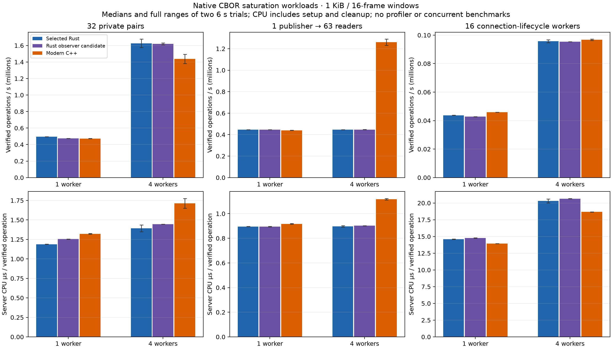
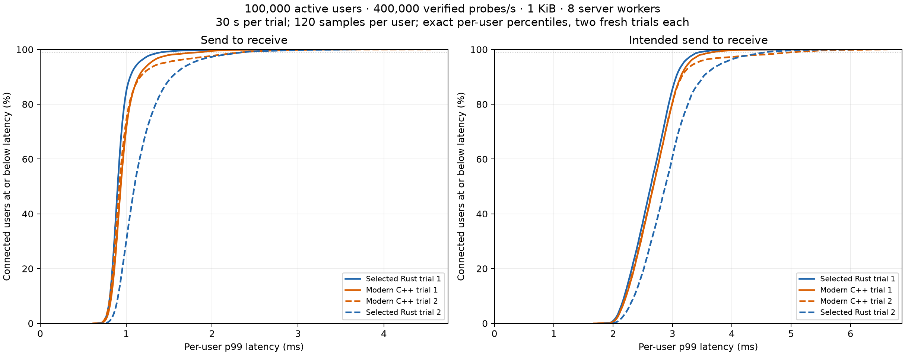
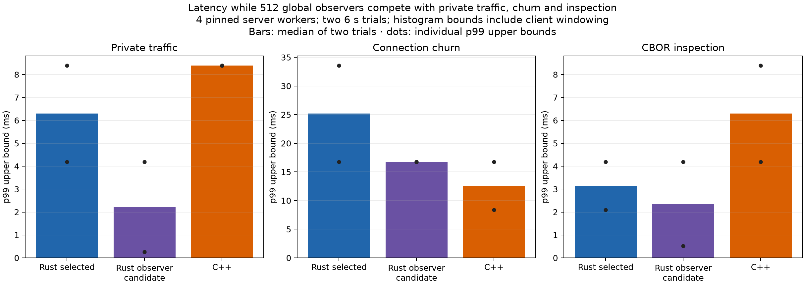

# Modern C++ versus Rust: measured comparison

2026-10-17. The C++20 candidate is a separate static library and CLI. The selected Rust service/default remains unchanged. C++ has a strong populated-memory and multi-worker fanout result; it is not a universal replacement for the best Rust runtime.

The [fresh three-way comparison with the original GitHub C++](../docs/benchmarks/2026-10-17-threeway-current/README.md) uses a separate matched workload and six repeats. Original C++ leads private throughput and CPU efficiency there; modern C++ leads fanout throughput and uses the least process memory. Those rows must not be mixed with the saturation table below.

## Exact implementations

- Modern C++ executable SHA-256: `b9dc20b92e7c09f2188d1780da8d691730112f442e60447de62ee6b98ae86da1`; static library: `237a499d0538c7ac3c46ce3af6c5fe3bc8c3e8c883cbdf96e591cbb99ecbb7d6`. clang version 23.1.3; `-O3 -march=native -flto=thin`, native epoll, plaintext, compression disabled.
- uWebSockets `045bbc11ef4f3ec933c112579d3e8922302a798b`, uSockets `86097c490263ab662d62e8e7b541390bdec7d149`, with the tracked transport patch and source hashes in the archived build record.
- Selected Rust: runtime commit `c7bb20a103d3266a47ff3f26a6ec1c473d484e5c`, executable `f1bf8bf9fd7c7e8f189806dba4bbdc4441e11ca9f7f680d8d14efe4716cb49be`. Native Mio reactor; Rust 1.91.1 / LLVM 21.1.2; native optimized release build.
- Newer Rust observer-index candidate: `4c231770f20a9e2d1191fe2db27ba5fbe1d13a82b3257313de4893507e380091`, reconstructed from its recorded base and runtime patch. This candidate remains unselected; its sources/results are preserved independently.

## Saturation workloads

Fresh sequential processes, rotated runtime order, two 6-second trials per runtime/workload/worker count. Servers have individually verified singleton worker affinity on CPUs 0 through N-1. The same frozen four-thread checked client runs on CPUs 8-15. Private traffic uses 32 pairs; fanout uses one publisher and 63 checked readers; churn uses 16 independent lifecycle workers. Application payloads are 1 KiB; data windows contain 16 messages. Every received payload and its order are checked. No bridge, sanitizer, profiler, build, or concurrent benchmark runs during these timings.

Values below are medians of two trials. CPU is measured server process CPU, including setup and client cleanup, divided by verified operations; it is not isolated forwarding cost. Churn operations include connect, upgrade, join, checked self-delivery, Close acknowledgement and EOF.

| Workers | Workload | Selected Rust ops/s | Observer Rust ops/s | C++ ops/s | Selected Rust CPU µs/op | Observer Rust CPU µs/op | C++ CPU µs/op |
|---:|---|---:|---:|---:|---:|---:|---:|
| 1 | traffic | 494,344 | 474,856 | 472,874 | 1.188 | 1.254 | 1.321 |
| 1 | fanout | 446,633 | 445,734 | 439,919 | 0.895 | 0.895 | 0.917 |
| 1 | churn | 43,744 | 42,767 | 45,942 | 14.592 | 14.769 | 13.948 |
| 4 | traffic | 1,626,400 | 1,618,978 | 1,437,761 | 1.394 | 1.447 | 1.714 |
| 4 | fanout | 445,999 | 447,228 | 1,260,173 | 0.897 | 0.902 | 1.117 |
| 4 | churn | 95,775 | 95,450 | 96,720 | 20.302 | 20.656 | 18.670 |

The four-worker C++ fanout gain comes with greater CPU per delivered message. Private traffic is slower and less CPU-efficient than selected Rust. Churn is close at four workers; a small throughput difference is not a strong win given two trials. Fresh SO_REUSEPORT placements vary between trials; the full ranges and p99 histogram bounds are retained in the raw traces. The comparison does not establish a language-wide ranking.

## 100,000-user responsiveness and memory

Each of four fresh processes admits 100,000 distinct live users in 16-member rooms, routes a proof through every connection, runs 400,000 verified private probes/s for 30 seconds, proves every connection again, and checks complete retirement. Each user contributes 120 exact latency samples. Across the four runs, 48,000,000 timed probes are verified. Server CPU is captured between the ready/measured gates, excluding setup and CSV sorting/output. Eight server workers are pinned to CPUs 0-7; eight client workers run on 8-15. Both servers request 16 KiB send and 64 KiB receive buffers; heartbeat and rate limits are disabled in both.

RSS/PSS/private memory are sampled with the full population at the ready gate; these are process memory, not kernel TCP memory or client memory. After-retirement RSS is also shown because C++ retains more resident allocator/container capacity after clients leave. Logical gauges and file descriptors return to their starting state. Latency includes client scheduling and room batching; it is not a measurement of the isolated relay hop.

| Runtime/trial | Populated RSS MiB | Populated private MiB | After RSS MiB | Server CPU-s | Median user p99 ms | p99 of users’ p99 ms | Worst user p99 ms | Worst packet ms |
|---|---:|---:|---:|---:|---:|---:|---:|---:|
| rust 1 | 104.65 | 100.00 | 49.86 | 52.48 | 0.901 | 1.418 | 3.676 | 6.992 |
| cpp 1 | 55.71 | 51.47 | 56.42 | 50.28 | 0.937 | 1.859 | 3.118 | 6.068 |
| cpp 2 | 55.80 | 51.56 | 56.39 | 50.59 | 0.920 | 2.366 | 4.549 | 15.390 |
| rust 2 | 107.13 | 102.55 | 49.84 | 53.66 | 1.097 | 2.362 | 3.673 | 17.216 |

The per-user CDFs keep all 100,000 users visible rather than combining their traffic into one population-wide percentile. Intended-send latency additionally includes time spent waiting for the load client to issue its probe. Thirty seconds and two repeats do not establish long-duration or hostile-load reliability.

## Competing traffic and observers

Same frozen inspection client and native CBOR controls in all implementations: 512 authenticated global channel observers, one private pair, 64 idle rooms, eight churn workers, and two CBOR inspectors querying every 10 ms. Four pinned server workers, eight client workers, 1 KiB payloads, 16-frame fanout windows, two 6-second fresh trials. Setup/cleanup gates use the protocol; there is no HTTP inspection in this case. The p99 values are logarithmic histogram upper bounds and include client windows. CPU includes every competing operation plus setup/teardown.

| Runtime/trial | Observer deliveries/s | Private p99 upper ms | Churn p99 upper ms | Inspection p99 upper ms |
|---|---:|---:|---:|---:|
| rust 1 | 369,281 | 4.194 | 16.777 | 2.097 |
| cpp 1 | 1,043,941 | 8.389 | 8.389 | 8.389 |
| rust-observer-index 1 | 380,055 | 0.262 | 16.777 | 0.524 |
| rust-observer-index 2 | 368,700 | 4.194 | 16.777 | 4.194 |
| cpp 2 | 941,710 | 8.389 | 16.777 | 4.194 |
| rust 2 | 381,823 | 8.389 | 33.554 | 4.194 |

C++ carries more observer traffic, but the newer Rust observer candidate has lower private p99 bounds here. A single private pair is sensitive to connection/worker placement; throughput variation in that pair is not used as a general capacity claim. Aggregate fanout throughput alone does not satisfy the platform’s latency priority.

## AOCL and retained experiments

The optional server-only AOCL LibMem 5.3.2 dispatcher test verifies the loaded library mapping and SHA; the client is never preloaded. The final C++ binary is identical in both arms. Two rotated five-second trials per mode use the same 64-client, 1 KiB workloads.

| Mode | glibc median ops/s | AOCL median ops/s | AOCL / glibc |
|---|---:|---:|---:|
| traffic | 1,519,181 | 1,548,765 | 1.019× |
| fanout | 1,398,759 | 1,237,331 | 0.885× |

AOCL is not enabled by default: the private result is inconsistent across pairs and fanout regresses in both pairs. The batched mailbox drain is retained after both measured pairs improved. A per-worker-counter experiment and early private-guard-release experiment did not earn adoption in their short end-to-end trials. Those controls were earlier C++ builds, even though their raw harness inherited the key `rust`; the archived binary hashes and experiment label map identify them as C++ controls. No benefit is claimed from the rejected variants.

## Verification and remaining differences

- Full unchanged shared corpus: 776 cases / 2,311 exchanges. Exact opaque CBOR values, malformed values/frames, fragmented and pipelined input, variable isolation, disconnect events and final resource cleanup.
- Full corpus passes separately under AddressSanitizer + UndefinedBehaviorSanitizer and ThreadSanitizer. CMake boundary tests and three repeated embedded stop-token lifecycles pass. These are finite campaigns, not an exhaustive race/fuzzing proof.
- Runtime checks cover observer scope/deduplication and opt-out barriers, variables, ID takeover, unauthorized controls, active shutdown, incomplete-HTTP shutdown and failed-bind worker unwinding.
- A real unread destination receives Close 1013 while healthy payloads/order continue; after retirement, connections, users, queued bytes, output bytes and variable bytes are zero. Transport-close ownership prevents early admission/budget release.
- The transport patch fixes the observed stock dependency differences: all 22 whole-frame transport probes now match the shared expectations, followed by the full three-mode corpus.
- Application CBOR validation uses a fixed stack and no object graph; local forwarding borrows receive payload bytes where prefix space permits. Cross-thread output requires one shared ownership copy, and uWebSockets still copies small frames into its transport storage. It is not end-to-end zero-copy.

C++ does not yet offer the complete Rust origin/per-IP admission policy, aggregate decoder-memory budget/reclamation, heartbeat, separate application/join/write deadlines, rate buckets, graceful drain administration, authenticated channel-inspection JSON or full metrics schema. Its current API binds plaintext loopback. Automatic transport/control allocation is reconciled rather than a strict allocator-wide admission cap. Consequently these healthy, same-host workload comparisons do not establish production feature parity or a guarantee that arbitrary 100,000-user workloads cannot fail.

Keep the selected Rust service for the present low-latency operating recommendation. Preserve C++ as the concrete lower-populated-memory and parallel-fanout alternative, and use the measured cross-thread output, metadata/fanout scheduling and retained-memory costs to guide subsequent work.

Raw traces, compressed per-user CSVs, plots, source snapshots, build records, sanitizer logs, experiment controls and a SHA-256 manifest are in [the benchmark archive](../docs/benchmarks/2026-10-17-modern-cpp/README.md). No manual relay service was replaced, and no production deployment or push was performed.

## Follow-up: no-op output-accounting guard rejected

A separate [accounting experiment](../docs/benchmarks/2026-10-17-cpp-zero-accounting/README.md)
isolated skipping zero-byte atomic updates. Eight private trials, single-worker
and fanout guards, and eight 100,000-user trials verified 96 million timed
population probes. Aggregate population CPU changed by only -0.75%, with one
matched pair reversing the result; small-population CPU/delivery was essentially
unchanged and latency results were mixed. The prototype was not adopted. The
accepted executable/library hashes and the comparisons above remain unchanged.
Future `cpp/compare.py` traces include a qualified C++ retained-copy proxy, so
copy-path/connection-placement variation is visible instead of silently treated
as an implementation effect.

## Follow-up: single-allocation queued body rejected

The [single-allocation study](../docs/benchmarks/2026-10-17-cpp-single-allocation/README.md)
replaced queued `shared_ptr<const string>` bodies with shared immutable arrays
while keeping the delivery record at 40 bytes. An escaped optimized allocation
diagnostic confirms two allocations become one for a 1 KiB encoded message.
The initial four-worker private cohort improved median throughput by 10.3% and
CPU/delivery by 6.4%, but connection placement changes the retained-copy share.

Eight fresh 100,000-user trials verified 96 million timed probes. Aggregate
measured CPU fell from 201.66 to 198.59 seconds (-1.52%); one pair reversed both
CPU and per-user latency results. Competing-traffic guards also showed worse
latency buckets in the candidate. Given the responsiveness priority and mixed
end-to-end evidence, the prototype was rejected. The accepted executable and
static library above are restored exactly. All 36 smaller-population trials,
eight population trials, full protocol corpus, both source trees and per-user
plots are archived; the rejected change did not receive a new sanitizer campaign.

## Controlled worker ownership

A new [epoll ownership study](../docs/benchmarks/2026-10-17-cpp-placement/README.md)
removes the private-path placement confound without instrumenting either relay.
Sixteen rotated eight-second trials verify 197,348,704 deliveries with exactly
zero retained copies for local pairs and one encoded-body copy per delivery
for remote pairs. Each worker has eight active sources and eight receivers;
256 sessions stay connected throughout. CPU gates exclude topology discovery,
setup, postchecks and retirement.

| Topology | Accepted C++ deliveries/s | Array prototype deliveries/s | Accepted CPU us/delivery | Array CPU us/delivery |
|---|---:|---:|---:|---:|
| Every pair local | 1,648,831 | 1,609,891 | 1.472 | 1.481 |
| Every pair remote | 1,352,783 | 1,528,636 | 1.791 | 1.624 |

The array prototype improves remote throughput/CPU in all four matched pairs,
but slightly worsens the local medians. Remote p99 is 1.049 ms in all candidate
trials versus 1.049/2.097/2.097/2.097 ms for the control (windowed histogram
bounds). This isolates a real ownership-path benefit; it does not override the
previous 100,000-user and competing-traffic selection decision. The accepted
runtime is unchanged. Use `examples/placement.rs` and `cpp/placement-compare.py`
for subsequent local/remote guards instead of assuming random socket placement
gives equivalent work.

## Compact-handle refinement rejected

A [three-arm controlled follow-up](../docs/benchmarks/2026-10-17-cpp-array-handle/README.md)
compares accepted C++, the prior array prototype, and an array version with a
16-byte transient shared-pointer handle instead of the 24-byte wrapper. The
queued delivery stays 40 bytes and all ownership/quota behavior is preserved.
Twenty-four eight-second trials verify 295,498,880 deliveries.

| Topology | Accepted CPU us/delivery | Prior array CPU us/delivery | Compact handle CPU us/delivery |
|---|---:|---:|---:|
| Every pair local | 1.485 | 1.485 | 1.483 |
| Every pair remote | 1.800 | 1.632 | 1.646 |

Local cost is essentially unchanged, and the refinement is slightly worse than
the prior array remotely. The earlier local gap does not establish wrapper
overhead as its cause. The refinement is rejected; the accepted build is restored.
The candidate passes the 776-case corpus, but was not promoted to new sanitizer
or population campaigns. A separate accepted-build mixed profile and instruction
annotations point toward global output-accounting updates as an investigation
target. Those user-event samples do not measure off-CPU waits or prove a
wall-time/latency cause. All sources, failed diagnostic setup, successful capture
metadata, every ordinary trial and source-dependency hashes are preserved.
