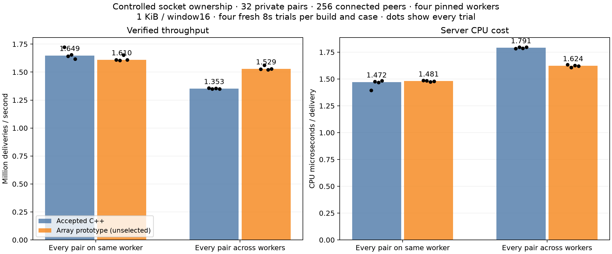

# Controlled worker ownership comparison

**Outcome: retain the measurement tools; keep the accepted C++ runtime selected.**

The earlier private comparisons could vary the retained-copy fraction between fresh SO_REUSEPORT processes. This study identifies live sockets externally and selects equivalent pair topologies without changing either relay executable.

## Method and invariants

- 256 real WebSocket sessions join one room. The client reports its local TCP ports and welcome IDs, then waits for the controller. All peers stay connected throughout measurement.
- Linux `/proc/PID/net/tcp` maps each client port to an accepted socket inode. `/proc/PID/fd` maps the inode to a server descriptor, and each epoll fdinfo maps that descriptor to exactly one owner loop. All 256 mappings must exist, with exactly four owner groups.
- Select 32 disjoint active pairs, balanced at eight senders and eight receivers per worker. In the local case each pair shares an epoll owner; in the remote case each source targets the next distinct owner. Unused peers remain idle. The mapping is checked again after measurement.
- Four individually pinned server workers on CPUs0–3; one unchanged four-thread Rust load client allowed on CPUs8–15. Same 1 KiB cyclic templates and 16-frame windows in both arms. Every full encoded response, sender ID and sequence is checked before continuing.
- Setup, topology discovery, template generation, postchecks and teardown are outside the CPU window. Ready/measured gates bound server-only process CPU. All four local trials per implementation have exactly zero retained-copy bytes; every remote trial has exactly 1,037 copied bytes per verified delivery. These are exact measured deltas, rather than a copy-path proxy.
- After timing, every active pair routes a checked proof message. All 256 peers then complete a checked normal Close acknowledgement and raw TCP EOF. Every run retires all sessions, output/variable bytes, extra rooms and descriptors.
- Four fresh eight-second trials per implementation and topology, with reversed implementation order on alternate repetitions. No builds, profiles or other workloads overlap ordinary timing.

## Results

| Topology | Build | Median verified deliveries/s | Median CPU us/delivery | Per-trial p99 upper ms |
|---|---|---:|---:|---|
| local | control | 1,648,831 | 1.472 | 1.049, 1.049, 1.049, 1.049 |
| local | array | 1,609,891 | 1.481 | 1.049, 1.049, 1.049, 1.049 |
| remote | control | 1,352,783 | 1.791 | 1.049, 2.097, 2.097, 2.097 |
| remote | array | 1,528,636 | 1.624 | 1.049, 1.049, 1.049, 1.049 |

The 16 ordinary trials verify **197,348,704 deliveries**. On the fully remote path, the array prototype improves median throughput by 13.00% and CPU/delivery by 9.32%. On the fully local path, throughput falls 2.36% and CPU/delivery rises 0.63%. The array wins throughput and CPU in every remote matched pair. Quantiles are client-observed histogram upper bounds, including windowing and scheduling, not isolated relay-hop times.



This establishes a real retained-message-path benefit under controlled topology. It does not override the rejected prototype's earlier mixed observer and 100,000-user latency evidence. The accepted source and executable stay unchanged. The next runtime change should preserve the cheap local path and demonstrate responsiveness under competing traffic and the full population before selection. These results do not diagnose reference-count/payload cache sharing; that hypothesis still needs separate evidence.

## Reproduction and provenance

Build the client with `cargo build --release --example placement`, then run:

```sh
python3 cpp/placement-compare.py \
  --server control=artifacts/candidates/cpp-modern/war-relay-cpp \
  --client target/release/examples/placement \
  --output artifacts/cpp-placement-new.json
```

Add `--server candidate=/absolute/path/to/another/war-relay-cpp` to compare another build in the same rotated workload. The frozen study executables are local artifacts, omitted from Git. Build the accepted runtime with `cpp/build.sh`; the array source and runtime patch are in the [previous ownership study](../2026-10-17-cpp-single-allocation/README.md). This archive depends explicitly on that hash-verified source archive. `client-build.json` records the exact executable, compiler, base commit, Cargo files and source hashes. Its existing library worktree diff is saved for reconstruction, and no Rust relay executable/service was changed. Strict release Clippy passes for the new client.

The two one-second smoke topologies pass separately. An initial smoke could not launch the copied client because its executable mode had not been preserved; that setup failure and original runner are retained, excluded from all timings. Successful smoke and measured runners each match their recorded hashes. After the ordinary matrix, the reusable controller added explicit selector/pipe cleanup and rejection of empty traffic windows; both final one-second smoke topologies pass too. The exact original 16-trial runner is saved as `cpp-placement-controlled-runner.py`, separately from the reusable final `placement-compare.py`.

Run `python3 docs/benchmarks/2026-10-17-cpp-placement/verify.py` to check this archive and its source dependency.
