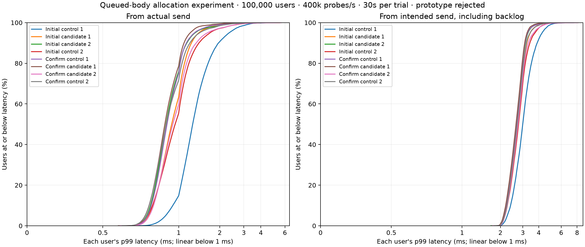

# Single-allocation queued-body experiment

**Decision: reject the prototype and restore the accepted modern C++ runtime.**

The candidate replaces `shared_ptr<const string>` with `make_shared_for_overwrite<char[]>`, copies a queued body once, and shares it across recipients. A full `size_t` body length occupies a union with close metadata, retaining the 40-byte delivery record. Borrowed local output, quotas, recipient ordering and accounting are unchanged. Sources derive from commit `02aea99`; both complete source trees, build records and the candidate patch are saved below.

## Allocation evidence

The separate allocation diagnostic escapes construction through noinline functions, keeps assertions enabled in the optimized build, and checks exact binary bytes plus continued shared ownership after the first owner retires. At a 1,037-byte encoded body, allocation count falls from two to one; requested bytes fall only from 1,086 to 1,084. Bodies of 15 bytes or less already used one string allocation, and some consume more requested bytes in the candidate. This diagnostic establishes allocation behavior, not end-to-end latency or allocator-wide memory use.

An initial diagnostic had assertions compiled out and allowed candidate construction to be eliminated. Its observations are explicitly marked invalid in `cpp-single-allocation-diagnostic-elided-not-valid.json`; they are not used as evidence.

## Ordinary guards

All trials are fresh, sequential and rotated. No build, profiler, sanitizer or other benchmark overlaps ordinary timing. Four-worker 1 KiB private/fanout cases use four eight-second trials per implementation. One-worker, 8-byte private, churn, and 64 KiB private guards use two six-second trials per implementation. Churn has its fixed 16-byte application payload even in the small-message matrix. CPU in these guards includes setup/cleanup. Histogram p99s include client windowing.

| Workload | Control deliveries/s | Candidate deliveries/s | Control CPU us/delivery | Candidate CPU us/delivery |
|---|---:|---:|---:|---:|
| first/fanout | 1,265,505 | 1,252,673 | 1.034 | 1.020 |
| first/traffic | 1,425,226 | 1,572,074 | 1.695 | 1.588 |
| one-worker/traffic | 482,129 | 481,474 | 1.296 | 1.296 |
| small/churn | 97,329 | 95,954 | 18.502 | 18.682 |
| small/traffic | 1,493,606 | 1,516,593 | 1.541 | 1.579 |
| large/traffic | 170,870 | 168,189 | 11.965 | 11.466 |

The initial private medians improve, but connection placement changes the retained-copy fraction between processes. The recorded copy proxy includes prefix fallback, local queued work and teardown notifications; it is not a socket-ownership census or a directly comparable Rust metric. One-worker private traffic has zero retained-copy bytes and essentially unchanged CPU cost.

## 100,000-user latency and CPU

Two independently named studies each run control/candidate then candidate/control. Eight fresh processes verify **96 million timed probes**: 100,000 unique users, 120 probes per user, 1 KiB payloads, 16-member rooms, 400k probes/s for 30 seconds, eight pinned server workers. CPU is measured between ready/measured gates, excluding setup, CSV work and retirement. RSS is sampled process memory with all users present, excluding client and kernel TCP memory.

| Study/pair | Control CPU-s | Candidate CPU-s | CPU change | Control/candidate p99 of user p99 ms | Control/candidate worst user p99 ms | Control/candidate worst packet ms |
|---|---:|---:|---:|---|---|---|
| capacity/1 | 52.48 | 49.71 | -5.28% | 3.157 / 1.974 | 4.696 / 3.488 | 7.455 / 5.318 |
| capacity/2 | 49.61 | 49.49 | -0.24% | 2.641 / 2.143 | 5.490 / 3.713 | 16.058 / 7.842 |
| capacity-confirmation/1 | 50.31 | 49.75 | -1.11% | 2.045 / 1.740 | 4.879 / 3.552 | 6.213 / 7.397 |
| capacity-confirmation/2 | 49.26 | 49.64 | +0.77% | 2.219 / 2.599 | 4.005 / 5.638 | 6.628 / 19.405 |

Aggregate measured CPU is 201.66 versus 198.59 seconds (-1.52%). One pair reverses both CPU and latency results. The last candidate run has a 19.405 ms worst packet versus 6.628 ms for its paired control. These finite runs do not establish a consistent responsiveness gain; neither isolated maxima nor the earlier favorable cohort are treated as a universal result.

## Competing traffic

Four-worker, two six-second trials per implementation: 512 authenticated global observers, one private pair, eight churn workers, two native-CBOR inspectors every 10 ms, 64 idle rooms and 1 KiB fanout. The single private pair is placement-sensitive. Percentiles below are histogram upper bounds.

| Kind/trial | Observer deliveries/s | Private p99 ms | Churn p99 ms | Inspection p99 ms | Fanout p99 ms |
|---|---:|---:|---:|---:|---:|
| control 1 | 1,019,736 | 8.389 | 8.389 | 4.194 | 8.389 |
| candidate 1 | 1,024,300 | 8.389 | 8.389 | 8.389 | 8.389 |
| candidate 2 | 985,498 | 8.389 | 8.389 | 4.194 | 16.777 |
| control 2 | 1,009,505 | 2.097 | 8.389 | 4.194 | 8.389 |

Candidate private throughput is lower in both trials; fanout p99 worsens by one bucket in one trial, and inspection p99 worsens by one bucket in the other. Placement and short-run variability prevent attributing each difference solely to the representation, but this is insufficient evidence to select a latency-sensitive replacement. Halving one allocation count did not establish a broadly better relay.

## Verification, restoration and next investigation

- 36 small-population ordinary trials pass, plus eight complete population trials. Corpus: 776 cases / 2,311 exchanges. All final connection/user/output/variable gauges are zero; every population run returns file descriptors to its exact baseline and verifies 100,000 normal closes plus 750,000 departure checks.
- The candidate was rejected before a new sanitizer campaign; the accepted build's existing ASan/UBSan/TSan evidence remains separate. No rejected runtime change is shipped or selected.
- Accepted executable restored and verified: `b9dc20b92e7c09f2188d1780da8d691730112f442e60447de62ee6b98ae86da1`.
- Accepted static library restored and verified: `237a499d0538c7ac3c46ce3af6c5fe3bc8c3e8c883cbdf96e591cbb99ecbb7d6`.
- Rejected executable: `a85e8c666ebfc58c4e8a71080599857e99c82df5540ba537a3d6423d5a668166`.
- Build-source hashes are checked against restored working sources. The selected manual Rust executable and readiness endpoint are unchanged. Existing Rust experiment edits are preserved; no push, deployment or manual service replacement occurs.
- The local libstdc++16 implementation places array shared-ownership metadata after the array. Sharing a cache line between reference counts and payload tail is a possible follow-up hypothesis, not a diagnosed cause of these timings. Investigate cache placement and obtain a controlled worker-ownership workload before proposing another allocation/layout change.
- Full sources, all raw trials, compressed user census CSVs, allocation diagnostic, build provenance, plot helper and this archive creator are retained. Binaries remain local outside Git. Compressed originals have independent uncompressed SHA-256 hashes.

Verify: `python3 docs/benchmarks/2026-10-17-cpp-single-allocation/verify.py`.
