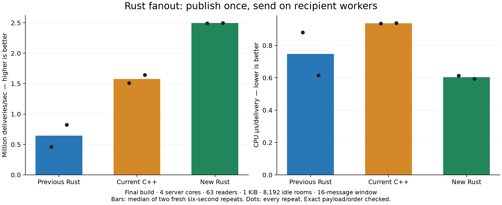
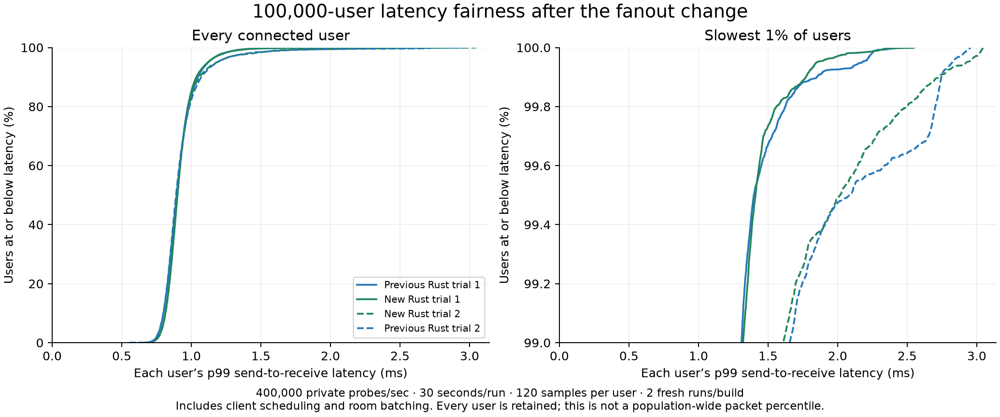

# Rust fanout: output on socket owners, shared bodies, bounded vectored batches

Accepted runtime commit `7290017b46d7d90c1c6a5100f7a1d945916ad76e`, executable SHA-256 `edb4a79d2259e1ccf6bd514d6b0fb59afa75b9a3af807dcfba2053040a5be312`. The selected runtime changes two Rust source files. Original C++ and accepted modern C++ are unchanged; prior observer-index and C++ counter-layout experiments remain unselected and preserved.

## Result

In the final matched fanout campaign, new Rust delivers 2,494,487 messages/s: 3.87x previous Rust and 1.58x modern C++. Every received sender ID, payload and order is checked. Process-to-process placement variation remains visible in the ranges and dots.

| Runtime | Fanout deliveries/s | CPU µs/delivery | Observed p99 histogram upper bounds, ms |
|---|---:|---:|---:|
| Previous selected Rust | 644,363 | 0.748 | 2.097152–4.194304 |
| Accepted modern C++ | 1,576,514 | 0.937 | 1.048576 |
| New Rust | 2,494,487 | 0.604 | 0.524288 |
| Original GitHub C++ | 687,213 | 0.684 | 2.097152–4.194304 |

## Cause and implementation

The previous transport attempts every recipient socket write synchronously on the publishing thread. More relay workers do not parallelize that one publisher’s fanout. A fresh eight-second gated cycles:user profile records 53.26% of samples in Socket.send and 16.68% in Peer.enqueue_frame. One I/O worker accumulates 4.18 CPU-seconds and the other three effectively zero. This profile is separate from ordinary timing; sampling is not an off-CPU, kernel-cost or wall-time decomposition.

- Broadcasts and private messages with observers now use an explicit multicast submission method. Socket transports retain charged shared frames and notify their owning workers; the existing single-recipient private method remains immediate. The Frame representation is unchanged.
- Worker notifications coalesce while their pending-token queue is nonempty. A sleeping worker still receives a wakeup; every socket retains its existing deduplication and FIFO rules.
- Each owner flush uses up to 16 frames / 32 iovecs per syscall, within the existing 256 KiB write quantum. Headers live on the stack; application bodies stay in their original shared receive storage. There is no timer or wait-to-fill threshold.
- Short writes retire only fully written frames and retain the original offset, body, byte charge and deadline for the partial frame. Cancellation, queue-message/byte limits, control-frame serialization, sender FIFO and physical-close admission ownership are retained.
- Completion statistics aggregate per batch; quota reservations and releases remain immediate and exact. Queue slots allocate on first use, are reused while active, and follow the existing capacity reclamation rules. This is payload sharing, not a claim of zero kernel copying or zero first-use allocation.
- The batch writer is explicitly out of line. Generated flush code fell from 2,921 bytes / 1,128 stack-reservation bytes in the first all-fanout variant to 582 / 56 in the selected version. Original flush was 1,460 / 136. Selected and baseline private-send functions both measure 1,508 code bytes / 200 stack-reservation bytes; enqueue_frame both measure 455 / 24. These sizes do not prove instruction identity.

After-profile sampling shows work distributed across the workers and different hot paths: send_fanout, batch writing, wake/queue bookkeeping and worker driving. New code uses safe Rust and adds no dependencies.

## Private forwarding

| Runtime | Private deliveries/s | CPU µs/delivery |
|---|---:|---:|
| Previous selected Rust | 2,072,199 | 1.052 |
| New Rust | 2,073,726 | 1.062 |
| Accepted modern C++ | 1,901,509 | 1.297 |
| Original GitHub C++ | 1,545,060 | 1.236 |

Private throughput is essentially unchanged against previous Rust in the final matched trials. Original-C++ rates vary substantially between fresh processes; these two-repeat private rows do not overturn the earlier six-repeat original-C++ comparison. All lower-rate observations are retained.

## Competing observers, traffic, churn and inspection

Four individually pinned workers, one private pair, 512 global channel observers, 64 idle rooms, eight churn workers, two inspectors querying every 10 ms, six seconds and two fresh trials per implementation. CPU for this case includes setup/cleanup and all competing operations; it is not forwarding-only cost.

| Runtime / trial | Fanout deliveries/s | Private p99 upper ms | Churn p99 upper ms | Inspection p99 upper ms |
|---|---:|---:|---:|---:|
| Previous Rust 1 | 378,876 | 8.388608 | 33.554432 | 4.194304 |
| Modern C++ 1 | 960,179 | 4.194304 | 16.777216 | 8.388608 |
| New Rust 1 | 2,153,949 | 1.048576 | 4.194304 | 1.048576 |
| New Rust 2 | 2,169,064 | 1.048576 | 4.194304 | 1.048576 |
| Modern C++ 2 | 999,797 | 8.388608 | 8.388608 | 8.388608 |
| Previous Rust 2 | 378,609 | 8.388608 | 33.554432 | 8.388608 |

## 100,000-user fairness and CPU

Two fresh runs per Rust build, rotated before/after order, eight individually pinned workers, 100,000 live users in 16-member rooms and 400,000 private probes/s for 30 seconds. Every user contributes 120 exact samples. These are 48 million before/after timed probes, including 24 million on the selected new build. Every connection is proved before and after; normal closes, departure notifications, exact sample census, byte/gauge retirement and descriptor counts are checked. Process memory excludes kernel TCP and client memory.

| Runtime / trial | CPU seconds | Populated RSS MiB | Median user p99 ms | p99 of users’ p99 ms | Worst user p99 ms |
|---|---:|---:|---:|---:|---:|
| Previous Rust 1 | 51.83 | 107.45 | 0.894326 | 1.309054 | 2.493522 |
| New Rust 1 | 52.14 | 102.66 | 0.900468 | 1.320288 | 2.550519 |
| New Rust 2 | 52.11 | 105.61 | 0.900338 | 1.611791 | 3.049656 |
| Previous Rust 2 | 52.28 | 103.48 | 0.890249 | 1.656160 | 2.956758 |

Total private-workload CPU is 104.25 versus 104.11 CPU-seconds (+0.13%). Median users’ p99 stays around 0.90 ms and tail distributions are comparable across these finite repeats. This establishes no universal private-latency improvement. Actual-send and intended-send per-user values are retained in compressed CSVs.

## Validation, iterations and replay

- Selected runtime: 72 unit tests, strict all-target Clippy, formatting and the independent 776-case / 2,311-exchange whole/fragmented/pipelined wire corpus pass. Integrated workspace tests also pass (75 tests, including preserved unselected observer-index tests).
- A short-write test alternates WouldBlock and partial writes at several widths across frame boundaries, checking exact FIFO, original body pointers and outstanding byte reservations. Another test proves multicast waits for owner flushing while an ordinary private submission still writes immediately.
- The selected ten-second fanout pressure test evicts all eight unread peers (1013 Close or expected transport termination), verifies all healthy frames and all eight departure notices, and retires every queue/read/connection/variable gauge. Healthy traffic continues after the slow peers leave.
- The first broadcast-only prototype has four repeats per workload/implementation, 32 fully passed cases. It establishes the large architecture gain. The all-fanout flag version and its outlined-writer follow-up each retain 16 checked saturation cases, six mixed cases and four population cases. Their private-tail concerns led to the selected explicit-method version; neither earlier all-fanout variant was adopted.
- The selected explicit version has 16 fully passed saturation cases, six mixed cases, four population cases, the pressure case and a separate fully completed after-profile. Headline saturation values use its two repeats per case. No observations or lower-rate trials are dropped.
- Preliminary diagnostics include one profiler-controller SIGINT-status mistake and one rejected pressure-server configuration (queue bytes did not fit the default maximum message). Corrected named runs pass; these setup failures are not benchmark observations.
- All ordinary timings are sequential with no builds/profilers/other load tests overlapping. Saturation uses four server CPUs 0–3 and eight client CPUs 4–11; workers may migrate within their shared set to match the original program. Mixed and population cases verify individual worker pinning.
- Saturation is 63 readers, 1 KiB values, 16-message windows and 8,192 idle rooms. Original C++ speaks its native binary envelope, both current implementations speak native validated CBOR. One frozen checked client drives all; no bridge. CPU is gated ready-to-measured. Latency includes client scheduling/windowing; histogram limits are upper bounds.
- This is plaintext loopback evidence on this host. It does not establish 100,000-user broadcast throughput, a long-duration soak, real-NIC behavior or TLS performance. The 100,000-user cases exercise private probes; fanout is separately checked at 63 and 512 readers.
- Runtime commit, exact executable/source/build hashes, all previous iterations, raw traces, profile reports and compressed full-population CSVs are retained. Baseline source resolves through dependency.json to the prior verified three-way archive. Run python3 verify.py for archive/source/CSV integrity; ELF and raw perf.data files remain local.
- Native manual service was quiescent before replacement. Its executable hash, readiness, private/fanout delivery, departure notification, normal Close/EOF and zero final resource gauges pass after promotion. The bridge and static UI services keep their processes.
