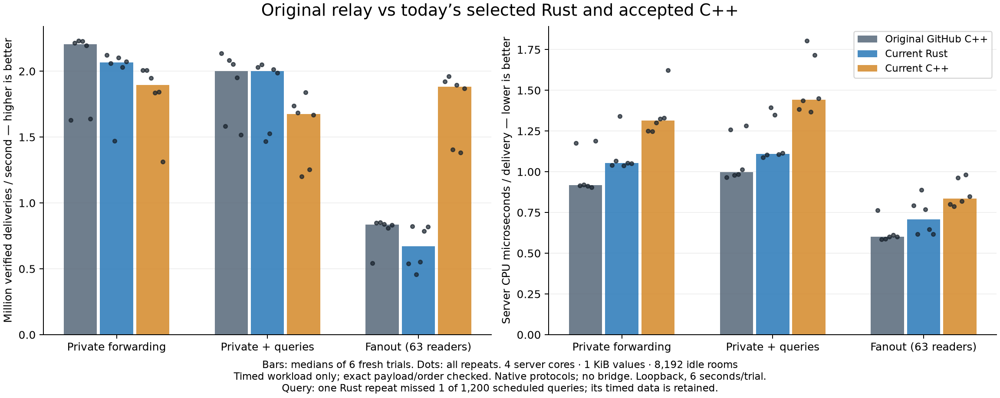

# Original GitHub C++ versus current Rust and modern C++

2026-10-17. Fresh three-way measurements of the exact selected/accepted binaries. The counter-layout, array-body, compact-handle and observer-index experiments are excluded. No relay implementation or running service changes.

## Matched workload

Six fresh six-second trials per implementation and workload: 54 trials total. Server CPU set 0–3 and client CPU set 4–11; workers can migrate within their common set, matching the original program’s affinity contract. Every process is isolated in private network/PID namespaces. Candidate and workload order rotate, with each candidate occupying each starting position twice. Ordinary timings are sequential and exclude builds, profilers and other load tests.

The same frozen checked client speaks each native protocol without a bridge. Private cases use 64 active pairs plus 8,192 idle single-member rooms (8,321 live connections including the retained inspection socket). Values cycle through 64 distinct 1 KiB application payloads encoded as identical 1,027-byte CBOR byte strings, with 16-message windows. Original C++ forwards these as opaque binary; both current implementations validate CBOR. Envelope widths and control encodings differ naturally between protocols. Query cases add two inspectors at 10 ms intervals, totaling 200 checked complete channel queries/s. Fanout replaces private pairs with one publisher and 63 readers, retaining the 8,192 idle rooms.

CPU is process CPU between ready and measured gates, excluding connection setup, postchecks and retirement. RSS is process resident memory sampled at the measured gate, excluding kernel socket/client memory. Latency includes client scheduling, validation and windowing; p99 values are logarithmic histogram upper bounds, not isolated relay-hop measurements.

## Results

All values are medians of six process trials, retaining the timed data from one Rust query-pacing failure. That trial completed 1,199 of 1,200 scheduled queries and aborted before its postchecks; it is not counted as a fully passed trial. Throughput counts verified delivered messages, including all fanout readers. CPU in query cases includes management work as well as private forwarding. With six repeats, arithmetic medians of histogram upper bounds can fall between buckets; 3.145728 ms is the midpoint of 2.097152 and 4.194304 ms, not a new histogram bucket.

### Private forwarding

| Implementation | Deliveries/s | CPU µs/delivery | p99 upper ms | Measured RSS MiB |
|---|---:|---:|---:|---:|
| Original GitHub C++ | 2,205,873 | 0.918 | 2.097152 | 20.65 |
| Selected Rust | 2,065,901 | 1.053 | 2.097152 | 17.04 |
| Accepted modern C++ | 1,895,091 | 1.313 | 2.097152 | 11.10 |

### Private forwarding plus 200 channel queries/s

| Implementation | Deliveries/s | CPU µs/delivery | p99 upper ms | Measured RSS MiB |
|---|---:|---:|---:|---:|
| Original GitHub C++ | 2,002,247 | 0.999 | 3.145728 | 20.84 |
| Selected Rust | 2,000,095 | 1.111 | 2.097152 | 17.53 |
| Accepted modern C++ | 1,676,664 | 1.443 | 4.194304 | 12.00 |

Query p99 upper bounds: Original GitHub C++ 8.388608 ms, Selected Rust 8.388608 ms, Accepted modern C++ 8.388608 ms.

### Fanout to 63 readers

| Implementation | Deliveries/s | CPU µs/delivery | p99 upper ms | Measured RSS MiB |
|---|---:|---:|---:|---:|
| Original GitHub C++ | 835,885 | 0.600 | 2.097152 | 20.53 |
| Selected Rust | 670,403 | 0.708 | 3.145728 | 16.92 |
| Accepted modern C++ | 1,882,604 | 0.834 | 1.048576 | 10.24 |

### All-repeat ranges

| Workload | Implementation | Deliveries/s min–max | CPU µs/delivery min–max |
|---|---|---:|---:|
| private | Original GitHub C++ | 1,630,107–2,230,018 | 0.906–1.191 |
| private | Selected Rust | 1,471,185–2,122,472 | 1.038–1.340 |
| private | Accepted modern C++ | 1,311,845–2,009,001 | 1.247–1.624 |
| query | Original GitHub C++ | 1,518,243–2,135,633 | 0.966–1.282 |
| query | Selected Rust | 1,469,171–2,049,081 | 1.087–1.395 |
| query | Accepted modern C++ | 1,200,289–1,840,629 | 1.369–1.803 |
| fanout | Original GitHub C++ | 542,786–852,619 | 0.587–0.764 |
| fanout | Selected Rust | 456,066–823,891 | 0.617–0.888 |
| fanout | Accepted modern C++ | 1,383,336–1,962,808 | 0.787–0.983 |

## Interpretation and limits

Original C++ has 6.8% more median private throughput than selected Rust and 16.4% more than modern C++; its median CPU cost is 12.8% and 30.1% lower, respectively. Modern C++ has 2.25x the original’s fanout throughput and 2.81x Rust’s, but spends more CPU per delivery. The private-path conclusion must be based on these matched rows, rather than combining the original’s historical rate with a different modern workload. Process ranges overlap; the result describes these implementations on this host and workload, not an intrinsic language ranking. Accepted modern C++ retains a substantial fanout-throughput advantage, which comes with a different CPU-per-delivery tradeoff.

53 of 54 ordinary trials pass every check. All timed windows together contain 515,344,704 timed deliveries, 21,599 paced queries and 439,895 normal Close/EOF exchanges from the fully completed trials. One Rust query trial missed one scheduled query (1,199/1,200), so the initial runner stopped before postchecks; a continuation driver ran only the remaining unstarted cases, without retries or dropped observations. Sender IDs, exact payload bytes, FIFO, complete channel replies and departure notifications are checked. Rust receives its exact counter/byte/reservation checks. Modern C++ receives checks for its exported counter contracts and zero physical resources after retirement. Original C++ has no equivalent management counters; its listeners, thread count, loaded libraries, protocol replies and socket closes are verified.

This campaign does not measure 100,000 users, long-duration stability, TLS, overload or hostile traffic, and does not rerun the separate original-C++ churn failures. Earlier 100,000-user Rust/modern-C++ results remain a distinct experiment. Nothing here establishes original-C++ capacity or reliability at 100,000 users.

## Provenance and replay

- Original upstream commit `881c8daaf2cf05adea8f522b28cf372e8f82d4e9`, rebuilt with four workers. Only the temporary source’s worker-count expression differs from upstream; routing/storage/protocol/uWS sources match recorded hashes. This is not the repository’s old shipped executable with failed listener binds.
- Original C++ executable: `0f07d539c145f0be960af3b27649126d3bafd7ec2015e6c9e2444cde5fe587b4`.
- Selected Rust executable: `f1bf8bf9fd7c7e8f189806dba4bbdc4441e11ca9f7f680d8d14efe4716cb49be` (runtime `c7bb20a103d3266a47ff3f26a6ec1c473d484e5c`).
- Accepted modern C++ executable: `b9dc20b92e7c09f2188d1780da8d691730112f442e60447de62ee6b98ae86da1`.
- Frozen client executable: `c69a691b6e2cb12ea8ffd566eb7998ace9123c6c34815ee577be87da79f48569`.
- C++ compiler/build flags, pinned modern dependencies, Rust compiler/source hashes, reconstructed selected Rust sources and original/modern source snapshots are included. This compares the recorded release builds, not identical compiler backends or CPU-target settings. All three use glibc; AOCL was not selected by previous studies.
- `reproduce.json` records the command and artifact hashes. `raw/threeway-current.json` preserves the matrix; each trace retains commands, gates, resource snapshots, checks and logs. `raw/threeway-current-summary.json` preserves every repeat and aggregate as well as median metrics.
- Preliminary smoke failures are retained as harness diagnostics only: live cork-buffer accounting is not a zero-buffer guarantee, C++ value-byte totals include controls, physical retirement can lag the client gate, and fanout without private health rooms has no stored variable. These failed assumptions were corrected before the ordinary campaign; they are not failed relay-performance trials. Historical smoke runner hashes can differ from the final archived runner.
- Run `python3 verify.py` to verify the archive hashes and selected source/build contracts. ELF files are identified by digest but not committed.
