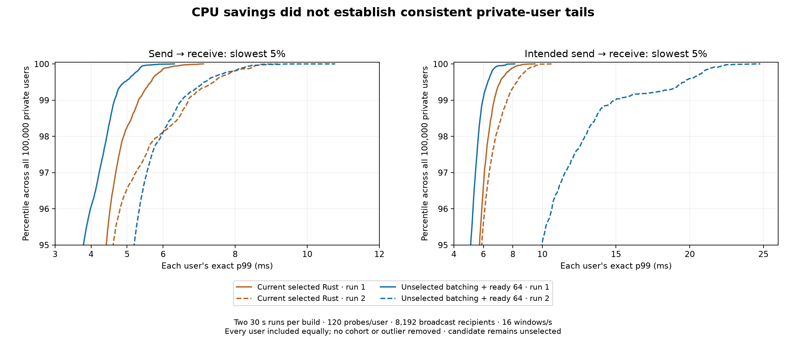

# Short, targeted 100,000-user multicast experiments (2026-10-18)

## Decision

**Keep the existing selected Rust runtime `279c3c1`, executable `3db9ebeb0fff87636a1bf2fc5a6e0ae88d48d12aa7a52571cb4b28fa4d911fa9`. No experimental server change was adopted.** The native manual service and its configuration remain unchanged; `target/release/war-relay` was restored byte-for-byte to that accepted executable. The original three dirty experimental files were preserved byte-for-byte.

Buffered multicast saves CPU and reduces broadcast latency, but the study does not establish consistently better private-user tail latency. The strongest candidate uses four fixed staging slots and a 64-connection ready batch. Its server CPU reduction reproduces at **13.6%**, while private intended-to-receive tails vary substantially. Following the user's priority, CPU/broadcast wins alone do not justify replacing the selected relay. The proposed multi-hour soak was not run. The longest measured phase was **30 seconds**.

The retained changes are measurement tools: optional exact per-recipient p99/max and intended-send latency CSVs, checked complete multicast matrices, configurable hot-room membership checks, and audited per-user summaries. The rejected implementation and all diagnostic runs are archived for review and follow-up.

## Final matched comparison

Two 30-second controls use the same accepted `3db9…` binary; two final candidate runs use `9f30cab8d2f226f37363812c08142eec3dd9a997750b238b27625a7e9698936b`. All four use the same frozen capacity executable and the same frozen exact-latency inspection executable. The controls were collected during this iteration before the final two candidate runs; other explicitly recorded diagnostic trials occurred between them. This is a finite same-host comparison with recorded process/topology variation, not a randomized deployment experiment. None of the four runs or their outliers is excluded.

Each trial retains 100,000 private users in 6,250 rooms of 16, sending four checked 1 KiB probes per user per second. That is **120 probes per user and 12 million private probes per trial**. A separate room has 8,192 checked recipients and one publisher, offering four broadcast frames at 16 windows/s: **524,288 intended deliveries/s**. Eight churn workers each offer four complete lifecycles/s; two authenticated CBOR inspectors query the full census every 10 ms. There is no extra saturated private pair. The stable census is 108,196 connections plus up to eight transient churn users.

Server workers own physical cores 0–7. Capacity owns the four other physical cores represented by logical CPUs 8–11/24–27; inspection/fanout owns 12–15/28–31. Actual singleton worker affinities and full topology are recorded. Native plaintext WebSocket/CBOR, 16 KiB requested send and 64 KiB receive buffers, 64-message/256 KiB peer queues, 256 MiB global queue and decoder budgets; heartbeats and input rates are disabled identically in performance trials. Correctness tests separately exercise rate and byte admission boundaries.

Ranges below retain both observations rather than hiding variation behind a single chosen result. Each per-recipient p99 uses nearest rank over its own samples. Population summaries are over recipient statistics, not pooled packets. Private latencies include client scheduling, kernel work and 16-user ring batching. Broadcast send latency starts at the four-frame window's send time; intended latency starts at its scheduled window time.

| Metric | Current selected Rust, two runs | Rejected combined candidate, two runs |
|---|---:|---:|
| Server CPU-seconds / 30 s | 105.710–106.150 | 91.140–91.870 |
| Median broadcast-recipient p99, ms | 53.592–63.809 | 39.954–51.036 |
| Median intended broadcast-recipient p99, ms | 74.166–75.718 | 40.982–52.530 |
| Median private-user p99, ms | 1.803–1.897 | 1.716–1.877 |
| p99 across private users’ p99, ms | 5.317–6.699 | 4.651–6.519 |
| Worst private-user p99, ms | 7.119–9.191 | 6.311–10.776 |
| p99 across users’ intended-to-receive p99, ms | 6.737–7.611 | 5.962–14.934 |
| Worst private probe, ms | 12.761–23.254 | 16.668–21.251 |
| Worst intended private probe, ms | 14.193–24.784 | 46.697–46.723 |

All submitted frames are verified in full sender/body/FIFO matrices, with exact counters, before/after routing proofs, normal Close/EOF and resource/descriptor retirement. Both candidates complete 480/480 target windows; controls complete 480/480 and 479/480. The latter is one uncompleted target window in a closed-loop paced generator, not a dropped submitted delivery. No unexpected live protocol/transport/overload errors or routing payload copies occur. CPU sampling excludes setup, CSV writing, postchecks and cleanup. RSS is process-only; it excludes client and kernel memory.



The figure zooms to the slowest 5% while weighting all 100,000 users equally. Solid/dashed lines retain both trials. The intended-to-receive excursion remains visible. One candidate run records a pre-send generator maximum of 33.9 ms in the one-second timeline cohort; the repeat also has substantial generator delay. Pre-send delay is observed before sending the current probe, but these observations do not identify its cause or prove that all response-tail differences originate in the client. No cohort is removed and no server-only latency claim is made.

## Questions answered by short tests

| Experiment | Measured phase | Answer / disposition |
|---|---:|---|
| Exact-recipient baseline | 8 s | The old power-of-two histogram hides meaningful fanout differences; add exact recipient p99/max and intended-send measurements. |
| 64-connection ready batch alone | 8 s | CPU and intended fanout tails do not improve together; reject. |
| One early multicast continuation per ready batch | 8 s | Private-user tail worsens sharply; reject priority scheduling. |
| Opportunistic four-frame staging | 8 s screens | CPU and broadcast latency improve, but naive speculative admission can change producer policy; reject that implementation. |
| Policy-safe four-frame staging, 1,024 ready turns | 8 s + 30 s | Shared ownership, FIFO and bounds pass, but private fairness p99 is 8.429 ms versus its 6.699 ms control; reject. |
| Policy-safe two-frame staging | 8 s | p99 across private-user maxima reaches 12.456 ms; reject without a 30-second extension. |
| Four-frame staging + 64 ready turns | 8 s + two 30 s | CPU/broadcast wins reproduce; private intended tails do not establish the required consistency; keep the existing runtime. |
| Quiet private control/candidate | 8 s each | Candidate CPU is 14.07 versus 13.89 CPU-s (+1.30%); distributions overlap and maxima remain variable. |
| Hot-room membership | 4 s | Eight join/deliver/Close/notice cycles between verified windows; final gauges and descriptor counts retire. This is not an uncontrolled departure storm. |
| Unread isolation | 5 s | Eight live unread consumers are evicted while 1,091 healthy recipients verify 11,983,544 deliveries. No healthy capacity Close; final resources clear. |
| Independent CBOR/framing corpus | about 1 s | 776 cases / 2,311 exchanges pass on the combined candidate. |

Eight seconds at four private probes/s gives 32 samples per user, so nearest-rank private p99 equals that user's maximum. These cases are screens of maxima, not substitutes for the 120-sample 30-second p99 comparison. Setup, checked teardown and CSV work extend process wall time beyond measured phases. No builds, profiles or competing ordinary benchmarks overlap those phases. No multi-hour test was used to decide these hypotheses.

## Preserved experimental design

The rejected native prototype groups at most four **already buffered** canonical ordinary-room broadcasts, without waiting for more input or fetching more socket data to fill a batch. It retains one immutable audience view, validates that each appended message sees that same view and no global channel-message observers, and yields after 1,024 recipient-frame visits. The owner writer can combine adjacent queued frames in its existing bounded vectored write path. Source FIFO, shared body pointers, cancellation and metadata charging are checked. Global broadcasts and observer permission barriers keep their original paths.

A non-consuming vendored decoder classifier returns the length of a complete masked binary frame with the expected CBOR broadcast prefix. It rejects control, fragment, reserved-bit, incomplete and pending-control states; ordinary WebSocket and CBOR validation still run. Source/global credit is reserved **before** consuming lookahead. A failed optional credit or speculative rate check leaves input untouched and adds no overload intent. The credit transfers into an ordinary envelope or one charged deferred barrier input; abandoned credit releases. The limiter is speculated on a local copy, preventing an optional future-rate denial from cancelling an already accepted broadcast. `Frame` and ordinary private output representation are unchanged. These changes remain only in archived candidate source trees.

Experimental verification passes 83 native library tests, including within-frame yielding/FIFO, four shared bodies, cancellation, membership and observer barriers, exact byte-credit transfer/rollback, a small producer quota and a rate boundary. The temporary workspace integration passes 86 library tests plus four inspection oracles. After retaining the original runtime, the actual workspace passes **80 library tests plus four inspection tests**, strict all-target Clippy, formatting and the 62-file vendor provenance check. The extra three library tests are the pre-existing unselected observer-index overlay. That overlay and the pre-existing C++ layout experiment are not selected or committed as runtime changes.

During the deliberate simultaneous-close phase of pressure validation, 1,025 additional capacity-intent markings can occur while normal Close wins; zero healthy capacity Close replies are observed. Live slow-consumer count is checked at the traffic-finished gate before teardown, avoiding conflation of live delivery and deliberate close storms. This preserves the existing metric semantics.

## Reproduce and inspect

- `manifest.json` binds every archived byte and the decoded CSV hashes. Run `python3 verify.py` from this directory to verify hashes and recalculate all complete mixed-case population summaries.
- `raw/short-fanout-primary-runner.py` is the exact runner used for the primary data (SHA is recorded in each case). `scripts/mixed-capacity.py` is the kept, updated helper. Both are host-specific CPU-layout harnesses; inspect the saved topology before adapting CPU sets.
- `sources/mixed-capacity-final` retains the accepted baseline; `sources/short-fanout-ready64-batch` retains the unselected combined candidate. Other source folders are rejected diagnostics, including some historically named “selected” during development. The final selection is defined by `raw/short-fanout-outcome.json`, not a directory name.
- `sources/short-fanout-client-v2` binds the exact inspection executable and its two example source files; `sources/inspection-client-v2-project` reconstructs its full build source context, including the original unselected library overlay used only when building that client. The server uses the separate clean selected source snapshot.
- Original capacity-client source, build metadata and binary are preserved separately under `sources/latency-timeline-client`; do not silently substitute today's different capacity example for its executable.

For a fresh development run, build `cargo build --release --example inspection`, then use `--exact-fanout-latency` with the helper's default current inspection executable. `--sidecar` and `--capacity-client` pin other builds. Example (same workload, short screen):

```sh
python3 scripts/mixed-capacity.py --server /path/to/pinned/war-relay \
  --capacity-client /path/to/pinned/capacity --scope room --pairs 0 \
  --seconds 8 --churn-cycles-per-second 4 --fanout-windows-per-second 16 \
  --exact-fanout-latency --output artifacts/new-short-screen.json
```

The output and CSV paths must be fresh. The helper verifies every user and recipient, exact counters and final resource retirement. The new optional exact recorder preallocates a finite sample bound from pacing/duration and refuses overflow rather than growing during delivery recording. Its CSVs contain each recipient's sample count, exact p99/max, and intended p99/max in nanoseconds; the helper reports clearly named millisecond summaries.

## Next focused diagnosis

Keep the selected relay frozen and profile the capacity client for eight seconds while recording its pre-send delay and CPU. Distinguish packet construction/allocation, executor scheduling and loopback processing before changing buffers or the server again. The new one-second cohorts and exact recipient summaries make that question testable without a soak. Then rerun the same short before/after contract, retaining the independent response and intended-send tails. Multiple concurrent publishers and real NIC/TLS remain separate untested questions for these candidates.
