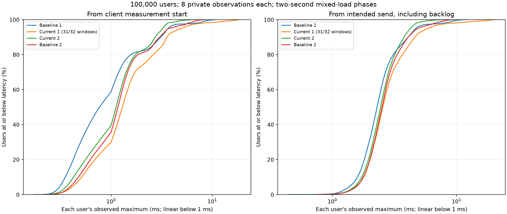
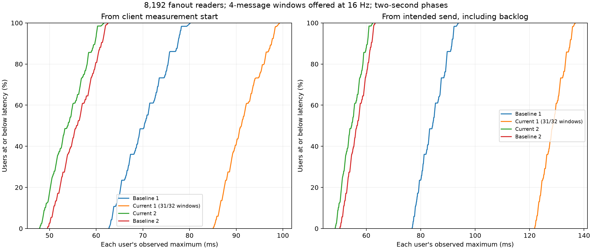

# Short current-source 100,000-user mixed fairness check

The current source does not establish a consistent improvement over the earlier running native baseline in these short trials. Both show substantial tail variation. One current-source trial completes only 31 of 32 offered fanout windows: correctness passes, but the offered workload does not. No runtime rollback, optimization or executable promotion follows from this evidence.

Correction (2026-10-18): the original prose incorrectly described all churn as disabled. The original runner hardcoded eight lifecycle workers. Raw commands, receipts, figures and numerical results are unchanged. These results describe private traffic, fanout and independent unpaced connection churn. The [diagnostic follow-up](../2026-10-18-fanout-workload-diagnostics/README.md) exposes an explicit worker count and isolates monitoring overhead.

Four fresh processes run baseline/current/current/baseline. The baseline is the frozen native 279c3c1 implementation; the current native snapshot contains selected source through b92da66 and excludes all rejected queue/header/notification experiments and the three dirty overlays. Receipts pin both server binaries and identical clients. Each measured phase is two seconds; population setup, CSV generation and checked teardown take additional time. Total measured comparison traffic is eight seconds.

Every run holds 100,000 users in 6,250 rooms of 16, with four checked 1 KiB private probes/user/second (800,000 private deliveries, eight observations/user). A separate room has 8,192 readers and one publisher, offering four-message 1 KiB fanout windows at 16 Hz (32 intended windows and 1,048,576 intended deliveries). The first current run completes 31 windows/1,015,808 fanout deliveries; no issued packet is lost or out of FIFO order. Inspectors and fanout-audience membership churn are disabled. Eight independent lifecycle workers remain active in other rooms, running unpaced because `--churn-cycles-per-second 0` means unlimited rate, not disabled churn. No TLS; eight server workers and both eight-worker clients are individually pinned to disjoint physical CPU sets. Commands, topology and actual thread affinities are retained.

| Run | Fanout windows | Native CPU-s | 99th percentile across users' observed private maxima (ms) | Worst private packet (ms) | Worst fanout packet (ms) |
| --- | --- | ---: | ---: | ---: | ---: |
| baseline 0 | 32/32 | 7.22 | 8.355 | 10.916 | 80.187 |
| current 1 | 31/32 | 7.56 | 12.815 | 19.137 | 99.304 |
| current 2 | 32/32 | 7.52 | 4.463 | 6.945 | 61.687 |
| baseline 3 | 32/32 | 7.58 | 6.639 | 8.819 | 62.595 |

CPU is sampled at the existing ready/measured gates (about 2.6 seconds), including gate settling; it is not exactly two seconds of service CPU. All 100,000 users contribute eight private observations, so their recorded p99 equals their observed maximum. These samples support ranking users, not estimating a long-term per-user p99 or proving a latency SLA. Fanout readers contribute 128 observations each in full-load runs, or 124 in the missed-load run.

The figures plot cumulative distributions across users of each user's observed maximum. Left panels use the source client's measurement timestamp; right panels include intended-send backlog. For fanout, that timestamp precedes reader notification and the window's socket writes, so it includes publisher-side wakeup work. A curve further left is better. The missed-load run remains visible and explicitly labelled. Current private users with every observed packet <=5 ms range from 95.014% to 99.440%. Current fanout readers with every observed packet <=50 ms range from 0% to 17.346%. Fanout intended-send worst latency reaches 136.819 ms in the missed-load run, versus 62.375 ms in the other current run. These are whole-client/kernel/relay paths, not isolated server-hop measurements.

All four runs pass exact payload/FIFO/counter checks and final resource retirement, with clean exits and zero recorded routing copies. Raw original receipts retain their old `passed` field meaning (correctness/process success); they are not rewritten to imply the requested fanout rate was met. summary.json derives an explicit overall workload status, which is false for current trial 1. The observed variation and missed-load case warrant investigation before claiming either a repeatable regression or a win.

This exercise exposed a runner reporting defect: `mixed-capacity.py` previously returned status 0 when offered fanout was missed. Selected fix: retain `correctness_passed` separately; overall `passed` and process status now also require any explicitly requested fanout window count to be met. Unpaced runs remain valid without a fanout rate target. Three real 32-user/16-reader fixtures (two seconds each) verify paced success (2/2 windows, exit 0), deliberately excessive offered rate (22,275/2,000,000 windows, correctness true but overall false/exit 1), and unpaced success (exit 0). The artifact-collision regression also passes. No relay runtime behavior changes.

The script patch applies to 4587da9. Raw old/new runner source, new integration test, binary build records, full receipts, private/fanout CSVs, window timelines, plots and test logs are retained. Plot generation ran after all timed traffic, and both figures were visually inspected. Existing manual services and protected source edits were preserved. Run `python docs/benchmarks/2026-10-18-short-current-100k/verify.py` to audit the evidence offline. Build release war-relay, capacity and inspection before running `scripts/test-mixed-load-gate.py`, or provide its documented frozen-binary environment paths.

The [send-order follow-up](../2026-10-18-fanout-send-order/README.md) corrects the earlier “From actual send” plot title to “From client measurement start.” Source data, curves, percentiles and threshold results are unchanged; prior renderings are retained in that follow-up.
