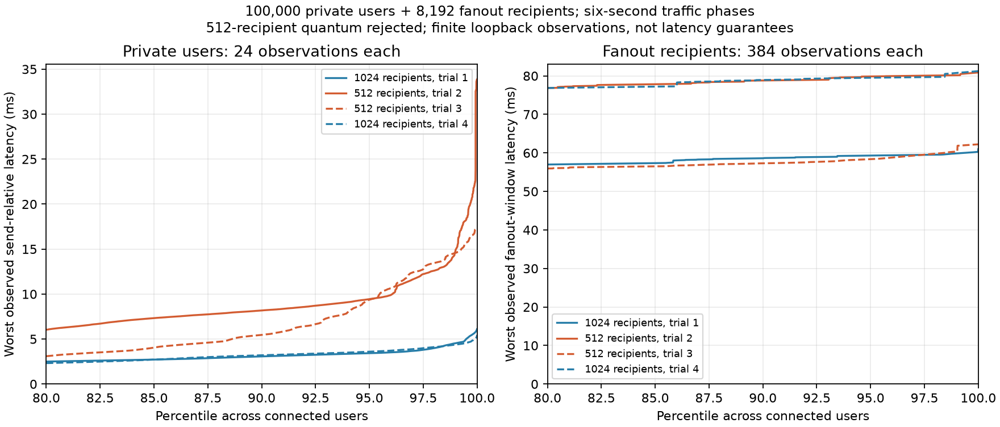

# Short mixed-load fairness: reject a smaller fanout quantum

Retain the native relay's 1,024-recipient fanout quantum. A clean 512-recipient experiment worsens private-user tails in two matched short trials without a consistent fanout or CPU improvement. No runtime change or local service replacement is adopted. The useful retained change is explicit sample-count/interpretation metadata in `scripts/mixed-capacity.py`, code commit `0e20529`.

## Workload and method

Four fresh processes run control/candidate/candidate/control. Each has 100,000 private users in 16-user rooms, 1 KiB values at four probes/user/second, 8,192 hot-room recipients, four messages/window at 16 windows/second, eight churn workers at four cycles/second, and two inspection clients. Each traffic phase lasts six seconds, contributing 24 observations per private user. All 96 offered fanout windows complete in every trial; each fanout recipient contributes 384 observations. Setup and exhaustive departure/Close cleanup are outside the timed phase. Complete runs take tens of seconds, not hours.

The relay uses eight pinned physical cores 0–7. Private and sidecar clients use separate masks 8–11,24–27 and 12–15,28–31. These two generators each have eight logical workers on four physical cores. No client shares a physical core with the server. Exact client stage clocks are enabled equally in all four runs, and the recorded generator backlog stays below its own 250 ms message period. Timings include generator/kernel effects; after-send time is not server-only latency.

Both native variants are release builds made sequentially in the same clean source and Cargo target paths. Their only native source difference is `FANOUT_QUANTUM: 1024 -> 512`. Source revision before the experiment is `318bba7`; existing user overlays in C++, the relay index, and listener tests are excluded and preserved byte-for-byte. No compilation or profiling overlaps the four timed comparisons. Binary and runner hashes are pinned in each receipt.

## Results

| Trial | Quantum | Private median worst, ms | Population p99 of private worst, ms | Worst private user, ms | Worst fanout window, ms | Server CPU-s |
| --- | ---: | ---: | ---: | ---: | ---: | ---: |
| 1 | 1024 | 1.443 | 4.541 | 6.136 | 60.973 | 20.69 |
| 2 | 512 | 1.561 | 14.901 | 33.885 | 80.878 | 20.98 |
| 3 | 512 | 1.600 | 14.579 | 17.444 | 62.231 | 20.96 |
| 4 | 1024 | 1.444 | 4.378 | 5.451 | 81.236 | 21.08 |

The control returns to similar private tails after both candidates. Fanout maxima overlap, CPU is similar, and every configuration completes the same offered work. This evidence rejects 512 for the current responsiveness objective; it does not establish that 1,024 is optimal for every audience or host. Lower work per turn can introduce more scheduling/continuation work; this experiment does not isolate a unique microarchitectural cause.



Each curve ranks users by their worst observation during that finite trial. The plot shows the upper 20% of users, with all curves reaching the exact worst user at 100%. The two panels have different Y scales. Fanout timing begins at window start and includes client windowing/verification. No samples or trials are pooled.

With only 24 samples per private user, nearest-rank p99 equals that user's maximum. A percentile across 100,000 users' maxima describes the population distribution of observed short-run stalls; it does not prove a long-run per-user p99, hard deadline, or WAN/TLS behavior.

## Profile, correctness, and retained reporting change

A separate eight-second baseline profile precedes the paired comparison. Its 22,842 cycles:user samples report zero lost samples. Self-symbol shares include connection driving 17.23%, bounded receive/routing 16.74%, worker loop 8.01%, fanout enqueue 6.13%, scheduling 5.50%, and notification 4.32%. This motivates screening fanout scheduling, not a claim of causality. Profile timings are not pooled into the unprofiled comparison. The raw 183 MiB perf recording remains local; its textual report and capture receipt are archived.

The profile verifies 3.2 million timed private probes. Each comparison verifies 2.4 million, for another 9.6 million. Every submitted audience matrix passes, with exact body/sender/FIFO checks, exact protocol counters, normal closes, descriptor retirement, zero routing copied bytes, and zero final connection/session/read-buffer/queue/variable gauges. Error, rejection, slow-consumer and pressure counters remain zero. The paired runs check 12,582,912 timed fanout deliveries in addition to private traffic; setup/postchecks/departures are independently counted rather than included in that number.

The runner now emits `latency_sampling`: users, observations per user, total private observations, whether all users' reported p99 equal their observed maximum, and an explicit finite-observation scope. It preserves existing latency fields and derives the new metadata only after validating CSV row identities/counts. It adds no runtime knob or server change. A separate two-second 1,600-user/512-reader mixed check validates 12,800 private observations, eight per user, all p99=max, full protocol/resource gates, and the new metadata. Python compilation passes. Historical receipts are not rewritten to pretend they used the new runner.

## Reproduce

From the repository root, use fresh output names:

```sh
python3 scripts/mixed-capacity.py \
  --server artifacts/candidates/short-fairness-quantum1024/war-relay \
  --capacity-client artifacts/candidates/latency-stages-client/capacity \
  --users 100000 --seconds 6 --readers 8192 --scope room --pairs 0 \
  --churn-cycles-per-second 4 --fanout-windows-per-second 16 \
  --exact-fanout-latency --latency-stages \
  --output artifacts/short-fairness-reproduction.json
```

Build clean variants using `git archive 318bba7 Cargo.toml Cargo.lock src examples vendor`, change only the constant for the candidate, and use the same release build path sequentially. CPU placement is host-specific; inspect topology before adapting it. Use the candidate executable only for the comparison, not to replace the retained service.

`python3 docs/benchmarks/2026-10-18-short-fairness-quantum/verify.py` verifies hashes, decoded CSV identities/samples/quantiles, completed windows, counters, zero resource gauges, and retained reporting metadata. `plot.py` recreates the figure using matplotlib. CSVs are losslessly gzip-compressed; their decoded SHA-256 values match the original runner receipts. The original/new runners and relevant source snapshots are included. These short tests support this rejection decision, not a long-duration reliability guarantee.
