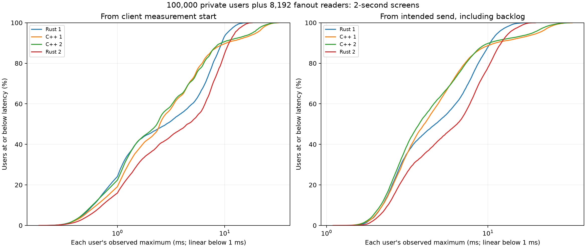
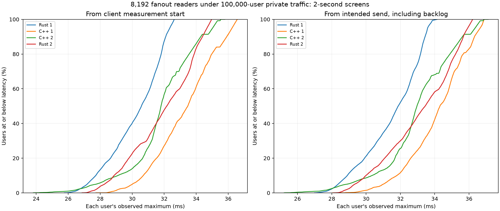

# Short current Rust/C++ population fairness comparison

2026-10-18, source base `27a5466`. Keep both selected runtimes unchanged. This matched short screen measures their current tradeoffs; it does not prove a new optimization. Rust has the better worst-user tails in both repeats here, while C++ uses much less RSS, slightly less measured CPU and gives more private users sub-5-ms observed maxima. The distributions cross: neither implementation wins for every user.

Four fresh sequential runs use Rust/C++/C++/Rust order, two seconds of measured traffic each. Total configured traffic is eight seconds; population setup and exhaustive checked teardown add wall time. Same frozen clients, CPU placement, payloads and offered work. No build, profile, compression or plot generation overlaps timed traffic. These are local plaintext loopback tests, no TLS or remote network. No independent churn, inspectors or extra private pairs run; the mixed load is private probes plus room fanout.

Each run holds 100,000 private users in 6,250 rooms of 16, plus 8,192 fanout readers, one publisher and one authenticated census connection: 108,194 connected sessions. Private users send four 1-KiB probes/second, giving eight observations each. Fanout offers four-message windows at 16 Hz, giving 128 observations per reader. All runs complete exactly 32/32 offered windows and pass payload/FIFO/counter/census and final retirement checks. All three child processes exit zero. Rust reports zero routing-copy bytes. C++ does not expose the same routing-copy/read-reservation metrics; its zero connections/queued bytes and checked protocol counts are verified without inventing metric parity.

| Run order | Ready RSS KiB | Server CPU-s | Median private user max ms | p99 across private user maxima ms | Worst private ms | Worst fanout ms |
| --- | ---: | ---: | ---: | ---: | ---: | ---: |
| 1 rust | 114,624 | 6.24 | 2.858 | 13.055 | 15.964 | 32.630 |
| 2 cpp | 60,960 | 6.13 | 2.490 | 25.292 | 31.486 | 36.573 |
| 3 cpp | 60,964 | 6.10 | 2.335 | 24.320 | 30.422 | 35.792 |
| 4 rust | 114,876 | 6.57 | 4.498 | 15.361 | 18.057 | 34.968 |

The receipt/table distribution summaries use the runner's existing lower order statistic at index floor((n-1)*p/100). Plot-summary quantiles use nearest rank; curves and threshold counts use every row directly.

RSS is the population-ready observation, not a continuous peak. Server CPU is the existing measurement-gate difference including settling, not a rate computed from exactly two seconds. Runtime feature/accounting differences remain: the richer native Rust implementation and lean C++ reference do not expose identical monitoring and decoder budgets. Rust rate limits, heartbeats and idle expiry are disabled; unsupported C++ options are omitted by the existing runner. Commands and hashes are retained. Frozen C++ sources match the committed implementation; Rust production source matches the selected implementation, with only test-module differences in server.rs. The three pre-existing dirty source overlays were not compiled into these binaries and were preserved.

The two Rust runs put every private user's eight observations below 20 ms. C++ has 4.861% and 3.423% of users with an observed maximum above 20 ms. However, C++ has 71.568–72.264% of users entirely below 5 ms, versus Rust's 51.604–60.045%. This is a tail/typical-user tradeoff, not uniform Rust dominance. All fanout readers' observed maxima stay below 40 ms in all four runs.

Each curve weights every user equally; it is not a pooled packet percentile. Left: from the source client's measurement timestamp, which may precede socket send. Right: from the intended send time, including generator backlog. Both include client/kernel/relay scheduling and are not isolated server-hop latency. Eight private observations cannot estimate a long-term per-user p99; observed maxima are used explicitly. No finite screen establishes a latency guarantee or long-duration stability. The Rust private tails differ from the earlier shared-rate screen despite the same production path, reinforcing the need for matched current repeats rather than cross-day speed claims.

The next useful runtime investigation is reducing the slowest-user delay without surrendering C++'s memory advantage or Rust's tail behavior. The common fanout completion interval includes roughly 30 ms after publisher writes; this alone does not locate time in the server. Use a separately timed short client/server diagnostic before changing scheduling or timestamp acquisition. This screen does not justify adopting another speculative notification fast path.

Exact wrapper invocations are in `commands.json`; choose fresh output stems to rerun. Complete per-user CSVs, raw JSON, window timelines, logs, frozen build identities and runner/plot source are archived. Executables remain at their original local paths, identified by SHA-256 in every receipt. Existing services and convenience binaries were untouched. Run `python3 verify.py` here for the offline evidence audit. Plot summaries include threshold counts derived from every user.
