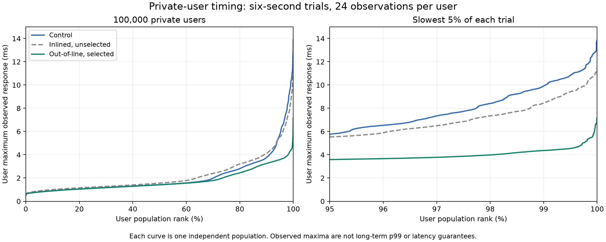

# Select the small writer for single-entry deferred queues

Source change **`266e5b1`** routes a one-entry output queue through the existing
`write_frame` helper. Larger queues retain the original 16-frame/32-iovec batch
writer, now named `write_many`. The dispatcher and bulk writer stay out of line.
There is no new frame format, allocation, per-connection state, counter layout,
reservation scheme, queue limit, scheduling quantum or protocol behavior.

The body remains borrowed from the charged envelope. Partial writes retain the
envelope and offset; complete writes pop it and release credits as before.
Existing byte quantum, control-frame ordering, error handling and cancellation
apply to both paths. The optimization reuses the same small writer already used
by immediate private sends, rather than adding another encoder.

Selected source is integrated in the root workspace. The frozen tested native
binary is `artifacts/candidates/single-write-outline/war-relay`, with identities
in `builds.json`. Manual native/bridge/static services were not restarted and
retain their earlier selected executable identities. This is source adoption,
not a live deployment or new universal latency guarantee.

## Measure the queue shape first

Two disposable diagnostics add completion counters only, then entry-depth and
completion counters together. For successful flush calls, buckets count zero
through 16 completed frames; queue depth is capped into a 16-or-more bucket.
Ready-to-measured counter deltas exclude setup and cleanup. Each case offers
two seconds of 64-private-pair/2,048-reader/four-message-window traffic.

| Diagnostic | Successful flush calls | One completion | One queued entry at call start |
| --- | ---: | ---: | ---: |
| Completion-only | 1,530,833 | 1,529,762 (99.93%) | Not recorded |
| Entry plus completion | 1,155,072 | 1,155,072 (100%) | 1,155,072 (100%) |

These probes add global atomic traffic and change metrics layout. Their timing
is excluded from performance comparisons, and their distribution is not assumed
for every workload. Neither probe enters production. Both exact measured
binaries are retained under `write-shape-completion` and `write-shape-queue`;
the first was reconstructed and checked byte-for-byte against its receipt hash.
Probe patches and original receipts preserve both observations.

The native control reserves 1,112 local stack bytes in `write_batch` on this
compiler/host and executes a 320-byte header-array memset before its loop.
The selected dispatcher reserves 104 local bytes and calls the small writer
for one entry; multi-entry calls still use the full bulk path. These are callee
prologue reservations, not total call-stack peaks or per-connection RAM savings.
Actual disassembly is archived. No payload is assembled into another buffer.

## Avoid enlarging the common flush routine

The first candidate allowed dispatcher inlining. Native symbol sizes showed
`Socket::flush_locked` growing from 555 to 964 bytes. The selected variant keeps
the dispatcher out of line, yielding 431 bytes for that routine and a separate
478-byte dispatcher. The unchanged bulk writer is 2,509 bytes in all variants.
The original/small `write_frame` symbols are 663/715 bytes; outlining does not
make the entire binary smaller. These are measured code sizes, not proof that
instruction-cache effects uniquely caused timing differences.

All three ordinary native variants were built sequentially in one clean project
and target path from `1743cfd`. Only `src/server/socket.rs` changes. Existing user
overlays were excluded from release comparisons and verified byte-identical.
The selected root source exactly matches the tested outlined candidate.

## Short ordinary screens

Every short trial offers two seconds of unpaced 1 KiB-value traffic, 2,048 fanout
recipients, four messages/window, four native workers on CPUs 0–3 and eight
client workers on 4–7,20–23. All workers are individually pinned and physical
client/server cores are disjoint. Mixed cases add 64 private pairs; fanout-only
cases use none. No listing rooms, inspection or churn are active. Full setup and
checked departure cleanup (batch 32) are outside measurement. No build, profile,
compression or other benchmark overlaps a measured phase.

Selected outlined variant, mixed private/fanout:

| Trial | Variant | Private million messages/s | Fanout million deliveries/s | CPU-s / million combined deliveries | Private p99 histogram upper ms | Worst fanout window ms |
| --- | --- | ---: | ---: | ---: | ---: | ---: |
| 1 | Control | 0.969 | 0.924 | 1.357 | 4.194 | 13.288 |
| 2 | Outlined | 1.273 | 0.814 | 1.247 | 2.097 | 14.353 |
| 3 | Outlined | 1.191 | 0.834 | 1.274 | 2.097 | 12.545 |
| 4 | Control | 1.256 | 0.704 | 1.325 | 2.097 | 16.126 |

Both outlined mixed runs use less CPU per delivered message than both controls;
the two-repeat mean difference is about 6%. Work is unpaced and its mixture
varies, so this is an observed workload result, not a fixed-work causal estimate
or universal gain. Do not infer a long-run tail guarantee from these buckets.

Outlined variant, fanout only:

| Trial | Variant | Fanout million deliveries/s | CPU-s / million deliveries | Worst fanout window ms |
| --- | --- | ---: | ---: | ---: |
| 1 | Control | 1.620 | 1.239 | 13.141 |
| 2 | Outlined | 1.750 | 1.124 | 11.571 |
| 3 | Outlined | 1.756 | 1.138 | 27.126 |
| 4 | Control | 1.918 | 1.093 | 6.807 |

This second workload varies substantially: the return control is faster than
both candidates, and one candidate fanout maximum is worse than both controls.
It does **not** establish a repeatable fanout-only win or consistently better
latency. The change is retained for the measured dominant queue shape, reduced
common-path work, favorable mixed CPU screen and subsequent full-population
acceptance, with these limits preserved rather than hidden.

All eight earlier inlined-variant short trials are also retained in
`summary.json` and raw receipts. Their mixed CPU ranges overlap; their
fanout-only trials favor that candidate. Those results are not pooled with the
selected outlined implementation. Its later large-run CPU/footprint tradeoff
is why the inlined version remains unselected.

## 100,000-user integration

Each large case has 100,000 private users in sixteen-member rooms, 8,192 extra
fanout readers, eight churn workers at 4 Hz and two CBOR inspectors. Private
traffic is 4 Hz; fanout is four messages/window at 16 Hz. The six-second offer
contains 24 observations/private user and 96 scheduled fanout windows. Controller
gate spans include overhead and are recorded separately. Establishing and
retiring sockets, writing matrices and verification add wall time outside the
offer; no multi-hour soak was run.

Eight native workers use CPUs 0–7, capacity uses 8–11,24–27 and sidecar uses
12–15,28–31, with all 16 client workers individually pinned. Exact fanout and
private stage diagnostics are enabled equally; no native instrumentation is
present. Native timing excludes setup/output/teardown. Each trial completes
all 96 offered windows, 2.4 million timed private probes and 3,145,728 timed
fanout deliveries, plus separately counted setup/postchecks/departures.

| Observation | Control | Inlined, unselected | Outlined, selected |
| --- | ---: | ---: | ---: |
| Native CPU-seconds | 20.38 | 21.25 | 20.37 |
| Median private user's observed worst | 1.424 ms | 1.559 ms | 1.413 ms |
| Population p99 of private observed worst | 9.918 ms | 8.444 ms | 4.365 ms |
| Worst private user | 13.886 ms | 11.469 ms | 7.174 ms |
| Worst fanout window | 74.322 ms | 81.927 ms | 75.993 ms |
| Completed/offered windows | 96/96 | 96/96 | 96/96 |

The selected large run's CPU is effectively unchanged, private tails are lower
in this finite comparison, and its worst fanout window is slightly higher.
One trial per implementation does not establish causality or repeatability for
those differences. No sender exceeds its own 250 ms offer period. Counts,
body/sender/FIFO, full matrices, affinity, normal closes, descriptor retirement
and zero error/pressure/rejection counters pass. Final connection/session/queue/
output-capacity/read-buffer/variable gauges and routing-copied-byte counter are
zero; only the global channel remains.



Each curve ranks one independent population's observed maxima. At 24 samples,
nearest-rank per-user p99 equals that maximum. The plot covers private users;
fanout results are reported separately above. Neither these curves nor stage
clocks isolate server-only latency or establish long-run p99, deadlines,
production capacity, WAN/TLS behavior or a new C++ comparison.

## Verification and reproduction

Clean candidate library: 80 tests passed. Actual workspace with the pre-existing
user changes: 83 tests passed. Existing socket tests include independent wire
reading, FIFO/short-write probes, large partial frames, retained-body pointers,
exact charges, control ordering and cancellation. Clean library/native Clippy
with `-D warnings`, Rust formatting and diff whitespace checks pass. No new
implementation-mirroring unit tests or dependencies were needed.

Use a fresh output prefix for the short mixed screen:

```sh
python scripts/inspection.py \
  --server artifacts/candidates/single-write-outline/war-relay \
  --client target/release/examples/inspection \
  --mode none --rooms 0 --seconds 2 --inspectors 0 --pairs 64 \
  --churn-workers 0 --workers 4 --client-workers 8 \
  --fanout-readers 2048 --fanout-window 4 --fanout-close-window 32 \
  --server-cpus 0-3 --client-cpus 4-7,20-23 \
  --pin-workers --pin-client-workers --output artifacts/single-write-reproduction.json
```

Fanout-only substitutes `--pairs 0`. The large recipe uses the existing
`mixed-capacity.py --users 100000 --seconds 6 --readers 8192 --scope room
--pairs 0 --churn-cycles-per-second 4 --fanout-windows-per-second 16
--exact-fanout-latency --latency-stages --pin-client-workers`, the frozen
`latency-stages-client/capacity`, and the selected server. Exact commands and
binary/runner/helper identities remain in every receipt. CPU masks describe
this host. Do not run timed variants concurrently.

Source patches reconstruct both probes and candidates from clean `1743cfd`;
`selected.patch` matches committed socket source `266e5b1`. Build/test/lint logs,
symbols and disassembly preserve code-generation evidence. Receipts, matrices,
private timelines and output are losslessly compressed with decoded hashes
matching receipts. `builds.json` pins all native variants. `verify.py` checks
archive integrity, diagnostic deltas, matrix identities/samples/quantiles,
retirement and offered work offline. `plot.py` produces standalone PNG/SVG
figures from the archived CSVs. Neither script replays traffic or proves a
latency SLA. All three pre-existing user files and manual services remain
unchanged; their live source/executable identity is distinct from this source
adoption.
