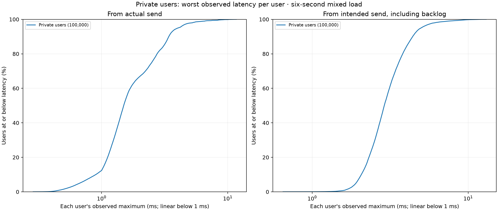
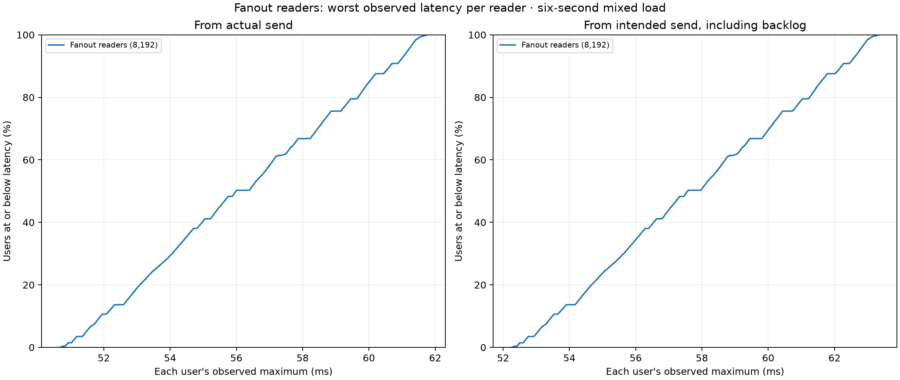

# Observed worst delivery for every user — 2026-10-18

Selected tooling improvement: the existing comparison plotter now supports `--statistic max` alongside the default per-user p99. The maximum view summarizes the percentage of users whose **every observed delivery** stayed at or below each requested threshold. It labels these as observed maxima, not p99s or latency guarantees. The default p99 loader and numerical summary are identical to the previous version on the 100,000-user input.

The tool also reads exact fanout CSVs with explicit `_ns` columns, normalizing values to milliseconds. Private `_ms` CSVs remain supported. Histogram p99 upper bounds retain their separate mode; combining that mode with observed maxima is rejected before plotting. Existing validation still rejects empty data, duplicate IDs, nonpositive samples, invalid numeric values and exact percentiles above their observed maximum. Maximum plots fit the observed range, using linear axes for a range below one decade so narrow fanout distributions retain useful tick labels. Default p99 plot scaling is unchanged.

No new traffic was run. These charts reanalyze the selected SIMD candidate's existing six-second mixed test: 100,000 private users with 24 observations each, 8,192 fanout readers with 384 each, and all 96/96 offered fanout windows completed. The original [receipt, source identities and full raw data](../2026-10-18-simd-text-validation/README.md) remain authoritative. Its server SHA-256 is `01e2f40a7f52feb343a5876297fff46c80486c93c1538c929f0d3d3659a6f838`; this is not a fresh benchmark of the later shutdown/client-only changes.

| Population / threshold | Users with all observed deliveries at or below threshold, from actual send | Including intended-send backlog |
| --- | --- | --- |
| 100,000 private users, 5 ms | 97.834% | 95.054% |
| 100,000 private users, 10 ms | 99.855% | 99.788% |
| 8,192 fanout readers, 50 ms | 0% | 0% |
| 8,192 fanout readers, 60 ms | 84.82666015625% | 69.54345703125% |

These are exploratory thresholds chosen for this analysis, not configured SLOs or pass/fail gates. There are 2,166 private users with at least one actual-send observation above 5 ms, and 1,243 fanout readers with at least one above 60 ms. All fanout readers have at least one above 50 ms. Their worst actual-send observations range from 50.676 to 61.757 ms, suggesting a broad fanout delay in this fixture rather than a few isolated slow recipients. The interval includes server, kernel, client scheduling, reads, validation and acknowledgement work; it cannot assign the delay to the relay alone. The earlier [stage/profile attribution](../2026-10-18-fanout-attribution/README.md) retains that distinction.

Private users have only 24 observations here, so their reported sample p99 already equals their maximum. The explicit maximum view is especially useful for the fanout population with 384 observations per reader: a rare stall need not appear in that reader's p99. Neither statistic estimates a long-term per-user deadline from this finite run. Population percentile summaries use the plotter's existing nearest-rank method; those can differ slightly from a runner using a different population rank convention.





The six focused Python tests pass, including a fixture where every user's p99 is at or below a threshold but half the users have an observed maximum above it, nanosecond normalization, histogram semantics and invalid input. Both generated maximum plots were visually inspected; an initial narrow logarithmic fanout view lacked useful ticks and was corrected to use linear axes. The default p99 CLI also renders the fanout input. An independent full-input check confirms default private p99 values, samples, maxima and summary match the previous tool exactly.

Example, reusing a retained CSV and a fresh output stem:

```sh
python scripts/plot-user-latency-comparison.py \
  --case 'Fanout readers=artifacts/simd-text-100k-fanout.csv' \
  --statistic max --threshold-ms 50 --threshold-ms 60 \
  --output artifacts/fanout-observed-maxima
```

`build.json` pins the source base and exact scripts. Full source patch, tests, default-mode compatibility receipt and generated JSON/PNG/PDF outputs are retained. Run `python docs/benchmarks/2026-10-18-user-maxima/verify.py` to check checksums and independently recompute the charts' statistics from the adjacent original archive. This requires the adjacent SIMD archive but starts no relay and imports no plotting library. Runtime code, running services and the three pre-existing dirty files are unchanged.
