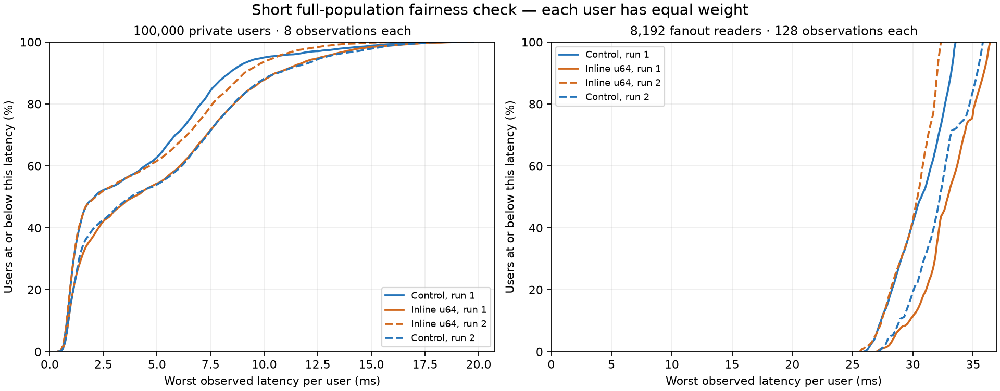

# Short current-build check at 100,000 users

The recent inline-u64 frame change passes the full-population correctness and retirement check. Four fixed-rate, two-second traffic runs in control/candidate/candidate/control order show overlapping performance ranges. The previously measured allocation reduction remains selected; no general latency or throughput gain is established here.

Each fixture holds **100,000 private users plus 8,192 authenticated global fanout observers**. At the ready gate there are 108,194 native connections, including the two sidecar control/publisher connections. Private users send four 1 KiB probes per second. Fanout sends four 1 KiB values per window at 16 windows per second. Each run verifies 800,000 measured private observations and 1,048,576 measured fanout observations. Setup, additional routing checks and retirement happen outside the traffic interval. There are no inspection requests, churn workers or extra unpaced private pairs.

The server uses eight individually pinned workers on CPUs 0–7. The private and fanout clients each have eight pinned workers on disjoint CPU sets (8–11,24–27 and 12–15,28–31). Send/receive buffers are 16/64 KiB. Heartbeats, application idle timeout and input rate limits are disabled in this performance fixture; message, queue and total read-buffer bounds remain active. These conditions do not establish behavior under every production policy or network path. No build, profiler or plotting overlapped the traffic runs. Existing manually running services were preserved.

Control is the frozen pre-inline-u64 native build (`artifacts/candidates/native-pending-control/war-relay`). Candidate is `artifacts/candidates/native-inline-u64/war-relay`, whose native runtime matches current source. Subsequent bridge-only changes do not affect it. Receipts retain executable hashes, commands, CPU affinity, exact counters and raw latency file hashes.

| Build/run | CPU seconds during traffic | Median user's worst private ms | 99th percentile of users' worst private ms | Worst private ms | Worst fanout ms |
| --- | --- | --- | --- | --- | --- |
| Control 1 | 6.28 | 2.092 | 15.339 | 19.486 | 33.553 |
| Inline u64 1 | 6.54 | 3.915 | 16.131 | 19.743 | 36.401 |
| Inline u64 2 | 6.18 | 2.147 | 13.168 | 16.514 | 32.324 |
| Control 2 | 6.50 | 3.788 | 16.094 | 19.793 | 35.806 |

The first candidate looked worse than the first control, so the pair was repeated in reverse order. The second control then closely matched the slower candidate, and the candidate repeat closely matched the faster control. This is why a single short pair should not decide a regression. These four finite observations do not prove equivalence or a universal absence of regressions.

Each point represents one user's **worst observed latency**, not one packet. Private users have only eight observations each; their reported empirical p99 therefore equals their observed maximum. Fanout readers have 128 observations each. The graph uses the maximum for both groups. Latency includes the client, relay and local kernel path; it is not isolated server processing time. Intended-schedule latency, which also includes generator delay, is retained separately in receipts.

Across these runs, 53.988–62.774% of private users had every measured probe complete within 5 ms. Private maxima reached 16.514–19.793 ms, and fanout maxima reached 32.324–36.401 ms. This confirms full-population delivery but leaves responsiveness work to do; it does not establish consistently sub-5-ms delivery for every user.

Every run met the offered fanout rate and passed exact body/FIFO, census/counter and retirement checks. All three disposable processes exited zero. Final connections, sessions, queued bytes, variable bytes, read-buffer reservation, output queue capacity and native connection slots were zero. File descriptors returned to baseline, and all checked error, rejection, slow-consumer, timeout, pressure and close-failure counters were zero. Native payload-routing copy counters remain zero. These are bounded-load observations, not a claim of indefinite stability.

There are **eight seconds of measured traffic total**, plus setup and exhaustive cleanup for each fixture. The raw CSV files remain local under the paths in `summary.json`; each is tied to its receipt by SHA-256. Compressed receipts, complete commands, the plotted figure and exact summary are saved here. `verify.py` checks the complete local CSVs when present and audits the archived receipts, counters and summary. `artifacts/current-100k-short-report.py` regenerates the figure from all original rows.

This audit also corrects the previous inline-u64 report: its unpaced saturation screen used four server workers, but its fixed-rate follow-up used eight, with two eight-worker clients. Each original comparison used matching worker counts; the earlier prose incorrectly applied four workers to both harnesses.
