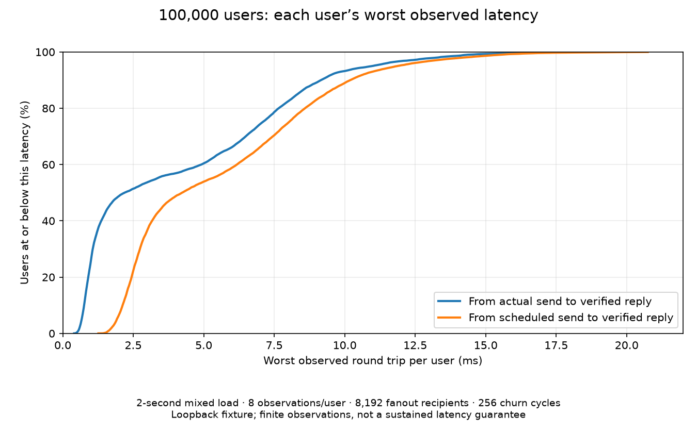

# Current committed-source short fairness acceptance — 2026-10-19

Built clean committed source d00b195 using build-snapshot.py, excluding the three unrelated dirty runtime experiments. Cargo confirms recompilation; build.json records input and binary hashes. No production service or convenience binary was replaced. This is an acceptance baseline, not an optimization comparison or a C++ comparison.

The receipt records the exact executable identities, commands, affinity, full correctness gates, finite latency samples and resource retirement. The fixture uses eight native workers, 100,000 private users at four messages/second for two seconds, 8,192 observer fanout recipients, four messages/window, 16 offered windows/second and eight churn workers at 16 cycles/second. Setup, independent postchecks and orderly teardown take additional time outside the two-second traffic phase. No profiler or concurrent build ran during timing.

All 800,000 private observations pass, as do all 32 offered fanout windows (1,048,576 fanout deliveries) and 256 churn cycles. All three processes exit zero. Final connections, sessions, queued bytes, read-buffer reservations, native connection slots and output queue capacity are zero; only the built-in global channel remains. Error/rejection/slow-consumer/pressure counters are zero, and routing copied bytes remain zero. Shared-body routing accounting does not imply zero copies in the entire network stack.

Each private user has eight samples, so its reported p99 equals its observed maximum. Across those per-user maxima, the median is 2.192060 ms, p95 is 10.971037 ms, p99 is 14.326695 ms and worst is 19.171012 ms. Including generator scheduling delay gives a 20.747871 ms worst user. The fanout recipient maximum is 33.180945 ms. Server CPU consumption over the measured interval is 6.24 CPU-seconds across eight workers. These are local loopback observations; eight samples per user cannot establish a long-term tail bound, network SLA or soak reliability.

The plot sorts each user's worst actual-send round trip and worst scheduled-send round trip independently. It displays a cumulative distribution, not individual-user identities or a time series. The second curve includes generator delay. All 100,000 rows contribute to both curves. The curve exposes remaining inequality: a passing correctness/load gate does not mean every user has equally low latency. A future optimization should reduce these tails under the same load while retaining FIFO, bounded ownership and resource retirement; this run alone does not attribute the tails to a specific bottleneck or justify a runtime edit.

Run `python docs/benchmarks/2026-10-19-current-short-fairness/verify.py` for saved evidence checks. Add `--check-local-csv` to validate the original local 100,000-row CSV and its hash. Its path is in receipt.json, with its digest; the large raw CSV stays in local artifacts. Repeat the exact recipe using fresh output paths and the frozen binaries recorded in that receipt. No runtime change was selected in this turn.
