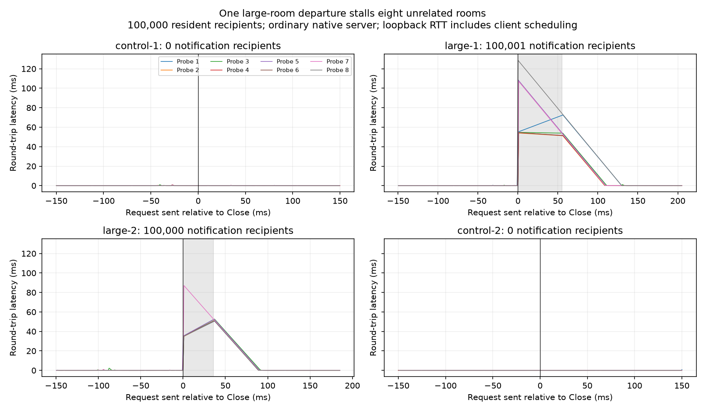

# Short departure fairness diagnostic

One departure from a large room delays self-echo traffic in eight unrelated rooms. This is a measured bottleneck to address next; this change adds the finite diagnostic and evidence, with no runtime optimization selected.

Measured 2026-10-19 against the ordinary frozen native executable `artifacts/candidates/metrics-static-20261019-native-candidate/war-relay`, SHA-256 `20336238cf6a27cdf4defe021a1dd5dd27bf1b9610e4f7955075967129b3003c`. The executable contains the accepted static metrics change from the fc15e63-based candidate. Relevant native production code remains equivalent at parent commit 602704792e9603ab02e90d53807f67360675e8b5; subsequent runtime work was in the legacy bridge, with native admin test changes only. The dirty root relay prototype was not compiled or measured.

## Results

Each large-population run establishes 100,000 audience sockets, eight self-echo witnesses in eight separate rooms, two departing large-room members and two singleton control members. The same audience stays resident throughout control / large / large / control. Native workers are pinned to CPUs 0–7; the Python client is restricted to CPUs 8–15 and 24–31 for both 100k runs. Worker affinity is verified in the receipts. No build or second benchmark runs during traffic.

| Run / event | Notification recipients | Close ACK elapsed | Range of the eight witnesses' worst RTTs |
| --- | ---: | ---: | ---: |
| First / control 1 | 0 | 0.078 ms | 0.031–0.554 ms |
| First / large 1 | 100,001 | 49.450 ms | 51.826–105.567 ms |
| First / large 2 | 100,000 | 35.100 ms | 51.593–88.626 ms |
| First / control 2 | 0 | 0.076 ms | 0.058–0.620 ms |
| Repeat / control 1 | 0 | 0.083 ms | 0.101–0.961 ms |
| Repeat / large 1 | 100,001 | 55.415 ms | 53.995–128.696 ms |
| Repeat / large 2 | 100,000 | 35.925 ms | 50.652–87.127 ms |
| Repeat / control 2 | 0 | 0.093 ms | 0.033–0.747 ms |

The eight maxima describe individual witnesses, not pooled percentiles. Setup took 4.34 and 4.49 seconds. Each event samples for 150 ms before Close and 150 ms after its acknowledgment: about 1.2–1.3 seconds of event windows per run. Notification verification happens between windows. The two 100k runs reach the final measurement gate in approximately 6.6 and 6.7 seconds from process startup, followed by bounded shutdown. A smaller 8,192-recipient screen also passed: departure acknowledgment 3.04–3.24 ms, worst observed witness RTT 7.65 ms. Its client affinity was unrestricted, so it is a screen rather than a controlled scaling comparison.



The shaded region is Close send through acknowledgment. Plot values are request RTTs positioned at their send times. Probes issue one request at a time and wait 1 ms after each reply. They do not generate the requests that would have occurred while blocked: this is a finite stall detector, not an open-loop load test, an unbiased latency distribution, a soak test, or a 100k-active-sender capacity certification. Eight rooms do not prove every worker was witnessed. Python scheduling, its GIL, kernel scheduling, and loopback traffic contribute to RTT. The 50 ms-shaped delays are not claimed to be entirely registry lock hold time.

## Source diagnosis and next implementation

The committed `Relay::remove()` takes `self.state.write()`, removes the departing member, and calls `enqueue_fanout` synchronously for every remaining member while retaining that write guard. Global disconnect observers are also visited under the same guard. Normal channel message fanout has a quantum; this departure loop does not. Source inspection plus the repeated event/control contrast makes departure fanout the next concrete optimization target. These runs do not isolate how much time is lock contention versus notification work, socket readiness, and scheduling.

The next candidate should move departure delivery into bounded work turns and release the registry lock between turns. It must explicitly preserve departure/message ordering, membership lifetime, global observer behavior, shared frame ownership and queue admission. Merely cloning the entire membership into a temporary vector would introduce a population-sized allocation and would not by itself preserve FIFO when other traffic overtakes the deferred notification. No such shortcut was adopted here. Compare any candidate with this same short fixture, then the existing short mixed-load checks.

## Acceptance and limits

All three accepted runs validate unique full-width welcome IDs, exact self-echo sender/value bytes, and every departure notification: 16,385 at the small population and 200,001 in each 100k run. Each witness has samples in each event. Notifications are read outside timed windows, before the next departure; one tiny notification per reader fits ordinary socket buffers and is not deliberate slow-consumer pressure.

After closing witnesses, the live gate requires exactly the audience population and zero queued bytes. Protocol/write/close/transport/pressure/reservation error counters must remain unchanged, and routing copied bytes must be zero. Final shutdown is requested before releasing the audience; an actual server Close 1001 proves shutdown was published, preventing an accidental quadratic disconnect storm during teardown. The owned server exits normally with code 0. This does not claim an all-zero live-server read-buffer or arena gauge while 100,000 sessions remain resident.

The initial screen receipt in `artifacts/departure-fairness-20261019-small.json` failed only its fixture assertion because the existing metrics helper returns strings; accepted receipts use integer conversion. The failed attempt is not part of the table. `fixture-v2.py` is the exact fixture used for accepted small/first runs; `fixture.py` adds client affinity/sampling metadata and per-event witness checks for the repeat. Both fixture hashes are checked offline. Existing services and the three pre-existing dirty files were preserved.

## Reproduce

From the repository root, using the frozen executable above (or an explicitly selected candidate):

```sh
taskset -c 8-15,24-31 python scripts/departure-fairness.py --server artifacts/candidates/metrics-static-20261019-native-candidate/war-relay --audience 100000 --output /tmp/departure-fresh.json
python docs/benchmarks/2026-10-19-departure-fairness/analyze.py
```

Output paths are exclusively created before traffic. Setup has a 60-second budget and socket operations have five-second deadlines; owned server shutdown has a bounded kill/reap fallback. Loopback source addresses spread ephemeral port use without changing global sysctls. The fixture caps its diagnostic audience at 100,000, not the relay's supported population. Raw receipts retain all probe timestamps, metrics, worker affinity, command and executable hash. `plot.py` renders the retained repeat and refuses to replace existing output. `sha256.json` authenticates all retained evidence; `verify.py` validates it and recomputes the table inputs without running traffic.
