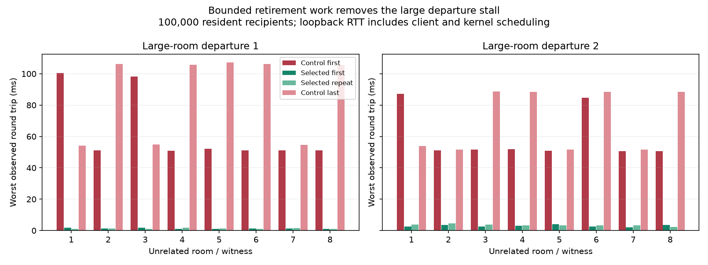

# Bound departure work without reordering notifications

A large-room departure previously walked every recipient while holding the global registry write lock. The selected implementation publishes charged retirement work to one shared FIFO, then native workers advance at most 1,024 recipient visits per retirement turn outside the registry lock. The 100,000-recipient diagnostic's worst observed unrelated-witness round trip fell from 107.128 ms to 4.571 ms across the accepted controls and selected runs: approximately 23 times lower in this screen.

This is a short, repeated stall diagnostic and a two-second mixed-load regression screen, measured 2026-10-19. It is not a production SLA, long-duration stability certification, or a benchmark against C++.

## Implementation

`RoomFanout` already owns an immutable recipient snapshot and a shared frame with queue-budget accounting. Retirement work reuses that representation. Its frame, snapshot, job metadata and conservative queue-slot allowance are admitted under the existing global queue byte limit. Source frame credit remains valid after the source has entered closing state. No payload is copied for each recipient; recipient handles are captured separately from payload storage. Room snapshots reuse the existing membership-view machinery; disconnect-observer lists capture their own handles.

The relay owns one retirement queue. After ordinary ready work, each native worker may advance its front job with a nonblocking lock attempt. A busy queue causes that worker to continue its own socket processing, rather than wait for another retirement turn. Pending retirement work keeps polling nonblocking, and the source wakes its worker when publishing work. The queue survives the source connection, including abrupt EOF. Terminal shutdown discards pending jobs and releases their reservations; it suppresses further departure publication. Large idle queue capacity is released, with at most 32 pointer slots retained when a running queue becomes empty.

One queue preserves the order established by registry removal across workers. A later small-room departure also joins the queue while older work is pending, so crossing below the 1,024-recipient threshold cannot bypass an earlier notification. Each sender's earlier routed messages remain ahead of its departure. Concurrent application senders retain the existing protocol contract, which promises no global total order between them.

Budget refusal retains the original synchronous best-effort behavior. Before falling back, older retirement work is finished so that the fallback cannot overtake it. **That pressure fallback is deliberately synchronous and can still cause a long turn.** The normal admitted path is bounded by recipient visits; this change does not promise bounded wall-clock latency under global queue exhaustion. No new platform limit or configuration option was added. Snapshot construction and membership maintenance still take place under the registry lock; this change removes the much larger output-enqueue walk from that critical section.

The change adds no task per connection, per-room scheduler, or additional runtime dependency. Small departures with no pending retirement sequence keep their existing synchronous path.

## Focused departure results

The same 100,000 audience sockets remain resident through singleton / large / large / singleton events. Eight self-echo witnesses occupy eight unrelated rooms, with one request outstanding each and a 1 ms wait after each reply. Each event has 150 ms before Close and 150 ms after its acknowledgment. Every audience notification is checked between events. The first large departure has 100,001 recipients; the second has 100,000. Native workers use CPUs 0–7, while the client uses CPUs 8–15 and 24–31.

| Executable / run | Large departure | Close acknowledgment | Worst observed witness RTT |
| --- | --- | ---: | ---: |
| Control first | 1 | 47.293 ms | 100.512 ms |
| Control first | 2 | 32.982 ms | 87.250 ms |
| Selected first | 1 | 1.286 ms | 1.712 ms |
| Selected first | 2 | 0.322 ms | 4.173 ms |
| Selected repeat | 1 | 1.353 ms | 1.697 ms |
| Selected repeat | 2 | 0.211 ms | 4.571 ms |
| Control last | 1 | 55.013 ms | 107.128 ms |
| Control last | 2 | 37.072 ms | 88.689 ms |



The controls bracket the experiment chronologically; the final shared-queue runs followed rejection of an earlier implementation. This is not a contiguous four-run ABBA trial of the final implementation. The gap is substantial and repeats, but fine percentage comparisons should not be inferred from these few samples. The comparison uses worst observed round trips, not pooled percentiles. Client/GIL scheduling, kernel scheduling and loopback traffic contribute to RTT; no isolated lock hold time or isolated relay-hop time is claimed. Requests that would have been generated while a witness was blocked are not synthesized. Eight witnesses do not prove every worker was covered.

Both selected Close runs verify exactly 200,001 departure notices, exact echo sender/value bytes, no additional protocol/write/transport/pressure failures, zero routing-copy bytes, exactly 100,000 sessions and zero queued bytes at the final live gate, and normal server exit. A further 100k-recipient EOF variant passes the same payload/notification/queue checks and observes exactly four expected transport disconnects, with no other new errors. That variant is correctness-only: its `close_ack_ms` field records the client shutdown call's return, not a server Close ACK. It is excluded from the latency table.

Configured event windows total roughly 1.2 seconds plus acknowledgment time per departure run. Full accepted final candidate invocations took about 9 and 18 seconds including setup, notification verification and shutdown. They have a 60-second setup budget, five-second socket deadlines and bounded owned-process cleanup. The original small fixture and its 100k methodology are described in the adjacent `2026-10-19-departure-fairness` report.

## Short mixed-load screen

Each accepted case requests two seconds of measured traffic with 100,000 capacity users, 8,192 additional fanout readers, window 4, 32 private pairs, two inspectors and eight churn workers doing 32 cycles/second each. The offered fanout rate is eight windows/second. Fixed clients and disjoint CPU masks are retained, with client workers individually pinned. Builds and profiling do not overlap the traffic.

| Run | Server CPU-seconds | Worst capacity-user observed RTT | Verified sidecar private messages/s | Worst fanout RTT |
| --- | ---: | ---: | ---: | ---: |
| Control first | 9.32 | 3.555 ms | 1,308,276 | 56.508 ms |
| Selected first | 9.35 | 6.724 ms | 1,210,241 | 60.009 ms |
| Selected repeat | 9.31 | 5.247 ms | 1,083,047 | 65.589 ms |
| Control last | 9.33 | 10.122 ms | 1,081,132 | 110.609 ms |

CPU use is effectively flat in these short runs. Private rates and ordinary traffic latency ranges overlap; no ordinary-throughput or ordinary-tail-latency improvement is claimed. The first control's private rate is higher than either candidate result, so these data also do not prove exact throughput equivalence. They support selecting the large departure-latency improvement without a demonstrated systematic CPU regression. A longer-tail claim would need more samples, not a longer unbounded test by default.

All four accepted cases meet all 16 offered windows, verify 524,288 fanout deliveries and 512 churn cycles during measurement, and verify 750,000 capacity departure notifications in cleanup. Both clients and server exit 0. Final connections, sessions, queued bytes, variable bytes, read-buffer reservations and native arena slots are all zero; routing copied bytes are zero. Each full mixed command takes about 34 seconds, with approximately two seconds configured for measurement and the remainder spent on population setup, checks and teardown.

The earlier control at 32 windows/second passed correctness but completed only 40/64 offered windows. It is retained as a failed offered-load gate, not an accepted comparison. The rate was lowered equally for both implementations.

## Rejected first design and regression coverage

The first candidate had a retirement queue per worker. It produced excellent isolated-departure latency, but the unchanged mixed client rejected it during batched room retirement with `fanout departure changed`: later jobs on another worker overtook earlier notifications. Its failed receipt, stderr, log and build identity are retained. That design is rejected and is not the selected implementation.

The shared-queue implementation passes 144 library tests in 10.03 seconds, Clippy for library/binaries/tests with warnings denied, and formatting. Added tests exercise:

- At most one quantum of retirement recipients per turn, exact notices and eventual completion.
- Earlier sender data preceding the departure, and exclusion of later joins.
- Charging after the source is already marked closing, cancellation and release of all staged reservations.
- Global disconnect observers using the same bounded machinery.
- Two departures across the small-room threshold preserving their sequence.
- Global metadata-budget refusal draining older work before synchronous fallback, with the pressure counter and byte balance checked.

An existing shutdown cancellation test now publishes terminal relay shutdown before retiring its connection, matching the production supervisor's order. This distinguishes shutdown suppression from an ordinary departure whose charged work legitimately remains pending.

## Provenance and reproduction

Implementation parent: `5d123b2`. The existing root checkout's three unrelated dirty files remain byte-for-byte unchanged; this implementation lives on branch `codex/departure-quantum` in the attached checkout `/home/phil/.codex/worktrees/departure-quantum/war_next`. Existing manually running services were preserved. The selected executable is ready for explicit use; this work does not change those services.

Control executable: `/home/phil/dev/war_next/artifacts/candidates/metrics-static-20261019-native-candidate/war-relay`, SHA-256 `20336238cf6a27cdf4defe021a1dd5dd27bf1b9610e4f7955075967129b3003c`. Its relay/server/socket source hashes exactly match the implementation parent; subsequent native admin changes at that parent are test-only.

Measured shared-queue executable: `/home/phil/dev/war_next/artifacts/candidates/departure-fifo-20261019/war-relay`, identified in `measured-build.json` and every accepted candidate receipt. After measurement, a two-line doc comment was clarified and the exact final sources were rebuilt to `/home/phil/dev/war_next/artifacts/candidates/departure-fifo-20261019-selected/war-relay`, SHA-256 `46f3765fa8a0ee879c33efd79648707fad81f118dd77ba543cf629ef95798dbd`. The ELF comparison proves that every allocated section, its layout and contents match the measured executable, except GNU build-ID bytes. This includes machine code, constants, initialized data and BSS layout. The selected build receipt matches the committed source snapshots. No runtime edit was made after the accepted measurements.

From the original checkout root, use a fresh output path:

```sh
taskset -c 8-15,24-31 python scripts/departure-fairness.py --server artifacts/candidates/departure-fifo-20261019-selected/war-relay --audience 100000 --output /tmp/departure-selected-fresh.json
```

The retained run scripts record all mixed commands and fixed executable paths. `eof-check.py` is the finite correctness variant. Original receipts are compressed losslessly; `summary.json` is recomputed by `analyze.py`. Base/selected source snapshots, the patch, build receipts, runner sources and failed experiments are included. Run `python verify.py` from this report directory for offline evidence verification; `python verify.py --check-local` also checks current source and both local executable identities and recomputes ELF equivalence. No traffic is launched by verification. `plot.py` recreates the figure from raw data and refuses to replace an existing PNG.
