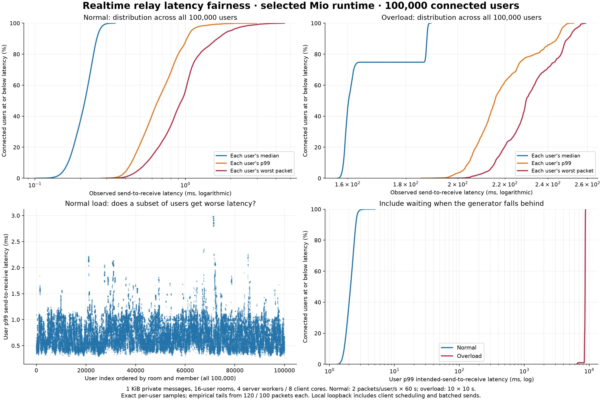
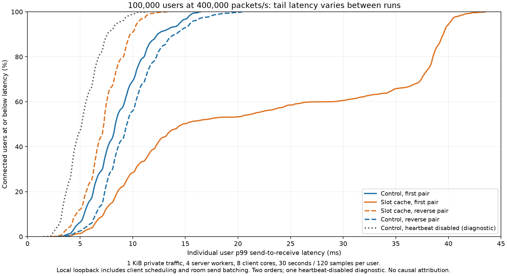
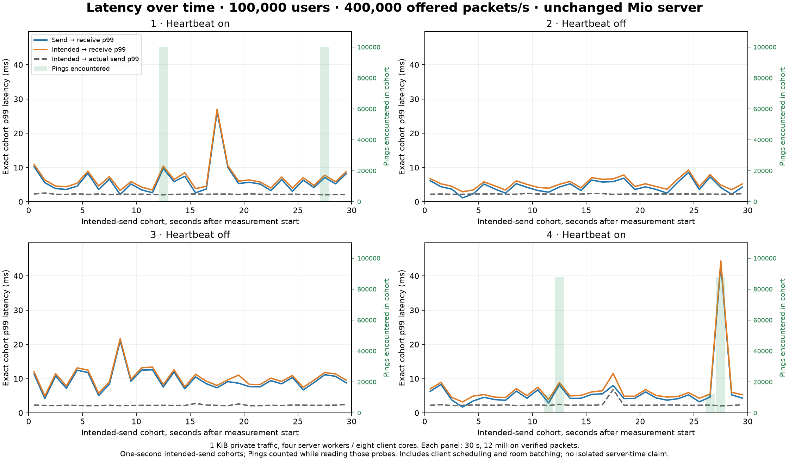

# Measured performance and resource decisions

The latest target-scale qualification is the
[short 100,000-user mixed check](benchmarks/2026-10-18-short-current-100k/README.md):
one current-source run misses the offered fanout target, and observed tails vary
substantially. It establishes neither a universal speedup nor consistently low
latency. Comparisons below preserve their dated builds; references to “current”
inside a historical section do not mean today's source. The [goal status](STATUS.md)
separates selected source from manually running executables.

The native runtime was replaced with readiness workers on 2026-10-16. The
[readiness rewrite](#readiness-runtime-rewrite-2026-10-16) records its architecture,
direct C++/old-Rust comparison, heap evidence and verification. Earlier sections
are historical measurements of the retired async native core.

The [current direct C++ comparison](#current-direct-c-comparison-2026-10-16)
refreshes both the shipped one-core and rebuilt four-worker baselines against
the selected `ceda58f` runtime. It supersedes the earlier port's performance
figures when describing the current implementation.

The [64-pair extension](#forwarding-counter-experiments-and-64-active-pairs-2026-10-16)
adds more active flows, a configurable verified client and a fresh direct
comparison. Its counter experiments are rejected; the selected relay executable
is unchanged.

## Scope

Measurements on 2026-10-15 used a Linux x86-64 host with an AMD Ryzen AI MAX+ 395,
Rust 1.91.1, release builds, four server workers, four load-client workers, and
loopback TCP without TLS. The initial read-buffer comparison disabled inbound
rates and heartbeats. The later cancellation and zero-copy comparisons disabled
inbound rates and kept heartbeats enabled. Normal service defaults retain both
protections.

Each candidate used a fresh server process. Candidate order reversed on alternate
repetitions. Candidates ran sequentially, without concurrent compilation or load
tests. The load generator prepared encoded frames outside the timed interval and
checked every delivered byte and its sequence. Latency includes client send,
network, relay, and client receive/validation time. This is not an isolated routing
kernel benchmark or a production capacity guarantee.

## Read-buffer decision

The demonstrated bottleneck was idle connection memory: eager read storage grew
with every connection. We compared 128 KiB (the library default), 16 KiB, and 4 KiB
using identical workloads. The selected default is **4 KiB**, configurable through
`--read-buffer-bytes` / `WAR_READ_BUFFER_BYTES`.

Median of three fresh-process measurements per candidate:

| Workload | 128 KiB read buffer | 16 KiB read buffer | 4 KiB read buffer |
| --- | ---: | ---: | ---: |
| 2,000 idle connections: server RSS | 270.92 MiB | 48.78 MiB | 25.25 MiB |
| 128 clients / private / 256-byte payloads | 864,244 deliveries/s | 1,065,267 deliveries/s | 1,194,581 deliveries/s |
| Private workload p99 latency | 4.03 ms | 3.73 ms | 3.83 ms |
| 32 clients / private / 64 KiB payloads | 107,572 deliveries/s | 126,875 deliveries/s | 123,945 deliveries/s |
| Large-payload workload p99 | 2.91 ms | 2.48 ms | 2.08 ms |
| 64 clients / broadcast / 256-byte payloads | 1,732,624 deliveries/s | 1,769,719 deliveries/s | 1,661,716 deliveries/s |
| Broadcast workload p99 | 0.96 ms | 0.81 ms | 0.90 ms |

Idle RSS fell **90.7%**, about **245.7 MiB** at 2,000 sockets. It excludes the load
generator and kernel socket memory. The connection count was verified against the
server metric before sampling memory. The result is consistent with avoiding
roughly 124 KiB of initial read capacity per socket plus allocator effects.

Throughput is noisier: for example, 4 KiB private/small-payload runs ranged from
882,874 to 1,323,579 deliveries/s, while the 128 KiB runs ranged from 827,950 to
1,054,653. Broadcast ranges overlap substantially. These short runs do **not**
establish a stable throughput win or loss; the firm reason for the default is
the repeatable memory reduction. Larger read buffers remain an explicit tuning
option for workloads with different frame sizes and concurrency.

Private runs used 64 pairs × 1,000 messages (256-byte payloads), or 16 pairs × 200
messages (64 KiB). Broadcast runs used one sender and 63 recipients × 500 messages.
The outstanding-message window was 16. Each successful run verified exactly
64,000, 3,200, or 31,500 deliveries respectively.

Raw records, binary hashes, host details, CPU times, and per-run metrics are in
[benchmarks/2026-10-15-nodelay-buffers.json](benchmarks/2026-10-15-nodelay-buffers.json).
The final default selection and the separate-output-budget fix came after this
comparison; both buffer candidates in the comparison used the same measured
binary and explicit configuration. The table compares configurations, not C++
against Rust or JSON against CBOR.

## Transport diagnostic

An initial measurement had approximately 41 ms p99 latency in small private
messages. The load client's default TCP settings enabled Nagle, which interacted
with the small-message pipeline. The server already set TCP_NODELAY. The harness
now sets it explicitly too; `--nagle` retains the diagnostic control.

A separate comparison used identical binaries, 4 KiB server buffers, fresh
servers, and alternating client Nagle/TCP_NODELAY order. Raw results are in
[benchmarks/2026-10-15-tcp-diagnostic.json](benchmarks/2026-10-15-tcp-diagnostic.json).
Median p99 fell from 41.30 ms to 5.22 ms in that diagnostic. This is a load-client
transport setting comparison; it is not attributed to a server routing change.
The initial Nagle-enabled records remain in
[benchmarks/2026-10-15-read-buffer.json](benchmarks/2026-10-15-read-buffer.json) for
the diagnostic trail. They are superseded for interpreting relay throughput.

## Memory and concurrency contracts

One immutable application body is shared across a broadcast's recipient queues;
its small replacement routing prefix is stored separately.
Validation does not deserialize application objects. Per-peer byte reservations
survive dequeue until the socket write finishes and release automatically on
failure, cancellation, or queue destruction. A process-wide reservation budget
also limits aggregate queue payloads; variable storage has its own aggregate cap.
Those caps are logical payload limits, not a promise about complete RSS. See
[operations.md](operations.md) for incomplete incoming frames and kernel buffers.

Routing uses one registry read lock and nonblocking queue attempts. Membership,
variable writes, and ID reassignment take its write lock. This is intentionally
simple; no sharding, alternate hash table, batching, or generated dispatch was
introduced without an observed bottleneck. Full shutdown suppresses peer
disconnect broadcasts, avoiding quadratic traffic among closing sessions.

## Reproduce

```sh
cargo build --release --bins --example load
python3 scripts/benchmark.py --buffers 131072 16384 4096 \
  --output artifacts/buffers.json
python3 scripts/benchmark.py --buffers 4096 --workloads private-256 --nagle \
  --output artifacts/nagle-control.json
```

Run other diagnostics separately from timing. The current evidence does not cover
TLS overhead, slow/lossy networks, sustained multi-hour churn, hundreds of
thousands of sockets, distributed routing, or browser rendering. It does not
confirm the upstream README's million-connection claim. Next measurements should
extend workload duration, active-connection count, and adverse-client behavior
before adding structural complexity.

The later [stability investigation](stability.md) adds a 30-second traffic run,
20-second reconnect churn, and a 12-second unread-recipient case. It records two
close-lifecycle failures and their fixes, including the measured throughput
tradeoff and the distinction between concurrent sockets and cumulative reconnects.

## Reusing cancellation waits

The close/eviction fixes initially recreated cancellation and watch futures for
every read-loop iteration and every output. A separate user-cycle profile of
`c06c37b` found `Notified` polling/dropping, waker cloning/dropping, and repeated
watch registration among the largest samples. That diagnostic is in
[close-output-profile.json](benchmarks/2026-10-15-close-output-profile.json).
It sampled user-space cycles, lost 21 samples and four chunks, and was run
separately from the comparisons; its shares are not whole-system CPU fractions.

One shutdown future and one terminal close-reason future now remain pinned for
each session. The read loop and output operations borrow those same futures.
Their completion still exits the session, and a cancelled partial write still
discards its transport. No queue, validation, timeout, or Close contract changed.
This follows Tokio's documented
[approach to resuming a pinned future](https://tokio.rs/tokio/tutorial/select).

Three rotating repetitions per binary used the same frozen verifying client,
64 clients (32 private pairs), 1,024-byte payloads, window 16, 15 seconds, four
workers per process, heartbeat enabled, and inbound rates disabled. Server
CPUs 0–3 and client CPUs 4–7 were distinct physical cores on this host. No
profiling or compilation overlapped the final comparison.

| Binary | Median deliveries/s | Range | Server CPU ns/delivery | p99 upper bucket |
| --- | ---: | ---: | ---: | ---: |
| Initial port, `1b975de` | 1,495,207 | 1,470,864–1,536,614 | 1,932 | 1.049 ms |
| Correct Close/cancellation, `c06c37b` | 1,384,284 | 1,344,703–1,398,560 | 2,135 | 1.049 ms |
| Same fixes, reusable waits | 1,623,686 | 1,586,659–1,634,250 | 1,771 | 1.049 ms |

That is **17.3% more verified deliveries/s and 17.1% less server CPU per delivery**
than the fixed-close control in this workload. CPU time includes connection
setup/teardown; throughput excludes setup. The initial release is only a
diagnostic control because it lacks the lifecycle fixes. An earlier independent
10-second comparison also reproduced the cancellation regression. Raw records,
hashes, core topology, and per-case traces are in
[reused-waits-comparison.json](benchmarks/2026-10-15-reused-waits-comparison.json)
and [close-cost-comparison.json](benchmarks/2026-10-15-close-cost-comparison.json).

Follow-up checks verified 846,758 connection lifecycles in eight seconds and
245,807 healthy deliveries alongside an unread recipient in five seconds, with
correct disconnect notification and complete cleanup. See
[reused-waits-lifecycle.json](benchmarks/2026-10-15-reused-waits-lifecycle.json).
Three 2,000-idle-socket samples per binary measured median RSS of 25.54 MiB for
the control and 26.05 MiB for reusable waits: about 0.50 MiB extra for persistent
session state. See [reused-waits-idle.json](benchmarks/2026-10-15-reused-waits-idle.json).
These remain local measurements, not a hosted capacity claim.

To compare frozen binaries with the same client:

```sh
python3 scripts/compare.py --candidate before=/path/to/before/war-relay \
  --candidate after=/path/to/after/war-relay --stress /path/to/frozen/stress \
  --repetitions 3 --seconds 15 --output artifacts/comparison.json
```

## Preserving receive storage through forwarding

Upstream's router replaces the target ID with the sender ID in its received
message. The first Rust port preserved the encoded CBOR value but copied it into
a newly encoded envelope. The WebSocket writer then copied that envelope into
its contiguous output buffer for each recipient. The native forwarding path now
preserves the application body through both stages:

1. Validate the complete received CBOR envelope using borrowed slices and a fixed
   parser stack. Consume its `Bytes` ownership when routing.
2. Encode only `[sender, ...]` into ten bytes of inline storage. Keep a shared
   view of the original encoded application value. Different CBOR integer widths
   require no body movement or protocol restriction.
3. Clone shared body ownership into recipient queues. Reservations include the
   emitted routing prefix and remain charged until writing finishes or aborts.
4. Put the WebSocket header and CBOR prefix into one 20-byte stack buffer. Write
   it and the immutable body through two `IoSlice`s, advancing through partial
   writes without assembling a contiguous payload.

The existing WebSocket library still performs the handshake, masking checks,
unmasking, fragmented-message assembly, and control parsing. The native server
wrapper owns writes sequentially, flushes pending control responses before data,
and disables application output as soon as Close, an error, or EOF is observed.
Only a completed server handshake without framing extensions can enter this
path. A cancelled or failed partial write discards that transport, as before.
The optional legacy bridge still does its necessary protocol translation.

The common native route has no newly assembled application payload buffer and
eliminates the two explicit full-value copies in private forwarding (one routing
copy plus one socket staging copy). Fanout also avoids a staging copy per
recipient. This is **user-space forwarding**, not kernel zero-copy: socket
transfers, unmasking, input-buffer growth, and fragmented-message assembly still
do their required work. No claim of zero allocations for the complete connection
or queue implementation is made.

Borrowing changes retention. Once a connection's largest observed message
exceeds its initial read buffer, shared messages smaller than one eighth of that
high-water mark are compacted once before fanout. Ordinary tiny messages share
the normal slab. Unique receive storage needs no compaction. This conservative
policy prevents a succession of tiny queued views from pinning enlarged read
slabs; it may keep copying small values after one large input. The queue budget
continues to count logical output bytes, not physical allocation capacities.

`war_routing_reused_bytes_total` and `war_routing_copied_bytes_total` expose these
two routing choices. Values are counted once before fanout, excluding relay
commands and unknown targets. Pointer-identity checks also prove that the
original body reaches every recipient queue and the vectored write unchanged.
Other checks cover CBOR integer widths, nonminimal target/array encodings,
WebSocket length boundaries, three-byte partial writes, Close/Pong ordering, and
a 70,000-byte fragmented input while the same socket receives unrelated output.

The final binary was compared with the reusable-waits control from `743c9ca`.
Each size used three alternating 10-second runs per binary, 64 clients / 32
private pairs, window 16, four workers per process, the same frozen validating
client, and distinct server/client physical cores (0–3 / 4–7). Rates were disabled
and heartbeats enabled. Neither profiling nor compilation overlapped these runs.
Traffic queues fit a whole window: the runner uses
`max(1 MiB + 10, 32 * (payload_bytes + 20))` equally for both candidates. These
are harness settings, not changes to product defaults. The unread-client test
retains its deliberate tight queue limit.

| Raw application payload | Before: median deliveries/s | Shared receive body: median deliveries/s | Before: server CPU ns/delivery | Shared body: server CPU ns/delivery | p99 upper bucket, both |
| --- | ---: | ---: | ---: | ---: | ---: |
| 1 KiB | 1,598,532 | 1,605,601 | 1,740 | 1,776 | 1.049 ms |
| 64 KiB | 199,854 | 209,143 | 16,234 | 11,784 | 4.194 ms |

The 64 KiB workload used **27.4% less server CPU per verified delivery**, with
**4.6% higher median throughput** in this comparison. At 1 KiB, throughput
changed +0.4% with overlapping run ranges, while CPU per delivery rose 2.1%.
That small-message cost remains a tradeoff; the evidence does not establish a
general small-message speed gain. CPU includes setup/teardown and is sampled at
the process level; throughput excludes setup. These results do not measure C++
versus Rust or CBOR versus another serialization format.

All six final candidate traffic runs verified every delivered byte and returned
to zero sessions, connections, queued bytes, and variable bytes (one persistent
global channel). They routed 49,331,279,504 encoded application bytes in the
1 KiB cases and 409,369,086,000 in the 64 KiB cases. The routing-copy counter was
zero throughout; the reuse counter matched the independently verified delivery
count times the encoded-value size in every run. Raw records, hashes, topology,
per-run counters, RSS, and traces are in
[zero-copy-final-small.json](benchmarks/2026-10-15-zero-copy-final-small.json) and
[zero-copy-final-large.json](benchmarks/2026-10-15-zero-copy-final-large.json).

The final lifecycle rerun completed 917,429 cumulative connection lifecycles with
64 churn workers in eight seconds. A separate five-second unread-client case
verified 259,154 healthy deliveries and exactly one disconnect notification;
the unread session was absent by the first post-overflow sample at 0.276 seconds.
All lifecycle gauges cleaned up. See
[zero-copy-final-lifecycle.json](benchmarks/2026-10-15-zero-copy-final-lifecycle.json).
These are cumulative reconnects, not that many simultaneous connections.

Three additional 2,000-idle-socket samples per binary measured median server RSS
of **26.01 MiB before and 26.88 MiB after**, a **0.86 MiB** increase for the
larger per-message metadata and transport/session state. RSS excludes the client
and kernel socket storage. Three finite fanout checks per binary each verified
all 31,500 deliveries (500 broadcasts × 63 recipients, 256-byte raw values,
window 16). The final candidate's routing-copy counter stayed zero. These short
fanout checks establish acceptance, not sustained broadcast throughput. See
[zero-copy-final-idle-fanout.json](benchmarks/2026-10-15-zero-copy-final-idle-fanout.json).

To repeat the two sizes, use the frozen-binary comparison command above with
`--payload-bytes 1024` and `--payload-bytes 65536`. Run other diagnostics and
compilation separately from each comparison. Longer fanout, mixed active/idle
populations, adverse networks, TLS, and multi-host capacity remain unmeasured.

The later [mixed-size fanout investigation](stability.md#mixed-size-fanout-and-simultaneous-peer-departure)
adds 128-client active workloads and a five-millisecond delayed reader beside an
unread peer. It distinguishes cancellation before the first write poll from
cancellation of a possibly partial frame, records the reproduced mass-departure
reset and its fix, and includes a repeated small-message cost check.
## Retention under repeated unknown-target primers

The `retention` example exercises backing-storage lifetime through real sockets.
Eight 1 MiB values first reach an unread recipient with a 64 KiB requested TCP
receive buffer. The sender then alternates a prebuilt 4 MiB message to an unknown
ID, a tiny value to that recipient, and a verified self-message barrier. The
barrier proves that preceding input was processed while output remains blocked.
After a two-second hold, the client reads and compares every queued frame and
finishes both Close handshakes.

Six sequential fresh four-worker release servers ran the cycle counts in order
64, 256, 256, 64, 64, 256. Rates and heartbeats were disabled, the write deadline
was 60 seconds, message queues allowed 1,024 entries, and the default 4 KiB read
and 32 MiB per-peer byte budgets remained in effect. Server-only RSS and metrics
were sampled about every 50 ms. All compilation and other socket workloads
finished before these measurements. The production compaction policy was
unchanged.

| Metric per run | 64 primers | 256 primers |
| --- | ---: | ---: |
| Large unknown-target input, approximately | 256 MiB | 1 GiB |
| Median sampled peak server RSS | 15,828 KiB | 15,920 KiB |
| Sampled peak RSS range | 15,696–15,872 KiB | 15,900–15,932 KiB |
| Held logical output bytes | 6,292,291 | 6,294,596 |
| Encoded value bytes reused | 8,388,648 | 8,388,648 |
| Encoded value bytes compacted | 211 | 981 |
| Verified data/barrier deliveries | 137 | 521 |

All six cases passed delivery/order checks, both Close handshakes, exact
incoming/delivery/value-byte counter totals, and cleanup to zero connections,
sessions, queued bytes, and variables with only the global channel remaining.
Protocol, transport, write, Close, overflow, and global-pressure error counters
were zero. The large unknown-target values produce no output reservations or
routing-byte counts. Compaction counts include the tiny queued values and
self-message barriers; large forwarded bodies retain shared storage.

Quadrupling the primer count changed the median sampled peak by 92 KiB in this
workload. This supports retaining the existing sharing/compaction policy. It is
a finite retention check, not a leak proof or a production capacity estimate.
Post-cleanup RSS ranged from 5.63 to 11.55 MiB; these observations do not identify
which allocator/runtime allocations account for that remaining storage. Logical
queue bytes and process RSS measure different things.

Reproduce with the commands in the README. Raw phases, samples, source and
executable hashes are in
[retention-pressure.json](benchmarks/2026-10-15-retention-pressure.json).
The recorded revision is the parent checkout before committing; source hashes
identify the measured implementation.

## Concurrent producers, connected idle storage, and retirement

The extended retention client starts synchronized producers feeding one unread
recipient. Each producer's sequence is checked independently; the relay does
not promise a cross-producer total order. The same 4 MiB unknown-target primers,
tiny private values, and self-message barriers exercise enlarged receive storage
while six MiB of initial output remains blocked. After complete drain, the client
observes open connections for two seconds, finishes client-initiated or expected
server-idle Close handshakes, then observes retirement for another two seconds.

Six initial cases used 64 cycles per producer, in order 1, 8, 32, 32, 8, 1.
They retained the default 32 MiB per-peer byte budget and used
`max(1024, producers * cycles + 32)` queue entries. Rates/heartbeats were disabled
and writes had a 60-second deadline. With application-idle expiry disabled, all
sessions remained joined during the connected-idle observation:

| Producers | Primer payload per run | Connected-idle RSS range | Tiny value bytes compacted |
| --- | ---: | ---: | ---: |
| 1 | 256 MiB | 15,716–15,720 KiB | 211 |
| 8 | 2 GiB | 38,592–44,644 KiB | 1,681 |
| 32 | 8 GiB | 137,476–143,540 KiB | 6,721 |

Each case reused 8,388,648 encoded large-value bytes. Empty output queues did not
return open connections to their initial read capacity. RSS is not an exact
allocation trace, but source inspection and the retirement observations support
budgeting enlarged input capacity separately from output reservations. The
configured 4 KiB read size is an initial size; incoming-size and admission limits
remain important for active populations.

The same six cases with a three-second application idle policy passed every
delivery, ordering, counter, and cleanup check. They observed exactly 2, 9, or 33
idle decisions and clean server-initiated handshakes. After the scheduling change
described below, final 1- and 32-producer reruns also passed. A further final case
used 64 producers, 32 cycles each, and 65 transports: all 4,105 data/barrier
deliveries and all 65 idle Close handshakes verified. It reused 8,388,648 encoded
large-value bytes and compacted 5,249 tiny bytes. Sampled RSS was 269,212 KiB
before acknowledgement and 6,560 KiB after retirement. All fifteen cases returned
to zero connections, sessions, queued bytes, and variables with the global
channel remaining; unexpected transport, write, Close, overflow, and pressure
counters were zero.

These finite observations are not a leak proof or a physical-memory cap. Published
shared bodies can outlive their source transport until recipients finish/discard
them. Application-idle retirement releases inactive sessions; active populations
still need input-size/admission budgeting and process RSS monitoring. See the
README and operations guide for the optional policy, disabled by default.

Raw records: [concurrent-retention.json](benchmarks/2026-10-15-concurrent-retention.json),
[concurrent-idle-expiry.json](benchmarks/2026-10-15-concurrent-idle-expiry.json),
[idle-final-retention.json](benchmarks/2026-10-15-idle-final-retention.json), and
[idle-final-64-producers.json](benchmarks/2026-10-15-idle-final-64-producers.json).
The first two identify the `c39d90e` implementation; the latter two identify the
final executable by hash. Parent revision fields predate their commits.

## Application-idle scheduling cost

The first idle-policy implementation reused one heartbeat/idle deadline wait,
but reset it whenever application activity moved the idle deadline later. Three
rotating twenty-second cases per configuration reproduced a cost relative to
the new disabled default. Separate user-cycle profiles attributed 8.38% of the
enabled profile to `tokio::time::sleep::Sleep::reset`.

The final implementation keeps an already earlier alarm when activity postpones
the deadline. When that alarm completes, it checks the current absolute deadline
and rearms before another poll; an earlier heartbeat deadline still retimes the
wait immediately. This preserves the deadline without a coarse periodic idle
check or per-message retiming. Application payload ownership and vectored writes
are unchanged. The final enabled profile no longer listed `Sleep::reset` among
symbols at or above the 0.5% reporting threshold.

The final comparison used four rotating twenty-second runs per candidate: fresh
four-worker servers, the same frozen 64-client/32-private-pair workload, 1 KiB
values, window 16, server CPUs 0–3, and client CPUs 4–7. Every candidate occupied
each run position once. Rates were disabled and heartbeats enabled, so each run
crossed the default first heartbeat. No compilation or profiling overlapped the
comparison, and relay workloads ran sequentially.

| Configuration | Median verified deliveries/s | Median server CPU ns/delivery | p99 histogram upper bound |
| --- | ---: | ---: | ---: |
| `14b9529` control | 1,610,854 | 1,780 | 1.049 ms |
| Initial enabled policy (`c39d90e`, 300 s) | 1,583,148 | 1,812 | 1.049 ms |
| Final, idle policy disabled | 1,701,361 | 1,689 | 1.049 ms |
| Final, idle policy enabled (300 s) | 1,606,449 | 1,776 | 1.049 ms |

All sixteen cases passed full frame verification and cleanup; routed copy counts
were zero. The same frozen private-traffic client drops its 64 socket handles at
the end instead of performing Close handshakes, so every comparison case records
64 expected transport disconnects. No protocol/write/Close-handshake error was
recorded. These comparisons establish data throughput and cleanup; graceful
Close acceptance comes from the separate retention, Rust-network, and JS cases.
CPU totals include that identical setup/teardown in every candidate.

Delayed rearming reduced median CPU per delivery by 2.0% and raised
median throughput by 1.5% versus the initial enabled implementation. Those
throughput ranges overlap; the modest local change is not a general speed claim.
The final disabled default measured 5.6% higher throughput and 5.1% less CPU per
delivery than the control. Enabling activity tracking still cost 5.6% throughput
and 5.2% CPU versus that new disabled default; it stayed close to the original
control's throughput/CPU with the same p99 bucket. Raw run ranges and positional
variation are retained rather than attributing every difference to one function.

The initial comparison/profile are
[application-idle-cost.json](benchmarks/2026-10-15-application-idle-cost.json) and
[application-idle-profile.json](benchmarks/2026-10-15-application-idle-profile.json).
Final records are [idle-final-cost.json](benchmarks/2026-10-15-idle-final-cost.json)
and [idle-final-profile.json](benchmarks/2026-10-15-idle-final-profile.json).
Profiles used `perf record`, user-space cycles at 199 Hz, DWARF call graphs,
twelve-second recording windows, and ten seconds of the same verifying traffic.
They were collected separately from timing; their percentages are sampled user
cycles, not shares of total server CPU. Recorder logs are preserved, and raw
`perf.data`/text reports remain local under `artifacts/profiles/`.
## Active decoder storage baseline, 2026-10-15

Fresh frozen-server measurements reproduced persistent input storage with empty
queues and application-idle expiry disabled. After 64 four-MiB unknown-target
primers per source, 32 still-connected producers retained roughly 134 MiB RSS;
closing the sockets reduced it to roughly 6 MiB. One- and eight-producer cases
also passed all delivery, sequence, Close, counter and cleanup checks. The raw
records are `benchmarks/2026-10-15-active-input-baseline.json` and
`benchmarks/2026-10-15-active-input-baseline-phases.json`. These are observed RSS
values, not an accounting of exact live allocations or an input-memory cap.

The retention client now emits `closing` before initiating its Close handshakes.
The sampler drains phase events before and after reading metrics/process state,
labels observations spanning a phase change as `transition`, and excludes those
observations from stable holding/idle/retired ranges. This fixes a reproduced
false failure in an experimental run, where already-closing sockets were still
classified as connected idle. It retains the full observations and phase names
in the record. Repeated `--server-arg=ARG` options now support explicit policy
comparisons; the complete server command remains in each case.

## Retiring unused decoder storage, 2026-10-15

The native relay now schedules receive-storage reclamation after five seconds
without a completed binary message larger than `max(64 KiB, initial read size)`.
It shares the existing pinned heartbeat/idle deadline wait. Large recurring input
postpones the operation, preserving buffer reuse during a burst. Small-message
traffic does not read an extra clock for this policy. Zero disables it.

The decoder exposes one narrow safe operation through `tungstenite` and its
Tokio wrapper. It replaces unused input storage only between frames and only
after the normal parser proves any remaining bytes are an incomplete header.
It can copy at most thirteen header bytes; it never copies a published body.
Busy input defers the attempt. Fragment assembly and control state stay in the
existing decoder. Successful reclamation also lowers the connection's routing
watermark so later tiny values can share its normal slab again. The complete
three-file patch, original package checksums/commits, license attribution, and a
file-by-file source audit are in [vendor](../vendor/README.md).

An exploratory eager reset at each empty read increased allocation churn and
allocator-retained RSS for small populations. It was discarded. The delayed
policy keeps reuse during the measured primer bursts and retires the unused
storage afterward. It is a memory-lifetime improvement with measured tradeoffs,
rather than a claim that dropping an allocation always returns its pages.

### Matched connected-idle observations

The control and candidate use the same frozen verifying retention client,
64 cycles of four-MiB unknown-target primers per producer, eight one-MiB output
fillers, and a six-second idle observation after all deliveries drain. Each case
uses a fresh four-worker process, disabled heartbeat/rates/application-idle Close,
the same 4 KiB initial read setting, and the existing output budgets. Producer
order varies across repetitions. Source/binary hashes are in
[read-buffer-idle-build.json](benchmarks/2026-10-15-read-buffer-idle-build.json).

This table uses each run's **last connected-idle sample**, with all connections
still present and queues empty. Values are medians of three runs per binary;
complete ranges and every observation remain in the
[summary](benchmarks/2026-10-15-read-buffer-idle-summary.json) and its referenced
control/default retention records.

| Producers, plus one receiver | Control RSS | New default RSS | Change |
| --- | ---: | ---: | ---: |
| 1 | 9.55 MiB | 11.41 MiB | No stable RSS gain; ranges overlap and allocator variation dominates |
| 8 | 37.76 MiB | 11.57 MiB | 69.4% lower |
| 32 | 140.24 MiB | 12.02 MiB | 91.4% lower |

All eighteen cases passed exact data/order, backpressure, counter, Close and
cleanup checks. Each enabled run completed exactly one reset per producer,
copied zero wire-header bytes, and reported zero deferred resets. At one
producer, the control range was 9.54–15.36 MiB and the candidate range was
5.52–11.42 MiB; the higher candidate median is retained explicitly. Freed
storage and process RSS are different quantities.

A separate disabled-policy 32-producer run retained 143,592 KiB with zero
resets, consistent with the control. A 64-producer/65-connection pair, using
32 cycles each to cap primer payload at eight GiB, passed all 4,105 data/barrier
deliveries and all 65 clean Close handshakes. The enabled process's last
connected-idle sample was 12,732 KiB versus 269,236 KiB for the control; all
65 sockets remained connected. Sampled peak RSS was effectively unchanged at about
275,284/275,292 KiB. Reclamation acts after input is no longer needed; it does
not reduce the demonstrated peak needed to process concurrent large frames.
Those individual records are [default at 64 producers](benchmarks/2026-10-15-read-buffer-idle-default-64-producers.json),
[control at 64 producers](benchmarks/2026-10-15-read-buffer-idle-control-64-producers.json),
and [disabled at 32 producers](benchmarks/2026-10-15-read-buffer-idle-disabled-32-producers.json).

### Traffic cost and ordinary idle connections

The same frozen traffic generator ran 64 clients as 32 private pairs, window 16,
four server workers on CPUs 0–3 and the client on CPUs 4–7. Candidate order
rotated; timed runs did not overlap compilation, profiles, or other workloads.
Each received frame was verified. The following are process-run medians:

| Payload | Binary/configuration | Deliveries/s | Server CPU ns/delivery | p99 bucket upper bound |
| --- | --- | ---: | ---: | ---: |
| 1 KiB | Control | 1,727,933 | 1,687 | 1.049 ms |
| 1 KiB | New default | 1,732,999 | 1,683 | 1.049 ms |
| 1 KiB | New binary, policy disabled | 1,727,633 | 1,687 | 1.049 ms |
| 64 KiB | Control | 205,060 | 11,917 | 4.194 ms |
| 64 KiB | New default | 198,605 | 12,226 | 4.194 ms |
| 64 KiB | New binary, policy disabled | 199,938 | 12,226 | 4.194 ms |

All twelve twenty-second 1 KiB runs and nine fifteen-second 64 KiB runs passed.
Throughput ranges overlap. No general CPU/throughput gain is claimed. The 64 KiB
candidate measured 2.6% more CPU per delivery and 3.1% less median throughput
than the control. The disabled new binary showed a similar CPU cost, so these
measurements do not isolate that difference to active reclamation. Some early
large-message cases occupied the 8.389 ms p99 bucket; the table retains the
median bucket and the raw per-run variation remains available.

Body-compaction counters stayed zero in every traffic case. These continuous
workloads keep postponing the storage deadline; actual resets and correctness
across them are established separately by the retention and socket regressions.
The frozen traffic generator deliberately drops its 64 socket handles after
timing. Every run recorded 64 combined abrupt read/write departures; one large
control run recorded 63 read-side disconnects plus one write error, first visible
after timed samples ended. Protocol errors, write timeouts and Close failures
were zero, and all resource gauges cleaned up. This traffic teardown is not a
graceful-Close acceptance check.

Raw records and full traces are
[small traffic](benchmarks/2026-10-15-read-buffer-idle-cost.json) and
[large traffic](benchmarks/2026-10-15-read-buffer-idle-large-cost.json).
Three alternating 2,000-socket idle trials per binary, with one fixed load
client, measured median server RSS increases of 22,692 KiB for the control and
22,712 KiB for the candidate: 20 KiB more. No storage reset occurred because
these clients sent no large input. This is a two-second idle-state measurement,
not a high-active-population or production-capacity claim. The raw record is
[small connections](benchmarks/2026-10-15-read-buffer-idle-small-connections.json).

### Scope and final acceptance

The public-API regressions verify release of the decoder's shared owner without
moving the published payload, all fourteen masked header splits, deferred partial
payloads and a buffered small frame. Native socket regressions verify continued
routing without later tiny-body compaction, a pending frame across the deadline,
and fragmented-message assembly with Ping/Pong across reclamation. All 52 Rust
checks, strict Clippy, seven real-socket JS cases, the new 61-file codec source
audit, and the original C++ comparison passed locally. The C++ comparison still
passes 46 common cases plus its eight explicit differences.

The refreshed local release actually reclaimed its decoder storage after an
observed 5.008 seconds while both clients stayed connected. A subsequent typed
private value preserved bytes and an exact uint64 with zero additional routed
body copies. Both clients completed code-1000 closes. A fresh Chrome run passed
seven bundled-client checks, and three live legacy/Close checks passed. Health
and readiness returned 200, and final connection/session/queue/variable gauges
and error counters were clean. Exact process hashes and evidence are in
[read-buffer-idle-live.json](benchmarks/2026-10-15-read-buffer-idle-live.json).

This releases unused decoder ownership. It does not impose a process-wide input
allocation budget, free incomplete messages, or guarantee the allocator returns
pages. The following iteration adds reservations before decoder growth;
connection/input limits and actual RSS still matter.

## Admission before decoder growth

The next measured problem was simultaneous incomplete input. The decoder reserves
the advertised frame length before the body finishes arriving, and fragmented
messages have a separate assembly buffer. Delayed cache reclamation cannot
prevent those allocations. A 64-source baseline advertised 8 MiB frames and
supplied only 2 MiB to each; all were admitted. Three fresh processes held
148–149 MiB RSS while an independent healthy session continued to echo data.

The selected implementation adds a shared **1 GiB staging allowance**, adjustable
with `--total-read-buffer-bytes` (`0` disables). A connection reserves before its
bounded HTTP upgrade; frame and fragment growth then acquire separate high-water
leases before allocating. Twice the requested capacity covers old/new staging
overlap. Large frame capacity includes one configured read chunk of read-ahead.
Ordinary reads within the high water perform no shared-budget atomics or new
guard allocations. Reclamation shrinks unused allowances; transport drop or
cancellation releases them. Published `Bytes` keep their original owners and
pointers and require separate consumer budgets. This is not an RSS cap.

An exploratory exact-capacity implementation passed correctness but increased
64 KiB server CPU per delivery by 9.1% in the first three-way comparison. A
userspace cycle profile identified the reader as a hot path; source inspection
suggested exact frame boundaries lost reusable storage for the next header.
Keeping one bounded read chunk recovered the cost in a second whole-socket
comparison. This is a source-supported explanation, not a syscall/allocation
count measurement. Both experimental binaries and all raw records are retained.

The second comparison rotated three candidates across all positions, three
fresh-process repetitions each, 15 seconds per run, 64 clients forming 32 private
pairs, a window of 16, and 64 KiB payloads. Four server workers used CPUs 0–3;
the fixed verifying client used CPUs 4–7. Rates were disabled and heartbeats
enabled. CPU includes setup/teardown; latency is a fixed-histogram upper bound.

| 64 KiB candidate | Median verified deliveries/s | Median server ns/delivery | Median p99 upper bound |
| --- | ---: | ---: | ---: |
| Prior server (`bf8d2e9`) | 201,967 | 12,131 | 4.194304 ms |
| Exploratory exact capacity | 206,765 | 13,593 | 4.194304 ms |
| Selected charged read-ahead | 205,480 | 11,867 | 4.194304 ms |

The selected version used 12.7% less CPU per delivery than exact capacity and
2.2% less than the prior server, with 1.7% higher throughput than the prior
server. These are small local differences against the prior server, not a
general speed guarantee. The reason for admission is bounded staging growth.
Every frame was verified, routed-value compaction stayed zero, and the selected
and exploratory final staging reservations were zero in every run. The frozen
traffic client intentionally drops its 64 socket handles after timing: these
transport departures do not establish graceful-Close acceptance.

Sources, release hashes, original package checksums and the complete codec patch
are bound in [input-budget-build.json](benchmarks/2026-10-15-input-budget-build.json).
The [initial 64 KiB comparison](benchmarks/2026-10-15-input-budget-traffic-64k.json),
[reader profile](benchmarks/2026-10-15-input-budget-profile.json) and
[selected comparison](benchmarks/2026-10-15-input-budget-read-ahead-64k.json)
include raw evidence or links to their complete traces. Original package
verification covers all 62 vendored files plus the declared patch.

The final small-message comparison used the same fixed client, affinity, window,
duration and alternating candidate order, three repetitions per server. At 1 KiB,
median throughput was 1,685,370/s before and 1,698,247/s after admission; server
CPU was 1,716 versus 1,690 ns per verified delivery, with the same 1.048576 ms
p99 bound. These sub-2% differences support retaining the bounded policy without
a broad throughput claim. Every delivered value was checked, compaction stayed
zero and all final staging/queue/session gauges were zero. Full traces are in
[the selected 1 KiB comparison](benchmarks/2026-10-15-input-budget-read-ahead-1k.json).

Admission has a standing-memory cost. Three alternating fresh-process pairs with
2,000 idle joined sockets measured median RSS deltas of 22,704 KiB before and
23,644 KiB after: **940 KiB more**, approximately 0.46 KiB per session on this
host. Staging reservations were exactly 16,384,000 bytes with no refusals. These
idle samples verify the active population; the idle runner does not separately
sample final cleanup.

Three alternating ten-second churn pairs used 64 workers and the same fixed
verifying client. Each lifecycle joins, verifies one self-routed counter and its
Close handshake. Every run passed with zero final staging/queue/session/connection
gauges and no protocol, handshake, write, Close or admission errors. Churn rate
ranges overlap substantially, so they establish correct sustained admission and
cleanup rather than a stable speed improvement. The full populations, CPU and
memory records are in [input-budget-resources.json](benchmarks/2026-10-15-input-budget-resources.json).

Nine final incomplete-input cases used the selected release and the same frozen
client. Three alternating control/limited pairs joined 64 source channels plus
one independent healthy client, advertised masked 8 MiB frames, supplied only
2 MiB per admitted source, and held for two seconds. The healthy client verified
1 KiB self echoes throughout. Admitted incomplete sockets intentionally dropped
TCP; two ordinary sessions verified normal Close and a new join/route after
the reservations released. All connection/session/queue/variable/staging gauges
returned to zero, with the persistent global channel remaining.

| Incomplete-input configuration | Admitted / refused sources | Held RSS |
| --- | ---: | ---: |
| Prior server, three runs | 64 / 0 | Median 148.22 MiB; range 143.87–156.38 MiB |
| Selected, 24 MiB staging allowance, three runs | 1 / 63 (`1013`) | Median 8.14 MiB; range 8.12–8.17 MiB |
| Selected default 1 GiB allowance, one run | 63 / 1 (`1013`) | 151.94 MiB |
| Selected admission disabled, one run | 64 / 0 | 149.81 MiB |

The tight allowance reduced median held RSS by **94.5% in this configured
workload**. The default admits most of this cohort and does not establish a
general RSS reduction; staging headroom and RSS measure different quantities.
An additional single-source case filled its exact 16,793,600-byte allowance,
kept the independent healthy client routing, verified HTTP `503` for another
handshake, and admitted a new client after release. All nine cases verified
post-release routing, two normal Close handshakes, exact expected incomplete
TCP-drop counts and zero protocol/write/Close errors. Refused incomplete frames
verify the received Close code, not a full acknowledgement exchange.

The selected release also passed an eight-producer retention/reclamation check
with 64 cycles of 4 MiB primers per producer. Every ordered data item/barrier and
all nine Close handshakes were verified. Last connected-idle RSS was about
11.66 MiB after the default five-second reset; final staging allowance was zero.
This retains shared application ownership while separating admission from cache
retirement. The [summary](benchmarks/2026-10-15-input-budget-summary.json) binds
every pressure source record and its hash; the
[retention record](benchmarks/2026-10-15-input-budget-retention.json) includes all
phases and final metrics. These are finite plaintext loopback checks, not a
production capacity or multi-hour stability claim.

The selected native and bridge releases also passed the 46-common-case/eight-
explicit-difference [original C++ comparison](benchmarks/2026-10-15-input-budget-reference.json),
all 60 Rust checks and seven JavaScript socket cases. After a subsequent host
reboot, runtime source/release hashes still matched their saved manifest. The
local services and headed Chrome were restarted, and Rust/Clippy/format/vendor
checks, seven Chrome checks, three live legacy/Close checks and a shared-routing
reclamation check passed again. The latter shrank staging from 8,405,022 to
16,384 bytes after 5.022 seconds while both sessions remained connected;
subsequent typed routing added no body copies. Both completed normal Close and
final staging/connection/session/queue/variable gauges were zero. Health and
readiness returned 200. [Live evidence](benchmarks/2026-10-15-input-budget-live.json)
records exact process hashes, the browser report, and the post-reboot boundary;
performance results were collected before the reboot.

## Fragment assembly capacity and repeated pressure, 2026-10-16

The next real-socket regression was a complete 4 MiB CBOR message split into a
3 MiB first fragment and a final 1 MiB continuation. Under a 16 MiB staging
allowance, the previous release (`8ab12a0`) returned `1013 Input Memory Limit`.
The frame storage and necessary 4 MiB assembly fit; geometric assembly growth
requested 6 MiB, which made the conservative twice-capacity allowances exceed
the budget. The failure also occurred with the normal 16 MiB message ceiling.
The [control record](benchmarks/2026-10-16-fragment-final-control-tight.json)
expects and verifies that refusal; its passing status describes the reproduction,
not acceptance of a valid message.

Budgeted assembly now bounds intermediate geometric growth by the configured
message ceiling. When a final fragment needs growth, it allocates the now-known
complete length. Thus the example grows assembly to 4 MiB, including with a
larger configured ceiling. Existing sufficient capacity stays in place; the
decoder does not shrink or copy a completed payload. Actual-length validation
still precedes admission, and the unmetered path retains upstream allocation
behavior. Binary and text assembly use the same bounds, including tiny limits
and UTF-8 characters split between fragments. The
[fixed release check](benchmarks/2026-10-16-fragment-final-after.json) completes
the message with a peak staging allowance of 14,696,448 bytes and zero refusals.

Three alternating fresh-process pairs compared the prior and final servers with
the same frozen client binary. Eight sources each sent three verified 4 MiB
messages, each as masked 3 MiB/1 MiB fragments, under a 256 MiB staging allowance
and a 16 MiB message ceiling. Interleaved Ping/Pong proved first-fragment
assembly before completion. An independent session verified 1 KiB echoes every
20 ms, including during assembly and retirement. Each wave waited two seconds
for the explicitly configured one-second decoder reset, then a fresh client
joined, self-routed and completed normal Close. Four server workers used
plaintext loopback; runs were sequential, without concurrent compilation.

| Eight-source, three-wave result | Prior release | Final release |
| --- | ---: | ---: |
| Verified fragmented messages per run | 24 | 24 |
| Peak staging allowance, all three runs | 144.0703 MiB | 112.0703 MiB |
| Median sampled peak server RSS | 90.08 MiB | 77.50 MiB |
| Sampled peak RSS range | 79.39–90.13 MiB | 62.36–81.46 MiB |
| Connected allowance after every reset | 72 KiB | 72 KiB |
| Verified normal Close handshakes per run | 12 | 12 |

The allowance reduction is exactly **32 MiB, or 22.2%**, for this workload.
Median sampled peak RSS was 14.0% lower, with substantial host/allocator
variation; RSS was sampled about every 50 ms and is a separate measure from
staging allowance. Healthy maximum round trips ranged from 0.30 to 1.07 ms
across both candidates. These short spaced-message runs establish verified
concurrent progress and storage behavior, not a CPU, throughput or production
latency improvement. Every run returned final staging/connection/session/queue/
variable gauges to zero, retained only the persistent global channel, and had
zero protocol/write/Close/transport/admission errors. The encoded CBOR value was
checked byte for byte and routed-body compaction stayed zero. Required WebSocket
unmasking and fragment assembly are outside that routing-copy metric.

Additional final-release cases use the same 16 MiB message ceiling:

- **64 sources plus the healthy session**, three waves of 1 MiB messages:
  all 192 messages completed. Each wave returned to 532,480 bytes of connected
  allowance (65 × 8 KiB); final allowance was zero.
- **Default five-second retirement**, two 4 MiB waves under a 16 MiB staging
  allowance: both completed, both resets occurred, and the two connected
  sessions returned to 16 KiB before final Close.
- **Retirement disabled**: all 24 messages completed and the expected
  117,514,240-byte high water remained between waves. There were no decoder
  resets; transport retirement released the entire allowance.
- **Admission disabled**: all 24 messages completed with allowance gauges zero;
  all 24 scheduled decoder resets still occurred.
- **64 KiB and 64 KiB + 1 byte**, split after one byte: both 16-message cases
  completed. The exact threshold caused zero resets; one byte above caused
  all 16, returning to the 72 KiB connected allowance after each wave.
- The separate **64-source incomplete-frame** check still admitted exactly one
  8 MiB advertised frame under a 24 MiB staging allowance and refused 63 with
  `1013`, while healthy routing and later admission stayed verified. Its admitted
  unfinished transport intentionally drops TCP; ordinary Close is verified
  separately.

The [final summary](benchmarks/2026-10-16-fragment-final-summary.json) binds every
final comparison and pressure trace by hash, including per-wave observations and
exact counters. The [build manifest](benchmarks/2026-10-16-fragment-final-build.json)
binds the source files, original package provenance, complete vendor patch,
release binaries and unchanged verifying client. Earlier `fragment-cap`,
`fragment-limit` and `fragment-wave` records preserve an exploratory change that
only capped growth at the configured ceiling. Its
[remaining below-ceiling failure](benchmarks/2026-10-16-fragment-final-before.json)
motivated passing the existing final-fragment flag to assembly; those earlier
records are not measurements of the final implementation.

Reproduce the workload with `cargo build --release --bins --example fragment_waves`
and `python3 scripts/fragment-waves.py --max-message-bytes 16777216 --output
artifacts/fragment-waves.json`. The benchmark overrides the reset interval to
one second; the ordinary server default remains five seconds. See the README
for the larger cohort and disabled-reset variants.

## Scheduling during empty-fragment input, 2026-10-16

Message size and staging admission do not bound the work done before a
fragmented message completes. A valid message can contain many empty masked
continuations. The decoder previously parsed until a complete message or actual
I/O blocking, while Tokio's I/O budget counted reads rather than frames. A
single ready socket could therefore delay unrelated routing and management
requests, especially with larger configured read chunks. This was reproduced
against `9ddd0ee` before changing the parser.

The decoder now exposes a bounded step using its existing parsing loop.
`read_with_frame_limit(NonZeroUsize)` returns `Ok(None)` when its frame quota is
exhausted without a message. The asynchronous wrapper explicitly wakes itself
and returns `Pending`; buffered input can then resume without waiting for a new
network event. Native and legacy server sockets enable **256 frames per poll**.
The library default and ordinary synchronous `read()` remain unlimited. No wire
validation, message/rate limit, payload owner or ordering changes. The hook
allocates no new payload buffer and carries incomplete UTF-8/control state and
admission leases across yields and cancelled read futures.

This provides scheduling opportunities rather than a time deadline. A single
frame can still require its normal body validation, unmasking and assembly;
the quota also does not cap a connection's total CPU use. Tokio's
[runtime fairness contract](https://docs.rs/tokio/latest/tokio/runtime/index.html#detailed-runtime-behavior)
requires bounded task polls and does not promise a particular scheduling order.
The measured latency below is specific to the workload and host.

Three alternating fresh-process pairs used one worker on CPU 0 and the identical
independent Python client on CPUs 4–7. Four source sockets each completed eight
small CBOR messages containing two million empty continuations apiece:
**64 million valid empty continuations and 32 verified messages per run**.
Each message's encoded value included a checked wave counter. A separate socket
verified 1 KiB self echoes about every millisecond, and management latency was
sampled approximately every 10 ms. All five sockets completed normal Close.
Rates, heartbeats and application idle were disabled; message/staging defaults
remained enabled. Preparation preceded timing; no compilation or competing
benchmark ran alongside a measured case.

| Read chunk / observation | Prior release | Bounded parsing |
| --- | ---: | ---: |
| 4 KiB: median of each run's maximum healthy RTT | 10.662 ms | 0.871 ms |
| 4 KiB: range of maximum healthy RTTs | 9.471–11.140 ms | 0.831–0.910 ms |
| 4 KiB: median of maximum management RTTs | 18.059 ms | 1.583 ms |
| 128 KiB: median of maximum healthy RTTs | 322.164 ms | 0.864 ms |
| 128 KiB: range of maximum healthy RTTs | 215.464–324.853 ms | 0.859–1.067 ms |
| 128 KiB: median of maximum management RTTs | 364.034 ms | 1.468 ms |

With 4 KiB reads the prior server completed 272–301 healthy probes during each
burst; bounded parsing completed 1,395–1,401. With 128 KiB reads those populations
were 20–24 versus 1,390–1,417. The prior larger-buffer runs have too few healthy
observations for a robust percentile claim, so the table reports per-run maxima.
Median server CPU increased from 1.73 to 1.76 seconds with 4 KiB reads and from
1.70 to 1.73 seconds with 128 KiB reads, about **1.7–1.8% more**. CPU is sampled
from `/proc` at 10 ms resolution. This is a measured scheduling/CPU tradeoff for
fragment-heavy input, not a throughput improvement.

Every fragment workload verified exact incoming message/byte totals, join and
delivery counts, delivered byte totals, normal Close and final resource release.
Staging reservations, sessions, connections, queued and variable bytes returned
to zero with the persistent global channel remaining. Protocol, write, timeout,
Close, transport and admission errors were zero, and routed-body compaction was
zero. The three new Rust checks additionally prove self-wakeup with entirely
buffered input, state preservation when pending read futures are dropped,
split UTF-8 with interleaved Ping/Pong, and terminal protocol-error behavior.

A separate four-worker pair on CPUs 0–3 used 16 sources, eight messages each and
two million empty continuations per message (256 million continuations per run).
Maximum healthy RTT was 9.230 versus 0.499 ms with 4 KiB reads, and 294.970 versus
0.797 ms with 128 KiB reads. All 128 messages and 17 normal Close handshakes were
verified in each case. These are single pairs supporting the repeated
single-worker finding, not a larger-population or production latency bound.

Ordinary complete-message cost was checked with three alternating 15-second
pairs per payload, four server workers on CPUs 0–3, and the same frozen Rust
traffic client on CPUs 4–7. Sixty-four peers formed 32 private pairs with a
window of 16; every encoded value and its order were verified.

| Complete-message workload | Prior deliveries/s | Bounded deliveries/s | Prior server ns/delivery | Bounded server ns/delivery |
| --- | ---: | ---: | ---: | ---: |
| 1 KiB, medians | 1,777,326 | 1,779,085 | 1,605 | 1,614 |
| 64 KiB, medians | 211,040 | 208,921 | 11,407 | 11,426 |

The 1 KiB CPU median increased 0.53% and the 64 KiB median increased 0.17%;
throughput changed +0.10% and −1.00%, within overlapping ranges. The p99 upper
bounds remained 1.048576 and 4.194304 ms respectively. These results support
retaining the scheduling change without claiming a general traffic speed gain.
All final resource gauges were zero, compaction stayed zero, and the frozen
client's 64 intentional TCP departures were accounted for in every run.

The final release also passed two 4 MiB fragmented waves under a tight 16 MiB
staging allowance and the ordinary five-second reset, plus 64-producer/one-healthy
session reclamation across three 1 MiB waves. All 192 larger-cohort messages,
68 normal Close handshakes and three returns to the expected 532,480-byte
connected allowance were verified. The original C++ comparison now additionally
checks binary and split-UTF-8 text with 1,024 empty continuations: all 48 common
cases and eight explicit differences passed. Those added cases exercise the
legacy server's quota as well as preserving the original wire behavior.

The [build manifest](benchmarks/2026-10-16-fairness-build.json) binds original
package provenance, the full codec patch, source/release/client hashes, exact
verifier source and test evidence. The
[summary](benchmarks/2026-10-16-fairness-summary.json) binds all comparison traces
and ordinary traffic checks. The traffic verifier intentionally drops its socket
handles at timing end; those records account for every expected TCP departure
and establish delivery/ordering and cleanup. Normal Close is verified separately
by the fragment workload and compatibility checks. An initial driver preflight
incorrectly expected graceful teardown from that frozen traffic client; its
record and correction are retained.

Reproduce the finite probe with `python3 scripts/fragment-fairness.py --workers 1
--output artifacts/fragment-fairness.json`. Its default is 500,000 empty
continuations per message; the comparison used `--fragments 2000000 --cycles 8`.
Affinity is optional and requires an appropriate Linux CPU set. These checks
do not establish production latency, multi-hour stability or cluster capacity.

## Cost check for pre-join rejection reporting, 2026-10-16

Native pre-join decoder failures now share the joined-session Close mapping and
increment `war_join_rejected_total` once per rejection. The counter is global,
with no labels or per-connection storage; successful packet processing has no
new counter update. Body validation and shared forwarding storage are unchanged.
The behavioral reproduction and independent corpus are described in
[stability.md](stability.md#rejections-before-join-and-mixed-input-2026-10-16).

Three alternating fresh-process pairs per payload checked ordinary traffic
against `9f39159`: four server workers on CPUs 0–3, the same frozen verifying
client on CPUs 4–7, 64 peers/32 pairs, window 16, ten seconds per run. Every value
and order were checked. Server CPU includes setup and teardown; latency
percentiles are fixed-histogram upper bounds.

| Payload / median | Prior release | Rejection reporting |
| --- | ---: | ---: |
| 1 KiB deliveries/s | 1,789,088 | 1,777,778 |
| 1 KiB server ns/delivery | 1,593 | 1,597 |
| 64 KiB deliveries/s | 199,861 | 199,851 |
| 64 KiB server ns/delivery | 11,766 | 11,623 |

Throughput medians changed −0.63% and −0.005%; CPU changed +0.21% and −1.21%.
The 1 KiB p99 bound stayed 1.048576 ms. The 64 KiB bounds ranged from 4.194304
to 8.388608 ms before and were 4.194304 ms after. These overlapping local runs
support retaining the diagnostic fix without a general speed or latency claim.
All twelve cases verified expected resource release and the frozen client's
64 intentional TCP departures per run, with zero new join rejections, protocol,
timeout, Close or admission errors and zero routed-body compaction. They do not
verify graceful Close; the input corpus and compatibility cases do so separately.

The selected release also passed the existing 64-source incomplete-frame check
under a 24 MiB staging allowance: one source was admitted, 63 received `1013`,
healthy routing and later admission remained verified, and all final staging/
queue/session/connection/variable gauges were zero. Its admitted incomplete
transport intentionally drops TCP. The
[summary](benchmarks/2026-10-16-input-rejection-summary.json) binds the corpus,
traffic, pressure and acceptance records; the
[manifest](benchmarks/2026-10-16-input-rejection-build.json) binds source, package,
patch and fixed-client hashes. This is finite plaintext loopback evidence.

## Cost check for optional browser-origin admission, 2026-10-16

The shared policy borrows configured strings and parsed HTTP header bytes once
per upgrade. There is no URL parsing or allocation in its acceptance check and
no new per-message work. An empty list preserves unrestricted admission; an
enabled list compares at most 64 exact origins. Denial builds a small fixed HTTP
response and updates native rejection counters. Native application-body storage,
queue ownership and vectored writes are unchanged. The optional bridge also
reuses the existing bounded HTTP reader; its post-upgrade translation path and
16 MiB data-message ceiling remain intact.

All comparisons use the same newly frozen verifying client, sending the same
`Origin: https://app.example` to both the prior `1c3a603` release and the new
release. Fresh four-worker relays run sequentially on CPUs 0–3, with the client
on CPUs 4–7. Each churn iteration joins, verifies its monotonic self-message and
finishes Close before reconnecting. Its latency measures connection through
verified self-delivery; Close follows that timing interval. CPU includes setup
and teardown, sampled at the host's 10 ms tick resolution. Percentiles are fixed
histogram upper bounds. Incoming rate limits are disabled for the workload;
the incoming-message ceiling is 1 MiB. Heartbeats, the 4 KiB initial read buffer,
five-second decoder retirement and 1 GiB staging admission retain their defaults.

Three five-second repetitions per arm measured 64 independent churn workers.
The 64-entry list places the match last, exercising the bounded linear scan:

| Five-second churn / median | Lifecycles/s | Server ns/lifecycle | p99 upper ms |
| --- | ---: | ---: | ---: |
| Prior release | 110,642 | 17,301 | 2.097152 |
| New, unrestricted | 105,268 | 17,250 | 2.097152 |
| New, one allowed origin | 110,106 | 17,354 | 2.097152 |
| New, 64 allowed origins | 110,157 | 17,519 | 2.097152 |

The enabled one/64-entry arms used +0.31%/+1.26% median server CPU per lifecycle
against that control. The unrestricted arm's throughput median was 4.86% lower
despite similar CPU cost and overlapping ranges, so it received a longer check:
four ten-second repetitions per build, alternating order. Those medians were
108,275 versus 108,148 lifecycles/s (−0.12%) and 17,462 versus 17,479 server
ns/lifecycle (+0.09%), with the same 2.097152 ms p99 bound and overlapping ranges.
The initial spread remains in the record; it is not attributed to the policy.

Three four-second traffic pairs checked 64 peers/32 private-routing pairs,
1 KiB values and a 16-message window. Every complete encoded value and its
order were verified. Throughput medians were 1,719,050 versus 1,707,154
deliveries/s (−0.69%); server CPU was 1,627 versus 1,622 ns/delivery (−0.28%).
The p99 bound stayed 1.048576 ms. This is a cost guard, with no speed improvement
or production capacity claim.

All 26 cases passed exact join/departure counts and resource/error checks:
15,148,001 complete churn lifecycles and 41,517,392 ordinary traffic deliveries.
No application values were compacted in these workloads. Churn verifies Close;
the traffic generator intentionally drops 64 TCP handles at its deadline, and
each traffic case accounts for exactly those transport/write departures.
Sessions, connections, queued/variable bytes and decoder reservations end at
zero, leaving the persistent global channel. Unexpected rejection, protocol,
Close, timeout and pressure counters are zero.

The [short comparison](benchmarks/2026-10-16-origin-cost.json) and
[longer confirmation](benchmarks/2026-10-16-origin-churn-confirm.json) retain raw
samples, commands, client/release digests and per-case checks. The
[summary](benchmarks/2026-10-16-origin-summary.json) and
[manifest](benchmarks/2026-10-16-origin-build.json) bind them to source and live
acceptance. For a fresh enabled-policy workload, build the stress example and
run `python3 scripts/stability.py --modes churn --churn-secs 10 --origin
https://app.example --allowed-origin https://app.example --output
artifacts/origin-churn.json`. Other browser engines, TLS/proxies, adversarial
Origin admission rates, legacy CPU cost and larger/longer deployments remain
unmeasured.

## ID registry capacity after population waves, 2026-10-16

Two global clients routed more slowly after 8,192 peers in separate rooms had
joined and departed. An initial unchanged-release run measured 1,444 versus
1,686 server ns per verified delivery before/after the wave. The ID ownership
map retained its large table, and `values()` kept visiting empty buckets, as
described by the [standard-library iteration contract](https://doc.rust-lang.org/std/collections/struct.HashMap.html#method.iter).
The transient rooms were empty and removed; global membership stayed at two.
Thus this global broadcast path isolated the ID index's history from departure
fanout and room membership scans.

A separate `cycles:u`/DWARF profile attributed 23.97% of sampled user cycles to
`Relay::receive`. Its annotated SIMD empty-control-byte group loop accounted
for about 61.4% of that function, or 14.7% of sampled user cycles. The source
path, workload and instructions identify the ID-map scan. The selected profile
reduces `Relay::receive` to 7.91%. Each profile has 2,250 samples and no lost
samples. Profiled timings are diagnostic and excluded from timing comparisons;
the reports and annotations are retained with digests of the local binary data.

The shared retirement helper checks only maps above 256 capacity and no more
than one-eighth occupied, then shrinks with room for twice the remaining IDs.
This hysteresis keeps ordinary small churn from allocating replacement tables.
It runs under the existing write lock after session removal or occupied-ID
takeover. It moves keys and `Arc` handles; peers, queues and shared application
bodies retain their addresses. There is no additional per-message check,
allocation, body movement, timer, background sweep or operator setting.

The departure-only prototype recovered routing cost but missed takeover-driven
retirement while displaced registrations were still alive. A failing 1,024-owner
regression demonstrated the gap, and the selected helper covers both paths.
Prototype records and its frozen source/binary remain distinct from the final
comparison. The [stability checks](stability.md#id-registry-lifetime-across-large-populations-2026-10-16)
cover delayed cleanup, stable payload pointers and healthy concurrent routing.

The final comparison uses three fresh processes per build, reversing order on
the second repetition. Relays use four workers on CPUs 0–3, with one frozen
client on CPUs 4–7. The same two global clients stay connected through three
8,192-peer waves per process. Transient peers use distinct ordinary rooms and
verify exact normal Close and EOF. Three-second traffic phases precede the first
wave and follow every wave: 64 prebuilt 1 KiB values, 16-message windows, every
encoded sender/value and FIFO position checked. Stdin gates separate filling,
draining and traffic; native CPU includes boundary management sampling at the
host's 10 ms tick resolution. Incoming rates and heartbeats are disabled in this
probe, with default message/storage admission policies retained.

Post-wave values below are medians of each process's three-wave median, then
medians across its three processes. Fresh phases remain separate:

| Median / two global clients | Prior `241a172` | Selected |
| --- | ---: | ---: |
| Fresh deliveries/s | 449,174 | 446,403 |
| Fresh server ns/delivery | 1,440 | 1,449 |
| After waves, deliveries/s | 416,192 | 447,340 |
| After waves, server ns/delivery | 1,638 | 1,464 |
| After waves, p99 upper bucket | 0.032768 ms | 0.032768 ms |
| Fill one 8,192-peer wave, server CPU | 0.16 s | 0.16 s |
| Drain one wave, server CPU | 0.09 s | 0.09 s |

The selected post-wave workload uses **10.64% less server CPU per delivery**
with **7.48% higher throughput**. Fresh CPU differs by +0.62%. Repeated regrowth
and draining stay in the same measured CPU bins; this does not claim that
rehashing is free. It allocates metadata and briefly holds the write lock.
Map hash seeds/IDs vary across processes. This comparison verifies 31,309,200
deliveries and 147,468 normal Close handshakes, with exact counters, zero body
compaction and complete final resource release in all six processes.

Eighteen separate four-second cost runs check ordinary 64-client traffic and
churn with the same frozen stress client. At 1 KiB, median throughput differs
by +0.81% and CPU/delivery by −0.40%, with p99 at 1.048576 ms in both builds.
Churn differs by +0.07% throughput and +0.12% CPU/lifecycle, with p99 at 2.097152 ms.
The short 64 KiB comparison had a higher median p99 bucket in the selected build,
so four ten-second alternating pairs followed. Those throughput medians are
205,511 versus 202,278 deliveries/s (−1.57%) and CPU is 11,530 versus 11,561
ns/delivery (+0.27%), with overlapping ranges and the same 4.194304 ms median
p99 bound. One selected long run has the 8.388608 ms bucket; all raw results
are retained. These guards support a scoped improvement after population waves,
not a general ordinary-traffic speed or latency improvement.

All 26 cost runs pass exact counts, error/resource checks and zero routed-value
compaction. Traffic deliberately drops 64 TCP handles at its deadline; every
departure is accounted for. Churn and the population probe separately verify
normal Close. The quiescent local runtime was updated after validation; a live
1,024-peer wave preserves typed global delivery, and all 1,026 peers close
cleanly. Fresh browser/legacy checks and default decoder reclamation also pass.

The [final comparison](benchmarks/2026-10-16-registry-peak-final-comparison.json),
[ordinary cost guard](benchmarks/2026-10-16-registry-cost.json),
[long large-frame confirmation](benchmarks/2026-10-16-registry-large-confirm.json),
[summary](benchmarks/2026-10-16-registry-summary.json), and
[manifest](benchmarks/2026-10-16-registry-build.json) bind traces and sources.
Reproduce with `cargo build --release --bins --example registry_peak`, then
`python3 scripts/registry-peak.py --waves 3 --peak-clients 8192 --seconds 3
--output artifacts/registry-peak.json`. The benchmark requires its harness gates.
Channel/membership-table capacity, mass departure within one room, much larger
active fanout, multi-hour behavior and deployed TLS/network paths remain outside
this optimization. Event-boundary RSS does not measure continuous peak RSS,
and freeing ID buckets does not imply that the allocator returns pages to the OS.

## Membership index capacity after room departures, 2026-10-16

The ID-index change did not cover ordinary room membership or the global
membership index scanned during private delivery. An initial 4,096-peer room
case showed little CPU change; its record is retained. At 8,192 transient peers,
an unprofiled ordinary-room run rose from 1,457 to 1,688 native ns/delivery after
departure. Private global-index delivery rose from 1,476 to 1,714 ns/delivery.
A separate profile put `Relay::receive` at 26.24% of user cycles, dominated by
its empty-bucket group scan. These observations preceded runtime changes.

One typed helper now trims sparse `u64 -> Arc<Peer>` ownership and membership
indexes. The prior thresholds remain: capacity above 256, occupancy at most one
eighth, and room for twice the remaining entries. Empty ordinary rooms retire
directly; the persistent global room keeps its variables. Only keys and `Arc`
handles move. Peer, queue, variable and published-payload storage stays intact,
with no additional per-message check, allocation or body movement. Rehashing
allocates metadata under the existing write lock; regrowth can allocate again.
The [stability regression](stability.md#membership-lifetime-during-room-departures-2026-10-16)
first fails on retained capacity, then checks pointers, held reservations,
administrative events, later delivery and both variable lifetimes.

The final comparison uses three fresh processes per build/scope, reversing order
on the second repetition. Four-worker relays use CPUs 0–3 and the same frozen
client uses 4–7. The two original peers stay connected through 8,192 transient
members in the same room. `room` measures ordinary broadcast; `private` measures
private delivery with both survivors in the global room and zero listener flags,
isolating its index scan from extra listener fanout. Three-second traffic phases
use 64 prebuilt 1 KiB values and 16-message windows. Every full encoded value,
sender, frame and FIFO position is checked. Stdin gates exclude filling/draining
from routing CPU. Rates/heartbeats are disabled, with storage/queue defaults
retained. CPU includes boundary management sampling at 10 ms tick resolution;
percentiles are fixed-histogram upper bounds. Hash seeds/key positions vary.

Every remaining peer verifies each disconnect ID and its exact FIFO prefix.
Sixteen-close windows wait for all readers, preserving default 64-message queues
and all notifications. Each process checks 33,566,720 departure deliveries and
normal Close/EOF. This is paced departure, not unpaced simultaneous closure.

| Post-departure median | Prior `3963138` | Selected |
| --- | ---: | ---: |
| Ordinary room deliveries/s | 403,031 | 440,729 |
| Ordinary room server ns/delivery | 1,696 | 1,488 |
| Ordinary room p99 upper bucket | 0.065536 ms | 0.032768 ms |
| Global-index private deliveries/s | 409,571 | 434,403 |
| Global-index private server ns/delivery | 1,636 | 1,494 |
| Global-index private p99 upper bucket | 0.065536 ms | 0.032768 ms |

Post-wave room CPU improves **12.28%** with **9.35% higher throughput**; private
CPU improves **8.68%** with **6.06% higher throughput**. Fresh CPU differs by
−0.64%/+1.44% respectively; fresh private p99 also differs by one bucket.
Filling CPU medians remain 0.16–0.17 seconds. Draining uses about 89 native
CPU-seconds per wave, dominated by preserved quadratic notifications and kept
separate from steady routing. These data support the post-wave improvement,
without a free-rehash or general ordinary-traffic speed claim.

All twelve processes verify 30,873,216 application deliveries, 402,800,640 exact
disconnect deliveries and 98,328 normal Close handshakes, with exact counts/bytes,
zero routed-body compaction and complete resource release. The selected profile
puts `Relay::receive` at 9.78% of user cycles. Control/selected profiles have
2,209/2,220 samples and zero lost samples; profiled timings are excluded.
The prior global-ID probe also passes three further waves in separate rooms.

Eighteen four-second ordinary cost cases use 64 clients and a frozen stress
client. Throughput/CPU medians differ by −0.98%/+0.23% at 1 KiB, −0.02%/−0.71%
at 64 KiB and −0.79%/+1.07% for churn. Ranges overlap, with matching p99 buckets
at 1.048576, 4.194304 and 2.097152 ms. Counts, departures, zero compaction and
cleanup pass. Traffic deliberately drops 64 TCP handles per case; churn and the
population probe separately verify normal Close. Live ordinary/global-room
waves verify 1,051,648 disconnects, 130 typed messages during/after departure,
2,052 clean closes and zero additional body copies. Variables survive retirement,
and ordinary variables release normally. Fresh Chrome/legacy/reclamation pass.

The [comparison](benchmarks/2026-10-16-member-comparison.json),
[ordinary guard](benchmarks/2026-10-16-member-cost.json),
[live record](benchmarks/2026-10-16-member-live.json),
[summary](benchmarks/2026-10-16-member-summary.json), and
[manifest](benchmarks/2026-10-16-member-build.json) bind commands and sources.
Build `cargo build --release --bins --example registry_peak`, then run
`python3 scripts/registry-peak.py --scope room --peak-clients 8192 --seconds 3
--output artifacts/member-room.json`. Use `--scope private` for the global
membership path; `--scope global` retains the separate-room probe. The following
section measures channel-name table costs. Larger active application fanout,
unpaced departure, long duration, TLS/proxies and clusters remain unmeasured.
Event-boundary RSS is not continuous
peak RSS; metadata trimming does not guarantee OS page return or cap process RSS.

## Channel-name capacity after room waves, 2026-10-16

After ownership and membership reclamation, the native channel-name map still
retained spare buckets from retired ordinary rooms. Both authenticated CBOR
channel queries and management inspection iterate this map. The first release
socket probe at 8,192 temporary rooms records fresh/post-wave query CPU of
1,945/2,054 ns and throughput of 474,278/444,151 queries/s. Every reply and all
management snapshots pass; this exploratory run is excluded from final medians.

A separate user-cycle profile includes the channel-name empty-bucket loop in
`Relay::receive` (inlined control handling). This is consistent with the
[standard-library iteration contract](https://doc.rust-lang.org/std/collections/struct.HashMap.html#method.iter),
which visits empty buckets as well as occupied entries. The profile identifies
the scan rather than establishing its full CPU cost or a general bottleneck.
The control has 2,138 samples and the selected recording 2,135, both with zero
lost samples; their `Relay::receive` shares are 8.36%/6.92%. Profiled timings are
diagnostic and excluded from performance comparisons.

The existing sparse-map policy is now generic over the registry's key/value
types and also runs after removal of an empty ordinary room. Capacity must be
over 256 and at least eight times the remaining length before shrinking, with
twice the remaining length retained as growth headroom. Rehashing moves channel
descriptors and handles; name/variable bytes, peer objects, queues and published
bodies keep their existing storage. Normal application messages and inspections
add no trimming check. Rehashing allocates metadata under the existing write
lock; another room wave can grow it again. This is not an RSS cap or an OS
page-return guarantee.

The frozen `registry_peak` client adds `--scope channels`: two original clients
stay in `re_globl` while 8,192 temporary peers join distinct ordinary rooms.
After authentication it sends channel queries in 16-message windows, comparing
every complete response with independent literal CBOR. An authenticated HTTP
snapshot at each gate independently verifies every field and base64 sort order,
including the 8,193-entry peak and the final empty global room. These snapshots
sit outside traffic CPU intervals. Queues keep their default 64-message limit.
Every connection checks its exact normal Close acknowledgement and EOF.

Three fresh processes per build keep those clients through two population waves.
Order reverses for repetition two; four-worker servers use CPUs 0–3 and the same
frozen client uses 4–7. Each phase lasts four seconds. Take the median of each
process's two post-wave phases, then the median across the three processes:

| Measurement | `c2278cf` control | Selected |
| --- | ---: | ---: |
| Fresh query CPU, ns/reply | 1,958 | 1,975 |
| Fresh replies/s | 471,130 | 468,278 |
| Post-wave query CPU, ns/reply | 2,047 | 1,951 |
| Post-wave replies/s | 442,038 | 470,346 |
| Post-wave p99 upper bucket, ms | 0.065536 | 0.032768 |
| Filling CPU, seconds for two waves | 0.34 | 0.34 |
| Draining CPU, seconds for two waves | 0.19 | 0.19 |

Post-wave CPU improves **4.71%**, throughput **6.40%**. Per-process post-wave
CPU ranges are 1,983–2,123 ns for control and 1,950–1,955 ns selected; throughput
ranges are 426,209–460,162 and 467,858–471,317 replies/s. Fresh CPU is +0.88%,
with the same 0.032768 ms p99 bucket. Preparation CPU includes gated management
inspection and is separate from routing/query timing. The result supports
query recovery after room waves, without a general traffic or capacity claim.

All six processes verify **33,165,328 queries and 98,316 normal Close/EOF
handshakes**, exact incoming/delivered counts and bytes, zero routing reuse/copy
counters for control queries, and final zero resource/error gauges. Three more
separate-room waves pass the prior global-routing probe. Eighteen ordinary cost
cases use the same frozen stress client across 1 KiB, 64 KiB and connection churn.
CPU medians differ by +0.56%, +0.19% and +0.13%; throughput by +0.77%, +0.18% and
−2.90%, with overlapping ranges and the same p99 buckets (1.048576, 4.194304 and
2.097152 ms). Native CPU covers socket setup through final transport cleanup,
excluding process shutdown. Every native process separately exits zero without
a forced kill. Traffic deliberately drops 64 TCP handles per case; churn checks
normal Close. No general ordinary-traffic speedup is attributed to this change.

The stability runner formerly ignored service exit status. A calibration wrapper
completes actual churn, forwards termination, waits for a native exit zero and
then deliberately exits 7. The old runner falsely passes; the corrected runner
rejects it after waiting, with exit status and shutdown logs retained. A separate
diagnostic verifier initially rejected `perf`'s expected SIGINT return after an
intentional stop. That rejected recording is preserved and excluded from
timings; a fresh completed recording passes after accepting only exit zero or
the deliberately sent SIGINT. The timed runner snapshot remains frozen.

The [comparison](benchmarks/2026-10-16-channel-comparison.json),
[ordinary guard](benchmarks/2026-10-16-channel-cost.json),
[live record](benchmarks/2026-10-16-channel-live.json),
[summary](benchmarks/2026-10-16-channel-summary.json), and
[manifest](benchmarks/2026-10-16-channel-build.json) bind commands and sources.
Build `cargo build --locked --release --bins --example registry_peak`, then run
`python3 scripts/registry-peak.py --scope channels --peak-clients 8192 --waves 2
--seconds 4 --output artifacts/channel-peak.json`. The runner provisions disposable
loopback-only benchmark credentials. Final timing cases use the frozen timed
runner; the current runner differs only in diagnostic `perf` stop handling.
Management inspection is functionally verified, not separately benchmarked.
Large active inspection/lock contention, unpaced departure, multi-hour operation,
TLS/proxies and clustered routing remain unmeasured. RSS samples are event-boundary
observations, not continuous peaks or an allocation census.

## Concurrent channel inspection, 2026-10-16

The next measured workload keeps 8,192 single-member rooms connected, plus two
private pairs and eight reconnect workers in distinct fixed rooms. Two optional
inspectors each request the full channel list every 10 ms. The first control
measurements show HTTP inspection reducing healthy throughput from about 569k
to 395k deliveries/s and increasing the p99 upper bucket from 0.131072 to
1.048576 ms. This is an exploratory observation, separate from the final matrix.

Both inspection paths held the registry read lock while sorting and encoding;
HTTP also formatted UTF-8/base64 under it. Waiting membership writers can then
delay other registry readers. The selected implementation captures coherent
bounded names and counts, releases the lock, then formats/sorts/encodes the
response. Inline names avoid per-name reference counts. CBOR captures only the
member counts it returns; HTTP also captures variable usage. It copies small
inspection metadata without changing application-body ownership or routing.

An initial shared-`Bytes` snapshot improved HTTP results but added CBOR CPU
cost. Separate user-cycle diagnostics found sorting and shared-name cloning;
that motivated the narrower inline representation. The initial prototype,
exploration and profiles remain recorded, and are excluded from the final
timing medians. Profiles identify sampled work, not a complete attribution of
lock-wait time.

Final medians use three fresh processes per build/mode, eight measured seconds
each, with mode order rotated and build order reversed on repetition two.
The four-worker server uses CPUs 0–3; the same frozen four-worker client uses
4–7. Setup, exact quiescent snapshots and cleanup are gated outside timing.
Each inspector verifies all names, counts and ordering; HTTP also verifies all
metadata fields. Binary, NUL and Unicode names are included. Every private
message checks its full 1 KiB value, sender and FIFO order in 16-message windows.
Every reconnect checks welcome, counter self-delivery, exact normal Close and
EOF. Queues retain their defaults; inbound rates and heartbeats are disabled.

| Concurrent inspection | Healthy deliveries/s, control → selected | Reconnects/s, control → selected | Healthy p99 upper bucket, ms | Reconnect p99 upper bucket, ms |
| --- | ---: | ---: | ---: | ---: |
| None | 535,030 → 533,004 | 53,597 → 52,853 | 0.131072 → 0.131072 | 1.048576 → 1.048576 |
| Authenticated CBOR, 200 queries/s | 495,409 → 529,973 | 49,617 → 52,764 | 0.262144 → 0.131072 | 1.048576 → 1.048576 |
| Authenticated HTTP, 200 queries/s | 401,109 → 472,039 | 35,259 → 39,016 | 1.048576 → 0.262144 | 4.194304 → 2.097152 |

CBOR inspection allows **6.98% more healthy deliveries and 6.34% more
reconnects**; HTTP allows **17.68% and 10.66% more** respectively. With no timed
inspection, throughput differs by −0.38%/−1.39%, with overlapping ranges and
unchanged p99 buckets. These are improvements under this concurrent inspection
workload, not general forwarding gains. All inspection cases complete exactly
1,600 timed queries per process. CBOR inspection p50 changes from 2.097152 to
1.048576 ms; its p99 remains 2.097152 ms. HTTP inspection p50/p99 stay in the
8.388608 ms bucket. Healthy HTTP-case p50 worsens from 0.032768 to 0.065536 ms,
despite the p99 improvement. Latencies include client validation and competing
client tasks; the percentile figures are logarithmic bucket upper bounds.

Server CPU for all concurrent work changes from 16.11 to 15.74 seconds without
inspection, 15.69 to 16.73 with CBOR, and 15.12 to 16.65 with HTTP. The latter
increases accompany more completed application work and cannot be interpreted
as isolated CPU per message or per inspection. Snapshot allocation and sorting
still scale with the full list; the change adds no cache or pagination.

All eighteen processes verify **71,136,608 healthy deliveries, 6,832,194
reconnect lifecycles, 19,200 timed inspections and 6,979,734 normal closes**.
Exact input/output counts and bytes pass, routed application-body compaction
stays zero, all final resource/error gauges clear, and every client/server exits
zero without forced killing. RSS is sampled at gates rather than continuously.

The [final comparison](benchmarks/2026-10-16-inspection-final-comparison.json)
contains medians, ranges, hashes and links to every raw trace. The
[initial shared-name prototype](benchmarks/2026-10-16-inspection-comparison.json)
is a separate candidate. The frozen timed client predates the later C++ protocol
adapter; its original source and runner are preserved under
`artifacts/clients/inspection`. Build `cargo build --locked --release --bins
--example inspection`, then run `python3 scripts/inspection.py --mode http
--output artifacts/inspection.json`; use `--mode cbor` or `--mode none` for the
companion workloads. These finite plaintext loopback results do not establish
TLS/proxy behavior, multi-hour stability or cluster capacity.

An [ordinary traffic/churn guard](benchmarks/2026-10-16-inspection-cost.json)
runs eighteen more fresh four-second cases with 64 clients. At 1 KiB, throughput
is +0.81% and CPU per delivery +0.08%; churn throughput is −3.74% and CPU
decreases 2.34%. Both retain their p99 upper buckets. The first 64 KiB
comparison records throughput −4.18%, CPU +2.47% and a worse p99 upper bucket
(4.194304→8.388608 ms). A separately recorded
[six-case follow-up](benchmarks/2026-10-16-inspection-large-cost-followup.json)
uses the identical 64 KiB workload and alternating order: throughput is +3.99%,
CPU −2.88%, with both p99 buckets at 8.388608 ms. Ranges overlap in both sets;
the initial adverse observations remain recorded. These short guards do not
establish a consistent ordinary large-message gain or loss. They support the
inspection-specific result without a general forwarding-speed claim. All
twenty-four guards verify every application value, exact joins/departures, zero routed-body
compaction, cleanup and process exit. Traffic deliberately drops 64 TCP handles
per case; churn separately verifies normal Close. Guard CPU includes setup and
final transport cleanup, excluding service shutdown.

## Direct C++ comparison, 2026-10-16

The inspection optimization above compares two Rust builds. A separate direct
comparison now runs the upstream shipped C++ executable (`app`, SHA-256
`ce95e4dea01a4db0e5c32942d5520b5f4a8ab1c87affdcd8120bc8aefa332547`)
from upstream revision `881c8daaf2cf05adea8f522b28cf372e8f82d4e9` against the
selected native Rust release. C++ uses the original binary protocol; Rust uses
CBOR. Both receive identical encoded byte-string values (1,024 application
bytes, 1,027 value bytes). C++ treats them as opaque; Rust validates CBOR. This
compares complete implementations and protocols, not language overhead alone.

One frozen four-worker load client contains small adapters for join, welcome,
authentication, routing, queries and departures. Private traffic uses the same
two pairs, 64 cyclic templates and 16-message windows as the inspection probe.
Both servers hold 8,192 other single-member rooms. Full values/senders/order,
every normal Close/EOF, authenticated query names/counts, and variable setup are
checked. Each process is fresh in a private network namespace; dependencies and
executable checksums are pinned. C++ build flags are unknown; it uses the shipped
executable with isolated OpenSSL 1.1/TBB dependencies rather than a fresh tuned
source build. Original source/history are retained.

Three eight-second repetitions per implementation/case rotate case order and
reverse implementation order on repetition two. Both servers are pinned to CPU
0 for the first matrix; Rust uses one worker. The second allows CPUs 0–3 for
both and gives Rust four workers. The unchanged C++ process settles at three
total threads in this environment; Rust has two/five respectively. A separate
line-buffered startup diagnostic records 31 failed listener binds and one
listening socket. Consequently the four-core allowance does not turn the
shipped C++ executable into a four-loop baseline. We record
observed CPU use rather than assuming the C++ source's hardware-concurrency loop
results in equivalent active parallelism. The client uses separate cores 4–7.
Setup/cleanup are gated outside timing. No builds, profiles or other load tests
overlap these measurements; rates/heartbeats are off and Rust queues are default.

| One-core workload | C++ healthy deliveries/s | Rust healthy deliveries/s | C++ reconnects/s | Rust reconnects/s |
| --- | ---: | ---: | ---: | ---: |
| Private only | 742,524 | 583,047 | — | — |
| Private + eight reconnect workers | 257,120 | 396,667 | 9,224 | 15,779 |
| Private + 200 channel queries/s | 674,045 | 511,033 | — | — |

C++ private throughput is higher: Rust is 21.48% lower in the private-only case
and 24.18% lower with queries. Private-only native CPU is 902 versus 1,228
ns/verified delivery (median of per-process ratios). Healthy private p99 is in
the same 0.065536 ms upper bucket. With churn, Rust completes 54.27% more healthy
deliveries and 71.07% more lifecycles; healthy p99 is 0.131072 versus 1.048576 ms.
Both reconnect p99s are 2.097152 ms. Both query cases complete all requested
inspections with 4.194304 ms query p99.

| Four-core allowance | C++ healthy deliveries/s | Rust healthy deliveries/s | C++ reconnects/s | Rust reconnects/s |
| --- | ---: | ---: | ---: | ---: |
| Private only | 734,305 | 602,004 | — | — |
| Private + eight reconnect workers | 255,090 | 550,759 | 9,185 | 57,783 |
| Private + 200 channel queries/s | 670,793 | 626,215 | — | — |

Rust is 18.02% lower for private-only throughput and 6.65% lower with queries.
Private-only per-process CPU medians are 914/1,443 ns per verified delivery for
C++/Rust. In the churn case Rust completes 2.16× the healthy traffic and 6.29×
the reconnects, using 2.132 server CPU-seconds per wall-second versus 0.850.
Healthy churn p99 is 0.131072 versus 1.048576 ms; reconnect p99 is 1.048576 versus
2.097152 ms. Query p99 is 4.194304 ms for Rust and 2.097152 ms for C++; both
complete exactly 1,600 timed queries per process. These are separate concurrent
workloads; the differences across rows do not establish a causal effect of
enabling queries on private throughput. Client CPU remains below its four-core
allowance. Raw records contain ranges and both processes' CPU use.

At the ready gate with roughly 8,200 connected sockets, median RSS is about
**19.7 MiB for C++ and 101 MiB for Rust** in both matrices. This is roughly a
fivefold Rust memory cost at this population, despite shared application bodies.
During churn C++ grows to about 33.4 MiB; Rust stays near 101–102 MiB. These are
event-boundary RSS samples, not continuous peaks or an allocation census, and
include each server's dependencies and operational features. The results identify
private-forwarding CPU and idle connection memory as concrete follow-up targets;
they do not support a general Rust-over-C++ performance claim.

C++ delays retired members/variables until its 30-second GC; the short churn
case verifies the exact retained member count in each fixed churn room before
that first collection. Rust removes those members immediately and verifies
zero final reservations/resources. Queries run without churn so both channel
lists have the same membership; C++ ordering is normalized only on the client,
while Rust's documented order is checked. The full mixed HTTP management case
has no original C++ counterpart. GC pauses, long-duration behavior, TLS, larger
fanout and a rebuilt/tuned multicore C++ executable remain outside this comparison.

All **36 cases** pass, checking **158,383,904 healthy deliveries, 2,197,118
reconnect lifecycles, 19,200 timed inspections and 2,492,234 normal closes**.
Rust exact metrics/bytes and zero body-compaction/resource/error gauges pass.
All clients and Rust servers exit zero without forced killing; C++ stops with
its expected SIGTERM status because it has no graceful process signal handler.
The [one-core matrix](benchmarks/2026-10-16-cpp-one-core.json) and
[four-core matrix](benchmarks/2026-10-16-cpp-four-core.json) link every raw trace,
binary/source hash, loaded-library checksum, observed thread count and command.
Reproduce using the commands in the [README](../README.md#verify-and-measure).

### Rebuilt four-worker C++ source

The shipped artifact's failed listener binds make it unsuitable for judging
multicore C++ scaling. A second baseline compiles the preserved `relay.cpp` and
uWS sources with the upstream build script's `-O3 -march=native -mrdrnd
-fomit-frame-pointer -std=c++1z` flags, using Clang 23.1.1 and current system
OpenSSL/TBB/libuv/zlib. A temporary source copy changes only the worker-count
expression to the constant four, matching Rust's four workers and CPU allowance.
Production/upstream files are unchanged. Every fresh C++ process is checked for
four listening sockets and six total threads before the client starts. Rust
uses its normal Cargo release build; these compiler/library configurations are
recorded, not treated as an isolated language comparison.

Three fresh eight-second repetitions per build/case use the same frozen client
and application work, rotating private/query order and reversing build order in
repetition two. Both use CPUs 0–3, the client 4–7. Final medians and ranges:

| Measurement | Rebuilt C++, four workers | Rust CBOR, four workers |
| --- | ---: | ---: |
| Private deliveries/s | 1,110,733 | 615,940 |
| Private throughput range | 1,106,959–1,114,843 | 599,497–619,511 |
| Private p99 upper bucket, ms | 0.065536 | 0.131072 |
| Private server CPU, ns/verified delivery | 1,074 | 1,449 |
| Private ready RSS, MiB | 20.49 | 101.10 |
| Healthy deliveries/s with 200 channel queries/s | 686,055 | 630,576 |
| Query-case healthy throughput range | 681,759–1,085,770 | 627,520–636,578 |
| Query p99 upper bucket, ms | 4.194304 | 2.097152 |

C++ private throughput is **1.80× Rust's**; Rust is 44.55% lower. Private server
CPU per delivery is 34.93% higher for Rust, while its ready RSS is about 4.93×.
The query case has substantial C++ run-to-run variation, so the 686k median must
be read with its 682k–1,086k range. Rust is 8.09% below that median and has a lower
query p99 bucket in this matrix. Work placement among C++ reuse-port listeners
was not controlled or measured per thread; the data do not isolate the reason
for the variation. Both complete every requested query, and latencies include
client-side response validation. These are separate concurrent workloads, not
a test of adding queries to an otherwise fixed execution schedule.

The rebuilt multicore **churn case fails verification** and has no valid
throughput result. Three separate short checks record a timeout, a self-delivery
mismatch, and—with diagnostic welcome-ID tracking enabled—a repeated ID
`30936709452072125` during `churn0`'s join at sequence 550. Each had four verified
listeners and finished before the first C++ GC, while retired IDs should still
be reserved. This establishes the observed ID/lifecycle failure; it does not
isolate which source-level race produced it. The single-active-loop shipped
executable's successful churn results above cannot substitute for a successful
four-worker source run. Rust's separate four-worker churn cases pass every
delivery/lifecycle and all final resource checks.

All **twelve successful rebuilt/Rust cases** check **76,130,992 healthy
deliveries, 9,600 timed inspections and 98,376 normal closes**. Exact native
Rust counters/bytes, zero body compaction and final resource release pass; all
clients/Rust servers exit zero, and C++ receives its expected SIGTERM without
forced killing. The [rebuilt comparison](benchmarks/2026-10-16-cpp-rebuilt.json)
contains source/configuration/compiler/library hashes and every raw trace. The
[separate diagnostic record](benchmarks/2026-10-16-cpp-rebuilt-churn-diagnostics.json)
preserves all three failed checks and the shipped artifact's startup failures.
Diagnostic runs are excluded from successful timing medians.

Use `python3 scripts/compare-cpp.py --rebuild-cpp --workers 4 --cases private
query --output artifacts/cpp-rebuilt.json` after building the Rust binaries and
inspection example. The runner builds C++ once before timing. `--audit-ids` is
a fault-diagnosis option with extra client storage/work and must not be mixed
into ordinary performance results. Compiler tuning parity, per-thread work
placement, long GC cycles, TLS and sustained large populations remain open.


## Readiness runtime rewrite (2026-10-16)

The native relay was reimplemented around the original's ownership and I/O
intent. The previous port shared application bodies but allocated a Tokio task,
a receive slab, a message channel and a close watcher for every connection.
At 8,196 connected sockets, the diagnostic heap capture attributed 86.9% of
96,884,947 requested live bytes to receive buffers, task allocations and bounded
message channels. Body sharing alone had not preserved the original design.

The replacement is in `0c4c603`, with measured empty-arena retirement in
`b066540`. The retired control is `e2d7cf9`. Both remain reproducible Git states;
timing uses frozen executable copies and frozen clients. The
[source and binary manifest](benchmarks/2026-10-16-reactor-build.json) binds the
selected build and evidence.

### Ownership and scheduling

- A fixed number of Mio loops own native decoders on dedicated OS threads.
  Management and signals use Tokio. An embedder's blocking-pool limit does not
  reduce I/O concurrency. There is no task, application message channel or close
  watcher per native connection.
- Each worker lends one reusable base receive slab. Empty idle decoders own no
  receive allocation. Partial headers, parsed headers awaiting payloads and
  partial payloads remain with their decoder. Fragment assembly has a separate
  owner and admission lease. Storage and its lease always move together.
- Completed oversized worker slabs retire before lending to another connection.
  Published immutable `Bytes` keep their original owner and address. Current
  allocation capacity governs tiny-view compaction; a previous large message
  alone no longer causes later base-slab values to be copied.
- Routing attempts a bounded nonblocking vectored write directly. The small
  WebSocket/sender headers stay separate from the borrowed body. Only socket
  backpressure allocates queue storage and retains output. A per-socket mutex
  serializes writes from different workers and the decoder's control output.
- Short writes record their offset, preserve FIFO and retain byte reservations.
  Control frames cannot interrupt a partially transmitted application frame.
  Policy cancellation drops a partial transport; untouched output permits Close.
  Terminal decoder failures flush a best-effort Close without reinterpreting a
  denied body as its acknowledgement.
- Connections live in worker arenas with monotonic tokens. Reusing a slot cannot
  redirect old events to its new occupant. One indexed timer per connection
  bounds deadline metadata. Frame and accept quanta explicitly reschedule work
  when yielding before `WouldBlock`, including entirely buffered continuations.
- Large arenas and timer/token tables retire once their worker becomes empty;
  small arenas remain for churn. Dropping the service, worker failure and normal
  shutdown suppress departure fanout before membership retirement.

The existing CBOR validation, channel/ID/variable semantics, origin policy,
admission/rate/buffering limits, management API, metrics and legacy bridge remain.
The old asynchronous native runtime and its output-future machinery were removed.
The transport trait has a channel-backed fixture only under `cfg(test)`.

### Direct C++ and retired-Rust comparison

[Full three-way results](benchmarks/2026-10-16-reactor-comparison.json) contain
18 successful cases: three repetitions of two workloads across rebuilt C++, the
retired Rust port and the replacement. Case and implementation order rotate.
All run sequentially in fresh private network namespaces, with server CPUs 0–3
and client CPUs 4–7. No profiler, compilation or other load test overlapped these
measurements. C++ uses the unchanged upstream relay/uWS sources at
`881c8daaf2cf05adea8f522b28cf372e8f82d4e9`, changing only the configured worker
count in a temporary copy, with upstream `-O3 -march=native` flags and current
system libraries. All four C++ listeners are verified, along with six threads
(four loops, main and collector). Rust uses the normal portable release profile
and five threads (four loops and main).

The identical frozen client holds 8,192 idle rooms, two private pairs, a protocol
probe, and a channel variable. It verifies every sender, full encoded value,
FIFO sequence, inspection response, Close and EOF. Private traffic uses 64 cyclic
1 KiB templates, 1,027 encoded value bytes and window 16. C++ forwards these values
as opaque binary; Rust validates CBOR. The query workload adds two authenticated
channel inspectors at 100 queries/s each. Rates and heartbeats are disabled for
this controlled comparison; TLS and proxies are absent. Rust resource, byte and
message counters are exact at the phase gates, and all reservations retire.

| Private workload, median of three | Retired Rust | Replacement Rust | Rebuilt C++ |
| --- | ---: | ---: | ---: |
| Verified deliveries/s | 612,639 | 983,077 | 1,082,318 |
| Observed throughput range | 604,108–612,852 | 739,316–986,679 | 1,062,273–1,090,751 |
| Native RSS at measured gate | 101.12 MiB | 16.52 MiB | 20.51 MiB |
| Delivery p99 upper bucket | 0.131072 ms | 0.065536 ms | 0.065536 ms |
| Server CPU ns/verified delivery, per-run median | 1,469 | 1,258 | 1,101 |

The replacement delivers **60.5% more private traffic with 83.7% less RSS** than
the retired port. It is still **9.2% below C++ throughput** in this matrix and
uses about **14.3% more server CPU per verified delivery**, while its measured
RSS is **19.5% lower**. This is not a claim that Rust or CBOR beats C++ in general.

Only two private pairs are active. Per-thread CPU data explains a material
placement effect: replacement run 1 used 5.58 CPU seconds on one I/O worker;
run 2 used about 4.97 and 4.96 seconds on two workers. Flow placement is chosen
by the kernel and was not controlled. C++ also shows this variation in query
runs. Medians and full ranges remain visible; these values are not a saturated
four-core capacity ceiling or a language-only comparison.

| With 200 authenticated channel queries/s, median of three | Retired Rust | Replacement Rust | Rebuilt C++ |
| --- | ---: | ---: | ---: |
| Healthy deliveries/s | 626,142 | 973,472 | 1,016,046 |
| Healthy delivery p99 upper bucket | 0.131072 ms | 0.065536 ms | 0.065536 ms |
| Inspection p99 upper bucket | 4.194304 ms | 2.097152 ms | 4.194304 ms |
| Native RSS at measured gate | 102.29 MiB | 16.88 MiB | 20.75 MiB |

All cases completed their 1,600 paced queries. Inspection CPU is included in
this workload, so its CPU time must not be read as an isolated routing cost.
The rebuilt C++ multiworker churn failure documented above remains a verification
limit; it receives no successful churn rate in this comparison.

### Mixed management, reconnects and larger payloads

[Mixed results](benchmarks/2026-10-16-reactor-mixed.json) contain 18 successful
old/new cases, using the same frozen clients, CPU sets and three alternating
repetitions. The complete orchestration source and trace hashes are embedded.
A result-extraction error in the diagnostic driver was repaired and the already
verified traces reused; both driver revisions are preserved. Server/client
workloads were unchanged.

| Workload / median | Retired Rust | Replacement Rust |
| --- | ---: | ---: |
| 8,192 idle rooms + eight reconnect workers: healthy deliveries/s | 532,854 | 641,429 |
| Same workload: verified reconnect cycles/s | 54,570 | 48,733 |
| Same workload: server CPU seconds/wall second | 2.094 | 1.692 |
| Same workload: measured RSS | 103.40 MiB | 18.58 MiB |
| Above + 200 HTTP inspections/s: healthy deliveries/s | 452,844 | 548,144 |
| Above + inspections: verified reconnect cycles/s | 37,634 | 39,751 |
| Above + inspections: inspection p99 upper bucket | 8.388608 ms | 8.388608 ms |
| Above + inspections: measured RSS | 112.63 MiB | 19.14 MiB |
| 32 private clients, 64 KiB values, window 16: deliveries/s | 210,520 | 241,890 |
| 64 KiB workload: delivery p99 upper bucket | 4.194304 ms | 2.097152 ms |
| 64 KiB workload: sampled peak RSS | 12.53 MiB | 5.55 MiB |

The first mixed workload has a real tradeoff: healthy throughput rises 20.4%
and CPU use falls 19.2%, while reconnect rate falls 10.7%. With concurrent HTTP
inspection, both healthy traffic (+21.0%) and reconnects (+5.6%) improve, with
9.1% less CPU. Individual management runs still vary substantially with flow
placement. Keep that regression and the unsaturated setup visible when choosing
future scheduling work; the rewrite is not uniformly faster on every metric.

The 64 KiB workload improves throughput by 14.9%, reduces its p99 bucket by half,
and lowers sampled peak RSS by 55.7%. Those cases use the existing stability
runner: CPU spans setup/workload/cleanup, RSS is sampled every 250 ms, and they
have no 8,192-room idle population. Their CPU/RSS figures cannot be substituted
for the gated C++ comparison.

### Heap evidence and population retirement

The [control capture](benchmarks/2026-10-16-reactor-heap-control.json) and
[selected capture](benchmarks/2026-10-16-reactor-heap-selected.json) use a server-only
`LD_PRELOAD` of gperftools, record its library hash/environment, and dump at
ready/measured/done gates. They use 8,196 sockets and the same frozen client.
These are **requested live allocations under a replacement allocator**, not
ordinary RSS or timing measurements. Symbolized reports are retained for the
[control](benchmarks/2026-10-16-reactor-heap-control.txt) and
[replacement](benchmarks/2026-10-16-reactor-heap-selected.txt).

| Heap gate | Retired Rust | Replacement Rust |
| --- | ---: | ---: |
| Ready, requested live bytes | 96,884,947 | 13,095,683 |
| Done, requested live bytes | 147,144 | 189,272 |
| Base decoder receive allocations at ready | 33,570,816 bytes | 16,384 bytes across four workers |

The first readiness implementation kept 7,776,536 requested bytes after every
socket left. Its arena high water dominated the remaining live allocations.
Releasing large empty arenas reduced that gate to 189,272 bytes, while retaining
small arenas for churn. Arena capacity can still remain while a worker has live
connections; allocator-retained pages and kernel socket buffers remain separate.

### Verification and limits

The selected source passes 89 Rust tests (26 library, 13 budget, three reclaim,
three decoder scheduling and 44 network/runtime tests), strict Clippy and format
checks. The declared codec patch verifies all 62 files against two pinned
published archives. New checks cover unchanged payload pointers through partial
vectored writes, a queue-free ordinary output path, control exclusion during a
partial data frame, storage lending across partial masked headers, budget
reservation after lending, oversized-slab retirement, embedding cancellation,
a saturated one-thread blocking pool and preservation of IPv6-only listeners.

The [independent raw-input corpus](benchmarks/2026-10-16-reactor-corpus.json)
verifies 776 cases / 2,311 exchanges, including fragmented and pipelined input,
invalid values, terminal framing errors and healthy witnesses. The
[reference suite](benchmarks/2026-10-16-reactor-reference.json) passes 48 common
cases and eight documented differences against the original executable through
the legacy bridge. JavaScript checks exercise typed/native/legacy interoperability
and application idle behavior.

[One-worker](benchmarks/2026-10-16-reactor-fairness-one.json) and
[four-worker](benchmarks/2026-10-16-reactor-fairness-four.json) adverse scheduling
checks each verify four million empty continuation frames plus healthy traffic,
Close/EOF, counters and cleanup. The finite
[fanout check](benchmarks/2026-10-16-reactor-fanout.json) verifies 934,848 deliveries
to 27 paced readers across mixed 256 B/1 KiB/64 KiB/256 KiB values, while retiring
four unread recipients and verifying 108 departure notifications. These are
finite stability checks, not long-duration production or TLS acceptance.

The [32-client stability run](benchmarks/2026-10-16-reactor-stability.json)
verifies 9,264,080 private 1 KiB deliveries, 542,314 complete reconnect lifecycles,
and 209,490 healthy 64 KiB deliveries alongside an unread recipient. Every server
exits successfully without a forced kill. A
[headed Chrome check](benchmarks/2026-10-16-reactor-browser.json) passes all seven
bundle checks, including a 128 KiB value, concurrent variables, exact uint64 IDs
and clean Close handshakes. Four live native listeners and empty final resource
gauges were checked against the selected executable hash.

## Close output under backpressure (2026-10-16)

Investigating reconnect cost exposed a correctness defect in `b066540`.
After consuming a peer's Close, a blocked reply left the decoder in a closed
state with output still buffered. The next worker turn could call its read
method, which terminated the decoder and discarded that output. An acknowledgement
of a server-initiated Close also failed to switch the connection to flushing only.

`12bfc4d` attempts the peer-Close flush in the receiving turn. If TCP returns
`WouldBlock`, later turns flush without reading the closed decoder, waiting for
writable readiness within the existing Close deadline. This follows the bounded
Close exchange described in [RFC 6455 section 5.5.1](https://www.rfc-editor.org/rfc/rfc6455#section-5.5.1).
No per-connection task or application-output staging was added.

The [negative and positive control](benchmarks/2026-10-16-close-regression.json)
uses the same final Linux fixture against the original and replacement server
source. Real TCP sockets have a deliberately small receive window/send buffer;
valid Pong replies fill the unread peer's output path. One test initiates Close
from the peer; the other acknowledges a blocked server-initiated Close. Both
fail against the committed original and pass with the fix. After pressure clears,
the client receives the expected Close, membership and transport capacity retire,
and no Close failure is recorded. The fixture enlarges the receive window only
after proving that output remains blocked, so its drain deadline does not depend
on a tiny-window TCP persist interval. The report includes the exact fixture,
source hashes, commands and both process outputs.

### Throughput and latency limits

The [first matrix](benchmarks/2026-10-16-close-comparison.json) repeats three
workloads with two private pairs, 8,192 idle rooms and four workers, using the
same frozen client and alternating old/new server order. All 18 cases pass.
Private throughput medians are 979,076/s before and 976,103/s after. Mixed churn
and management runs retain the earlier one-versus-two active-source-worker
placement effect, so their small median differences cannot establish a general
reconnect improvement.

The [controlled follow-up](benchmarks/2026-10-16-close-single-pair.json) uses
one private pair, ensuring one active private source worker in each case.
It again runs three repetitions of each workload, sequentially, with server
CPUs 0–3 and client CPUs 4–7. Each measured phase lasts eight seconds. Values
are 1 KiB with window 16; the churn cases add eight reconnect workers, and the
management cases add 200 paced HTTP inspections/s. No build, profiler or other
load test overlaps either timing matrix. The release binary hashes match across
the matrices and the final selected build.

| One-pair workload / median of three | Before | After |
| --- | ---: | ---: |
| Private deliveries/s | 571,642 | 568,326 |
| Private delivery p99 upper bucket | 0.032768 ms | 0.032768 ms |
| With reconnects: healthy deliveries/s | 321,783 | 323,900 |
| With reconnects: complete cycles/s | 68,311 | 67,406 |
| With reconnects: cycle p99 upper bucket | 0.524288 ms | 0.524288 ms |
| With reconnects and HTTP: healthy deliveries/s | 283,804 | 288,020 |
| With reconnects and HTTP: complete cycles/s | 56,401 | 57,422 |
| With reconnects and HTTP: cycle p99 upper bucket | 1.048576 ms | 0.524288 ms |
| With reconnects and HTTP: inspection p99 upper bucket | 8.388608 ms | 8.388608 ms |
| With reconnects and HTTP: measured RSS | 19.12 MiB | 19.12 MiB |

This is a correctness fix with no broad throughput win. Private traffic changes
by −0.6%, churn-only cycles by −1.3%, and management/churn cycles by +1.8%.
The management/churn latency bucket improves consistently across the three runs,
but these are finite loopback checks with histogram bucket bounds. They do not
resolve the earlier 10.7% reconnect regression against the retired asynchronous
port, and they are not a new C++ capacity comparison.

The separate [diagnostic capture](benchmarks/2026-10-16-close-churn-profile.json)
and [flat profile](benchmarks/2026-10-16-close-churn-profile.txt) use the original
readiness build with `cycles:u`, 499 Hz and 8 KiB DWARF stacks. About 4.1% of
user-cycle samples are in the registry's shared-lock slow path. Source inspection
also shows that private routing holds that read guard during direct socket
writes. This identifies a separate lock-scope hypothesis to measure; it does not
establish that lock contention accounts for the entire reconnect gap. Profile
timing is excluded from both ordinary matrices.

### Selected-build verification

The [build manifest](benchmarks/2026-10-16-close-build.json) binds `12bfc4d`,
both frozen release executables, runtime/vendor sources, frozen clients, helpers
and all raw reports. The [source checks](benchmarks/2026-10-16-close-checks.json)
pass 91 Linux Rust tests, strict Clippy and formatting. JavaScript checks pass
six native/legacy interoperability cases and a separate application-idle case.

The selected release passes the independent
[raw-input corpus](benchmarks/2026-10-16-close-corpus.json): 776 cases / 2,311
exchanges, exact counters, Close/EOF and empty final resources. The
[C++ reference comparison](benchmarks/2026-10-16-close-reference.json) passes
48 shared wire cases and eight documented differences through the legacy bridge.

The finite [32-client stability run](benchmarks/2026-10-16-close-stability.json)
verifies 6,950,304 private 1 KiB deliveries, 548,010 complete reconnect lifecycles,
and 211,450 healthy 64 KiB deliveries alongside an unread recipient. The
[mixed-size fanout run](benchmarks/2026-10-16-close-fanout.json) verifies 746,064
deliveries to 27 paced readers, four retired unread recipients and 108 departure
notifications. Every service exits successfully without a forced kill.

The refreshed local release also passes all seven
[headed Chrome checks](benchmarks/2026-10-16-close-browser.json), including a
128 KiB value and three clean Close handshakes. Its executable hash matches the
frozen selected build; four native listeners, HTTP readiness and empty final
connection/staging/output/variable gauges are verified. These checks remain
finite local acceptance, without TLS or a production deployment.

## Listener eligibility and private routing concurrency (2026-10-16)

`04cc911` removes two measured sources of work from ordinary private routing.
The before control is `12bfc4d`, including its verified Close flush fix.

Previously, each private message scanned every global-channel member for the
private-listener bit. Ordinary channel broadcasts and departure notifications
also scanned global membership for their respective bits. In a populated private
probe, 8,192 idle global members with zero listener flags reduced delivery rate
from 522,861/s to 92,505/s, raising server CPU per delivery from 1,116 ns to
9,945 ns. Its post-retirement phase recovered to 512,777/s. Idle decoders alone
did not explain that cost; routing was traversing ineligible peers on each value.

The registry now keeps three compact recipient indexes for the three authorized
listener classes. Only authenticated global members opting into a class enter
its index. Flag changes and retirement update the indexes under the registry
write guard. Entries use immutable session keys, so changing or taking over an
ID cannot remove a different listener. Repeated masks do not add duplicate
entries. Large sparse vectors release spare capacity. New empty indexes allocate
no recipient storage; small capacity remains available for later opt-ins.
Updates may allocate when listener membership grows, while
delivery borrows the existing index and shares the original body.

Private routing also held the registry read guard through byte reservations and
the direct socket write. The separate before profile found both shared and
exclusive lock slow paths under concurrent reconnects. When the private-listener
index is empty, routing now captures the sender ID and target under one guard,
retains the target, and releases the guard before output. An
[`Arc` clone](https://doc.rust-lang.org/std/sync/struct.Arc.html#cloning-references)
retains the existing allocation; it does not copy the peer or message body.
Routes with eligible private observers and other fanout retain the existing
guarded path. Permission and ID changes apply coherently to subsequent lookups;
accepted output can finish after a later registry change.

### Transport ownership

Review of the first unshipped snapshot prototype found an admission-lifetime
defect: the captured target could retain TCP after the decoder's connection
guard had released capacity. The existing reservation now belongs to the socket.
It is declared after the socket state so TCP and queued reservations retire
before the admission guard, following Rust's
[field destruction order](https://doc.rust-lang.org/reference/destructors.html#r-destructors.operation).
This moves the existing guard without adding another allocation.

The [ownership regression fixture](benchmarks/2026-10-16-listeners-ownership.json)
retains a real routing target, retires its
decoder/membership, and checks that capacity remains charged while TCP is open.
Dropping the captured target then releases capacity and produces EOF. It fails
against the unshipped prototype and passes with the socket-owned reservation.
Both final benchmark candidates include this ownership fix. Earlier exploratory
builds and traces are kept separately and excluded from the selected results.

### Mixed-workload ablation

The [three-way matrix](benchmarks/2026-10-16-listeners-mixed.json) has 18 successful
fresh-process cases. It compares the committed before runtime, listener indexes
with the registry guard retained, and the complete selected build. Both new
variants own admission at the socket; their only runtime difference is the
private early-unlock branch. The exact source patch for the indexed control is
embedded with the driver and binary hashes.

Each implementation runs three repetitions of two workloads, rotating order.
All hold 8,192 idle rooms, one private pair, eight reconnect workers, 1 KiB values
and window 16 for eight seconds. The management case adds 200 paced HTTP
inspections/s. The original inspection client remains frozen. Server CPUs are
0–3 and client CPUs 4–7. Every sender, full body, FIFO sequence, query, Close,
EOF, byte/message counter and final reservation is checked. No build, profiler
or other load test overlaps ordinary timing.

| Median of three | Before | Indexes, guard retained | Selected |
| --- | ---: | ---: | ---: |
| With reconnects: healthy deliveries/s | 325,391 | 327,245 | 350,128 |
| With reconnects: complete cycles/s | 68,605 | 67,366 | 71,825 |
| With reconnects: server CPU seconds/wall second | 1.499 | 1.487 | 1.499 |
| With reconnects and HTTP: healthy deliveries/s | 290,511 | 292,064 | 318,067 |
| With reconnects and HTTP: complete cycles/s | 56,336 | 57,195 | 59,699 |
| With reconnects and HTTP: server CPU seconds/wall second | 1.750 | 1.761 | 1.745 |
| With reconnects: delivery p99 upper bucket | 0.131072 ms | 0.131072 ms | 0.131072 ms |
| With reconnects and HTTP: inspection p99 upper bucket | 8.388608 ms | 8.388608 ms | 8.388608 ms |

The selected build improves healthy traffic by 7.6% and reconnects by 4.7%
without the HTTP inspectors, with effectively unchanged CPU use. With inspection,
healthy traffic improves 9.5% and reconnects 6.0%, with 0.3% less CPU. The indexed
control alone has no broad gain here: these idle rooms contain no global members
to scan. Shortening the read-guard lifetime explains the material improvement in
this workload. Full per-run ranges and histogram latency buckets remain in the
reports; these measurements do not settle the earlier comparison with the
retired asynchronous port or establish a new C++ capacity comparison.

### Private traffic through a live global population

The [populated-routing matrix](benchmarks/2026-10-16-listeners-population.json)
extends the existing registry probe with `--scope private --measure-populated`.
It measures traffic while the idle global members are still connected, in
addition to the original phases before population and after retirement. All
members have zero listener flags. The addressed peer is the sole data recipient.
The same frozen client, helper, CPU sets, 1 KiB values and window 16 are used for
both builds; each measured phase lasts three seconds.

There are three alternating before/selected repetitions at 1,024 additional idle
members, and one matched case per build at 8,192 additional members. The large
before trace was collected before implementing the indexes and is imported
unchanged with its hash verified. Large-case numbers below are single observed
runs, not medians or a saturated capacity ceiling.

| Live private workload | Before | Selected |
| --- | ---: | ---: |
| Two peers, before population: deliveries/s, median of three | 511,813 | 507,772 |
| Plus 1,024 idle global members: deliveries/s, median of three | 384,549 | 513,213 |
| Same populated phase: server CPU ns/delivery | 1,890 | 1,133 |
| Same populated phase: p99 upper bucket | 0.065536 ms | 0.032768 ms |
| Two peers after retirement: deliveries/s, median of three | 509,314 | 507,025 |
| Plus 8,192 idle global members: deliveries/s, single case | 92,505 | 510,976 |
| Same large phase: server CPU ns/delivery | 9,945 | 1,148 |
| Same large phase: p99 upper bucket | 0.262144 ms | 0.032768 ms |

The repeated 1,024-member phase improves throughput by 33.5% and reduces server
CPU per delivery by 40.0%. The 8,192-member case improves throughput 5.52x and
reduces CPU per delivery by 88.5%. In the repeated two-peer phases, throughput
changes by −0.8% before population and −0.4% after retirement, within overlapping
run ranges. Keep that small observed cost visible alongside the populated and
mixed-workload wins.

Both large cases verify 33,566,720 ordered departure deliveries, all 8,194 welcome
messages and normal Close/EOF exchanges, exact final counters and empty resources.
Their full lifetime takes about 107 seconds because departure fanout is quadratic
for a shared room; this validation is outside the three routing intervals. The
listener index does not remove notifications required by the protocol. Sampled
RSS is process memory at gates, not kernel socket memory or continuous peak RSS.

### Verification and reproducibility

The [selected source checks](benchmarks/2026-10-16-listeners-checks.json) pass
95 Linux Rust tests, strict Clippy and formatting. New behavioral checks cover
all listener masks, repeated opt-ins, ordinary-channel scope exclusion, shared
payload addresses, target/listener duplicate suppression, ID changes, takeover
and delayed cleanup. A real four-worker wire test uses exact FIFO barriers after
acknowledged permission changes and verifies that a replacement ID owner inherits
no listener permission. Weak references prove retired listeners are released.
The transport-lifetime regression separately verifies capacity and actual TCP EOF.

The frozen selected release passes the unchanged
[C++ reference suite](benchmarks/2026-10-16-listeners-reference.json): 48 shared
cases and eight documented differences through the legacy bridge. The
[32-client stability run](benchmarks/2026-10-16-listeners-stability.json) verifies
9,181,296 private 1 KiB deliveries, 546,329 complete reconnect lifecycles and
209,835 healthy 64 KiB deliveries alongside an unread recipient. The
[fanout run](benchmarks/2026-10-16-listeners-fanout.json) verifies 765,072 mixed-size
deliveries to 27 paced readers, four retired unread recipients and 108 departure
notifications. Each server exits successfully without a forced kill.

JavaScript checks pass six native/legacy interoperability cases and the separate
application-idle case. All seven [headed Chrome checks](benchmarks/2026-10-16-listeners-browser.json)
pass against the refreshed release, including a 128 KiB value and clean Close
handshakes. Its running executable hash matches the frozen build; four listeners,
HTTP readiness and empty final connection, staging, queue and variable gauges
are verified.

Fresh [diagnostic profiles](benchmarks/2026-10-16-listeners-profiles.json) use the
same one-pair/churn workload before and after the change, with user cycles at
499 Hz and 8 KiB DWARF stacks. They are separate from every ordinary timing run.
Flat self-cycle percentages exclude kernel execution and sleeping waits; they
support the lock-scope diagnosis without serving as latency or capacity results.
Full profile hashes and the rounded per-thread aggregates are retained.

The [build manifest](benchmarks/2026-10-16-listeners-build.json) binds the selected
commit, runtime/vendor sources, test/helper sources, all release/control/client
executables and every raw report. An index-only ablation is reproducible from
the selected commit with its recorded nine-line source deletion. Earlier
exploratory variants remain in the local prototype archive and contribute no
selected timing result. These are finite local acceptance and loopback
measurements, without a new production or TLS capacity claim.

## Canonical channel-name ownership (2026-10-16)

`b0da28a` makes peers share the registry's existing channel-name storage. The
before control is `04cc911`. Previously, every join copied its name into a new
`Bytes`, including joins to an existing channel. Cloning that new name for the
channel entry also promoted its ownership, leaving two small live allocations
per nonempty name in the shared-global-room probe.

Admission now uses one
[`get_key_value`](https://doc.rust-lang.org/std/collections/struct.HashMap.html#method.get_key_value)
lookup for both bounds and the stored name. Joining an existing channel clones
that canonical owner. A new channel still copies at most 16 name bytes, so it
never borrows an ephemeral caller buffer or pins a decoder slab. Empty ordinary
channels and their variables retire as before; surviving name views keep their
own immutable storage. Global names use the existing static key. No intern pool
or retained empty-channel cache was introduced.

### Allocation evidence

The server-only heap diagnostic runs the existing verified population client
and registry helper, with a dump at each quiescent gate. It holds 1,024 additional
global-room peers plus the two private endpoints, all using `re_globl`. All
payload, sender, FIFO, ordered departure, Close/EOF, counter and resource checks
still run. Only the server loads gperftools; the client and controller retain
their ordinary allocators. The diagnostic driver, base-helper hash, library
hash/environment and each captured dump hash are recorded. Heap timing and RSS are
excluded from ordinary performance comparisons.

GNU `addr2line` symbolizes return addresses using each dump's recorded PIE base,
including inline frames. At the live-population gate, the attributed classes are:

| Requested live allocation class / 1,026 members | Before objects | Selected objects | Before bytes | Selected bytes |
| --- | ---: | ---: | ---: | ---: |
| `Bytes::copy_from_slice` | 1,026 | 0 | 8,208 | 0 |
| `bytes::shallow_clone_vec` | 1,026 | 0 | 24,624 | 0 |
| Identified name storage total | 2,052 | 0 | 32,832 | 0 |

The whole capture has 5,403 live allocations before and 3,354 after. The
identified name allocations account for 38.0% of the before allocation count.
Three other live allocations differ between these captures. The full requested
live byte totals also vary with worker-arena capacity and connection placement;
attribute the deterministic 32,832-byte saving to these name classes rather than
treating the entire heap delta as a name-storage win. Requested heap bytes,
allocation count, allocator-retained pages, RSS and kernel socket memory are
different measurements.

Both captures show no live name-copy or name-promotion objects after all members
leave. The selected capture still records transient welcome-frame promotions
in cumulative allocation counts. Sharing names removes persistent metadata
duplication; it does not establish that all connection setup is allocation-free.

### Ordinary timing and tradeoffs

The [comparison matrix](benchmarks/2026-10-16-channel-names-comparison.json)
contains 24 successful fresh-process cases: three alternating before/selected
repetitions of four workloads, with workload order rotated. Server CPUs are 0–3
and client CPUs 4–7. Frozen clients and unchanged helpers verify every full body,
sender, FIFO sequence, query, Close/EOF and exact counter/resource total. No
build, profiler or other load test overlaps ordinary timing.

The first three workloads hold 8,192 separate idle rooms and one private pair,
using 1 KiB values and window 16 for eight seconds. Churn adds eight reconnect
workers; management also adds 200 paced HTTP inspections/s. The shared workload
uses 1,024 additional global-room members and three three-second private phases
before, during and after population. Its retirement checks are outside timing.

| Median of three | Before | Selected |
| --- | ---: | ---: |
| Private deliveries/s, 8,192 idle rooms | 575,995 | 585,236 |
| With reconnects: healthy deliveries/s | 350,961 | 354,733 |
| With reconnects: complete cycles/s | 71,988 | 71,714 |
| With reconnects and HTTP: healthy deliveries/s | 317,694 | 323,720 |
| With reconnects and HTTP: complete cycles/s | 59,654 | 59,985 |
| Shared room, 1,024 idle members: private deliveries/s | 515,156 | 510,780 |
| Shared room: CPU ns/delivery | 1,132 | 1,129 |
| Shared room: event-gate RSS | 6.22 MiB | 6.27 MiB |

Throughput changes range from −0.8% for the shared-room case to +1.9% for healthy
traffic with HTTP/reconnects. Churn-only cycles change −0.4%. Delivery, reconnect
and inspection p99 buckets are unchanged. These small deltas and the
per-run ranges do not establish a broad throughput improvement. The observed RSS
does not establish a reduction either. The retained improvement is ownership
simplicity and elimination of measured duplicate name allocations, with one
channel lookup replacing the prior two admission lookups. This is not another
large routing-speed gain or a new C++ performance comparison.

### Verification and reproducibility

The [source checks](benchmarks/2026-10-16-channel-names-checks.json) pass 97 Linux
Rust tests, strict Clippy and formatting. The
[storage regression](benchmarks/2026-10-16-channel-names-regression.json) fails
the intended canonical-sharing assertion against the old implementation and
passes with the change. New checks cover static global names, empty/binary/NUL,
16-byte and Unicode names, caller-buffer mutation, surviving name views and
fresh variables after ordinary-channel recreation. Existing rehash checks still
prove stable stored-name, variable and published-payload addresses.

The selected release passes the unchanged
[C++ reference suite](benchmarks/2026-10-16-channel-names-reference.json), covering
48 common cases and eight documented differences through the legacy bridge.
The [stability run](benchmarks/2026-10-16-channel-names-stability.json) verifies
9,225,104 private deliveries, 531,768 complete reconnect lifecycles and 210,542
healthy 64 KiB deliveries alongside an unread recipient. The
[fanout run](benchmarks/2026-10-16-channel-names-fanout.json) verifies 773,280
mixed-size deliveries, four unread retirements and 108 departure notifications.
Every service exits successfully without a forced kill.

Seven JavaScript checks and all seven
[headed Chrome checks](benchmarks/2026-10-16-channel-names-browser.json) pass,
including the 128 KiB value and clean Close handshakes. The running native hash
matches the selected frozen build; four listeners, readiness and empty final
connection/staging/queue/variable gauges are verified.

The [heap summary](benchmarks/2026-10-16-channel-names-heap.json) links eight
captured gates per implementation. Full diagnostic reports and symbolized
allocation tables retain the collector/analyzer sources and exact hashes. The
[build manifest](benchmarks/2026-10-16-channel-names-build.json) binds the source,
vendor files, test/helper sources, control/release/client binaries, raw heaps
and every report. These remain finite local and loopback checks.

## HTTP channel-listing allocation (2026-10-16)

Selected runtime `8f7bdd2` is compared with `b0da28a` using identical frozen
clients. This checkpoint changes the management response representation.

The HTTP `GET /v1/channels` handler previously called the public Rust
`Relay::channels()` API. After taking the small owned registry snapshot, that API
allocated a UTF-8 string for each valid name and a base64 string for every
nonempty name. A large polling client repeatedly created and freed those small
allocations before serializing the complete array.

The HTTP path now prepares a temporary 24-byte base64 key per row for sorting,
then serializes the original bounded name and numeric metadata directly.
The registry read lock is held only while copying the small names and numbers;
encoding, sorting and serialization still happen after it is released. The
response encodes each name again into a stack buffer. Base64 contains no zero
bytes, so zero padding the fixed-size key preserves the previous lexical order,
including empty names and prefix keys. The public Rust `Relay::channels()` return type and
owned strings remain available to callers. Using
[`sort_by_cached_key`](https://doc.rust-lang.org/std/primitive.slice.html#method.sort_by_cached_key)
avoids repeated encoding inside the comparator and a second vector of full
metadata rows. The temporary sort-key storage retires before JSON formatting.

### Isolated request allocation diagnostic

The unchanged frozen inspection client first populates 8,192 ordinary rooms and
one private pair, then independently verifies the entire HTTP listing. While
that client waits at its ready gate, the controller warms one listing, captures
the server heap, makes 20 sequential authenticated listings, and captures it
again. Every response must exactly match the warmed bytes. Only the server
loads the recorded gperftools replacement allocator. The original client's
payload, sender, FIFO, listing, Close/EOF, counter and final-resource checks still
run, but all diagnostic timing and RSS are excluded from ordinary comparisons.

Both versions return exactly 770,198 bytes for 8,194 rows, with response SHA-256
`4e05aa791fcb95e7823ebad8fcfd61fa6ee245c6791fa99bd78ced83aeb179c6`.
The cumulative allocation changes between the paused captures are:

| Per HTTP request | Before | Selected |
| --- | ---: | ---: |
| Allocations | 16,449 | 62 |
| Requested allocation bytes | 3,289,056 | 2,764,686 |
| Live allocation change after the request batch | 0 | 0 |
| Live requested-byte change after the request batch | 0 | 0 |

The two old name-allocation stacks account for 327,740 allocations and 3,276,680
requested bytes across 20 requests: 16,387 allocations and 163,834 bytes per
request. Both disappear from the selected HTTP path. Total allocation count
falls 99.6%, while requested allocation bytes fall 15.9%. The additional byte
reduction comes from sorting compact keys rather than building another vector
of full metadata rows. The complete operation still allocates snapshot/output
storage and HTTP machinery; this is not an allocation-free response. Cumulative
requested bytes include response-buffer
growth and are neither simultaneously live bytes nor RSS.

The [allocation summary](benchmarks/2026-10-16-management-cached-allocations.json) binds
the before/selected raw captures and responses. Both symbol reports retain the
full allocation stacks and analyzer source; totals are checked against each raw
heap header. The collector source, unchanged client/runner hashes, library and
server binary hashes are recorded separately.

### Ordinary timing, selection and tradeoffs

The selected [comparison matrix](benchmarks/2026-10-16-management-cached-comparison.json)
contains 18 successful fresh-process cases: three repetitions of three workloads
and two implementations. Workload order rotates and implementation order
alternates. Both versions use four server workers on CPUs 0–3 and the unchanged
client on CPUs 4–7. No builds, profiles or other load tests overlap timing.

Each case runs one private pair with 1 KiB values and window 16 for eight seconds.
The private control holds 8,192 additional ordinary rooms without concurrent
churn or inspection. Large management adds eight reconnect workers and two HTTP
inspectors, each paced at a ten-millisecond interval. Small management holds
64 ordinary rooms with the same churn and inspection settings. All inspectors
verify every row, field, name and ordering, including transient churn rooms.
Complete payload/FIFO checks, normal Close/EOF, exact counters and empty final
connection/staging/queue/variable gauges must pass in every case.

| Median of three / large management | Before | Selected |
| --- | ---: | ---: |
| Healthy private deliveries/s | 318,248 | 312,884 |
| Complete reconnect cycles/s | 59,379 | 59,745 |
| Completed HTTP listings/s | 199.97 | 199.97 |
| HTTP p99 upper bucket | 16.777216 ms | 8.388608 ms |
| Reconnect p99 upper bucket | 0.524288 ms | 0.524288 ms |
| Private delivery p99 upper bucket | 0.131072 ms | 0.131072 ms |
| Server CPU seconds/wall second | 1.7485 | 1.6535 |
| Event-gate server RSS | 19.20 MiB | 17.53 MiB |

Large-management CPU falls 5.4%, and the HTTP p99 bucket improves in all three
selected runs. Both versions complete the requested 200 listings/s. The bucket
change bounds observations; it does not establish that exact p99 latency halved.
Healthy private throughput falls 1.7%, while complete reconnect throughput rises
0.6%. Total server CPU covers all mixed work and is not an isolated cost per
request or delivery.

The private control is 577,663 versus 565,091 deliveries/s (−2.2%), with the same
0.032768 ms p99 bucket. Small management is 353,708 versus 344,616 healthy
deliveries/s (−2.6%) and 70,499 versus 69,902 reconnects/s (−0.8%), with unchanged
median delivery, reconnect and HTTP p99 buckets. Per-run ranges are retained in
the matrix; the small-management healthy ranges do not overlap. These are
measured costs, and this checkpoint makes no broad routing-throughput gain claim.
It is retained for lower allocation traffic, management CPU and listing latency,
with those delivery-rate tradeoffs exposed. Event-gate RSS is not a continuous
peak, a memory cap or requested live heap bytes.

An [earlier representation](benchmarks/2026-10-16-management-experiments.json)
kept the prepared base64 key beside every full metadata row in another vector.
It also removed per-name allocations, but reduced requested bytes by only 5.0%.
Its own alternating 18-case matrix showed large-management healthy throughput
−2.0% and a worse reconnect p99 bucket. That representation is not retained. Its
source patch, hashes, matrix and allocation captures remain recorded. Selection
does not treat the two matrices' differing control results as interchangeable.

### Verification and reproducibility

The [source checks](benchmarks/2026-10-16-management-checks.json) pass 99 Linux
Rust checks, strict Clippy, formatting and the release build. The new detached
snapshot check covers all 256 single-byte names, every name length through 16,
empty names, base64 prefix keys and Unicode, and serializes successfully after
all original channels and the registry are destroyed. A real HTTP/WebSocket
fixture checks exact JSON bytes, field order, binary/NUL/escaped/Unicode names,
variable usage, authentication and clean service cleanup.

The refreshed local service passes all seven
[headed Chrome checks](benchmarks/2026-10-16-management-browser.json), including
the 128 KiB value, typed variables and clean Close handshakes. Executable hashes,
four native listener sockets, health/readiness and empty final resource gauges
are verified. The [build manifest](benchmarks/2026-10-16-management-build.json)
binds committed source, vendor files, test/helper sources, control and selected
binaries, raw heaps, browser output and ordinary/experimental reports. The C++
performance matrix was not repeated for this HTTP-only change. These remain
finite local and loopback checks, with no TLS or production capacity claim.

## HTTP response-buffer capacity (2026-10-16)

Selected runtime `dced6e1` preserves the prior response schema and ordering.

The before control is `8f7bdd2`, which already removes per-channel string
allocations. Its pinned Axum 0.8.9 `Json` implementation starts a `BytesMut` at
128 bytes and serializes through its writer. For the existing 770,198-byte
channel-listing workload, the server-only allocation diagnostic identifies
repeated growth as the next source of requested allocation traffic.

The HTTP handler now starts the buffer at `128 * row_count + 2` bytes, using
saturating arithmetic. This is an estimate for ordinary bounded-name rows,
with a normal growth fallback for escaped names and large counters. The encoder
still formats each row once, after the registry snapshot and sorting finish.
It adds no sizing pass, shared scratch state or retained response cache. The
completed buffer uses
[`BytesMut::freeze`](https://docs.rs/bytes/1.12.1/bytes/struct.BytesMut.html#method.freeze)
to transfer its storage to the HTTP body. Serialization failures keep the same
HTTP 500/plain-text behavior as the previous handler. `serde_json`, already
present through Axum and the development dependencies, is now a direct runtime
dependency; `Cargo.lock` is unchanged.

### Isolated request allocation

The unchanged collector and frozen inspection client repeat the prior paused
ready-gate diagnostic: 8,194 rows, one warmed request, then 20 authenticated
requests between server-only heap captures. Every response is compared byte for
byte, and the client independently checks every expected field, name and order.
The complete WebSocket payload/FIFO, Close/EOF, counter and final-resource checks
still pass. Diagnostic timing and RSS are excluded from ordinary comparisons.

| Per request | Before | Selected |
| --- | ---: | ---: |
| Allocations | 62 | 50 |
| Requested allocation bytes | 2,764,686 | 1,716,512 |
| Live allocation change after the request batch | 0 | 0 |
| Live requested-byte change after the request batch | 0 | 0 |

This removes 12 allocations per request (19.4%) and 1,048,174 cumulative
requested bytes (37.9%). Both versions produce the same 770,198-byte response,
SHA-256 `4e05aa791fcb95e7823ebad8fcfd61fa6ee245c6791fa99bd78ced83aeb179c6`.
The selected initial body allocation is 1,048,834 bytes. It has spare capacity;
the requested-byte reduction comes from avoiding repeated growth, not from a
smaller wire response or an exact-size allocation. Allocators can sometimes
extend storage in place, so requested allocation bytes do not establish the
number of bytes copied.

The [allocation summary](benchmarks/2026-10-16-response-buffer-allocations.json)
binds both full reports, raw captures and symbolized allocation stacks. Header
totals match the symbolized sums. The collector, analyzer, library/environment,
unchanged client/runner and server binaries are recorded by hash.

### Ordinary workloads and tradeoffs

The [comparison matrix](benchmarks/2026-10-16-response-buffer-comparison.json)
contains 18 successful fresh-process cases: three repetitions of three workloads
and two implementations. Workload order rotates and implementation order
alternates. Both use four server workers on CPUs 0–3 and the unchanged client
on CPUs 4–7. No build, profiler or other load test overlaps ordinary timing.
One private pair sends verified 1 KiB values in windows of 16 for eight seconds.
Private control holds 8,192 ordinary rooms. Large management adds eight reconnect
workers and two HTTP inspectors at ten-millisecond intervals (200 requested
listings/s). Small management uses 64 ordinary rooms with the same mixed work.

| Median of three / large management | Before | Selected |
| --- | ---: | ---: |
| Healthy private deliveries/s | 315,691 | 326,882 |
| Complete reconnect cycles/s | 59,637 | 60,597 |
| Completed listings/s | 199.97 | 199.97 |
| Listing p99 upper bucket | 8.388608 ms | 8.388608 ms |
| Reconnect p99 upper bucket | 0.524288 ms | 0.524288 ms |
| Delivery p99 upper bucket | 0.131072 ms | 0.131072 ms |
| Server CPU seconds/wall second | 1.6385 | 1.6698 |
| Event-gate server RSS | 17.58 MiB | 17.62 MiB |

Large management delivers 3.5% more healthy private messages and completes 1.6%
more reconnects, while total server CPU rises 1.9%. Both complete the requested
listing rate; median listing, reconnect and delivery p99 buckets are unchanged.
The healthy-throughput ranges are 310,203–321,734 before and 323,989–332,119 after.
Churn ranges overlap. CPU includes all mixed work and is not an isolated
serialization cost. The event-gate RSS does not establish a decrease or a memory
cap, despite the reduction in cumulative allocation traffic.

Private control is 562,833 versus 579,746 deliveries/s (+3.0%), with the same
0.032768 ms p99 bucket. Small management is 348,699 versus 356,276 healthy
deliveries/s (+2.2%) and 70,805 versus 70,934 reconnect cycles/s (+0.2%). Its
median listing p99 bucket is 0.524288 versus 0.262144 ms, with overlapping per-run
buckets; delivery and reconnect buckets are unchanged. The reports retain every
case and range. These are whole selected-build measurements. The private control
performs listing checks at quiescent gates outside its timed traffic; isolating
code-layout or allocation-state effects would require a separate experiment.

### Verification and reproducibility

The [source checks](benchmarks/2026-10-16-response-buffer-checks.json) pass 100
Linux Rust checks, strict Clippy, formatting and the locked release build. A new
real HTTP/WebSocket fixture holds 32 distinct 16-byte control-character names.
Its expected JSON occupies 6,278 bytes versus the initial 4,226-byte hint, so
normal buffer growth is required. It verifies the entire response against the
public snapshot API and checks every name, including the final row. The focused
fixture also passes in a release build. Existing authentication, exact field
order, binary/UTF-8, snapshot ownership and payload-sharing checks continue to
pass.

All ordinary comparisons and both allocation diagnostics verify complete
payloads, sender IDs, FIFO ordering, every listing field, Close/EOF, exact
counters and empty final resource gauges. The refreshed local runtime passes
the seven [headed Chrome checks](benchmarks/2026-10-16-response-buffer-browser.json).
Executable hashes, four native listener sockets, health/readiness, clean
handoff/Close behavior and empty connection/staging/queue/variable gauges are
verified. The [build manifest](benchmarks/2026-10-16-response-buffer-build.json)
binds committed sources, vendor files, test/helper sources, frozen binaries,
raw heaps and every report. These are finite Linux loopback checks with rates
and heartbeat disabled, without TLS or a production capacity claim.

## Bounded HTTP channel pages (2026-10-16)

`2e7806b` adds optional `limit` and exclusive `after` parameters to the authenticated
HTTP listing. Plain `GET /v1/channels` keeps its full-array schema and base64 text
order. Limits are 1–1,000; cursors are canonical standard base64 for at most
16 raw name bytes, including the valid empty cursor. Authorization happens before
query validation. The [operator contract](operations.md#bounded-channel-browsing)
describes URL encoding, termination, retired cursors and concurrent changes.

The bounded path scans the registry under one read guard and maintains a capped
max-heap of keys and indices into small owned rows. Only the requested number of
metadata rows are retained. Sorting the retained keys and JSON formatting happen
after unlocking. Temporary storage depends on page size; no persistent index or
cursor snapshot is added. Each page is coherent, while subsequent pages observe
fresh state. Selection still scans the hash table, so a complete traversal
repeats work. This is intended for browsing part of a large population.

Axum's pinned
[`Query::try_from_uri`](https://docs.rs/axum/0.8.9/axum/extract/struct.Query.html#method.try_from_uri)
provides standard form-query decoding after authorization. Its feature adds the
locked `form_urlencoded`, `serde_urlencoded` and `ryu` packages. Cursor validation
uses a fixed stack decode buffer and rejects noncanonical, oversized and malformed
names. Existing full Rust/HTTP snapshots and the CBOR query contract remain
available.

### Allocations and output size

Five fresh server-only allocator diagnostics hold 8,194 stable channels. The
newly frozen client independently verifies the complete population, payloads,
sender IDs, FIFO, Close/EOF, counters and final resources. At a paused gate the
controller checks each first page against the full response prefix, warms it,
and makes 20 requests between raw heap captures. Every repeated response must be
byte-identical. Diagnostic timing/RSS are excluded from ordinary comparisons.

| Request / 8,194 stable channels | Returned rows | Response bytes | Allocations/request | Requested bytes/request |
| --- | ---: | ---: | ---: | ---: |
| Before full array | 8,194 | 770,198 | 50 | 1,716,512 |
| Selected full array | 8,194 | 770,198 | 50 | 1,716,608 |
| Selected first page, limit 1 | 1 | 81 | 53 | 45,294 |
| Selected first page, limit 100 | 100 | 9,376 | 53 | 70,640 |
| Selected first page, limit 1,000 | 1,000 | 93,976 | 53 | 301,041 |

The full before/selected response SHA-256 is
`4e05aa791fcb95e7823ebad8fcfd61fa6ee245c6791fa99bd78ced83aeb179c6`.
Full allocation count is unchanged, with 96 additional requested bytes per
request in this capture. Every batch ends with zero change in live allocation
count and requested live bytes. Page requests have a little more fixed query
machinery but much smaller metadata/output storage. The 100-row first page uses
95.9% fewer cumulative requested allocation bytes than the selected full array.
These requests return different quantities of data. This is not an
equivalent-output speedup, a peak-memory reduction measurement or a count of
bytes copied. The [allocation summary](benchmarks/2026-10-16-paging-allocations.json)
binds all captures, symbols, collectors, libraries and binary hashes.

### Mixed workloads and full-list compatibility

The [27-case matrix](benchmarks/2026-10-16-paging-comparison.json) contains three
rotating repetitions with alternating before/selected order. Both servers use
four workers on CPUs 0–3 and the same freshly frozen client on CPUs 4–7. Each
eight-second phase uses one private pair, 1 KiB values and window 16. Large mixed
cases hold 8,192 idle rooms, add eight reconnect workers and request 200 HTTP
inspections/s. Small mixed cases use 64 rooms. Private controls omit concurrent
churn and inspection. No builds, profilers or other load tests overlap timing.

The 18 before/selected full/private/small cases exercise the same existing API
and frozen client. Nine additional selected cases poll the first page at limits
1, 100 or 1,000. Their stable checkpoints traverse every page and independently
verify all expected rows, fields and cursor progress. During traffic the client
checks every returned row, prefix completeness for stable names, allowed churn
rows, bounds and strict order. Every case checks complete data-plane payloads,
Close/EOF, exact counters and empty final resource gauges.

| Median of three / selected large mixed workload | Full array | First 1 | First 100 | First 1,000 |
| --- | ---: | ---: | ---: | ---: |
| Healthy private deliveries/s | 323,763 | 332,756 | 333,195 | 323,128 |
| Complete reconnect cycles/s | 59,477 | 67,072 | 67,322 | 64,638 |
| Completed inspections/s | 199.97 | 199.97 | 199.97 | 199.97 |
| Inspection p99 upper bucket, ms | 8.388608 | 2.097152 | 2.097152 | 4.194304 |
| Reconnect p99 upper bucket, ms | 0.524288 | 0.524288 | 0.524288 | 1.048576 |
| Server CPU seconds/wall second | 1.6498 | 1.4535 | 1.4510 | 1.4610 |
| Event-gate RSS, MiB | 17.57 | 16.49 | 16.52 | 16.73 |

Polling 100 rows uses 12.0% less server CPU than polling the full array, with
2.9% more healthy deliveries and 13.2% more reconnects in this mixed workload.
It returns only a subset per request, and client verification work also shrinks.
The larger 1,000-row heap has a worse reconnect p99 bucket under this polling
load. Selection holds the registry read guard while scanning; bounded output
does not remove writer contention. Buckets bound observed latency rather than
report exact p99 values. RSS samples are event-boundary observations, not peaks.

The default API has measured whole-build costs too. Large full-list healthy
traffic is 323,231 before versus 323,763 selected (+0.2%), reconnect throughput
60,702 versus 59,477 (−2.0%), and server CPU 1.6635 versus 1.6498 (−0.8%). Private
control is 581,369 versus 567,632 deliveries/s (−2.4%), with nonoverlapping run
ranges and the same 0.032768 ms p99 bucket. Small mixed healthy throughput is
359,233 versus 351,753 (−2.1%) and reconnect throughput 72,242 versus 70,974
(−1.8%), with unchanged median p99 buckets. These costs are retained alongside
the bounded browsing feature; no general routing-speed gain is claimed. The
matrix uses a new common client, so earlier matrices' medians are not substituted
for its before control.

### Complete traversal cost

The [traversal diagnostic](benchmarks/2026-10-16-paging-traversal.json) uses three
fresh static populations and rotates request order. At a paused ready gate, a
Python controller follows every cursor and checks all 8,194 rows against the
full reference. Server CPUs are 0–3 and client/controller CPUs 4–7. Its wall time
includes HTTP connections, Python JSON parsing and complete equality checks.

| Complete static traversal, median of three | Requests | Controller-verified elapsed |
| --- | ---: | ---: |
| Full array | 1 | 6.32 ms |
| Limit 1 | 8,195 | 2,315.95 ms |
| Limit 100 | 82 | 31.45 ms |
| Limit 1,000 | 9 | 9.53 ms |

The final empty request at limit 1 is part of the documented termination rule.
This demonstrates the rescan/round-trip cost of exporting everything through
small pages. Process CPU accounting has 10 ms ticks and is too coarse for the
single full request. The first traversal hook incorrectly returned a pre-probe
CPU baseline for subsequent traffic; it now captures the baseline after all
paused queries. All three processes were rerun. The
[accounting correction](benchmarks/2026-10-16-paging-traversal-accounting.json)
retains the rejected records' hashes and positive post-probe baseline checks.
The separate 27-case ordinary matrix never used this hook.

### Verification and runtime

The [source checks](benchmarks/2026-10-16-paging-checks.json) pass 103 Linux Rust
tests, strict Clippy, formatting and the locked release build. New tests cover
all 256 single-byte names, every length through 16, Unicode and base64 prefix
keys, page sizes, detached metadata, variables, empty cursors, URL-encoded
plus/slash/padding, invalid and duplicate parameters, authentication precedence
and live membership changes. The
[release API acceptance](benchmarks/2026-10-16-paging-acceptance.json) observes a
cursor channel retire before reusing its key, then verifies joins behind/ahead,
changed member counts and all 13 normal peer closes with empty final resources.

The selected releases pass the unchanged
[C++ reference suite](benchmarks/2026-10-16-paging-reference.json): 48 common cases
and eight documented differences through the legacy bridge. Seven JavaScript
checks and seven [headed Chrome checks](benchmarks/2026-10-16-paging-browser.json)
pass. The refreshed native and bridge executable hashes match the measured
build; four native listeners, readiness and empty resource gauges are verified.
The [build manifest](benchmarks/2026-10-16-paging-build.json) binds committed
runtime sources, vendor files, helper/client sources, frozen binaries, raw
captures, traversal correction and all reports. These remain finite Linux
loopback checks without TLS or production capacity claims.

## Transfer the received body owner (2026-10-16)

The investigation starts from the private-control difference recorded in the
paging checkpoint. Both `dced6e1` (before paging) and `2e7806b` (paging) use the
same `Frame::routed` implementation: it receives an owned `Bytes`, creates a
shared slice of its CBOR value, then drops the original owner. That establishes
the correct payload lifetime but adds a transient clone/drop pair.

The change consumes the existing input view instead: advance its start to the
validated value offset and move that owner into the frame. The pinned
[`Buf::advance`](https://docs.rs/bytes/1.12.1/bytes/buf/trait.Buf.html#tymethod.advance)
implementation for `Bytes` checks bounds, then adjusts its pointer and length.
It does not move body bytes or introduce another shared reference. Frame
prefixes, queue clones and the deliberate tiny-value compaction path keep their
existing roles. Existing aliases retain their original views.

### Profiling evidence

Three separate fresh-process diagnostics run one private pair with 8,192 idle
rooms, 1 KiB values and window 16 for eight seconds. Four server workers use
CPUs 0–3 and the same frozen client uses CPUs 4–7. `perf record` samples
`cycles:u` at 499 Hz with 8 KiB DWARF stacks; all payload, sender, FIFO, full-list,
Close/EOF, counter and final-resource checks still pass. These diagnostic
throughput/CPU figures are excluded from ordinary medians.

| Self sample share / private diagnostic | Before paging | Paging | Owner transfer |
| --- | ---: | ---: | ---: |
| `bytes::bytes_mut::shared_v_clone` | 10.03% | 9.75% | 1.67% |
| `bytes::bytes_mut::shared_v_drop` | 9.34% | 8.47% | 4.00% |
| Samples | 3,512 | 3,474 | 3,459 |
| Lost samples | 0 | 0 | 0 |

These relative user-space samples identify avoidable ownership work and support
its removal. They are not wall-time percentages or an equivalent percentage
throughput gain. Other frame/queue ownership operations remain. The old source
contains the same transient slice in both controls, so this finding does not
establish what caused the earlier paging regression.

### Equivalent ordinary workloads

The [ordinary comparison](benchmarks/2026-10-16-routing-owner-comparison.json)
runs 27 fresh processes, with three repetitions rotating workload and build
order. No build, profiler or other load test overlaps these timing windows.
All cases use the same frozen inspection client, four server workers on CPUs
0–3, client CPUs 4–7, 8,192 idle rooms and one private pair with 1 KiB values,
window 16 and eight seconds of traffic. Churn adds eight reconnect workers.
Full and page-100 add 200 HTTP inspections/s while churn continues. Comparisons
within each workload request equivalent results. Page-100 also verifies complete
cursor traversals at quiescent checkpoints.

| Median of three | Paging control | Owner transfer |
| --- | ---: | ---: |
| Private deliveries/s | 574,695 | 585,314 |
| Private p99 upper bucket, ms | 0.032768 | 0.032768 |
| Private server CPU seconds/wall second | 0.65250 | 0.65250 |
| Churn: healthy deliveries/s | 352,853 | 356,984 |
| Churn: complete reconnect cycles/s | 70,446 | 70,697 |
| Full listing: healthy deliveries/s | 321,515 | 323,729 |
| Full listing: complete reconnect cycles/s | 60,500 | 59,911 |
| Full listing: reconnect p99 upper bucket, ms | 0.524288 | 1.048576 |
| Full listing: server CPU seconds/wall second | 1.64227 | 1.63601 |
| Page-100: healthy deliveries/s | 332,215 | 336,435 |
| Page-100: complete reconnect cycles/s | 67,872 | 66,940 |
| Page-100: server CPU seconds/wall second | 1.47354 | 1.44479 |

Private throughput improves 1.85%, with control range 572,982–577,136 and selected
range 579,812–586,757 deliveries/s. The additional pre-paging control is 575,387
deliveries/s (range 568,573–577,774), just 0.12% above the paging control in this
run. The earlier 2.4% paging gap is not reproduced; this change does not establish
its cause. The selected private result is 1.73% above the pre-paging control.

Mixed-workload ranges overlap. Healthy throughput improves 1.17% with churn,
0.69% with full listings and 1.27% with page-100, while reconnect throughput
changes +0.36%, −0.97% and −1.37% respectively. The full-list reconnect p99 moves
to a worse histogram bucket. Page-100 server CPU falls 1.95%; full-list CPU falls
0.38%; churn CPU rises 0.26%. HTTP throughput stays about 199.97/s, with unchanged
p99 buckets of 8.388608 ms for full listings and 2.097152 ms for page-100. RSS
stays essentially unchanged. These mixed results do not support a general speed
claim. The retained change simplifies ownership and removes sampled callback
work, with a modest repeatable private-path gain and the recorded mixed costs.

### Verification and provenance

The runtime change is commit `1d766c279e19d567d9dba49d276c1541cbe173d6`.
The [checks](benchmarks/2026-10-16-routing-owner-checks.json) cover 104 Rust
tests, strict Clippy, formatting, the locked release build and seven JavaScript
checks. The new ownership test exercises exact and spare-capacity vectors,
copied and offset views, existing aliases, queue-style clones and retirement
of the original owners. It verifies unchanged payload pointers, uniqueness,
bytes and replacement sender IDs. Existing compaction and nonminimal CBOR
encoding checks also pass.

The [C++ reference comparison](benchmarks/2026-10-16-routing-owner-reference.json)
passes 48 shared cases and eight documented differences. The
[stability checks](benchmarks/2026-10-16-routing-owner-stability.json) verify
9,107,728 traffic deliveries, 556,331 complete reconnect cycles and 210,637
healthy deliveries alongside an unread peer. The
[fanout check](benchmarks/2026-10-16-routing-owner-fanout.json) verifies 749,952
healthy deliveries across 27 readers, four unread readers, a one-millisecond
reader delay, window 16 and cyclic 256 B / 1 KiB / 64 KiB / 256 KiB values.
Unread peers reach the configured output limit and are disconnected under the
existing policy; healthy payloads and order remain correct. Final connection,
session, receive-reservation, variable and queued-output counters all return
to zero. All four stress processes exit normally without forced termination.

The [release API check](benchmarks/2026-10-16-routing-owner-acceptance.json)
verifies channel traversal, authorization precedence, retired cursors and 13
normal closes. The [headed Chrome check](benchmarks/2026-10-16-routing-owner-browser.json)
passes seven cases, including typed 128 KiB delivery and three normal closes,
against the selected release. The native relay, legacy bridge and browser check
remain available on the documented local ports, with four native listener
sockets verified.

The [profile summary](benchmarks/2026-10-16-routing-owner-profiles.json)
contains exact binary and capture hashes and the symbol reports. Original raw
captures are retained locally under `artifacts/routing-owner-profiles/`, with
their original capture paths and updated replay commands recorded. The
[build manifest](benchmarks/2026-10-16-routing-owner-build.json) binds the 88
runtime source files, common client, helper sources, controls, reports and live
runtime evidence. These finite Linux loopback checks do not establish TLS or
production capacity.

## Rejected borrowed output submission (2026-10-16)

The borrowed-submission prototype is rejected. It improves the ready-socket
private throughput median by 1.94%, but the extended fanout comparison is
3.04% slower with 3.98% more server lifecycle CPU. Eight of nine fanout pairs
favor the existing implementation. The original owned output interface remains
in use. A useful queued-write lifetime test is retained independently.

The previous output interface consumes an owned `Envelope` for every delivery.
Its body and budget clones are needed when a queue must outlive the call, but
the normal socket path writes borrowed slices immediately and drops those
temporary owners. The existing user-cycle profile identifies the output and
ownership paths as a material part of the remaining user-space work.

The prototype accepts a scoped `Submission`: a frame reference and its
already-acquired byte charge. Immediate completion, closed sockets and refused
submissions release that charge on return. Only queuing calls `into_owned`,
which clones the body and budget owners and transfers the existing charge to
the queue's `Envelope`. Partial writes retain the original body and exact wire
offset. Completion, cancellation and queue destruction release the charge once.
The type cannot outlive the borrowed frame or peer, and consuming promotion
prevents submitting the same reservation twice. The per-peer and global byte
admission checks still happen before the transport can write anything.

The queue still owns ordering, message limits, write deadlines and control-frame
serialization. This does not remove synchronization or byte-accounting atomics.
Promotion now occurs while the socket output lock protects queue ordering;
any first-share allocation on that path also occurs there. Writable sends avoid
the temporary owners. Backpressure retains the required owners and its costs.

Two separate fresh-process diagnostics compare the previous and selected
release using the same frozen client, one private pair, 8,192 idle rooms,
1 KiB values, window 16 and eight seconds. Four server workers use CPUs 0–3;
the client uses CPUs 4–7. `cycles:u` is sampled at 499 Hz with 8 KiB DWARF
stacks. Both diagnostics pass complete payload, FIFO, counter and cleanup checks.
Report generation finishes before ordinary timing begins.

| Self sample share / private diagnostic | Previous | Borrowed submission |
| --- | ---: | ---: |
| `bytes::bytes_mut::shared_v_clone` | 1.91% | Absent at 0.1% report threshold |
| `bytes::bytes_mut::shared_v_drop` | 4.53% | 1.46% |
| Socket `send` | 15.31% | 14.15% |
| Samples | 3,496 | 3,469 |
| Lost samples | 0 | 0 |

These are relative sample fractions, not wall-time gains. A missing symbol does
not prove zero operations. The
[profile summary](benchmarks/2026-10-16-borrowed-send-profiles.json) binds the
capture hashes and full symbol reports; raw captures remain local artifacts.

### Ordinary traffic and inspection

The [comparison](benchmarks/2026-10-16-borrowed-send-comparison.json) uses 24 fresh
processes, three repetitions rotating workload order and alternating which
build runs first. It uses the same CPU affinity, frozen client, room population,
private pair, values, window and eight-second traffic interval as the profiles.
Churn adds eight reconnect workers. Full/page-100 also add 200 inspections/s,
returning equivalent results within each workload. The complete page traversal
is verified at quiescent gates. No profiler, build or other load test overlaps
these ordinary timing windows.

| Median of three | Previous | Borrowed submission |
| --- | ---: | ---: |
| Private deliveries/s | 573,495 | 584,619 |
| Private server CPU seconds/wall second | 0.65000 | 0.65000 |
| Churn: healthy deliveries/s | 356,195 | 363,166 |
| Churn: complete reconnect cycles/s | 71,398 | 73,741 |
| Churn: server CPU seconds/wall second | 1.46249 | 1.48248 |
| Full listing: healthy deliveries/s | 323,703 | 325,095 |
| Full listing: complete reconnect cycles/s | 61,025 | 60,144 |
| Full listing: server CPU seconds/wall second | 1.67601 | 1.64601 |
| Page-100: healthy deliveries/s | 334,831 | 341,473 |
| Page-100: complete reconnect cycles/s | 68,278 | 68,933 |
| Page-100: server CPU seconds/wall second | 1.46104 | 1.47354 |

The ratio of private throughput medians improves 1.94%; the median of the three
paired percentage changes is 1.08% (range +0.43% to +2.70%). Absolute private
run ranges overlap: 569,978–578,371 before and 575,941–585,373 selected.
Page-100 healthy throughput medians improve 1.98%, with nonoverlapping ranges
of 331,644–336,079 and 341,115–342,233; paired changes are +1.60% to +3.19%.
All 12 workload/repetition pairs have higher selected healthy throughput, but
that does not make each individual difference larger than normal variation.

Churn healthy throughput medians improve 1.96% and reconnect throughput 3.28%,
with 1.37% more server CPU as more work completes. Full-list healthy throughput
improves only 0.43%, reconnect throughput falls 1.44% and CPU falls 1.79%.
Page-100 reconnect throughput improves 0.96% with 0.86% more CPU. Full-list and
churn run ranges overlap. The healthy p99 buckets stay 0.032768 ms for private
and 0.131072 ms for mixed cases; reconnect p99 stays 0.524288 ms. HTTP throughput
stays about 199.97/s, with p99 buckets of 8.388608 ms for full arrays and
2.097152 ms for page-100. These are histogram upper bounds. Event-gate RSS is
essentially unchanged. The measurements support a modest ready-socket benefit,
with mixed costs under full-list inspection. They do not justify retaining the
prototype once its fanout cost is included.

### Fanout confirmation and rejection

The [initial fanout study](benchmarks/2026-10-16-borrowed-send-fanout.json)
compares three alternating pairs of fresh processes. Each holds 32 clients:
one publisher, 27 healthy readers and four unread readers. The four-second
traffic interval uses window 16, a one-millisecond reader delay and cyclic
256 B / 1 KiB / 64 KiB / 256 KiB values. Server CPUs are 0–3 and the same frozen
stress client uses CPUs 4–7. Every full encoded frame and its order is checked.
The configured per-peer output limit disconnects the four unread clients.

The initial median is 189,061 deliveries/s before and 184,684 for the prototype.
Ranges overlap, with one notably slower prototype run. A fixed six additional
pairs use the identical workload; the
[confirmation](benchmarks/2026-10-16-borrowed-send-fanout-confirmation.json)
retains all six original cases and adds the twelve new ones. Other validation,
builds and profiling finish before this extension begins. No cases are excluded.

| Median of nine fresh processes per build | Existing output | Rejected prototype |
| --- | ---: | ---: |
| Healthy deliveries/s | 190,482 | 184,684 |
| Fanout p99 upper bucket, ms | 4.194304 | 4.194304 |
| Server lifecycle CPU seconds | 3.27 | 3.40 |
| Sampled maximum RSS, MiB | 6.71 | 6.56 |

Healthy throughput medians fall 3.04%. The median paired percentage change is
−1.10%, with eight of nine pairs lower and a range of −4.09% to +0.34%.
Absolute run ranges still overlap: 183,996–194,878 before and 182,693–193,477
for the prototype. Lifecycle CPU rises 3.98%; this includes setup and teardown,
and process accounting has 10 ms ticks. The small RSS difference is not a memory
gain claim. Both builds disconnect exactly four unread clients in every run,
with no extra teardown overflows, and retire all resource gauges cleanly.

This establishes an adverse whole-workload result for a relay use case that
needs to scale. It does not establish a particular instruction or lock as the
cause. Promotion under the output lock is a possible mechanism, not a measured
causal explanation. Removing sampled clone work alone does not justify this
interface change.

### Retained verification and reproducibility

The [checks](benchmarks/2026-10-16-borrowed-send-checks.json) distinguish the
prototype's 106 passing Rust tests from the retained code's 105 passing tests.
The retained addition drives a real nonblocking socket through a partial write,
retires its registration, verifies that the original body pointer and full byte
charge survive, then drains and decodes the complete message and observes the
charge return to zero. Existing cancellation/control-frame checks still pass.
Strict Clippy, formatting and the locked release build pass after restoration.

The rebuilt relay and bridge retain identical ELF section headers and code/data
contents to the frozen existing release; only `.note.gnu.build-id` and `.strtab`
contents differ. No runtime output behavior is changed. The existing frozen
local services remain active. The rejected prototype also passed 48 shared C++
reference cases and eight documented differences, seven JavaScript checks,
four release API checks including 13 normal closes, and an unread-peer stress
check with 210,364 verified healthy deliveries. Those correctness results did
not override its measured fanout cost.

The [experiment record](benchmarks/2026-10-16-borrowed-send-experiment.json)
binds both releases, the two prototype source copies and replayable patch,
all 24 inspection cases, 18 distinct fanout cases, profiles, helper sources and
checks. The prototype source is archived under its candidate directory rather
than retained in the server; its complete patch is also embedded in the record
for replay from the stated base commit. These finite Linux loopback checks do
not establish TLS or production capacity.

## Inline control headers and shared encoded replies (2026-10-16)

The control path previously encoded welcome IDs and replies into temporary
`Bytes` buffers, then cloned the complete encoded packet through another
`Frame`. A variable read copied its stored CBOR value into a presence array,
then copied that array into the reply buffer. Departure notifications built an
encoded packet and wrapped it again for each recipient.

The retained output interface still consumes an owned, charged `Envelope`.
Its queue, byte-admission checks, lock and partial-write handling are unchanged.
The frame retains the same three fields and ten-byte inline prefix. Welcome
uint64s fit there directly. Reply prefixes need at most five bytes; a uint32
reply fits in ten, with larger integers using an encoded body. Booleans use
static encoded bodies. Channel-list replies move their existing encoded vector
into the frame; variable replies share the stored encoded value behind a
seven-byte presence prefix. The registry guard is released before submitting
the retained value to output. Departure notifications prepare one frame shared
by all recipients. Public protocol helpers and wire bytes remain unchanged.

Channel-list bodies reserve their exact CBOR size before encoding. The detached
snapshot supplies bounded name lengths and full-width member counts; the array
header and entries are counted with checked arithmetic outside the registry
guard. The encoder writes into that single reservation. Integer and array-header
widths are checked against the independent encoder at every width transition.

### Server allocation diagnostic

The [before](benchmarks/2026-10-16-control-frame-heap-before.json) and
[selected](benchmarks/2026-10-16-control-frame-final-heap-selected.json) captures run
the same independent Python native-WebSocket client. It checks every full CBOR
reply, welcome ID, departure notification and normal Close/EOF, then checks
exact server message, delivery, byte and resource counters. Each of eight
probes performs 64 operations between quiescent gperftools heap dumps. Four
server workers use CPUs 0–3 and the client/controller uses CPUs 4–7. Only the
server receives the replacement allocator. These are allocation diagnostics,
excluded from ordinary timing and RSS comparisons.

The [before symbols](benchmarks/2026-10-16-control-frame-symbols-before.json)
and [selected symbols](benchmarks/2026-10-16-control-frame-final-symbols-selected.json)
account for every raw heap row, whose sums match their headers. Totals include
one boundary metrics request and heap-dump overhead. They describe the whole
probe, rather than implying zero process-wide allocation for small replies.

| Requested allocations across 64 operations | Before objects | Selected objects | Before bytes | Selected bytes |
| --- | ---: | ---: | ---: | ---: |
| Reconnect, welcome and normal close | 2,546 | 2,354 | 1,028,112 | 1,024,784 |
| Authenticate | 178 | 50 | 64,784 | 62,352 |
| Listen flags | 306 | 50 | 66,896 | 62,352 |
| Complete two-channel listing | 434 | 242 | 77,904 | 73,488 |
| Missing variable | 242 | 50 | 65,168 | 62,352 |
| Replace 32 KiB variable | 498 | 370 | 4,787,472 | 4,785,040 |
| Read stored 32 KiB variable | 244 | 53 | 4,263,864 | 66,512 |
| Departure with two readers, including join/close | 2,358 | 2,164 | 898,208 | 890,744 |

The 32 KiB reads request 98.44% fewer bytes in this complete probe. The before
stacks show 64 allocations of 2,098,304 bytes in `protocol::reply` and another
64 allocating 2,097,536 bytes in its caller. Both copies disappear. The selected
probe includes one first-share owner allocation and a newly retained worker
receive slab; its live delta is 4,160 bytes versus 4,136 before. Final variable,
receive-reservation and queued-output gauges still retire to zero. Stored values
remain exact-size copies at set time, so replies cannot pin a larger input slab.

Authentication, listen and missing replies remove their per-reply payload
allocations; the remaining 50 allocations belong to the diagnostic boundary
and server housekeeping. Reconnects remove three allocations per session in
this probe. Departure object counts fall, while requested bytes vary with
transport/worker storage activity. The first revision requested 936,240 bytes
for that probe, above the original 898,208, while the final capture requests
890,744. This is not a fixed metadata-only microbenchmark. Allocation savings
are not substituted for throughput or latency measurements, and no general RSS
reduction is claimed.

### Initial revision and exact reservation

The first representation change used the encoder's existing geometric vector
growth. Its [allocation diagnostic](benchmarks/2026-10-16-control-frame-symbols-selected.json)
records 370 allocation events / 75,664 bytes for 64 two-channel queries. Exact
reservation removes another 128 events and 2,176 requested bytes in that probe.
It does not change the variable-read result.

The [initial 30-case matrix](benchmarks/2026-10-16-control-frame-comparison.json)
and [fixed six-pair CBOR extension](benchmarks/2026-10-16-control-frame-cbor-confirmation.json)
are retained separately. Across nine initial CBOR pairs, healthy-throughput
medians are 352,637 before and 334,076 selected (−5.26%), server CPU 1.52853
versus 1.46104 seconds/wall second, and inspection p99 buckets 4.194304 versus
2.097152 ms. Healthy run ranges overlap widely and paired changes range from
−8.21% to +9.66%. These results motivated completing the buffer representation
with exact reservation; they do not establish a specific causal mechanism.
The initial [nine-pair fanout study](benchmarks/2026-10-16-control-frame-fanout.json)
is also preserved. The following comparison uses fresh runs of the final build.

### Final complete workloads

The [final matrix](benchmarks/2026-10-16-control-frame-final-comparison.json)
uses 42 fresh processes: three alternating pairs for private, churn, full HTTP
and page-100 HTTP, plus nine alternating pairs for CBOR inspection from the
start. Each eight-second case holds 8,192 idle rooms and one private pair with
1 KiB values and window 16. Mixed cases add eight reconnect workers; inspection
cases add two inspectors targeting 200 complete requests/s. Server workers use
CPUs 0–3 and the same frozen client uses CPUs 4–7. Workload order rotates and
build order alternates. Builds, allocation profiling and other load tests do
not overlap timing. All body, sender, FIFO, listing/order/cursor, Close/EOF,
exact byte/counter and cleanup checks pass.

| Final medians | Original | Selected |
| --- | ---: | ---: |
| Private deliveries/s | 581,336 | 583,299 |
| Churn: healthy deliveries/s | 355,895 | 356,476 |
| Churn: complete reconnect cycles/s | 72,093 | 71,677 |
| Full HTTP: healthy deliveries/s | 323,942 | 328,340 |
| Full HTTP: complete reconnect cycles/s | 60,721 | 61,384 |
| Page-100: healthy deliveries/s | 338,058 | 338,369 |
| Page-100: complete reconnect cycles/s | 67,915 | 68,283 |
| CBOR: healthy deliveries/s, nine runs | 344,511 | 350,173 |
| CBOR: complete reconnect cycles/s, nine runs | 65,893 | 65,732 |
| CBOR: server CPU seconds/wall second | 1.49606 | 1.48355 |

The final CBOR throughput median improves 1.64%, with 0.24% fewer reconnects and
0.84% less CPU. Run ranges overlap widely: 318,058–348,647 before and
320,274–359,934 selected. The earlier CBOR decline does not repeat in the final
matrix, but changing allocation strategy and using fresh controls together does
not establish the cause of that earlier result. Inspection throughput remains
about 199.97/s with the same 4.194304 ms p99 bucket.

Private throughput changes +0.34% with +0.38% CPU; churn healthy throughput
changes +0.16%, reconnect throughput −0.58% and CPU −0.25%. Full HTTP healthy
throughput changes +1.36%, reconnect throughput +1.09% and CPU −0.67%.
Page-100 healthy throughput changes +0.09%, reconnect throughput +0.54% and CPU
+0.60%. All healthy-throughput run ranges overlap. Event-gate RSS is essentially
unchanged. These small mixed results support no general throughput or RSS gain
claim; the clear retained benefit is lower allocation and copying.

Median latency buckets stay unchanged in all five workloads. Healthy private
p99 is 0.032768 ms and mixed healthy p99 is 0.131072 ms. Reconnect p99 is
0.524288 ms except CBOR's 1.048576 ms. Full HTTP inspection p99 is 8.388608 ms,
page-100 is 2.097152 ms and CBOR is 4.194304 ms. These are histogram bucket
upper bounds rather than exact percentiles.

The [final fanout study](benchmarks/2026-10-16-control-frame-final-fanout.json)
adds nine alternating pairs using 32 clients: one publisher, 27 healthy readers
and four unread clients. Each four-second interval uses window 16, a one-ms
reader delay and cyclic 256 B / 1 KiB / 64 KiB / 256 KiB values. Complete encoded
payloads and order are verified, including all expected departure IDs.

| Fanout median of nine | Original | Selected |
| --- | ---: | ---: |
| Healthy deliveries/s | 186,061 | 188,080 |
| p99 upper bucket, ms | 4.194304 | 4.194304 |
| Server lifecycle CPU seconds | 3.36 | 3.29 |

The ratio of throughput medians improves 1.09%, but the median paired change is
only +0.06%, with paired changes ranging from −3.28% to +2.68%. Absolute ranges
overlap: 183,418–189,563 before and 183,245–189,744 selected. Lifecycle CPU
includes setup and teardown and has 10 ms accounting ticks. This is treated as
flat fanout performance, alongside the allocation changes, rather than a
repeatable fanout speed gain. Four unread clients reach the configured output
limit in each case while healthy readers complete their verified traffic.

### Verification and local runtime

Runtime commit `8f2bc2045e62767abf65691b31496657866b054c` passes the
[source checks](benchmarks/2026-10-16-control-frame-checks.json): 109 Rust tests,
strict Clippy, formatting and the locked release build. New checks cover all
integer/header width transitions, literal wire vectors, missing versus stored
null, opaque/nonminimal values, and a variable reply retaining the original
stored body after replacement and channel retirement. Its output reservation
remains charged until the retained frame is dropped. The original owned send
interface and socket admission/partial-write lifetime checks remain in place.

The [reference comparison](benchmarks/2026-10-16-control-frame-reference.json)
passes 48 shared C++ cases and eight documented differences. Seven JavaScript
checks pass, along with [four release API checks](benchmarks/2026-10-16-control-frame-acceptance.json)
including 13 normal closes. The [final stress checks](benchmarks/2026-10-16-control-frame-final-stability.json)
verify 9,143,936 traffic deliveries, 542,207 complete reconnect cycles and 212,968
healthy deliveries beside an unread client. All processes exit normally, and
final connection, session, read-reservation, variable and queued-output gauges
return to zero. The unread peer follows the existing bounded-output policy.

The [headed Chrome check](benchmarks/2026-10-16-control-frame-browser.json)
passes seven cases against the frozen selected release, including typed values,
128 KiB delivery and three normal closes. The console is empty. Four native
listener sockets and live process executable hashes are verified. The native
relay, legacy bridge and browser check remain on the documented local ports.

The [build manifest](benchmarks/2026-10-16-control-frame-build.json) binds 88
runtime source files, frozen binaries and the common client, helper sources,
all initial/final reports and raw allocation captures. The first-stage source
copies and complete patch are retained so its results remain reproducible.
These are finite Linux loopback checks without TLS or production-capacity claims.

## Release large empty output queues (2026-10-16)

A recovered socket retained its `VecDeque<Pending>` high-water allocation after
all messages were written. `war_queued_bytes` correctly returned to zero because
the payload reservations were released, while unused queue slots stayed live.
The change releases empty queues larger than 32 slots and retains smaller ones
for reuse. It runs when application writable interest is disabled, including
the exact-quantum return path. Terminal output releases every queue allocation.
No live body is compacted or moved by retirement; queued ownership and byte
charges still survive partial writes and release on completion/cancellation.

Two gauges separate this storage from logical payload reservations:
`war_output_queue_capacity_bytes` and `war_output_queue_peak_capacity_bytes`.
Capacity is slot count times the compiled `Pending` size, including unused
slots, without allocator overhead, message bodies or kernel buffers. Accounting
changes only on capacity growth/release and socket destruction; the immediate
write path adds no per-message capacity atomics. The peak is process-wide.

### Recovered connected sockets

The new `queue_waves` client holds one publisher and 32 receivers connected.
Each of three waves sends a changing 8 MiB encoded value followed by 48 changing
scalar values. A private marker proves publication completes before readers
resume. Parallel readers compare every complete frame and its order; all
departures, normal Close/EOF and exact message/delivery/byte/resource totals
are checked. Per-peer limits retain the defaults of 64 messages and 32 MiB.
The probe raises the global byte allowance to 1 GiB to hold this workload,
disables rates/heartbeat and uses a 60-second write deadline. Four server
workers use CPUs 0–3; the frozen client uses CPUs 4–7.

The [allocation diagnostic](benchmarks/2026-10-16-queue-retirement-memory.json)
contains three fresh-process roles: the original release, capacity gauges with
the old retention behavior, and the selected release. Only the server uses
gperftools. Every row sums to the captured heap header. Release unwind stacks
combine some vector allocations, so the instrumentation-only control measures
queue capacity directly rather than attributing a merged stack to one owner.

| Across 32 recovered receivers | Gauge-only baseline | Selected |
| --- | ---: | ---: |
| Queue-slot capacity while each burst is queued | 163,840 B | 163,840 B |
| Queue-slot capacity after each drain and at idle | 163,840 B | 0 B |
| Process peak queue-slot capacity | 163,840 B | 163,840 B |
| Whole live requested heap: idle minus connected baseline | 165,944 B | 2,328 B |
| Cumulative requested objects: connected baseline to idle | 832 | 1,158 |
| Cumulative requested bytes: connected baseline to idle | 25,951,328 B | 26,587,680 B |

On this x86-64 build each 64-slot queue occupies 5,120 bytes. The entire
163,840-byte high water now retires while those same sockets remain open.
Small warm queues remain available for ordinary windows. The cost is repeated
growth on later large bursts: requested bytes rise 2.45% in the whole diagnostic
and allocation events increase. These totals include transport/runtime work,
boundary metrics and heap-dump overhead. They do not establish a general
allocator or RSS reduction. Freed blocks may remain mapped in allocator arenas.

### Ordinary recovery and traffic costs

The [recovery comparison](benchmarks/2026-10-16-queue-recovery-comparison.json)
runs five fresh processes per role, rotating all three implementations. Each
process executes the same three waves with the same frozen client. No heap
profiler, build or competing load test overlaps ordinary timing. Publish/drain
intervals exclude gate pauses; server CPU covers ready-to-idle, including any
progress during those pauses and management sampling.

| Median of five process medians | Original | Gauges only | Selected |
| --- | ---: | ---: | ---: |
| Publish and marker interval, ms | 5.016 | 5.041 | 4.646 |
| Concurrent verified drain, ms | 17.686 | 17.881 | 18.029 |
| Server ready-to-idle CPU, seconds | 0.07 | 0.07 | 0.07 |
| Idle event-gate RSS, MiB | 13.32 | 13.42 | 13.41 |

Drain medians rise 1.94% versus original and 0.83% versus gauges-only, with
overlapping ranges: 17.290–18.842 ms original and 17.010–19.296 ms selected.
Publish ranges overlap too. CPU accounting has 10 ms ticks, coarse compared
with this 70 ms total. These observations do not support a speed or RSS gain.
All five instrumented baselines retain 163,840 bytes at idle, and all five
selected processes report zero, with the same peak in every case.

The [private/churn matrix](benchmarks/2026-10-16-queue-retirement-comparison.json)
adds 12 fresh eight-second cases, alternating builds and workload order across
three repetitions. Each holds 8,192 idle rooms and one private pair with 1 KiB
values/window 16; churn adds eight reconnect workers. The common frozen client
checks every payload, sender, order, Close/EOF and exact final counters.
Only private/churn workloads run in this matrix; inherited driver prose also
describes inspection modes used by earlier studies.

| Median of three | Original | Selected |
| --- | ---: | ---: |
| Private deliveries/s | 588,567 | 582,953 |
| Private server CPU seconds/wall second | 0.65250 | 0.65125 |
| Churn: healthy deliveries/s | 363,961 | 366,297 |
| Churn: complete reconnect cycles/s | 71,649 | 73,080 |
| Churn: server CPU seconds/wall second | 1.45499 | 1.46749 |

Private throughput changes −0.95%, healthy churn throughput +0.64%, reconnect
throughput +2.00% and churn CPU +0.86%. Healthy-throughput ranges overlap in
both workloads. Private p99 remains 0.032768 ms, mixed healthy p99 0.131072 ms
and reconnect p99 0.524288 ms, all histogram upper buckets. No general routing
speed improvement is claimed; the private-path cost is retained in the record.

The [nine-pair fanout comparison](benchmarks/2026-10-16-queue-retirement-fanout.json)
uses 27 healthy readers and four unread peers, window 16, a one-ms reader delay
and cyclic 256 B / 1 KiB / 64 KiB / 256 KiB values. Median healthy throughput is
187,820 before versus 187,724 selected (−0.05%), with unchanged 4.194304 ms p99
bucket. Lifecycle CPU medians are 3.32 versus 3.35 seconds. Throughput and CPU
ranges overlap. Healthy readers complete all full-frame/order checks while the
unread peers reach the existing output limit. This is treated as flat fanout
performance, alongside the memory/observation feature.

### Verification and provenance

The implementation is commit `a3dfe507f413570072de36bcae92389415e9aed5`.
The [source checks](benchmarks/2026-10-16-queue-retirement-checks.json) record
111 passing Rust tests, strict Clippy, formatting, a locked release build and
seven JavaScript checks. The two new socket tests cover small-queue reuse,
large-queue retirement while payload aliases remain live, exact frame order,
and retirement on the exact 256 KiB write-quantum boundary.

The [C++ reference check](benchmarks/2026-10-16-queue-retirement-reference.json)
passes 48 common cases and preserves eight documented differences against
reference commit `881c8daaf2cf05adea8f522b28cf372e8f82d4e9`. This is a behavior
check; the performance comparisons above use the preceding Rust release.
The [release API acceptance](benchmarks/2026-10-16-queue-retirement-acceptance.json)
passes four checks with 13 normal disconnects. The separate
[stability cases](benchmarks/2026-10-16-queue-retirement-stability.json) verify
6,987,120 traffic deliveries, 553,695 complete reconnect cycles and 211,139
healthy deliveries beside an unread peer. Every case checks final counters and
releases its live read/queue reservations. These fixed loopback workloads do
not establish production capacity.

The [Chrome browser check](benchmarks/2026-10-16-queue-retirement-browser.json)
passes all seven checks, including arbitrary CBOR values, private routing,
128 KiB payload fidelity and three clean Close handshakes, with no console
errors or warnings. The local native relay and legacy bridge run the same
frozen release binaries used by acceptance; the native process has four
listener sockets and reports healthy/ready with no live sessions or retained
queue capacity after the check.

The [build manifest](benchmarks/2026-10-16-queue-retirement-build.json) binds
both release binaries, all 88 runtime source files, 37 tracked client/check
files, the frozen benchmark clients, 58 evidence reports, 27 diagnostic heap
captures and the browser artifacts by SHA-256. The instrumentation-only
baseline retains its own source copies and binary hashes so the capacity
observation can be distinguished from the retirement change. Diagnostic heap
captures and binary snapshots are local artifacts; the JSON reports and
workload sources are committed.

## Compact sparse connection arenas (2026-10-16)

After a large population retired, a worker's surviving connections kept its
entire decoder arena and timer index allocated. The previous empty-worker reset
only helped workers whose last connection left. Two long-lived clients were
enough to retain several megabytes of empty slots after repeated population
waves.

The worker now compacts an arena with more than 256 slots when at most one
eighth of its capacity remains occupied. It uses the existing
[`Slab::compact` callback](https://docs.rs/slab/0.4.12/slab/struct.Slab.html#method.compact)
to update token-to-slot mappings and move each indexed timer without changing
its deadline. Ready queues, poll registrations and cross-worker notifications
carry monotonic socket tokens, which remain stable. Compaction moves decoder
metadata; socket owners, receive/fragment allocations and shared application
bodies keep their storage. No application-body copy or new routing atomic is
introduced. Timer index/heap capacity shrinks after rekeying.

Small arenas remain warm for ordinary reconnect traffic. Once a compacted arena
becomes empty, the worker releases it and its timer/token tables even if its
capacity is now small. This matters: the first prototype trimmed sparse arenas
but then retained their small allocations at the empty-worker gate. The
selected revision restores complete cleanup after that population wave.
Subsequent large waves can allocate arena storage again. Compaction scans old
slots and rekeys surviving timers on the retiring connection's worker, so its
latency and allocation costs belong in the comparison.

### Requested heap across population waves

The [heap comparison](benchmarks/2026-10-16-arena-memory.json) records three
sequential server-only gperftools diagnostics: previous release, initial
prototype and selected revision. One frozen real-socket client keeps two
global-room clients alive and fills/retires 8,192 other single-member rooms
twice. Before and after each wave it exchanges changing 1 KiB values, checking
every sender/value/order; all temporary peers complete normal Close and EOF.
Four native workers use CPUs 0–3 and the client uses CPUs 4–7. Each of the
27 raw captures is hashed, and every allocation row sums to its capture header.
These use a replacement allocator and are excluded from ordinary timing/RSS.
Release unwind stacks merge unrelated raw-vector allocation sites, so the
report uses whole requested heap rather than claiming exact site attribution.

| Whole requested live heap | Previous | Initial prototype | Selected |
| --- | ---: | ---: | ---: |
| Two-client connected baseline | 162,844 B | 162,844 B | 162,876 B |
| Two clients after the second population wave | 3,402,188 B | 448,812 B | 373,548 B |
| All connections retired | 189,436 B | 439,868 B | 189,468 B |
| Recovered increase over connected baseline | 3,239,344 B | 285,968 B | 210,672 B |
| Final increase over connected baseline | 26,592 B | 277,024 B | 26,592 B |

The selected recovered live heap is 89.02% lower; the increase attributable to
the population waves is 93.50% lower. The final increase returns to the previous
26,592-byte level. The four-worker connected baseline grows 32 bytes. Cumulative
requested bytes across the complete diagnostic rise from 214,359,610 to
222,313,210 (+3.71%), and allocation events rise from 535,476 to 536,096
(+0.12%). These totals include connection setup, transport/runtime work,
management sampling and heap dumps, as well as repeated arena growth. They do
not prove that every saved or added allocation belongs to a connection arena.

### Ordinary population recovery

The [ordinary comparison](benchmarks/2026-10-16-arena-comparison.json) runs three
alternating fresh-process pairs without profiling, builds or competing load
tests. Each process executes the same two population waves, with a three-second
verified traffic interval at the initial baseline and after each recovery.
Traffic uses 64 cyclic 1 KiB templates and windows of 16. Transient peers occupy
separate rooms and receive no routing traffic. Retirement is sampled separately
between population-ready and recovered-traffic-ready gates; its wall/CPU interval
includes management sampling and control-gate overhead.

| Median of three process medians across two recovered waves | Previous | Selected |
| --- | ---: | ---: |
| Recovered healthy deliveries/s | 525,267 | 515,446 |
| Server CPU ns/verified delivery | 1,103.06 | 1,114.42 |
| Healthy p99 upper bucket, ms | 0.032768 | 0.032768 |
| Population retirement wall interval, ms | 146.79 | 146.11 |
| Population retirement CPU, seconds | 0.055 | 0.055 |
| Recovered event-boundary RSS, MiB | 14.93 | 12.55 |

Recovered traffic throughput is 1.87% lower and CPU per delivery 1.03% higher.
The three selected throughput process medians are all below the three preceding
release medians; this cost is retained alongside the memory benefit. Retirement
wall ranges overlap, and CPU has 10 ms accounting ticks. No faster-retirement
claim is supported. Recovered RSS medians fall 15.89% in this workload, but their
ranges overlap: 13.709–15.557 MiB previous and 11.178–13.961 MiB selected. Final
empty-process RSS ranges are broad too. Allocator retention, listener flow
placement and small warm arenas still affect RSS; this is no fixed memory
ceiling or production-capacity result.

### Routing, reconnects and backpressure

The [12-case routing matrix](benchmarks/2026-10-16-arena-routing-comparison.json)
uses three alternating pairs for each of private-only and private plus eight
reconnect workers. Each fresh four-worker server holds 8,192 idle rooms; one
private pair exchanges 1 KiB values in windows of 16 for eight seconds. The
unchanged frozen client verifies payloads, sender IDs, FIFO, normal Close/EOF,
exact counters and final reservations. No build, profiler or competing load
test overlaps these measurements.

| Median of three | Previous | Selected |
| --- | ---: | ---: |
| Private healthy deliveries/s | 583,358 | 579,060 |
| Private server CPU seconds/wall second | 0.65250 | 0.65125 |
| Churn: healthy deliveries/s | 362,472 | 360,899 |
| Churn: complete reconnect cycles/s | 72,240 | 73,768 |
| Churn: server CPU seconds/wall second | 1.47249 | 1.49124 |

Private healthy throughput changes −0.74%, mixed healthy throughput −0.43%,
reconnect throughput +2.11% and mixed CPU +1.27%. Healthy and reconnect ranges
overlap. Private p99 remains 0.032768 ms, mixed healthy p99 0.131072 ms and
reconnect p99 0.524288 ms, all histogram upper buckets.

The [six fanout cases](benchmarks/2026-10-16-arena-fanout.json) use three
alternating pairs, 27 healthy readers and four unread peers. Four-second traffic
intervals cycle 256 B / 1 KiB / 64 KiB / 256 KiB values with window 16 and a
one-ms reader delay. Healthy median throughput changes from 189,664 to 188,309
deliveries/s (−0.71%), with overlapping ranges and unchanged 4.194304 ms p99
bucket. Lifecycle server CPU rises from 3.23 to 3.29 seconds (+1.86%); the three
selected CPU samples exceed the three previous samples. This is a measured cost,
not a speed improvement. Every case preserves full payload/order validation,
unread-peer output limits, normal healthy closes and final cleanup.

The change is retained for substantially lower memory after large population
waves. Its extra allocation work, recovered-traffic cost and fanout CPU cost
remain explicit; it is not a universal throughput or latency improvement.

### Verification and provenance

Implementation commit `58f22492f8ecf14b53662cef7b9ad765cfe62664` passes
[113 Rust tests, strict Clippy, formatting and the locked release build](benchmarks/2026-10-16-arena-checks.json).
The new real-socket test moves live records for an unfinished HTTP upgrade,
partial masked input, queued shared output and a Close handshake. It verifies
stable socket addresses/tokens, unchanged payload aliases, exact completed
frames, preserved deadlines, stale-event isolation on later slot reuse and
complete release after the last connection leaves. The timer test also checks
equal-deadline ordering, a moved connection with no timer and absence of stale
old-slot entries.

The [C++ reference](benchmarks/2026-10-16-arena-reference.json) passes 48 common
cases and eight documented differences against preserved upstream commit
`881c8daaf2cf05adea8f522b28cf372e8f82d4e9`. The performance comparisons above
use the preceding Rust release. Seven JavaScript checks pass, including the
original legacy client, and [release API acceptance](benchmarks/2026-10-16-arena-acceptance.json)
passes four checks with 13 normal closes.

The [longer functional stress checks](benchmarks/2026-10-16-arena-stability.json)
verify 66,022,656 deliveries over 30 seconds, 2,738,312 complete reconnect cycles
over 20 seconds and 205,569 healthy deliveries beside an unread peer. Processes
exit normally and final sessions, connections, read/queue reservations and
variables clear. Reference/client verification was dispatched before the stress
runner's terminal completion was observed; stress rates and RSS are therefore
excluded from performance comparisons. All ordinary comparisons were completed
sequentially before that functional verification.

The [real Chrome check](benchmarks/2026-10-16-arena-browser.json) passes seven
checks with no console errors or warnings, including arbitrary CBOR values,
cross-channel private delivery, 128 KiB payload fidelity and three normal Close
handshakes. The local native/bridge processes run the frozen selected release;
health/readiness return 200, the native process owns four listener sockets and
resources clear after the browser check. The
[build manifest](benchmarks/2026-10-16-arena-build.json) binds the source commit,
both release binaries, frozen clients, source/check files, ordinary reports,
27 diagnostic heap captures, initial prototype source snapshot and browser
artifacts by SHA-256. These finite Linux loopback checks do not establish TLS,
adverse-network or production capacity.

## Optional direct-peer IP admission (2026-10-16)

Implementation `ef3d8fcd3826fbc6a4110167a792867dbf05dfd1` adds an optional
concurrent TCP quota per canonical peer IP at native and legacy ingresses.
Default `--max-connections-per-ip 0` preserves previous admission. The
[baseline observation](benchmarks/2026-10-16-ip-admission-before.json) holds eight
unfinished upgrades from one address against a shared cap of eight; a valid
upgrade from a second address is refused despite zero joined sessions. The
[release acceptance](benchmarks/2026-10-16-ip-admission-acceptance.json) repeats
the workload at both ingresses with the policy disabled and with a limit of two.
Enabled cases refuse six stalled sockets, keep a second address usable, and
admit a replacement from the first address after one held socket closes. All
verified clients complete exact self-echo and normal Close/EOF.

Native workers share one optional index. A live entry's strong references count
connection leases; the index holds weak references. Acquisition is serialized,
and existing leases can only decrease the observed count. Rejected candidates
drop outside the index lock, and final cleanup checks identity before removing
an expired entry so it cannot delete a concurrent replacement. The index trims
large sparse capacity. Native leases follow the socket guard through captured
routing targets; the bridge stores its lease after the underlying stream so
field destruction closes TCP first. The policy introduces no per-message work
or independent allocation per connection lease. IP normalization uses
[`IpAddr::to_canonical`](https://doc.rust-lang.org/std/net/enum.IpAddr.html#method.to_canonical);
forwarding headers do not supply identity. See the
[operating policy](operations.md#direct-peer-connection-admission) for NAT,
reverse-proxy, bridge and embedding behavior.

### Ordinary routing and reconnect comparison

The [18 cases](benchmarks/2026-10-16-ip-admission-comparison.json) rotate three
build/policy roles across three repetitions: the preceding arena release,
the new release disabled, and the same new release enabled with limit 9,000.
Each fresh server holds 8,192 idle rooms and one private pair using changing
1 KiB values/window 16 for eight seconds; churn adds eight reconnect workers.
Four native workers use CPUs 0–3, the same frozen client uses CPUs 4–7, and no
build, profile or competing load test overlaps timing. The high enabled limit
admits the full identical workload; no IP refusals occur. All payload, sender,
order, Close/EOF, counter and final-reservation checks remain active.

| Median of three | Previous | New, disabled | New, enabled |
| --- | ---: | ---: | ---: |
| Private healthy deliveries/s | 580,928 | 586,583 | 583,423 |
| Private server CPU seconds/wall second | 0.65375 | 0.65125 | 0.65500 |
| Churn: healthy deliveries/s | 357,621 | 360,422 | 362,823 |
| Complete reconnect cycles/s | 72,016 | 71,422 | 71,460 |
| Churn server CPU seconds/wall second | 1.47499 | 1.44999 | 1.44999 |
| Private ready RSS, MiB | 17.39 | 17.36 | 17.41 |

Against the previous release, private throughput changes +0.97% disabled and
+0.43% enabled; reconnect throughput changes −0.83% and −0.77%. Their ranges
overlap. Mixed healthy throughput changes +0.78%/+1.45%; the enabled samples are
slightly above the previous range, while its CPU range overlaps. Private p99
remains 0.032768 ms, mixed healthy p99 0.131072 ms and reconnect p99 0.524288 ms,
all histogram upper buckets. These short single-address cases show no material
default-path regression; they do not establish zero admission cost or a general
speed gain, and do not measure high rates of distinct source addresses.

### Requested allocation cost

The [allocation record](benchmarks/2026-10-16-ip-admission-memory.json) preserves
six server-only gperftools diagnostics and 18 hashed captures. All raw rows sum
to their capture headers. Initial four-worker captures have arena-growth noise
from flow placement, so three one-worker controls keep arena capacity stable.
Every role holds 8,194 clients and runs the same verified one-second private
workload. Profile timing/RSS are excluded from ordinary comparisons.

| One-worker whole requested live heap | Previous | Disabled | Enabled |
| --- | ---: | ---: | ---: |
| Connected baseline | 15,137,271 B | 15,202,848 B | 15,203,124 B |
| After verified traffic | 15,137,271 B | 15,202,848 B | 15,203,124 B |
| All connections retired | 147,269 B | 147,294 B | 147,522 B |

Disabled adds 65,577 requested bytes at this population, approximately eight
bytes per connected socket plus fixed overhead. Enabled adds 276 bytes across
three live allocations for the workload's one canonical address. After all
clients leave, its address entry retires; the optional limiter and small index
retain 228 bytes above disabled. Every diagnostic records the same traffic
interval delta: zero live growth, 50 cumulative allocations and 62,456 requested
bytes, including boundary management/dump overhead. No additional per-message
allocation appears in this workload. These are requested allocation sizes under
a replacement allocator, not OS RSS or allocator-size-class guarantees.

### Verification and runtime

The [source checks](benchmarks/2026-10-16-ip-admission-checks.json) pass 120 Rust
tests, strict Clippy, format and the locked release build. Four new library tests
cover canonical addresses, concurrent limits, expired-entry replacement and
4,096-address retirement; the retained-target ownership test now also requires
its IP lease to survive decoder retirement. Three new network cases cover four
workers, spoofed forwarding headers, the global cap, timeout recovery, normal
closure and legacy cancellation.

With the limit set to 64, four sequential
[stress cases](benchmarks/2026-10-16-ip-admission-stability.json) verify 17,643,120
traffic deliveries, 1,093,917 complete reconnect cycles, 212,228 healthy deliveries
beside an unread peer and 755,136 fanout deliveries. None records an IP refusal;
all processes exit normally and final resources clear. The
[C++ comparison](benchmarks/2026-10-16-ip-admission-reference.json) passes 48
common cases and eight documented differences with default IP admission;
performance numbers above compare Rust releases. Seven JavaScript checks and
[four release API checks](benchmarks/2026-10-16-ip-admission-api.json) pass too.
The [Chrome check](benchmarks/2026-10-16-ip-admission-browser.json) binds the local
selected binaries, seven browser checks, three clean closes, four native
listener sockets and healthy/ready endpoints. The
[build manifest](benchmarks/2026-10-16-ip-admission-build.json) binds source,
clients, reports, heap captures, documentation and browser artifacts. Local
manual services retain the disabled default. These checks do not establish TLS,
production capacity, per-user identity or trusted-proxy admission.

## Address churn with complete lifecycle validation (2026-10-16)

Benchmark commit `eac47f1` fixes a verification gap and adds rotating loopback
source addresses. Earlier frozen stress clients stopped their churn latency
clock after self-echo, accepted any Close payload, and did not wait for TCP EOF
after receiving Close. The loop also lacked an explicit acknowledgement check
before stream termination, relying on the codec's handling of unexpected EOF.
Their historical
numbers remain recorded, with the
[validation qualification](stability.md#churn-validation-correction-2026-10-16).
The current client requires a complete valid welcome ID, a 16-byte worker ID/
counter self-echo, the exact empty Close acknowledgement and TCP EOF. It records
latency only after the transport retires. Distinct worker bytes also prevent a
misrouted echo from matching another worker at the same sequence number.

The runner checks accepted, joined, disconnected, incoming-message and delivery
totals independently of the client. Three new tests supply raw missing/wrong
Close frames, an application frame and a valid acknowledgement whose peer keeps
TCP open. They prove that successful echo or receipt of Close alone cannot count
as a complete cycle. Source binding accepts only an IPv4 loopback literal and
plain `ws://`, with pool size in `0..=65534`; zero keeps ordinary connections.

### Equivalent comparisons

The [12 cases](benchmarks/2026-10-16-address-churn-comparison.json) use one frozen
client and the unchanged native release from
`ef3d8fcd3826fbc6a4110167a792867dbf05dfd1`. Thirty-two workers execute eight-second
churn workloads with either one source IP or 4,096 rotating `127.64.x.y`
addresses. Both pools bind explicitly, keeping that syscall on both sides of
each admission comparison. For pool 4,096, each worker rotates through a disjoint
subset, creating and retiring entries instead of sharing one persistent entry.
At most 32 client transports are active; the pool is not a claim about 4,096
simultaneous addresses.

Three repetitions alternate pool and policy order. Native admission is disabled
(`0`) or enabled (`64`), allowing the same entire workload. Four server workers
use CPUs 0–3 and the client uses CPUs 4–7. No build, profiler or other load test
overlaps ordinary timing. Every trace verifies exact payloads, Close/EOF and
lifecycle/delivery/value-byte counters; IP denials, copies, protocol/write/Close
errors and final live read/output reservations all remain zero.

| Median of three processes | One address, disabled | One address, enabled | 4,096 addresses, disabled | 4,096 addresses, enabled |
| --- | ---: | ---: | ---: | ---: |
| Complete cycles/s | 138,809 | 138,577 | 139,065 | 138,230 |
| Lifecycle server CPU, seconds | 16.02 | 15.91 | 15.79 | 16.20 |
| Server CPU ns/complete cycle | 14,426 | 14,351 | 14,383 | 14,649 |
| Full-cycle p99 upper bucket, ms | 1.048576 | 1.048576 | 1.048576 | 1.048576 |
| Sampled peak RSS, MiB | 6.36 | 6.18 | 6.18 | 6.23 |

CPU-per-cycle values are medians of per-process ratios, not ratios of the CPU
and throughput medians. Enabled throughput changes −0.17% for one address and
−0.60% for the rotating pool; CPU per cycle changes −0.52% and +1.85%. Ranges
overlap, including 135,228–139,799 versus 138,088–140,090 cycles/s for the rotating
pool. Its CPU-per-cycle ranges are 14,117–14,534 versus 14,499–14,655 ns. These
finite runs support a small measured rotating-address cost and unchanged latency
buckets, rather than a general speed or capacity claim.

### Profile and implementation decision

A separate [enabled rotating-address profile](benchmarks/2026-10-16-address-churn-profile.json)
records `cycles:u` at 499 Hz with 8 KiB DWARF stacks. It captures 9,473 samples,
with zero lost samples in the
[symbol report](benchmarks/2026-10-16-address-churn-profile-4096-enabled-1.perf.txt).
The profile includes connection setup through normal process cleanup; its timing
is excluded from ordinary medians. IP acquisition has 1.19% self sample share
and address-entry destruction 0.87%. Connection driving has 10.13%, bounded
WebSocket reading 3.12% and exclusive registry-lock slow acquisition 2.41%.
Shared hashing/allocation symbols also serve other paths, so their whole shares
cannot be attributed to admission. This is a user-cycle diagnostic, not a kernel
or total-CPU decomposition.

The measured cost supports retaining the current single admission index. This
checkpoint improves verification and workload coverage; native/bridge binaries,
routing ownership and admission implementation remain exactly those of the
preceding runtime release. No sharding or alternate lifetime model is selected
from these measurements.

### Reproduction and verification

The normal runner now accepts both controls:

```sh
cargo build --locked --release --bins --example stress
python3 scripts/stability.py --modes churn --clients 32 --churn-secs 8 \
  --source-addresses 4096 --max-connections-per-ip 64 \
  --output artifacts/address-churn.json
```

Use the same frozen client and source pool with limit `0` for the control.
The [published-command check](benchmarks/2026-10-16-address-churn-cli.json)
verifies 412,582 complete cycles; the earlier
[smoke check](benchmarks/2026-10-16-address-churn-smoke.json) verifies 418,550.
The [other-mode checks](benchmarks/2026-10-16-address-churn-compatibility.json)
verify 8,847,552 ordinary deliveries, 395,385 unbound complete churn cycles,
208,037 healthy deliveries beside an unread recipient and 758,160 fanout
deliveries. Every process exits normally and resources clear. Full-cycle latency
and the 16-byte values should be compared only with equivalent new-client runs.

[Source checks](benchmarks/2026-10-16-address-churn-checks.json) pass 123 Rust
tests, strict Clippy, formatting, Python compilation and CLI validation. The
[manifest](benchmarks/2026-10-16-address-churn-build.json) binds the helper commit,
the unchanged 90 runtime sources/binaries, current and frozen client/helper
sources, raw traces, perf data/report and documentation. Timings used the helper
snapshot before the final CLI-only policy switch was exposed; its `run_case`
function has the identical AST in the final helper. The first diagnostic's
workload passed but its collector failed before saving the report; its local
capture is preserved separately, and the published profile is a fresh complete
run. Raw perf data stays local and is ignored by Git. These are Linux loopback
checks with a bounded active population, without TLS or production acceptance.

## Terminal shutdown admission, 2026-10-16

This is a management correctness fix with measured routing costs. Separate
public drain and private stopping booleans let an authorized resume clear
shutdown admission. A regression returned `204` where terminal shutdown must
return `409`. One atomic state makes shutdown terminal and leaves ordinary
manual drain/resume reversible. The state is read at admission and departure;
no new payload-path check, allocation or body copy is introduced. The
[stability record](stability.md#terminal-shutdown-admission-2026-10-16) describes
the failure and real HTTP/WebSocket checks.

The [first comparison](benchmarks/2026-10-16-shutdown-state-comparison.json)
runs 12 sequential fresh processes: three alternating before/selected pairs
for private routing and private routing with eight reconnect workers. Each
8-second case retains 8,192 idle rooms and one active private pair, 1 KiB values
and a window of 16. Four server workers use CPUs 0–3; the same frozen inspection
client uses CPUs 4–7. Every body, sender, FIFO order, Close/EOF, counter total
and final resource release is checked. Builds, profilers and other load tests
do not overlap ordinary timings. The baseline is runtime `ef3d8fc`.

| Workload | Before median | Selected median | Change |
| --- | ---: | ---: | ---: |
| Private deliveries/s | 586,879 | 576,887 | −1.70% |
| Mixed healthy deliveries/s | 366,290 | 360,676 | −1.53% |
| Mixed reconnect cycles/s | 72,688 | 71,978 | −0.98% |
| Mixed server CPU seconds/wall second | 1.46124 | 1.45999 | −0.09% |

The first private throughput ranges do not overlap: 584,902–591,806 before
versus 564,263–581,713 selected. Private server CPU per delivery rises about
1.73%. Mixed throughput and CPU ranges overlap; CPU there covers both routing
and reconnection and is not assigned to either operation independently.

Because every first private pair favored the baseline, a
[supplemental private check](benchmarks/2026-10-16-shutdown-state-private-recheck.json)
uses four more alternating pairs and 12-second cases, with the identical frozen
binaries/client and remaining workload. Median throughput is 577,322 versus
573,948 deliveries/s (−0.58%); CPU per delivery is +0.46%. Ranges overlap at
573,644–583,315 versus 573,233–574,876 deliveries/s. Both records remain
published; the recheck does not replace the initial result. Private p99 is the
same 0.032768 ms histogram bucket throughout. Mixed healthy/churn p99 remain
0.131072/0.524288 ms. RSS at the timed gate stays approximately 17.3–17.7 MiB.

The change is retained for the reproduced shutdown failure, with the observed
small throughput reductions stated explicitly. No speedup or production
capacity claim follows from these Linux loopback runs. Application bodies
continue to share their original storage. The
[manifest](benchmarks/2026-10-16-shutdown-state-build.json) binds source, binary,
client and helper hashes, all 20 timed traces and the separate functional
acceptance checks. The stress checks use the newer exact-acknowledgement/EOF
client; the mixed timing client retains its independently recorded eight-byte
counter contract, identical on both sides.

The separate stress cases record zero routed-body copy bytes for ordinary
traffic, churn and the slow-reader workload. Mixed-size fanout reuses
2,209,485,464 value bytes and compacts 6,496,872 (0.293%) under the existing
small-view policy after receive storage grows. This bounded copy prevents a
small value from retaining a large shared slab; it is counted once before
fanout. The same policy is present in the baseline and was not changed here.

## Accept recovery under descriptor pressure, 2026-10-16

This change fixes a process availability failure. At a child-only descriptor
limit of 64, unfinished HTTP upgrades make the preceding native release exit
with `EMFILE`, dropping an established session. The legacy listener fails the
same way. Linux documents this as a per-process descriptor limit reached by
[accept](https://man7.org/linux/man-pages/man2/accept.2.html). The
[paired fault oracle](benchmarks/2026-10-16-fd-pressure-oracle-final.json) and
[release acceptance](benchmarks/2026-10-16-fd-pressure-acceptance.json) run the
same probe before and after the fix, including one/four native workers and the
bridge. The [stability record](stability.md#accept-recovery-under-descriptor-pressure-2026-10-16)
details recovery, exact replies, cleanup, bounded retries and shutdown checks.

Native workers now retain one optional accept-retry deadline. The listener is
deregistered during a one-second resource-error wait; established sockets and
existing deadlines continue. On retry it is registered and explicitly drained,
so recovery needs no new connection edge. The bridge likewise preserves tasks
and cancellation during its wait. A shared small error classifier follows
axum's existing accept policy. One singleton counter records native failures;
there is no per-connection timer, new payload check or routing allocation.
Connection quotas and body-sharing/compaction rules are unchanged.

The [ordinary comparison](benchmarks/2026-10-16-fd-pressure-comparison.json)
uses 12 sequential fresh processes: three alternating before/selected pairs
for private traffic and mixed private traffic/reconnection. Baseline runtime is
`3b2bcc9`. Each eight-second case keeps 8,192 idle rooms and one private pair,
1 KiB values and a 16-message window. Mixed cases add eight reconnect workers.
Four server workers use CPUs 0–3; the same frozen client uses CPUs 4–7. Every
body, sender, FIFO order, Close/EOF, byte/counter total and final resource
release is verified. The new accept-error counter remains zero during ordinary
work; older frozen binaries predate that field. No build, profiler, pressure
probe or competing load test overlaps the timing cases.

| Workload | Before median | Selected median | Change |
| --- | ---: | ---: | ---: |
| Private deliveries/s | 575,956 | 589,706 | +2.39% |
| Mixed healthy deliveries/s | 361,385 | 365,477 | +1.13% |
| Mixed reconnect cycles/s | 71,986 | 73,441 | +2.02% |
| Mixed server CPU seconds/wall second | 1.45749 | 1.47248 | +1.03% |

Private CPU per delivery falls 1.96%; private CPU per wall second rises 0.38%.
Private throughput ranges are 574,424–577,812 before and 584,366–590,276 selected.
Mixed healthy ranges overlap at 359,141–364,692 and 363,513–370,281; mixed churn
ranges overlap at 71,100–73,074 and 72,613–75,123. Mixed CPU covers routing and
reconnection together and is not assigned to either operation separately.
Private p99 stays in the 0.032768 ms histogram bucket; mixed healthy/churn p99
remain 0.131072/0.524288 ms. Timed-gate RSS medians remain about 17.4–17.6 MiB.
These finite Linux loopback results support retaining the correctness fix;
they do not establish a general speed gain or production capacity.

The [checkpoint manifest](benchmarks/2026-10-16-fd-pressure-build.json) binds
source/binary/helper hashes, the counterfactual and selected fault checks,
127 Rust tests, strict Clippy/format checks, release builds, all 12 timed traces
and separate socket/C++/API/JavaScript/browser acceptance. Debug CI commands
were exercised locally; no GitHub CI run or hosted deployment is claimed.

## Large-room fanout fairness, 2026-10-16

A frame-only read quota let one native connection submit up to 256 broadcasts
before yielding. At 512 recipients this permits over 130,000 recipient visits
in one turn. Broadcast output also retained the registry read lock, delaying
admission and unrelated routing. The new
[probe](../examples/inspection/fanout.rs) combines a fully verifying broadcast
room, a private pair and eight reconnect workers. Its negative test corrupts
the non-primary reader and is rejected. Every normal run checks the complete
reader/message matrix, exact sender/body/FIFO, all controlled departure
notifications, normal Close/EOF and independent metric/byte/resource totals.
Client memory is bounded by readers, fixed templates and histograms.

The [exploratory sweep](benchmarks/2026-10-16-fanout-fairness-baseline.json)
covers 0/64/512 readers with one/four native workers. Separate
[user-cycle profiles](benchmarks/2026-10-16-fanout-view-profiles.json) place most
sampled work in submission/output, rather than CBOR parsing. A quota-only
[candidate](benchmarks/2026-10-16-fanout-quantum-comparison.json) improved
single-worker fairness but regressed four-worker private progress. It is
rejected. Subsequent socket-owner diagnostics also show that sharing a native
worker with the broadcast source matters; those exploratory timings are not
used for the final before/after estimates.

The selected implementation captures a shared recipient view for ordinary
room broadcasts when there are no global channel observers, then releases the
registry before output. Membership changes invalidate the cached peer handles;
a stable room reuses its view. Native read turns charge recipient slots as
well as frames, and yield between complete messages. One message still finishes
against one coherent view, without moving or copying its application body.
Global broadcasts and routes with global observers keep their existing path
and frame quota. No equivalent fairness improvement is claimed for those cases.

### Placement-controlled comparison

The [final comparison](benchmarks/2026-10-16-fanout-view-comparison.json)
runs 30 fresh processes: three alternating pairs for each recorded combination.
At the verified ready gate, `/proc` TCP descriptors and epoll registrations map
the frozen client's source sockets to native workers. The private source either
shares the broadcaster's worker or uses another worker, as declared below.
All stable sockets are accounted for. Twenty-three setup-only placement rejects
are recorded locally and excluded before traffic starts; performance is never
used for selection. Exact case/selection driver sources are embedded in the
comparison record.

Each case measures six seconds, one private pair, eight reconnect workers,
1 KiB byte-string values and windows of 16. Server CPUs are 0–3; the same frozen
four-thread client uses CPUs 4–7. Repetition rotates workload order and reverses
implementation order. Baseline runtime is `a0191a1`; helper commit is `c8b55d3`.
No builds, profiles or other load tests overlap ordinary timings. Latencies are
logarithmic histogram bucket upper bounds, including client verification.

| Workers / readers / source placement | Private deliveries/s, before → selected | Private p99 ms | Reconnect cycles/s, before → selected | Reconnect p99 ms | Fanout throughput change |
| --- | ---: | ---: | ---: | ---: | ---: |
| 1 / 512 / shared | 2,195 → 17,676 | 33.554 → 2.097 | 277 → 2,197 | 67.109 → 8.389 | −5.92% |
| 4 / 512 / shared | 2,119 → 18,295 | 16.777 → 2.097 | 1,016 → 8,105 | 67.109 → 8.389 | −3.26% |
| 4 / 512 / separate | 182,615 → 418,389 | 2.097 → 0.131 | 935 → 8,065 | 67.109 → 8.389 | −4.61% |
| 4 / 64 / separate | 275,278 → 422,150 | 0.262 → 0.262 | 5,979 → 14,316 | 8.389 → 4.194 | −0.87% |
| 4 / 0 / no broadcast | 366,673 → 361,181 | 0.131 → 0.131 | 72,090 → 72,131 | 0.524 → 0.524 | — |

All distributions/ranges and both client/server CPU totals remain in the raw
record. CPU per wall second rises where more independent work completes; in
the four-worker/512-reader/separate case it is 0.852 → 1.252. These mixed costs
are not assigned to individual delivery or reconnect operations. Client CPU in
that case remains below its four-core allowance. The no-broadcast private
median is −1.50% with overlapping ranges, and reconnect throughput is +0.06%.
A separate [pure-private guard](benchmarks/2026-10-16-fanout-view-private-guard.json)
keeps 8,192 idle rooms without churn: 583,181 → 585,552 deliveries/s (+0.41%),
with overlapping ranges and unchanged 0.032768 ms p99 bucket.

A separate [two-peer fanout guard](benchmarks/2026-10-16-fanout-view-small-room.json)
uses one sender/one reader without private traffic or churn: 484,110 → 482,552
deliveries/s (−0.32%), overlapping ranges, unchanged 0.065536 ms p99 bucket
and median lifecycle CPU per delivery −0.12%. Its six fresh runs use the same
frozen stress client; every body/FIFO and normal close is checked. A separate
[upper-bound check](benchmarks/2026-10-16-fanout-view-upper-bound.json) verifies
the probe’s 1,024-reader limit with private traffic/churn and controlled
teardown. Neither guard changes the final controlled-cohort estimates.

The selected result trades about 3–6% fanout throughput at 512 readers for much
better admission and private progress. It does not establish a general CPU
saving, hard latency deadline or production capacity. Timed churn uses separate
one-member rooms, rather than membership churn inside the broadcast room.
Frequent changes in a large active room rebuild its recipient metadata and
need their own measurement.

### Ownership and allocation cost

Four separate [allocator diagnostics](benchmarks/2026-10-16-fanout-view-memory.json)
use one native worker and the same frozen client with gperftools replacing the
server allocator. At 8,192 idle rooms the extra inline channel field adds
262,144 requested live bytes, with no extra live allocation objects. After the
population retires, 4,096 extra bytes remain in the existing warm small channel
table. This is metadata capacity, not queued or retained application data.

For 512 readers plus their source, the small active channel table adds 64 bytes
before traffic. Warming its recipient view adds exactly 4,144 bytes in two live
allocations: 513 peer handles and the shared vector owner. Stable membership
reuses that view; it is invalidated on join/departure. At measurement the total
increase is 4,208 bytes; after retirement it returns to the table's 64-byte
increment. Requested heap sizes are not RSS, and cumulative allocation totals
have different traffic mixes, so they are retained without a per-message cost
claim. Pure-private timed-gate RSS medians rise from 17.41 to 17.66 MiB.

Tests acquire the registry write lock during output, reuse the same view,
invalidate it on join/departure, retain captured peer identity, and retire its
last owner. An already routed 8 KiB body keeps its original address through
those changes and final channel destruction; its byte reservation lasts until
the envelope drops. Another regression places two complete broadcasts in the
decoder and proves that each reaches all 300 recipients in FIFO order before
the next buffered message is processed on another turn. All 1 KiB timing
workloads record zero routed-body compaction bytes. The existing small-view
compaction policy remains for mixed-size storage reclamation.

### Reproduction and release checks

```sh
cargo build --locked --release --bins --example inspection
python3 scripts/inspection.py --workers 4 --rooms 0 --pairs 1 --seconds 6 \
  --mode none --churn-workers 8 --fanout-readers 512 \
  --output artifacts/fanout-fairness.json
```

This published workload uses normal kernel placement. Exact controlled cohorts
use the case wrapper and driver embedded in the final comparison, with its
recorded frozen binaries. The
[checks](benchmarks/2026-10-16-fanout-view-checks.json) pass 131 Rust tests,
strict Clippy/format checks and release builds. They retain the before-fix
scheduling failure and an admission-fixture correction: parallel rejects can
hit the documented global cap before the IP quota. The corrected fixture still
requires all 32 physical refusals and exact total counters, then verifies a
serial IP-counter increment and global-first priority at capacity.

Separate socket stress, descriptor-pressure recovery, C++ compatibility,
JavaScript/API checks and real Chrome acceptance are bound by the
[manifest](benchmarks/2026-10-16-fanout-view-build.json). The selected release
profile has 4,449 samples; the two earlier profiles have 3,863/5,199, all with
zero lost samples. Raw captures remain local and normalized symbol reports are
tracked. Profiles describe sampled active work, not off-CPU waiting, and are
excluded from ordinary timings. All results are finite Linux loopback checks,
without TLS or hosted acceptance.

## Accepted socket setup recovery, 2026-10-16

Runtime `9a941637c63f5bd34a82c27db985cdeba2388c31` keeps an accepted socket's
configuration/registration error local to that socket. It shares the existing
one-second listener suspension and retains admission until TCP closes, including
early setup refusals. The [stability record](stability.md#accepted-socket-setup-failures-2026-10-16)
retains the failing baseline, passing debug/release fault probes and exact scope.
One/four-worker baseline processes previously exit 1 on either injected syscall
result; selected processes preserve the established session, recover admissions
and stop normally. Failed setup increments `war_setup_errors_total` and
`war_rejected_total`. The listener's own suspension/registration failure remains
a worker error. Payload routing and buffer ownership do not change.

The [ordinary guard comparison](benchmarks/2026-10-16-setup-pressure-guard.json)
uses twelve fresh four-worker processes: three alternating before/selected pairs
for each workload, six seconds per process. Baseline is the preceding
`b410571e769d9b0b70fa6f5517fc6576d898ef24` runtime, and the identical frozen
client is `c8b55d394c92c0f2bdf4f7bf5a299239397dbc53` / SHA
`5af8d672f365d0770a3a2a7c554fcfead2715c428bdc3c61137c514526037744`.
Server CPUs 0–3 and client CPUs 4–7 are separate. Values cycle through full
1 KiB bodies with window 16. Pure private holds 8,192 idle rooms and one pair;
mixed uses no idle rooms, one pair and eight complete reconnect workers.
Both disable inspection/broadcast, retain the default disabled IP quota and
verify every body/sender/FIFO, exact independent counters, normal Close/EOF,
zero retained resources and process exit. Fault libraries, builds, profiling
and competing workloads do not overlap these timings.

| Workload / measure | Before median (range) | Selected median (range) | Median change |
| --- | ---: | ---: | ---: |
| Pure private deliveries/s | 582,517 (570,068–585,708) | 580,134 (576,421–582,032) | −0.41% |
| Pure private p99 bucket | 0.032768 ms | 0.032768 ms | unchanged |
| Mixed private deliveries/s | 366,161 (361,692–367,693) | 370,585 (367,724–371,465) | +1.21% |
| Mixed private p99 bucket | 0.131072 ms | 0.131072 ms | unchanged |
| Mixed reconnect cycles/s | 71,208 (69,430–71,735) | 72,650 (72,093–72,820) | +2.02% |
| Mixed reconnect p99 bucket | 0.524288 ms | 0.524288 ms | unchanged |

Pure-private server CPU/wall medians are 0.64833 → 0.65000 (+0.26%), with
overlapping 0.64833–0.65333 ranges. Mixed CPU/wall is 1.43998 → 1.45831
(+1.27%) while more independent work completes. Client CPU/wall medians are
0.69333 → 0.69333 and 2.06831 → 2.09998 respectively. RSS medians are
17.668 → 17.621 MiB for the idle-room workload and 5.516 → 5.551 MiB mixed.
These short guards support retaining the stability fix; they do not establish
a general speedup, CPU saving or production capacity. Mixed CPU is not a
per-operation cost, and histogram upper bounds include client verification.
All twelve cases report zero routed body copies at this size. Ordinary success
adds error-result handling at admission, an eight-byte aggregate counter and
no new per-message checks, body allocations or recipient copies.

Single-worker injected release faults recover an already queued flow in
0.980–1.001 seconds after failed TCP retirement; with four workers the sampled
new flows reach another worker in under a millisecond. Per-worker suspension
can delay that worker's new clients by about a second. This bounded admission
pause prevents spinning under repeated failures while existing sessions and
shutdown remain serviced. It neither reserves kernel resources nor guarantees
successful allocation under system-wide exhaustion. The
[build record](benchmarks/2026-10-16-setup-pressure-build.json) binds final
functional checks, frozen binaries, helpers, comparisons and local acceptance.

## Recipient views during membership churn, 2026-10-16

Runtime `0f70200` reuses an ordinary room's recipient storage across membership
changes when the cached view has no routing owner. The registry write lock
excludes new captures; `Arc::get_mut` establishes exclusive ownership before
appending/removing a handle. Captured views retain the prior invalidation and
lazy rebuild path. Removal scans the metadata view and releases the departed
handle immediately. Sparse capacity shrinks below one eighth occupancy when
more than 256 slots remain. No per-peer index, lock or per-message allocation
is added, and CBOR bodies keep their existing storage.

The new probe in helper commit `b01b1667710fdb05b3bd2db0bf0955fffc2dc1d7`
adds `--fanout-churn-every` and `--fanout-window`, and permits zero private
pairs when fanout is present. A temporary reader joins between windows,
receives every body in its next window, completes exact Close/EOF, and then
every survivor including the sender verifies its unique departure. All normal
readers verify complete sender/body/FIFO sequences. Independent counters cover
the full message/reader matrix, welcomes, notifications, joins and closes.
A negative oracle corrupts a departure at a secondary reader while keeping
the primary transport open. It fails for that changed departure. This preserves
the earlier non-primary body-corruption oracle too.

[Eight exploratory baseline processes](benchmarks/2026-10-16-room-churn-baseline.json)
measure stable/changing rooms with 64/512 readers and windows 1/16. A separate
eight-second baseline profile has 3,369 samples and zero lost samples. Recipient
view initialization and vector destruction account for 3.76%/3.56% sampled self
work; socket output and enqueue remain larger costs at 37.97%/18.93%.
The candidate profile has 3,349 samples and zero lost samples, without material
self samples for those construction/drop symbols at the report's 0.1% cutoff.
That trace does not establish a wall-time or CPU saving. The
[profile record](benchmarks/2026-10-16-room-churn-profiles.json) retains raw-capture
hashes, verifying traces and normalized symbol reports. Neither profile overlaps
ordinary timing, and neither measures off-CPU waiting.

The [final comparison](benchmarks/2026-10-16-room-churn-reuse-comparison.json)
has 48 fresh processes: three alternating pairs for eight cohorts, six seconds
per process. Baseline is runtime `9a941637c63f5bd34a82c27db985cdeba2388c31`;
both use frozen client SHA
`850593ed3a75ebc320f823b320ba80198793c04c87207de6210d711626865198`.
Server CPUs 0–3 and client CPUs 4–7 are separate. Each stream uses 64 distinct
cyclic 1 KiB values. Changing rooms join/retire one temporary reader every two
windows. Membership transitions are gated between complete windows; this does
not measure continuous membership changes during a deliberately suspended
route. The room starts cold, so its first timed join precedes its first cache
construction. Separate ownership/capacity tests exercise captured views and
growth of an already warm cache. All processes verify complete output and
cleanup, with zero routed value copies. No build, profile, fault injection or
competing workload overlaps ordinary timings.

| Workers / readers / window / membership | Fanout deliveries/s before → selected | Median change | CPU ns per verified output before → selected |
| --- | ---: | ---: | ---: |
| 1 / 64 / 1 / changing | 394,454 → 395,325 | +0.22% | 751.59 → 749.96 |
| 1 / 64 / 16 / changing | 714,001 → 715,530 | +0.21% | 682.23 → 680.76 |
| 1 / 512 / 1 / changing | 459,792 → 463,308 | +0.76% | 718.58 → 708.41 |
| 1 / 512 / 16 / changing | 794,961 → 794,956 | −0.001% | 675.36 → 675.36 |
| 1 / 512 / 1 / stable | 790,787 → 799,203 | +1.06% | 689.12 → 683.10 |
| 1 / 512 / 16 / stable | 841,078 → 850,264 | +1.09% | 666.74 → 660.32 |
| 4 / 512 / 1 / changing | 458,561 → 454,140 | −0.96% | 725.28 → 727.48 |
| 4 / 512 / 16 / changing | 786,151 → 796,419 | +1.31% | 681.55 → 674.24 |

CPU per output includes every timed verified application output, including
transient welcomes and departures. The exact workload mix within a cohort is
preserved; the last timed window may change the ratio by one window. Fanout
p99 medians keep their cohort's 0.131072/2.097152/1.048576/
16.777216 ms bounds. Seven of eight cohort ranges overlap. The stable
single-message guard has separated ranges: 786,037–792,661 → 795,297–807,916/s
(+1.06% median). The change is retained for allocation
reduction, without a general throughput or CPU-saving claim. Full ranges,
membership latency, server/client CPU and RSS are in the comparison.

The [private/reconnect guard](benchmarks/2026-10-16-room-churn-routing-guard.json)
adds twelve ordinary fresh processes using the earlier fixed private client.
Pure-private median is 584,748 → 574,558/s (−1.74%), with overlapping
572,910–593,005 and 565,692–587,086 ranges and unchanged 0.032768 ms p99.
Mixed private is 365,278 → 365,715/s (+0.12%) and complete reconnects are
70,921 → 72,343/s (+2.00%), with unchanged 0.131072/0.524288 ms p99 buckets.
Mixed server CPU/wall is 1.43832 → 1.46164 while more cycles complete; it is not
a per-operation CPU comparison. These guards do not show a consistent speedup.
Their raw traces captured checkout-context client hashes in the older source
fields; the comparison's `client.source_hashes` identifies the actual frozen
`c8b55d3` sources. Harness `d65308d` now discovers adjacent frozen source
snapshots, accepts `--client-source-root`, and labels snapshots as requiring an
independent build record. A [source check](benchmarks/2026-10-16-room-churn-source-check.json)
verifies the older client's hashes differ from the current checkout and resolve
to its frozen sources. The original traffic, timings and raw traces are unchanged.

[Four separate allocator diagnostics](benchmarks/2026-10-16-room-churn-memory.json)
replace only the server allocator with gperftools. They use one worker, 512
readers, one-frame windows and two seconds of work. In the changing case every
window has one complete membership cycle, so sent messages equal completed
cycles exactly. After subtracting the ready phase, requested allocations per
cycle are 32.8226 → 30.8349 objects (−6.06%) and 15,242.70 → 11,097.17 bytes
(−27.20%). This includes fixed HTTP/dump overhead amortized over the completed
cycles; it is not an exact allocator-site count. The difference is about two
objects/4.05 KiB per cycle, consistent with reusing the 514-handle array and
its owner. The stable control has identical phase deltas in both builds:
52 objects/66,600 bytes total across thousands of broadcasts, including the
fixed gates and initial cache warmup. No per-message allocation claim follows
from those totals.

At the changing-case measured gate the old cache has been invalidated after
departure; the selected cache retains two objects/4,152 requested bytes.
Both return to the identical 206 objects/112,866 bytes after cleanup. Stable
live sizes are identical. A previously warm view that grows can retain extra
capacity; a 1,024-member wave test verifies sparse retirement to at most 256
slots while two peers remain, and releases the view when the room empties.
These are handle slots, not retained departed peers or values. Heap figures
are requested sizes, not RSS, kernel memory or a production bound.

Reproduce the changing-room workload after building both binaries and the helper:

```sh
cargo build --locked --release --bins --example inspection
python3 scripts/inspection.py --rooms 0 --pairs 0 --mode none --inspectors 0 \
  --churn-workers 0 --fanout-readers 512 --fanout-churn-every 2 \
  --fanout-window 1 --workers 4 --seconds 6 --output artifacts/room-churn.json
```

The [checkpoint manifest](benchmarks/2026-10-16-room-churn-reuse-build.json)
binds source, frozen binaries/clients, ordinary and diagnostic evidence, tests,
C++ compatibility, socket stress, management and real Chrome acceptance. All
results are finite Linux loopback checks without TLS or hosted acceptance.

## TCP admission continuations and backlogs, 2026-10-16

Runtime `8676e7e` retains at most one queued listener continuation per native
worker. A full 64-accept turn queues another turn; intervening listener readiness
cannot append a duplicate. Popping the token clears its flag before accepting,
so yielding before `WouldBlock` still guarantees progress with edge-triggered
readiness. The worker adds one boolean, with no new payload allocations or
per-message admission checks. The initial real-TCP regression fixture fails on
the baseline with two queued continuations. The final fixture also verifies 128
actual policy refusals, EOF, exact counters and retained/released physical capacity.

The same investigation exposed inconsistent kernel queues. The initial Tokio
listener had backlog 128; additional native reuse-port listeners used 1,024.
Both CLIs now request 1,024 by default through `--listen-backlog` /
`WAR_LISTEN_BACKLOG`, range `1..=65535`. Native `serve` applies it to the supplied
socket and every worker listener. Bridge embedding keeps its supplied listener's
backlog; its CLI applies the setting. The separate management listener is
unchanged. The [operations guide](operations.md#pending-tcp-connections) describes
embedding migration, the OS cap and kernel memory outside application quotas.

The [comparison](benchmarks/2026-10-16-accept-admission-comparison.json) contains
48 sequential ordinary fresh-process cases, three alternating rounds and
six-second phases. The baseline is runtime `0f70200`, native SHA-256 `2db288da…`;
the coalescing-only intermediate is `317cb3cd…`; the selected native is
`b369bf27…`. Each runs the identical frozen Rust client `626b41b8…`, built from
helper `a6949d5`, and isolated two-process controller `ab2a97d`. The admitted
session explicitly negotiates `war.cbor.v1`, verifies uint64 welcome, 64 distinct
cyclic 1-KiB byte-string bodies, sender and FIFO in windows of 16, then exact
Close/EOF. Independently, 0/64/256 raw clients repeatedly connect and require
EOF/reset without any application bytes. They never send an HTTP upgrade.

Global capacity one or direct-IP capacity one holds the admitted socket through
every refusal. Each case uses a fresh network/PID namespace: server CPUs 0–3,
healthy generator CPU 4, flood generator CPUs 5–7. Healthy rates use that
generator's own actual phase duration; server CPU and aggregate elapsed include
the final refused-TCP tail. Every phase independently checks exact message,
byte, admission and delivery counters, zero copied routing bytes and final
resource retirement. No builds, profiles, fault injection or other load overlap
these timings. All 48 cases pass and disposable servers/clients exit zero.

The table gives three-run medians. Rates are thousands of verified operations
per second; p99 is the fixed histogram's upper bound, in milliseconds. Echo
latency starts at the beginning of its 16-message window; refusal latency spans
TCP connect through EOF/reset.

| Workers / policy / raw clients | Echo before → selected (k/s) | Refusals before → selected (k/s) | Echo p99 before → selected | Refusal p99 before → selected |
| --- | ---: | ---: | ---: | ---: |
| 1 / global / 0 | 561.2 → 571.3 | — | 0.065536 → 0.065536 | — |
| 4 / global / 0 | 567.6 → 563.6 | — | 0.065536 → 0.065536 | — |
| 1 / global / 64 | 199.8 → 209.3 | 265.5 → 264.4 | 0.524288 → 0.524288 | 1.048576 → 1.048576 |
| 1 / global / 256 | 152.6 → 109.8 | 272.2 → 293.3 | 1.048576 → 1.048576 | 2.097152 → 4.194304 |
| 1 / direct-IP / 256 | 145.8 → 102.4 | 270.6 → 295.8 | 1.048576 → 1.048576 | 2.097152 → 4.194304 |
| 4 / global / 256 | 406.9 → 400.5 | 279.7 → 289.8 | 0.131072 → 0.131072 | 4.194304 → 4.194304 |
| 4 / direct-IP / 256 | 410.9 → 400.1 | 259.3 → 289.8 | 0.131072 → 0.131072 | 2.097152 → 4.194304 |

The ordinary controls are +1.81%/−0.70% for one/four workers. Their echo ranges
are 560,520–568,849 → 569,003–574,411 and 566,456–570,401 → 558,845–571,199/s.
The one-worker 256/global echo ranges are 151,354–152,756 → 105,524–117,485/s;
four-worker ranges are 395,093–407,077 → 396,228–405,881/s. Full ranges and CPU
figures for every cohort remain in the comparison. Process RSS medians stay
about 5.0–5.2 MiB; this excludes kernel socket memory and cannot measure the
larger queue's total memory cost.

Coalescing alone leaves the smaller first-listener queue. On 256/global, its
echo/refusal medians are 154.6/266.9 k/s with one worker and 407.5/270.8 k/s
with four, versus baseline 152.6/272.2 and 406.9/279.7. Echo ranges overlap.
These intermediate runs support the bounded-queue invariant without establishing
a throughput gain from the boolean itself.

Kernel counters explain the backlog tradeoff. Across the 21 matched runs per
variant, baseline listen drops and SYN retransmissions both total 6,655; selected
totals are zero drops and one SYN retransmission. These are separate from
userspace policy refusals and accept errors. No-overflow operation sustains more
actual refused lifecycles, consuming worker time: saturated one-worker echo
throughput falls 28.0–29.8% while refusal throughput rises 7.8–9.3%. Four-worker
echo rates fall 1.6–2.6%, refusal rates rise 3.6–11.7%. The baseline's kernel
drops had throttled incoming work. Larger queues can also increase ordinary
refusal waiting time, as the p99 table shows.

The benefit is fewer dropped handshakes and shorter extreme refusal tails in
these finite bursts. The maximum observed refusal in the 256/global one-worker
cohort falls from 3,076 ms to 50.3 ms; for four workers, 1,065 ms to 35.2 ms.
Baseline aggregate phases extend as far as 7.040 seconds for a requested six;
selected phases finish by 6.001 seconds. These three-run extrema are observations,
not latency guarantees. The setting remains tunable, including 128 if that is
the intended kernel queue policy. No general speedup, CPU saving or denial-of-
service capacity follows from these results.

A separate isolated [1,024-client diagnosis](benchmarks/2026-10-16-accept-flood-backlog-diagnosis.json)
fails with the coalescing-only binary and backlog 128: 2,138 kernel listen drops,
843 syncookies, 1,416 SYN retransmissions and a flood-client TCP deadline. At
failure the server still has one healthy session, 344,512 processed application
messages, 557,635 policy refusals and zero accept errors. The controller kills
its waiting healthy client during cleanup; this failed fixture is retained and
is not included in the successful ordinary medians. The selected
[1,024-client check](benchmarks/2026-10-16-accept-backlog-upper-bound.json)
completes 530,535 refusals and 157,312 echoes, with zero kernel drop/retransmission
counters and normal exit/cleanup. This is a finite Linux loopback check.

Earlier `accept-flood-*` smoke/pilot traces used a shared echo/flood runtime, or
shorter exploratory phases. A shared saturated generator can bottleneck echo
progress; those apparent gains are not the retained comparison. The final
controller uses independent processes and records actual role-specific phase
durations. Failed exploratory traces remain distinguishable from passing cases.
In particular, `accept-flood-isolated-smoke-selected.json` uses the coalescing-only
`317cb3cd…` binary; its filename does not identify the final backlog candidate.

The [12 setting cases](benchmarks/2026-10-16-accept-backlog-settings.json) use
Linux `ss` to check native one/four-worker and bridge defaults, CLI value 173,
environment value 37 and requested 65,535 clamped to host `somaxconn`. No host
limits change. Six separate shutdown diagnostics exercise baseline,
coalescing-only and selected binaries with one/four workers during an active
256-client refusal flood. Each held peer verifies eight echoes, shutdown Close
1001 and EOF; each native process exits zero. Flood clients intentionally exit
one when the listener closes. These are cancellation checks, not successful
throughput trials; their approximately 1.1–1.3 ms shutdown observations do not
establish a comparative speedup.

Reproduce the ordinary workload after building the binaries and helper:

```sh
cargo build --locked --release --bins --example admission
python3 scripts/admission-flood.py --workers 1 --policy global \
  --flood-workers 256 --seconds 6 --isolate --output artifacts/admission.json
```

The [manifest](benchmarks/2026-10-16-accept-backlog-build.json) binds exact source,
frozen binaries/clients/controller, all ordinary and diagnostic traces, 138 Rust
tests, strict checks, C++ compatibility, socket stress, management and real
Chrome acceptance. GitHub-hosted CI execution and hosted deployment are not
claimed. The goal remains active.

## Accept-turn fairness, 2026-10-16

Runtime `d47f0fd` changes one native scheduling constant: at most 16 sockets per
accept turn, previously 64. The one-token continuation bound, 1,024 backlog,
resource-error retries, read/write budgets and shared CBOR payload path retain
their previous behavior. Yielding sooner lets established socket work run more
often during connection floods. No runtime option, allocation, per-message
branch or additional queue is introduced.

The previous checkpoint exposed established one-worker throughput lost while
the larger backlog sustained more refusal work. A separate ten-second diagnostic
records 0.42 user and 5.26 system CPU seconds: about 93% of measured native CPU
is kernel work. Perf samples are restricted to user cycles, with unresolved
kernel addresses; symbol percentages do not attribute that complete kernel cost.
This supports measuring scheduling balance rather than inferring a parsing or
copying optimization. Both [profiles](benchmarks/2026-10-16-accept-fairness-profiles.json)
are separate from ordinary timing comparisons.

The [32-case pilot](benchmarks/2026-10-16-accept-fairness-pilot.json) compares
batches of 8/16/32/64 in two alternating three-second rounds, one/four workers
and zero/256 refused TCP clients, at the same backlog. One-worker flood medians
in thousands of operations/s are:

| Accept batch | Established echoes | Completed refusals |
| --- | ---: | ---: |
| 64 | 110.8 | 286.3 |
| 32 | 113.6 | 288.6 |
| 16 | 155.3 | 276.1 |
| 8 | 247.9 | 227.6 |

Eight gives more established traffic but costs about 20.5% of refusal throughput;
32 gives little echo benefit. Sixteen is retained after the longer comparisons
and admitted-traffic guards below. This is a workload-specific scheduling choice.

The [main comparison](benchmarks/2026-10-16-accept-fairness-comparison.json)
contains 42 sequential fresh-process trials: three alternating six-second
rounds, one/four workers, global/direct-IP limits and zero/64/256 refused clients.
Baseline native `b369bf27…` is runtime `8676e7e`, selected `cc494c8d…` is
`d47f0fd`. Both use the same frozen client `626b41b8…` and controller `4e7deb8`.
Each case has a fresh network namespace. Server CPUs are 0–3, the independent
echo generator uses CPU 4 and the independent refusal generator CPUs 5–7.
All full 1-KiB cyclic encoded bodies, sender/FIFO, negotiated CBOR, exact
Close/EOF, refused TCP EOF/reset without bytes, independent counters and final
resource retirement verify. Healthy rates use their own actual phase duration;
total server CPU includes final TCP tails. No builds, profiles, fault injection
or competing benchmark loads overlap these runs or the 18 routing guards.

Rates below are three-run medians in thousands of verified operations/s. Echo
p99 is the fixed histogram upper bound in milliseconds, measured from the start
of each 16-message window, rather than an unpipelined request latency.

| Workers / policy / refused clients | Echoes before → selected (k/s) | Echo change | Echo p99 before → selected | Refusals before → selected (k/s) |
| --- | ---: | ---: | ---: | ---: |
| 1 / global / 0 | 563.6 → 562.0 | −0.27% | 0.065536 → 0.065536 | — |
| 4 / global / 0 | 554.6 → 553.3 | −0.24% | 0.065536 → 0.065536 | — |
| 1 / global / 64 | 194.5 → 218.7 | +12.45% | 0.524288 → 0.262144 | 263.0 → 248.6 |
| 1 / global / 256 | 109.2 → 152.5 | +39.64% | 1.048576 → 0.524288 | 286.2 → 277.2 |
| 1 / direct-IP / 256 | 99.4 → 149.1 | +50.05% | 1.048576 → 0.524288 | 287.6 → 276.2 |
| 4 / global / 256 | 399.7 → 398.0 | −0.40% | 0.131072 → 0.131072 | 289.0 → 289.2 |
| 4 / direct-IP / 256 | 401.0 → 399.5 | −0.38% | 0.131072 → 0.131072 | 288.7 → 290.7 |

The one-worker 256/global echo ranges are 102,338–109,854 → 148,849–153,400/s;
direct-IP ranges are 95,666–101,061 → 143,040–153,414/s. Both separate clearly.
Ordinary controls and four-worker echo ranges overlap. Refusal rates fall
5.48%, 3.12% and 3.98% in the one-worker 64/global, 256/global and 256/direct-IP
cohorts; their median refusal p99 buckets stay 1.048576/4.194304/4.194304 ms.
The one-worker 256-client server CPU per wall second rises from 0.558 to 0.577
and 0.560 to 0.583, while the mix of completed work changes. These are not
per-operation CPU comparisons or a general CPU-saving claim. All 42 runs have
zero kernel listen drops; SYN retransmissions total zero before and three after.
Full ranges, TCP extrema, RSS, actual phase durations and CPU details remain in
the comparison. Neither version establishes a production capacity guarantee.

The [12 standard routing guards](benchmarks/2026-10-16-accept-fairness-routing-guard.json)
use the same frozen inspection client in three alternating six-second pairs:
four workers, 8,192 idle rooms and one private pair, or no idle rooms with one
pair and eight admitted reconnect workers. Pure-private throughput is −0.19%,
mixed private −0.34% and reconnects −0.22%; all ranges overlap and p99 buckets
are unchanged. The [six burst guards](benchmarks/2026-10-16-accept-fairness-burst-guard.json)
instead use one worker, one private pair and 64 admitted reconnect workers.
Private throughput rises 56,936 → 61,201/s (+7.49%), with separate ranges
56,382–57,302 → 60,439–61,221, and p99 halves from 1.048576 to 0.524288 ms.
Complete reconnects fall 71,113 → 70,509/s (−0.85%, overlapping ranges) with
unchanged 2.097152-ms p99. Every reconnect verifies welcome, full self-echo,
exact Close/EOF and retirement; independent service counters agree. CPU spans
the changing mix, so even its lower burst median is not an efficiency claim.

The same selected binaries pass the 1,024-client refusal check, a 1,024-reader
changing-room fanout check, shutdown during a refusal flood, descriptor pressure,
socket-setup faults, C++ compatibility, JavaScript, management and real Chrome
acceptance. The [manifest](benchmarks/2026-10-16-accept-fairness-build.json)
binds 138 passing Rust tests, strict checks, exact source/binaries, clients and
all ordinary/diagnostic evidence. The small unpinned CI command passes locally;
GitHub-hosted CI and deployment are unverified. The goal remains active.

## Inline HTTP upgrade state, 2026-10-16

Runtime `ceda58f` removes `Box<Upgrade>` from native connection state. The
concrete upgrade metadata is 288 bytes and already fits the 320-byte decoder
variant; the measured stage/connection remain 320/512 bytes. Acceptance stores
that state inline, and `WouldBlock` resumes into the same slot. The input buffer,
socket, relay and eventual frame buffers retain their own owners. This removes
allocator work without growing each long-lived connection or changing shared
CBOR payload forwarding. Sizes are observations of the recorded Linux/compiler
build, rather than a public ABI or cross-platform guarantee.

The independent helper `995d8c3` sends incomplete HTTP headers and paced bytes,
checks drained Linux TCP receive queues for those exact peers, then verifies
EOF/reset without application bytes at the absolute five-second deadline.
It checks the physical connection cap, conservative read allowance, 16 subsequent
admissions and full retirement. An independent frozen Rust client negotiates
CBOR, verifies every complete cyclic 1-KiB body/sender/FIFO, then exact Close/EOF.
Ordinary traffic spans timeout cleanup; diagnostic `--quiet` instead keeps that
client at its ready gate through the pending wave before verifying later traffic.
An initial exploratory drain check incorrectly included the active healthy
socket; its failed fixture is a controller error, not relay-failure evidence.
The corrected check identifies pending peers by their TCP source ports.

The [four allocator cases](benchmarks/2026-10-16-handshake-inline-memory.json)
replace only the server allocator with gperftools. Zero/256 pending peers receive
32 one-byte rounds, with drained receive queues between rounds; the healthy
client stays quiet through the measured drip phase. Every case runs in its own
network/PID namespace. Requested cumulative and live allocation counts come
from hashed quiescent heap captures, with every stack row summed against its
header. The [symbolized deltas](benchmarks/2026-10-16-handshake-inline-alloc-symbols.json)
resolve the exact frozen executable's retained function symbols; source debug
lines are stripped.

| Allocation measurement | Before | Selected |
| --- | ---: | ---: |
| `Connection::drive` drip allocations | 8,192 objects / 2,359,296 bytes | 0 / 0 |
| Whole drip-phase allocated objects | 9,843 | 1,652 (−83.2%) |
| Whole drip-phase requested bytes | 4,417,424 | 2,059,152 (−53.4%) |
| Live objects with 256 pending peers | 1,241 | 985 |
| Live requested bytes at that gate | 2,616,551 | 2,542,823 |
| Zero-peer control phase requests | 1,650 objects / 2,057,616 bytes | Identical |
| Stage / connection metadata | 320 / 512 bytes | Identical |

The 8,192 removed state boxes are exactly 256 peers × 32 rounds × 288 bytes.
Fixed management/dump allocations remain; small differences outside that stack
mean the whole-phase object reduction is 8,191 rather than exactly 8,192.
Live pending state saves 73,728 requested bytes. These figures are not RSS,
allocator size-class costs, kernel socket memory or per-application-message
allocations. Profile timings and RSS are excluded from ordinary comparisons.

The [48 ordinary cases](benchmarks/2026-10-16-handshake-inline-comparison.json)
use the same frozen client `626b41b8…`, before native `cc494c8d…` (`d47f0fd`) and
selected `6c78289b…` (`ceda58f`). Paced driver `30e747f` admits setup in blocks
of at most 128 outstanding connects before starting the healthy window. This
keeps population setup outside the comparison of retained-header work; the
1,024 backlog and five-second timeout stay fixed. Three alternating six-second
rounds cover one/four workers and zero/1,024/4,096 pending peers. Idle peers send
no header; drip peers send 32 paced bytes after their incomplete header, with
drained receive queues after every round. Server CPUs are 0–3, independent
healthy client CPU 4 and controller CPUs 5–7. Every case has a fresh namespace.
The allocator cases use their separately frozen pre-pacing driver, identically
for before/selected; their snapshots remain distinct from the ordinary driver.

All bodies, ordering, exact counters, no-byte timeout closures, admission/read
allowance reuse and final resource retirement verify. Management metric requests
complete throughout the wave; the largest observed response is 18.623 ms. This is
an observation, not a control-plane deadline guarantee. No builds, profiles,
injected faults or other benchmark loads overlap the 48 cases or 18 routing
guards. Three-run echo medians and fixed-histogram p99 upper bounds are:

| Workers / pending peers / input | Echoes before → selected (/s) | Change | p99 before → selected (ms) |
| --- | ---: | ---: | ---: |
| 1 / 0 / control | 576,707 → 581,777 | +0.88% | 0.065536 → 0.032768 |
| 4 / 0 / control | 576,769 → 570,161 | −1.15% | 0.065536 → 0.065536 |
| 1 / 1,024 / idle | 573,555 → 569,929 | −0.63% | 0.065536 → 0.065536 |
| 4 / 1,024 / idle | 580,022 → 568,078 | −2.06% | 0.032768 → 0.065536 |
| 1 / 1,024 / drip | 567,348 → 553,809 | −2.39% | 0.065536 → 0.065536 |
| 4 / 1,024 / drip | 564,072 → 569,725 | +1.00% | 0.065536 → 0.065536 |
| 1 / 4,096 / drip | 541,499 → 537,386 | −0.76% | 0.065536 → 0.065536 |
| 4 / 4,096 / drip | 550,015 → 556,968 | +1.26% | 0.065536 → 0.065536 |

All eight throughput ranges overlap. The one-worker 1,024-drip ranges are
552,606–568,999 → 542,694–561,143/s; four-worker 4,096-drip ranges are
549,801–559,569 → 555,031–563,467/s. Median p99 buckets move in two cohorts,
one each direction, within the observed bucket ranges; six are unchanged.
Latency is measured from the start of a 16-message window. Server CPU spans
all raw/recovery work inside that window, not population setup. Complete
ranges, process RSS, phase durations, timeout observations and CPU stay in the
record. This establishes no general throughput, latency or CPU improvement.

The [12 standard routing guards](benchmarks/2026-10-16-handshake-inline-routing-guard.json)
and [six admitted-burst guards](benchmarks/2026-10-16-handshake-inline-burst-guard.json)
also have overlapping ranges. Pure-private median is −0.13%; mixed private
−0.56% and reconnects +0.29%. The one-worker 64-reconnect burst is −1.13% for
private traffic and −0.94% for full reconnects, with unchanged median p99.
Allocation reduction, unchanged slab footprint and simpler state ownership are
the retained benefits. No per-operation CPU-saving claim follows.

The [manifest](benchmarks/2026-10-16-handshake-inline-build.json) binds exact
source, layout diagnostics, allocator captures, all ordinary cases, 138 Rust
tests, strict checks, C++ wire comparison, socket stress and real Chrome
acceptance. The new CI command passes locally. The fragmented-upgrade compaction
guard and embedding-cancellation guard check parser state, complete CBOR output,
physical TCP closure and reservation release. Separate 8,192-idle-peer,
1,024-refusal and 1,024-reader changing-room checks pass. These are finite local
Linux loopback checks; hosted CI, deployment and production capacity are unverified.

## Current direct C++ comparison, 2026-10-16

The selected native Rust executable is the inline-upgrade readiness runtime
`ceda58f`, SHA-256 `6c78289b5adda4d7f67ac8862ed5583a7b0e5223aa82b4b24d3e5000e8dc31e3`.
This refresh answers the current comparison question; the earlier fivefold RSS
penalty describes the retired async port. No relay implementation changed for
these measurements. The benchmark runner now attributes a frozen client's
source hashes to its adjacent source snapshot or explicit `--client-source-root`,
with matching parent/child checks, instead of hashing unrelated current sources.

The [audited summary](benchmarks/2026-10-16-current-cpp-summary.json) links
the [four-worker matrix](benchmarks/2026-10-16-current-cpp-four-worker.json)
and [one-core matrix](benchmarks/2026-10-16-current-cpp-one-core.json), every
raw trace and checksum, and the complete orchestration/collector sources.
Each implementation/workload has three fresh six-second trials. Order rotates
between workloads and reverses between implementations. All trials run
sequentially in private network/PID namespaces; builds and diagnostics do not
overlap timing. Both sides use the same frozen verified client
(`5af8d672f365d0770a3a2a7c554fcfead2715c428bdc3c61137c514526037744`),
8,192 idle single-member rooms, two private pairs, and a protocol/variable probe.
Values cycle through 64 distinct 1,024-byte application templates (1,027 encoded
value bytes), using windows of 16 messages. The client verifies complete
sender/value/FIFO, welcome, query, Close and EOF behavior. Rust exact counters,
zero routing-copy bytes and final resource release pass at the phase gates.

Rust runs its portable Cargo release build with CBOR. C++ uses the preserved
upstream binary protocol and treats those same values as opaque bytes; Rust
also validates their CBOR representation. Rates and heartbeats are disabled
for both native Rust measurement configurations. This measures the complete
implementations/protocols, with no legacy bridge on the measured path.

For the four-worker comparison, a temporary source copy changes only upstream
`881c8daaf2cf05adea8f522b28cf372e8f82d4e9`'s worker-count expression to four.
The rebuilt C++ binary (`3b8c7cd17446c13c504dfd3ffbd8c483a6d783975d866ac13a99f07e1e4321f6`)
uses the original `-O3 -march=native` build flags and current system libraries.
Every fresh process has four verified listeners and six threads. Rust has four
readiness workers plus main. Both server processes use CPUs 0–3; client CPUs
4–7 are separate physical cores.

| Four-worker measurement, median of three | C++ | Current Rust | Rust relative to C++ |
| --- | ---: | ---: | ---: |
| Private verified deliveries/s | 1,094,299 | 1,021,578 | −6.65% |
| Private observed throughput range | 747,002–1,105,554 | 1,009,598–1,047,646 | Overlapping ranges |
| Private server CPU ns/verified delivery | 1,084 | 1,204 | +11.08% |
| Private RSS at measured gate | 20.54 MiB | 16.86 MiB | −17.91% |
| Private delivery p99 upper bucket | 0.065536 ms | 0.065536 ms | Same bucket |
| Healthy deliveries/s with 200 channel queries/s | 1,093,752 | 1,028,642 | −5.95% |
| Query-workload observed throughput range | 1,026,048–1,099,065 | 1,000,221–1,035,018 | Overlapping ranges |
| Query-workload healthy p99 upper bucket | 0.065536 ms | 0.065536 ms | Same bucket |
| Channel query p99 upper bucket | 4.194304 ms | 4.194304 ms | Same bucket |
| Query-workload RSS at measured gate | 20.71 MiB | 17.23 MiB | −16.81% |

CPU per delivery is the median of each run's CPU/verified-delivery ratio.
Two private pairs do not saturate four server workers. Per-thread CPU at the
gates shows both active C++ pairs on one worker in its slower private run
(3.85 CPU seconds); its faster two runs use two workers (about 3.58 seconds
each). All three Rust private runs use two workers (about 3.66–3.69 seconds
each). Kernel flow placement remains uncontrolled. These measurements support
the reported medians/ranges and higher four-worker Rust CPU cost; they do not
establish a fixed throughput penalty, saturated multicore capacity or a
language-only comparison. Query CPU also includes inspection work.

For the one-core comparison, the original shipped C++ executable is unchanged
(`ce95e4dea01a4db0e5c32942d5520b5f4a8ab1c87affdcd8120bc8aefa332547`),
using isolated pinned old libraries. Its one listener and three total threads
are observed in every trial. Both servers are pinned to CPU 0 and Rust uses
one worker. The shipped executable's build flags are unknown; it is a different
C++ artifact from the explicitly rebuilt four-worker baseline above.

| One-core measurement, median of three | Shipped C++ | Current Rust | Rust relative to C++ |
| --- | ---: | ---: | ---: |
| Private verified deliveries/s | 741,867 | 768,927 | +3.65% |
| Private observed throughput range | 729,478–742,542 | 765,324–770,419 | No overlap in these trials |
| Private server CPU ns/verified delivery | 905 | 887 | −1.94% |
| Private RSS at measured gate | 19.69 MiB | 16.70 MiB | −15.18% |
| Healthy deliveries/s beside eight reconnect workers | 281,584 | 436,411 | +54.98% |
| Complete verified reconnect cycles/s | 10,131 | 28,212 | +178.46% / 2.78× |
| Healthy churn-workload p99 upper bucket | 0.524288 ms | 0.131072 ms | Fourfold lower bucket |
| Reconnect p99 upper bucket | 2.097152 ms | 0.524288 ms | Fourfold lower bucket |
| Churn-workload RSS at measured gate | 30.96 MiB | 16.79 MiB | −45.78% |

The churn workload checks welcome, an exact counter self-delivery, Close and
EOF for every cycle. C++ delays retirement until its 30-second GC; each short
trial verifies the exact retained member count before that collection. Rust
retires peers immediately. The previously recorded rebuilt four-worker C++ ID
and lifecycle failures remain a separate limitation; these new churn numbers
compare the original single-listener executable only. No successful multicore
C++ churn rate is inferred from them.

All **24 trials pass**, verifying **113,887,488 healthy deliveries, 689,836
complete reconnect cycles, 7,200 paced channel queries and 886,576 normal
closes**. All clients and Rust processes exit zero; C++ receives its expected
SIGTERM without forced killing. The audit rechecks every trace hash, binary
identity, listener/thread count, frozen client source hash, phase sequence,
successful exit and final Rust resource gauges. This refresh does not rerun the
138-test implementation suite from the selected runtime's existing manifest;
the relay binary is unchanged. RSS is sampled at gates, and latency values are
histogram upper bounds including client validation and windowing. Multi-hour
traffic, TLS, much larger populations, many active flows and adverse networks
remain outside this loopback comparison.

## Forwarding counter experiments and 64 active pairs, 2026-10-16

The [study manifest](benchmarks/2026-10-16-forwarding-study.json) binds two
rejected counter prototypes, 48 ordinary comparison cases, two diagnostic CPU
profiles, the retained client extension and its verification, and twelve new
native C++/Rust cases. The selected relay remains `ceda58f`, SHA-256
`6c78289b5adda4d7f67ac8862ed5583a7b0e5223aa82b4b24d3e5000e8dc31e3`.
Rebuilding after restoring the original source produces that exact executable.
Shared CBOR body ownership, global queue/admission gauges and the public atomic
counter API retain their implementation.

### Counter experiments

Separate diagnostics sample `cycles:u` at 499 Hz with 8 KiB DWARF stacks during
verified traffic. The earlier frozen client uses two private pairs/four client
threads; the extended client uses 64 pairs/eight threads. Both hold 8,192 idle
rooms and use the same 1 KiB value cycle and window 16. User-cycle self samples in
`receive_with_storage` are 27.88%/29.33%; socket output submission is
18.47%/19.51%; WebSocket reading is 9.17%/9.51%. The first annotated capture
locates samples following the global counter atomics, registry read lock and
reference-count operations. Both profiles lose zero samples and pass complete
socket/counter/cleanup verification. These relative sample fractions do not
establish a particular contention mechanism or wall-time saving.

The first prototype keeps global atomic counters but separates input and output
groups onto 64-byte boundaries. The second replaces six cumulative traffic
counters with 32 cache-separated atomic lanes each, using a bounded thread-local
lane index and summing lanes for management reads. Concurrent lane reuse and
wrapping totals pass preliminary library tests. The striped prototype leaves
admission and byte reservations as global atomics; its cumulative loads are
exact at quiescence rather than point-in-time totals across writers. It also
changes the Rust counter type/update API. A release layout probe measures
`Metrics` at 288 bytes with alignment 8 before, 384 bytes with alignment 64 with
padding and 12,544 bytes with alignment 64 with stripes.

Each prototype gets a separate [24-case layout study](benchmarks/2026-10-16-counter-layout-study.json)
or [24-case striped study](benchmarks/2026-10-16-counter-stripes-study.json):
three alternating fresh-process pairs for one-core/two-pair, four-worker/two-pair,
four-worker/eight-pair and one-private-pair plus 64 broadcast readers. Every
case holds 8,192 idle rooms for a four-second traffic interval. Compilation,
profiling and other load tests finish before ordinary timing starts. All body,
sender, FIFO, Close/EOF, exact-counter and resource-release checks pass.

| Prototype / median change relative to its paired baseline | Padded globals | Striped cumulative counters |
| --- | ---: | ---: |
| One-core private throughput | −0.27% | +0.05% |
| One-core CPU per verified output | −0.45% | +0.32% |
| Four-worker/two-pair throughput | −0.89% | −26.52% |
| Four-worker/two-pair CPU per output | +2.10% | −22.16% |
| Four-worker/eight-pair throughput | −22.55% | +28.89% |
| Four-worker/eight-pair CPU per output | −3.91% | +2.48% |
| Fanout workload broadcast throughput | +1.85% | +2.08% |
| Fanout workload CPU per verified output | −1.85% | −1.63% |

The large private-throughput swings occur alongside different active-worker
placements and overlapping ranges. The two-pair cases use one or two busy
workers, and eight-pair cases use three or four; the manifest derives each
thread's CPU from the quiescent gates. These swings are not attributed to the
counter changes. The one-core control shows no useful gain, the two-pair padding control
costs CPU, and the modest fanout gains do not establish a consistent forwarding
benefit. Both prototypes are rejected. The striped counter's larger storage and
API/observation changes are additional costs without an established whole-relay
benefit. Their exact source, patches, binary hashes, helper versions and raw
results remain in the manifest; the current source contains neither prototype.

### Verified client concurrency

The retained client change `cd25cdb` raises the private-pair limit from eight
to 64 and adds `--client-workers 1..32`, default 4. Runtime construction preserves
the existing I/O/timer setup and four-thread default. Pair templates are still
prepared before timing; all received values, senders, sequence positions,
inspection responses and Close/EOF exchanges remain verified. Both Python
harnesses forward the worker option only when supplied, preserving older frozen
client replay. Direct-comparison scope text now records the requested pair and
room counts instead of always saying two pairs.

The new unpinned CI case uses 16 private pairs/two client threads/two server
workers, with no idle rooms and a one-second verified interval. Its exact debug
command passes locally; a release companion, the existing changing-room/fanout/
reconnect CI case, and an older frozen-client replay also pass. The restored
runtime plus new client pass 138 Rust tests, strict Clippy and formatting. Four
CLI boundary checks reject zero/33 client workers and 65 private pairs, and reject
zero pairs when no fanout is requested, before contacting a socket. Hosted CI
has not been run for this local commit.

### Direct comparison with 64 active pairs

The [expanded matrix](benchmarks/2026-10-16-active-pairs-cpp.json) runs three
fresh six-second repetitions per implementation for private-only and private
plus 200 authenticated channel queries/s. Both use 64 private pairs, 8,192 idle
single-member rooms, cyclic 1 KiB values, windows of 16 and one frozen verified client
(`c69a691b6e2cb12ea8ffd566eb7998ace9123c6c34815ee577be87da79f48569`).
The client has eight runtime workers plus main, observed in every run, pinned
to physical CPUs 4–11. Both servers use CPUs 0–3. C++ is rebuilt from the same
preserved source with only worker count changed to four and upstream native
optimization flags, yielding the same `3b8c7cd…` executable as before; four
listeners/six threads are checked each time. Rust remains the portable native
CBOR executable. C++ forwards identical encoded values as opaque binary.

All trials run sequentially without overlapping builds, profilers or other load
tests, in fresh network/PID namespaces. Setup and teardown are gated outside
timing. Rates and heartbeats are disabled for controlled Rust measurements;
TLS/proxies are absent. Workload and implementation order rotate as before.

| Median of three | Rebuilt four-worker C++ | Current four-worker Rust |
| --- | ---: | ---: |
| Private verified deliveries/s | 2,213,321 | 2,062,414 |
| Private observed throughput range | 2,202,569–2,253,912 | 2,059,896–2,086,203 |
| Private server CPU ns/verified delivery | 921 | 1,074 |
| Private delivery p99 upper bucket | 2.097152 ms | 2.097152 ms |
| Private RSS at measured gate | 20.65 MiB | 16.98 MiB |
| Healthy deliveries/s with 200 channel queries/s | 1,758,931 | 1,974,538 |
| Query-workload observed throughput range | 1,503,891–2,090,096 | 1,416,296–2,037,124 |
| Query-workload healthy p99 upper bucket | 4.194304 ms | 2.097152 ms |
| Channel-query p99 upper bucket | 8.388608 ms | 8.388608 ms |
| Query-workload RSS at measured gate | 20.90 MiB | 17.32 MiB |

Rust private throughput is 6.82% lower, CPU per verified delivery is 16.62%
higher, and measured RSS is 17.78% lower. Private ranges do not overlap in these three
repetitions; query ranges do, so the query medians do not establish a general
management advantage. Both server and client observed CPU use remain below
their allowances; more active flows do not prove saturation. CPU ratios are
medians of per-run CPU/delivery ratios, RSS is sampled at gates and latency is
a client-observed histogram upper bound including windowing and verification.
The added concurrency explains a different workload and latency distribution;
it is not a before/after relay speedup or an isolated language comparison.

All twelve cases pass **141,970,336 healthy deliveries, 7,200 paced queries and
99,864 exact normal Close/EOF exchanges**. Native metrics match the independent
client's byte/message totals, routing-copy bytes stay zero and all final native
resources retire. Clients and Rust processes exit zero; C++ receives its expected
SIGTERM without forced killing. Multi-hour operation, adverse networks, TLS
and a successful rebuilt multicore C++ churn workload remain outside this check.

## 100,000 connected users, 2026-10-16

The [capacity manifest](benchmarks/2026-10-16-capacity.json) binds the release
executables, client/harness source snapshots, test/build logs, raw traces and
separate diagnostic profile. The target is **100,000 real concurrent native
CBOR users**, with small rooms and a stated traffic rate. An open descriptor
alone does not count: every user has a valid unique welcome ID and must deliver
a complete checked private ring message. Current acceptance repeats that proof
after the workload, outside its timed interval. All stable peers complete exact
normal Close acknowledgements, EOF and checked room departure notifications.

The host is an AMD Ryzen AI MAX+ 395 with 16 physical cores/32 threads and
124 GiB reported RAM. Ordinary four-worker trials pin server CPUs 0–3 and
eight client workers to distinct physical CPUs 4–11. The eight-worker trial
uses server 0–7/client 8–15. No compilation, other load test or profiler overlaps
ordinary trials. These are plaintext loopback measurements; the client also
consumes CPU and kernel memory. Global `/proc` socket/slab samples include both
endpoints and other machine activity. Process RSS excludes kernel socket memory.

The generator bounds setup/retirement concurrency to 64 rooms, with 16 users in
each of 6,250 rooms. It binds a pool of 64 loopback source addresses to avoid a
single source address's ephemeral-port ceiling. Every application payload has
an independently checked sender ID, sequence and complete 1 KiB body. Rooms are
staggered across each second, and scheduling lag is measured separately from
the client-observed round-trip histogram. Quantiles are histogram upper bounds,
including send/receive/verification work. Idle sockets answer actual heartbeats.
Temporary churn rooms verify complete joins, ring delivery, all departure
messages, normal Close and EOF, while the original 100,000 users remain joined.

| Workload | Observed result |
| --- | --- |
| Previous runtime, two full 65 s population waves | 13,000,000 stable-user messages; 133,120 additional user join/Close/EOF cycles; all stable users retire after each wave |
| Final 16 KiB send / 64 KiB receive profile, all stable users active, 65 s | 6,500,000 stable-user messages; 66,560 additional churn sessions; eight unread recipients; final fresh routing proof through all 100,000 users; all checks pass |
| Stable-user p99 with that mixed workload | 0.524288 ms upper bucket; observed maximum 3.315591 ms |
| Final-profile RSS at measured gate | 112.45 MiB; 54.28 MiB after retirement |
| Authenticated metric polling during that mixed workload | Slowest sampled response 0.872 ms; 4 Hz target |
| Shared receive allowance and output queue after retirement | Both zero; sessions/connections zero; channel count returns to persistent global room |
| Routing application-body copy counter | Zero; validated values retain shared ownership |

RSS is a gate sample, not a continuous peak or live-allocation measurement.
The previous runtime's two waves retain 54.19 then 61.23 MiB after complete
retirement. Allocator pages therefore remain resident; zero live reservations
do not imply returning to startup RSS or prove a long-term memory plateau.

### Kernel buffering and unread recipients

An unread recipient with OS buffer policy later drained approximately 2,400 full
1 KiB messages before its capacity Close. This exposed a separate resource
layer from the bounded application queue. The new native
`--tcp-send-buffer-bytes` and `--tcp-receive-buffer-bytes` requests run only at
accept. Zero retains OS policy; positive requests are checked before startup.
Setup failures use the existing refusal/retry handling and descriptor ownership.
Linux accepted-socket tests verify actual `getsockopt` values for both options.

An initial matched pair uses the **same new native/client binaries**, 100,000 stable
users, 1,008 active users at one message/s for 65 seconds, heartbeats and a
10-second additional fanout publisher/healthy reader/eight unread recipients.
Only the kernel-buffer requests differ: OS defaults versus 16 KiB send/receive.

| Observation | OS policy | 16 KiB requests |
| --- | ---: | ---: |
| Median full frames drained per unread peer | 2,427.5 | 28 |
| Stable private-message p99 upper bucket | 1.048576 ms | 1.048576 ms |
| Sidecar healthy verified deliveries/s | 494,020 | 486,109 |
| Total server CPU over the mixed interval | 7.77 s | 7.97 s |

The buffered-frame observation falls 98.85%, while healthy sidecar throughput
is 1.60% lower in this single matched pair. It measures retained payload observed
by unread peers, rather than total kernel memory. The eight intentional capacity
closes, cancelled queues and absent acknowledgements have explicit expected
counters. All stable users remain usable and close normally. In pressure cases,
incoming bytes/messages, reused bytes and lifecycle totals are exact; the
sidecar's intentionally discarded output and uncounted publisher notifications
have explicit bounds, and every received healthy/buffered frame is validated.
Ordinary cases check every output byte/message exactly.

The near-maximum packet check changed the final receive setting. With 32 users,
a 65,520-byte application body makes a 65,533-byte CBOR routing packet. The
16 KiB receive request introduces a large latency cost on loopback. Controlled
send/receive combinations use the same native/client binaries, room size,
one-second paced workload and full pre/post routing checks:

| Send request | Receive request | Timed maximum RTT | Timed p99 upper bucket |
| ---: | ---: | ---: | ---: |
| 16 KiB | 16 KiB | 417.155 ms | 536.870912 ms |
| 64 KiB | 16 KiB | 417.115 ms | 536.870912 ms |
| 16 KiB | 64 KiB | 1.146 ms | 2.097152 ms |
| 32 KiB | 64 KiB | 1.146 ms | 2.097152 ms |
| 64 KiB | 64 KiB | 1.279 ms | 2.097152 ms |

These are finite small-population observations, rather than network-independent
latency guarantees. The selected profile uses **16 KiB send / 64 KiB receive**.
It then repeats the full 100,000-user/65-second active, heartbeat, churn and
unread workload with fresh routing proofs before and after. All large-frame
checks retain zero routing-copy bytes and retire their resources. The smaller
receive choice remains an archived experiment; the CI workload also exercises
near-maximum packets with the final receive setting.

The [deployment profile](operations.md#100000-native-connections) requests the
selected buffers with 110,000 TCP admissions for 100,000 joined users plus transient
headroom, 262,144 descriptors, bounded 64 KiB messages/256 KiB recipient queues,
256 MiB global queues/staging and independent cgroup memory guardrails. Linux
adjusts and may clamp socket-buffer requests; smaller windows can limit a flow
on networks with a larger bandwidth-delay product. This configuration needs
acceptance on the intended TLS edge and network before a hosted capacity claim.

### Overload and rejected routing-cache experiment

A separate three-pair ordinary comparison offers ten messages per user per
second at the same 100,000-user population. Four cores do not sustain the
offered one million messages/s: the previous runtime completes a median
**518,162/s**, with a **268.435456 ms** round-trip p99 bucket and seconds of
client scheduling backlog. All ten million planned messages per trial are
eventually checked; planned rate is not reported as achieved throughput.
An eight-worker/eight-core trial improves the observed completion rate to
about **715,126/s**, but retains the same p99 bucket and falls behind schedule.

A separate five-second-offer diagnostic completes five million checked
messages in 9.566 s. Its 27.51 server CPU seconds split into 6.78 user and
20.73 system seconds: **75.35% system CPU**. The user-cycle capture has zero lost
samples; receive/routing is 30.71% of user samples, drive 14.10%, worker run
9.34%, schedule 9.17% and receive-storage swap 6.81%. These percentages describe
user samples, rather than total cost or an isolated synchronization bottleneck.
They do not justify replacing the registry based on total throughput alone.

The interrupted worker-local weak recipient-cache prototype passes seven
focused lifetime/invalidation tests and full large-population checks. Three
paired dense-flow comparisons show a 3.76% private-throughput median gain and
1.23% lower CPU per output, with scheduling variation. In the 100,000-user
overload comparison, however, median CPU per completed message rises
**5,529 → 5,616 ns** and completion rate falls **518,162 → 502,862/s**. It is
removed, preserving the simpler registry/ownership model. Source patches,
focused tests and all ordinary traces remain in the manifest.

The accepted change targets observed kernel buffering, adds no message-path
allocation or new routing lock, and retains the shared-body/vectored-output
design. This evidence establishes a usable finite 100,000-user workload on this
host. It does not establish all-to-all delivery, 100,000 members in one room,
mass unread clients, WAN/TLS capacity or multi-hour stability.

## C10M guidance and the socket send path, 2026-10-17

The [C10M article](https://highscalability.com/the-secret-to-10-million-concurrent-connections-the-kernel-i/)
motivates local ownership, compact connection state and amortizing expensive
boundaries. The relay already has fixed native readiness workers, worker-owned
receive scratch, lazy bounded queues and shared immutable routing bodies. This
checkpoint measures additional changes against the actual relay workloads. It
does not adopt the article's historical packet-rate or connection-count claims
as WebSocket capacity results. The [current DPDK efficiency guide](https://doc.dpdk.org/guides/prog_guide/writing_efficient_code.html)
also explains local state and burst processing, including the latency tradeoff.

The [evidence manifest](benchmarks/2026-10-17-c10m.json) records frozen binaries,
source snapshots, ordinary comparisons, rejected prototypes, full kernel/user
diagnostics and verification logs. The control is the previous native executable
`5c22e737…`; the selected executable is `c27ff051…`. Both use the same verifying
clients. No build, profiler or other benchmark overlaps an ordinary timing trial.
All measurements use this host's four server cores 0–3. Capacity clients use
physical cores 4–11, and stress clients use 4–7. These are plaintext loopback
results on the same Ryzen AI MAX+ 395 host described above.

### Retained implementation

Native application writes now use `socket2::SockRef::send_vectored` through
`TcpStream::try_io`. The header, CBOR prefix and shared body still use the same
two borrowed slices. On Linux, this selects the socket `sendmsg` interface in
place of the general `writev`/VFS path. `try_io` preserves Mio's readiness
bookkeeping. The existing mutex, immediate-write fast path, partial-write offset,
FIFO, control/Close handling and exact byte reservations remain in effect.
The change adds no connection fields, heap buffers, queue or message-path lock.
It also keeps the Rust crate's `unsafe_code = "forbid"` policy.

Three fresh ordinary repetitions per binary rotate order. CPU cost includes
the server work within each harness's recorded boundary; the different workload
rows have different boundaries and must not be compared as one universal cost.

| Workload | Control median | Selected median | Observation |
| --- | ---: | ---: | --- |
| 100,000 users, 1 KiB, one million/s offered for 5 s: actual completions/s | 518,029 | 530,016 | +2.31%; all five million planned messages eventually checked in every trial |
| Same overload: server CPU ns/completion | 5,446 | 5,256 | −3.49%; system CPU median 20.38 → 19.66 s |
| Dense 64-client private workload: completions/s | 2,446,057 | 2,422,456 | −0.96%; overlapping ranges, 2.440–2.463 versus 2.374–2.462 million/s |
| Same dense workload: CPU ns/delivery | 1,100.27 | 1,070.47 | −2.71%; both p99 upper buckets 0.524288 ms |
| 16-member room, 15 healthy readers, 32-message windows: deliveries/s | 797,279 | 810,996 | +1.72%; overlapping ranges |
| Same fanout workload: CPU ns/delivery | 662.67 | 651.43 | −1.70%; both p99 upper buckets 1.048576 ms |

The overload p99 bucket remains 268.435456 ms, with seconds of scheduling
backlog. The change does **not** make the offered million/s sustainable. Dense
and ordinary fanout cases use OS TCP buffer policy; the population overload uses
the 16 KiB send / 64 KiB receive profile. All compared cases verify complete
messages, expected counters and retirement. Routing-body copy counters remain
zero. Kernel TCP copies are a separate boundary from application-body reuse.

An additional single matched pair at 100,000 users and 400,000 offered private
messages/s checks four million messages per binary over ten seconds. Both
complete approximately 399,500–399,600/s without accumulating seconds of backlog;
both p99 upper buckets are 16.777216 ms. Their total server CPU is 15.47 versus
13.69 s. This one pair is exploratory, with different user/system splits and
client CPU consumption; it is not a repeated CPU-gain or sub-millisecond claim.
The selected runtime also passes mixed 32-byte through near-1 MiB fanout bodies
and the 65,533-byte CBOR packet check with the bounded TCP profile.

Two selected-runtime 65-second population runs each retain 100,000 stable users,
check 6.5 million stable messages, complete 66,560 additional churn sessions,
answer heartbeats and run the eight-unread-recipient sidecar. Both repeat a
fresh routing proof through every stable user and verify normal stable/churn
Close/EOF and complete resource retirement. Their p99 upper bucket is
1.048576 ms; the matched control repeat has the same bucket. Stable RTT maxima
are 20.906 then 3.174 ms, versus 2.963 ms in the control repeat. The first
selected run also has a 17.893 ms client scheduling-lag maximum. The outlier is
retained in the evidence; these trials do not isolate its cause or prove a
long-term tail bound. Sidecar throughput varies substantially with flow/worker
placement, so it is not used as a paired CPU/throughput result. Intentional
unread peers may receive capacity Close or a TCP cancellation of a partly
written frame; all full received frames remain checked.

### Kernel-inclusive diagnostics

`scripts/capacity.py --profile --profile-kernel` records `cycles` and its exact
command. The existing `--profile` continues to record user-only `cycles:u`.
Kernel capture requires suitable perf permissions and runs separately from
ordinary timing. No host sysctl changes are part of the harness.

The control's five-million-message diagnostic loses zero samples. Inclusive
call chains include `writev` at 53.51%, socket receive at 16.23% and `epoll_wait`
at 7.48%. These are cycle samples of this loopback workload, including network
processing in the sampled server context. They are not a general kernel profile
of a remote deployment. Self samples include established-connection lookup
5.62%, `fput` 5.24% and `vfs_writev` 3.35%. This evidence motivates removing
the file-write layer; it does not establish that the application registry lock
is the dominant bottleneck.

The selected diagnostic also loses zero samples. Its inclusive send call chain
uses `sendmsg` (51.12%), and the previous prominent VFS write path is absent
from the displayed report at the 0.5% threshold. These diagnostic percentages
are not ordinary benchmark throughput. Both full reports and raw-profile hashes
are retained. TCP, descriptor lookup and readiness processing remain substantial
costs after the socket-interface change.

### Prototypes removed after measurement

- **Pinning each worker to one CPU:** one exploratory population case does not
  show an improvement over the existing fixed worker pool and process CPU set.
  No affinity dependency or production setting is added.
- **Worker-local cumulative traffic batches:** three population pairs reduce
  median CPU from 5,452 to 5,402 ns/message, but completion rate falls from
  524,569 to 517,179/s. The prototype and its lifetime/isolation/unwinding checks
  are archived; the immediate cumulative counters are retained.
- **Eight queued frames in one write:** three 4 KiB-send-request fanout pairs
  improve median throughput 18.65% and CPU about 4.97%, but introduce roughly
  42 ms maximum latency in all three candidate runs, versus under 3 ms in the
  controls. This fails the responsiveness requirement.
- **Smaller queued batches:** a 4 KiB cap removes those spikes. A further
  variant includes only complete subsequent frames. Each passes functional,
  partial-write and reservation checks, but their speed/CPU gains are small
  and inconsistent. Neither justifies the added implementation. All three
  queued-write variants are removed.

The selected source therefore retains the small socket-interface change and
the profiling option. Kernel bypass, a user-space TCP stack, huge-page pools
and a new cross-worker transport model require separate measured work and
operational acceptance. They are not implemented by this checkpoint.

## AOCL-LibMem evaluation, 2026-10-17

This study tests the user's request to use AOCL wherever it improves the relay.
[AOCL-LibMem 5.3.2](https://github.com/amd/aocl-libmem/releases/tag/5.3.2)
is the applicable component for the current message path: it supplies optimized
libc-compatible memory and string operations. CBOR routing has no numerical
kernel for BLAS, FFT or LibM. The native listener has no compression negotiation
or TLS encryption workload. Its WebSocket upgrade uses SHA-1; the algorithms
advertised by [AOCL-Cryptography](https://github.com/amd/aocl-crypto) include
SHA-2/SHA-3, rather than that upgrade hash. Those components are not added as
dependencies without an applicable operation and a measured benefit.

All comparisons use the same frozen native executable, SHA-256 `c27ff051…`,
and fixed verifying clients from the previous capacity checkpoint. The native
Rust implementation, ownership, CBOR encoding and socket path do not change.
The host is the same Ryzen AI MAX+ 395, with Linux 7.2.9, glibc 2.44 and GCC
16.2.1. The [evidence manifest](benchmarks/2026-10-17-aocl.json) records the full
hashes, source snapshots, builds, comparisons, diagnostics and validation logs.

### Library builds and effective use

The pinned source is AMD's `5.3.2` tag, commit
`876f5c1738d2bf681a52d2e595e16f24187be552`. Three separate release builds use
AMD's [documented options](https://github.com/amd/aocl-libmem/blob/5.3.2/BUILD_RUN.md):

| Build | CMake option | Shared-library SHA-256 prefix | File bytes |
| --- | --- | --- | ---: |
| Zen 5 native | `-DALMEM_ARCH=zen5` | `d5bc8146…` | 58,056 |
| CPU-dispatched | `-DALMEM_DYN_DISPATCH=Y` | `a561fd4a…` | 378,944 |
| AVX2 | `-DALMEM_ISA=avx2` | `899a1a5b…` | 78,296 |

Builds and installation stay inside the ignored artifact directory. No system
library or preload configuration changes. Upstream's Ninja configuration fails
with duplicate generated outputs on this host; Unix Makefiles build successfully.
The Zen 5 host supports AVX-512 and AVX2. The native build is architecture-specific;
the CPU-dispatched build selects the Zen 5 implementations on this actual CPU,
verified by resolving each function and matching its offset to the library's
symbols. The AVX2 build resolves to its corresponding implementations.

The runners now accept a server-only preload. `compare.py` associates it with
a candidate label; capacity, stability, input-corpus and fragment-wave runners
accept an explicit library path. They record its resolved path and SHA-256 and
require that path to appear in the server's memory mappings after readiness.
An inherited `LD_PRELOAD` is rejected so it cannot change the fixed clients.
Negative checks reject invalid paths and a text file that the ELF loader ignores.
`compare.py` and `stability.py` also accept an explicit worker count, retaining
four by default, to make placement-sensitive cases reproducible.

A separate `LD_DEBUG=bindings` diagnostic proves that the relay's `memcpy`,
`memmove`, `memset`, `memcmp` and `strlen` bind to AOCL in all three builds.
`bcmp` remains a glibc binding: this AOCL release does not export it. The fixed
client's live mappings contain no AOCL library. This establishes actual use,
rather than inferring it from a build flag. Compiler-inlined operations, Rust's
own SIMD implementations and kernel copies are outside the preload's scope.

### Ordinary comparisons

Each row uses three fresh processes per candidate, rotating candidate order.
Server and client use separate physical CPU sets. No build, validation job or
profiler overlaps these trials. CPU cost includes each harness's recorded setup,
traffic and teardown boundary. Different rows have different boundaries and
must not be compared as one universal message cost. Every frame, sender, body,
order, expected counter and normal Close/EOF is checked. Routed-body copy
counters stay zero in the fixed-size cases. Mixed-size fanout preserves the
existing compaction policy: small views can detach from a much larger receive
allocation to bound retention. About 0.0452% of routed value bytes are copied
once for that purpose; the remaining value bytes and each fanout's shared body
reuse storage. Reused plus copied bytes match the complete expected input value
total, and application resources retire after each run. AOCL introduces no
additional routing copies or buffers.

The four-worker dense case has 64 clients/32 private pairs, 1 KiB bodies,
16-message windows and eight seconds of traffic. Mixed fanout has one publisher,
15 healthy readers, four-message windows and the body-size cycle
32, 1,024, 65,520, 65,536 and 1,048,544 bytes. These cases use OS TCP buffer policy.

| Workload / observation | glibc median | Zen 5 median | CPU-dispatched median |
| --- | ---: | ---: | ---: |
| Dense 1 KiB: verified deliveries/s | 2,409,473 | 2,382,557 (−1.12%) | 2,409,955 (+0.02%) |
| Dense 1 KiB: server CPU ns/delivery | 1,084.29 | 1,106.41 (+2.04%) | 1,102.64 (+1.69%) |
| Mixed fanout: verified deliveries/s | 98,527 | 100,372 (+1.87%) | 99,455 (+0.94%) |
| Mixed fanout: server CPU ns/delivery | 11,760.88 | 12,345.68 (+4.97%) | 12,313.64 (+4.70%) |

Dense p99 upper buckets are 0.524288 ms in all variants. Fanout p99 buckets are
1.048576 ms. Fanout ranges overlap: glibc 89,084–99,907, native 98,398–101,245
and dispatched 98,257–100,515 deliveries/s. The small fanout throughput medians
come with more CPU work and do not justify enabling a library by default.

An initial four-worker near-1 MiB private case has only three active pairs and
four-message windows. Its placement variation is substantial. The native
AOCL median appears 8.59% faster, but control observations range from 7,316 to
9,397/s, native from 7,618 to 10,525/s and dispatched from 6,786 to 9,388/s.
The dispatched median is 0.82% lower than glibc. All raw observations remain
recorded; that initial native median is not treated as an established gain.

The repeat fixes the server at one worker on CPU 0, keeping the same six clients,
near-1 MiB bodies, window and duration. It compares native and AVX2 AOCL with
glibc. All candidates pass, including full output validation and retirement:

| Fixed one-worker large-frame observation | glibc | Zen 5 | AVX2 |
| --- | ---: | ---: | ---: |
| Median verified deliveries/s | 4,919.60 | 4,565.42 (−7.20%) | 4,534.75 (−7.82%) |
| Range of verified deliveries/s | 4,907–5,014 | 4,507–4,686 | 4,460–4,560 |
| Median server CPU ns/delivery | 178,498.99 | 194,602.58 (+9.02%) | 197,883.36 (+10.86%) |
| p99 upper bucket | 4.194304 ms | 4.194304 ms | 4.194304 ms |

### 100,000-user comparison

The population comparison uses four server workers on CPUs 0–3, the fixed
eight-worker capacity client on CPUs 4–11, 100,000 users in 6,250 rooms, 1 KiB
bodies and the 16 KiB send / 64 KiB receive operating profile. Each case offers
ten messages/user/s for five seconds. All five million planned messages are
eventually verified; their actual completion rate is reported. Three fresh
runs per candidate rotate order. Both native and AVX2 AOCL are compared with
the same glibc control binary:

| 100,000-user overload observation | glibc | Zen 5 | AVX2 |
| --- | ---: | ---: | ---: |
| Median actual completions/s | 532,717 | 526,365 (−1.19%) | 535,008 (+0.43%) |
| Completion-rate range | 519,459–541,920 | 511,035–534,786 | 525,934–535,845 |
| Median server CPU ns/completion | 5,274 | 5,274 (unchanged) | 5,280 (+0.11%) |
| Median user CPU seconds | 6.60 | 6.45 | 6.71 |
| Median system CPU seconds | 19.89 | 19.92 | 19.94 |
| RTT p99 upper bucket | 268.435456 ms | 268.435456 ms | 268.435456 ms |

The ranges overlap and the CPU difference is negligible. The AVX2 median is
not evidence of an established improvement. The offered million messages/s
continues to overload four workers. Each of the nine runs verifies the entire
100,000-user population with fresh routing before and after traffic, all
45 million timed messages collectively, unique welcome IDs, exact counters,
normal Close acknowledgements and EOF. Connections, sessions, queued bytes
and receive reservations retire to zero, descriptors return to the permitted
baseline allowance, and both server and client exit successfully without a
forced kill. This is a finite loopback comparison, not a new WAN/TLS or
long-duration acceptance claim.

### Connection churn

The management-side workload checks complete connect/upgrade/join/self-echo/
normal-Close/EOF lifecycles, with 16 concurrent clients, four server workers,
separate server/client CPU sets and five seconds per fresh run. The same
verifying client rotates over 256 loopback source addresses to avoid an
ephemeral-port ceiling. Three repetitions per candidate rotate order:

| Complete-lifecycle observation | glibc | Zen 5 | AVX2 |
| --- | ---: | ---: | ---: |
| Median lifecycles/s | 139,528 | 140,512 (+0.71%) | 140,874 (+0.96%) |
| Lifecycle-rate range | 137,404–141,114 | 138,728–141,737 | 138,153–141,557 |
| Median server CPU ns/lifecycle | 14,061.41 | 14,147.71 (+0.61%) | 14,154.25 (+0.66%) |
| p99 upper bucket | 0.524288 ms | 0.524288 ms | 0.524288 ms |

These ranges overlap and the AOCL variants use slightly more CPU. All
6,298,165 lifecycles across the nine runs validate the full handshake, distinct
worker/counter payload, exact response, normal Close acknowledgement and TCP
EOF. Service acceptance, registration, disconnection and delivery counters
match, all application resources retire and every server exits successfully.
The metric is completed lifecycles/s, not simultaneous users or total output
frames/s.

### Kernel/user diagnostic and validation

A separate ten-second, one-worker near-1 MiB control diagnostic records 4,911
cycle samples and zero lost samples. Kernel self samples account for about
88.44% of the displayed total. `_copy_from_iter` is 11.55%, `_copy_to_iter`
9.55%, page clearing 6.58% and `_raw_spin_lock_bh` 6.15%. All sampled libc code
together is about 1.33%, including allocator and syscall wrappers that AOCL does
not replace. Percentages are rounded self samples, not an elapsed-time speedup
or a guarantee of a maximum possible gain. They do show that the prominent
memory-copy samples are in the kernel, outside AOCL-LibMem's reach.

All 141 existing Rust tests pass under each of the native, dispatched and AVX2
libraries, using the 17 test executables built from the unchanged source. The
completed upstream validation includes 157 iterator/power-of-two tests for
memory routines and `strlen`, plus 234 boundary/alignment cases across the three
builds. Iterator tests cover 0–4,096 bytes; shift tests reach 32 MiB for the other
routines and 1 MiB for `memcmp`. Selected boundary sizes include zero,
31/32, 63/64/65, 127/128/129, 1,024 and 4,095/4,096, with the upstream validator's
full alignment sweep for each. The initial broader exhaustive campaign was
stopped after 162 passes because its combined per-byte/alignment sweeps and
large mismatch comparisons were expensive; it is retained as an interrupted
diagnostic, not claimed as a completed suite.

The independent protocol corpus also passes with native AOCL: 776 distinct
cases and 2,311 scheduled exchanges cover whole, fragmented and pipelined input,
malformed CBOR and WebSocket frames, Ping/Pong, exact policy Close/EOF,
disconnect notifications and continuing healthy traffic. Finite validation is
kept separate from the ordinary timing comparisons and from a production or
long-duration capacity claim.

The larger fragmented-input check runs eight sources through three 4 MiB
fragment/reclamation waves, with independent healthy traffic and a fresh
join/route after each wave. Glibc and all three AOCL builds each complete and
verify 24 large messages, all Close handshakes, exact counters, staging bounds,
24 reclamation events and complete retirement. Settled receive reservations
are 16 or 32 KiB. A no-reclamation control retains 67,141,632 bytes between
waves and records zero reclamation events; all 24 messages still complete.

This check exposed a stale assertion in `fragment-waves.py`: it required exactly
8 KiB per live connection after reclamation. The fixed worker reactor instead
shares one 4 KiB slab per worker, with twice-capacity admission reservations.
The old assertion fails on both glibc and AOCL because less memory is retained,
while all message, reset and retirement checks pass. The runner now requires
settled reservations to fit four worker slabs plus one possible partial frame
on the independently active healthy socket: a 40 KiB ceiling. It still requires
the exact reset count, sample coverage and zero final reservations. The original
failure traces, previous runner and disabled-reclamation control are retained
to distinguish a harness correction from a relay memory-management change.

### Adoption decision

None of these AOCL variants establishes a useful improvement for the tested
relay workloads. The small dense, fanout, churn and population differences
overlap process variation or cost more CPU; both optimized variants regress
the fixed-layout large-frame case. Glibc remains the default, and no native
server implementation, dependency, buffer ownership, queue, lock or service
preload changes. The retained work is the isolated comparison/validation support,
the corrected fragment-reclamation check, pinned local AOCL builds and this
evidence record. The [operations recipe](operations.md#evaluating-aocl-libmem)
can evaluate another release, CPU or operating workload without affecting clients
or requiring a Rust rewrite.

## Current C++ versus Rust with AOCL, 2026-10-17

This [direct comparison](benchmarks/2026-10-17-cpp-aocl.json) answers the request
to include AOCL on the C++ side and refreshes the earlier comparison against the
exact current Rust executable. It compares C++ with glibc, AOCL-LibMem 5.3.2
Zen 5, AVX2 and CPU-dispatched builds, and the selected Rust release with glibc.
The [preceding Rust AOCL study](#aocl-libmem-evaluation-2026-10-17) remains the
evidence for using these same libraries with Rust; it did not justify changing
the Rust default. No server implementation or running service changes here.

### Frozen implementations and workload

- Upstream C++ source is `881c8daaf2cf05adea8f522b28cf372e8f82d4e9`.
  Only the temporary copy's worker-count expression changes to four. Routing,
  storage, uWS and protocol sources retain their upstream hashes. Clang 23.1.3
  uses upstream `-O3 -march=native -mrdrnd -fomit-frame-pointer -std=c++1z`
  with the recorded current system TBB, OpenSSL, libuv and zlib. The binary is
  `0f07d539c145f0be960af3b27649126d3bafd7ec2015e6c9e2444cde5fe587b4`.
  The preceding comparison used Clang 23.1.1 and a different C++ executable;
  these are fresh measurements, not an isolated before/after compiler test.
- Rust is the unchanged portable Cargo release from runtime `ec1b55b`, SHA-256
  `c27ff051a53e8edbef3070d9e328aa262a86fbb61898f882db6427ada7cdc988`.
  It retains shared immutable bodies, worker receive scratch, CBOR validation,
  vectored `sendmsg`, exact output budgets and the current management counters.
- One frozen client, SHA-256
  `c69a691b6e2cb12ea8ffd566eb7998ace9123c6c34815ee577be87da79f48569`,
  verifies each protocol directly. No bridge participates. Each case has 64
  active private pairs, 8,192 idle single-member rooms, 64 changing 1 KiB
  application values (1,027-byte CBOR byte strings) and a window of 16 per
  pair. C++ forwards those identical encoded values as opaque binary; Rust
  validates them. The query workload adds two authenticated inspectors issuing
  200 total channel queries/s. Full names, counts and replies are checked.
- The Ryzen AI MAX+ 395 host supplies four physical server cores (0–3) and
  eight separate client cores (4–11). Every rebuilt C++ case checks four live
  listeners and six threads; Rust has four workers plus main. OS TCP buffer
  defaults are retained for both; TLS, proxies, rates and heartbeats are absent.
- Five fresh six-second repetitions per candidate and workload run sequentially
  in private network/PID namespaces. Candidate and workload order rotate.
  Setup/cleanup use explicit client phase gates outside timing. No builds,
  profilers or other load tests overlap ordinary timing trials. All lower-rate
  repeats are retained. Neither implementation exhausts its allowed CPU budget;
  this is not a maximum saturated-capacity measurement.

### Private routing

All values below are medians of five trials. CPU cost is computed per trial
before taking its median. RSS is the measured gate's process resident memory,
excluding kernel TCP memory; it is not a continuous peak or allocated-byte count.

| Implementation | Verified deliveries/s | Observed range, millions/s | Server CPU ns/delivery | Measured RSS, MiB |
| --- | ---: | ---: | ---: | ---: |
| C++ glibc | 2,177,406 | 1.593–2.236 | 937 | 20.71 |
| C++ AOCL Zen 5 | 2,171,757 | 1.552–2.205 | 929 | 20.72 |
| C++ AOCL AVX2 | 2,181,384 | 1.614–2.207 | 939 | 20.75 |
| C++ AOCL CPU dispatch | 2,184,462 | 1.552–2.213 | 928 | 20.90 |
| Rust glibc, current | 2,066,077 | 1.527–2.096 | 1,090 | 17.02 |

Against C++ glibc, Rust's median throughput is **5.11% lower**, CPU per verified
delivery **16.29% higher** and sampled RSS **17.86% lower**. Against the
numerically fastest C++ median (CPU dispatch), the corresponding differences
are −5.42%, +17.40% and −18.59%. All candidates have the same **2.097152 ms**
median private p99 upper bucket; individual trial p99 buckets span 2.097152 to
4.194304 ms. Latencies include client windowing, scheduling and full validation.

C++ AOCL median throughput changes are **−0.26% Zen 5**, **+0.18% AVX2** and
**+0.32% dispatch** versus C++ glibc. CPU cost changes are −0.89%, +0.23% and
−0.94%, respectively. Observed private throughput ranges overlap for every
candidate, with lower-rate repeats in both implementations. These medians do
not establish a useful AOCL gain or a universally fixed Rust/C++ gap.

### Private routing with 200 channel queries/s

| Implementation | Verified private deliveries/s | Observed range, millions/s | Server CPU ns/private delivery | Measured RSS, MiB |
| --- | ---: | ---: | ---: | ---: |
| C++ glibc | 2,075,964 | 1.536–2.094 | 996 | 20.82 |
| C++ AOCL Zen 5 | 2,085,300 | 2.080–2.094 | 998 | 20.89 |
| C++ AOCL AVX2 | 2,036,102 | 1.458–2.095 | 1,001 | 20.93 |
| C++ AOCL CPU dispatch | 2,077,547 | 2.073–2.116 | 990 | 21.00 |
| Rust glibc, current | 1,995,017 | 1.454–2.024 | 1,149 | 17.66 |

Rust's median is **3.90% lower throughput**, **15.35% higher CPU cost** and
**15.18% lower sampled RSS** than C++ glibc. CPU includes all query work as
well as private forwarding. Every trial completes exactly 1,200 timed queries.
All candidates have a median 2.097152 ms private-delivery p99 upper bucket and
8.388608 ms query p99 upper bucket. C++ AOCL throughput changes are +0.45%,
−1.92% and +0.08% for Zen 5, AVX2 and dispatch; these do not justify selecting
an AOCL default for this workload.

### Correctness, effective loading and limits

All **50 ordinary trials** pass, verifying **603,190,320 private deliveries**,
**30,000 timed queries** and **416,100 normal Close/EOF exchanges**. The client
checks exact sender IDs, payload bytes, FIFO, welcome messages, complete channel
replies and final close acknowledgements/EOF. Rust counters match the client;
connections, sessions, output queue bytes and receive reservations return to
zero. Rust reports **zero routing-copy bytes**, and its reused-byte total equals
the verified private value bytes in every trial. No server needs a forced kill.
C++ exits on its expected SIGTERM; Rust completes graceful shutdown with zero.

Ten preliminary smoke cases pass. Four separate loader diagnostics prove actual
C++ `memcpy`, `memmove`, `memset`, `memchr`, `strncmp` and `strlen` bindings to
AOCL for all three builds, with glibc as control. `bcmp` retains its glibc
binding because this AOCL release does not export it. Each ordinary trial also
verifies the requested server mapping/hash and the absence of AOCL in the fixed
client. An invalid text-file preload that the ELF loader ignores is rejected
before client startup. Binding diagnostics and the negative probe are excluded
from ordinary timing results.

This is a comparison of actual builds and protocol implementations, not a
language-only benchmark: C++ uses native CPU compilation and its original
opaque binary protocol, while the current Rust release is portable and validates
CBOR. It has roughly 8,320 stable users plus query/probe sessions, not a matched
100,000-user C++ capacity test. Previous one-core churn and 100,000-user Rust
results remain separate evidence; this matrix makes no fresh churn, WAN/TLS or
multi-hour stability claim. All sources, hashes, raw repeats, derived arithmetic
and isolated loader diagnostics are in the manifest, with an
[operations recipe](operations.md#evaluating-aocl-libmem). Keep glibc as the
default and the explicit C++ AOCL options for further measured workloads.

### Matched CPU diagnosis

The [follow-up diagnostic](benchmarks/2026-10-17-cpp-cpu.json) investigates the
CPU gap using those exact frozen C++/Rust binaries and client, 64 active pairs,
8,192 idle rooms and the same separated CPU sets. No server code or compiler
target changes. Fresh processes run sequentially in disposable network/PID
namespaces. Unlike the ordinary comparison, these diagnostic server/client
processes run under a root collector to permit resolved kernel sampling; no
sysctl changes are made. The original five-run ordinary medians remain the
performance comparison, not these diagnostic timings.

First, one fresh six-second run per implementation samples kernel/user cycles
at 499 Hz with 8 KiB DWARF stacks, only between the ready/measured gates. C++
has 8,680 samples and Rust 9,351, both with zero lost samples. Separate `/proc`
user/system CPU deltas sum exactly to each controller's original CPU delta:

| One matched profiled diagnostic, ns/verified delivery | C++ | Rust |
| --- | ---: | ---: |
| User CPU | 102.5 | 230.6 |
| System CPU | 806.9 | 853.3 |
| Total CPU | 909.4 | 1,083.8 |

This pair places most of its additional CPU in application work. It is one
profiled pair, not an exact decomposition of the ordinary median gap. Five
additional unprofiled accounting repeats per implementation retain all lower
throughput observations and expose substantial kernel variation:

| Five unprofiled diagnostics, median ns/delivery | C++ | Rust |
| --- | ---: | ---: |
| User CPU | 107.3 | 185.8 |
| System CPU | 820.7 | 1,092.6 |
| Total CPU | 933.4 | 1,271.7 |
| Observed total range | 920.0–1,215.9 | 1,079.5–1,363.2 |

Marginal user/system medians need not add to the median total. User CPU is
higher in every matched pair, while kernel cost changes enough that the whole
ordinary 16.29% difference cannot be assigned to one application mechanism.
Packetization, worker/socket interaction and the different output syscalls
remain unisolated contributors to kernel work.

In the Rust profile, `Relay::receive_with_storage` has 7.13% of total cycle self
samples, socket `PeerOutput::send` 4.68%, WebSocket reading 1.79% and
`Peer::enqueue_frame` 1.41%. Annotated routing/output samples cluster at and
immediately after atomic operations: incoming/delivery counters, registry read
ownership, byte-budget release and shared-owner increments/decrements. Sampling
skid and inlining prevent interpreting an adjacent instruction percentage as
an exact counter or cache-coherence cost. No lock-wait/cache-miss counter study
or functional ablation is performed here.

The source explains work that C++'s short private-routing path does not express
in the same way. Rust updates shared input/output and reuse counters, takes the
registry read guard, retains a recipient, reserves per-peer/global output bytes,
retains frame/budget owners, locks the destination socket, then releases budgets
and owners even when output completes immediately. Shared input views avoid
body copies but still incur reference-count operations. C++ looks up its TBB
map, replaces the fixed sender field and invokes uWS output. Its uWS output
formats a contiguous message and uses `send`; Rust keeps header/body slices
separate and uses vectored `sendmsg`.

Named CBOR helpers each occupy at most 0.14% of total self cycle samples in this
capture; inlined work is not separately attributable. The tested value is an
opaque CBOR byte string, so validation checks its structure/length without
materializing application objects. This evidence supports reducing per-message
coordination/ownership work before blaming CBOR or changing the zero-copy body
contract. It does not establish that CBOR has zero cost or that any identified
operation can be removed without replacement. Earlier padding/striped-counter
experiments failed to establish a consistent whole-relay gain and remain
rejected. A future change must preserve pressure limits, FIFO, cross-worker
lifetime safety and exact quiescent accounting, then pass matched ordinary
benchmarks. These diagnostics make no optimization or recovered-speed claim.

## Worker-local input statistics, 2026-10-17

The [manifest and complete evidence](benchmarks/2026-10-17-input-batch.json)
retain both optimization attempts, source snapshots, frozen binary hashes,
all ordinary timings and independent acceptance checks. The selected executable
has SHA-256 `35d46da18a5eb4e945d5eacb7962581e520b7e613e9006d89db559264e63db6e`;
the control remains `c27ff051…`. Both use portable Rust 1.91.1 release builds.

An explicit accumulator replaces four shared atomic input/routing updates with
worker-local arithmetic. It publishes before the existing event loop polls and
on drop, including unwinding. This adds no connection fields, payload movement,
new lock or thread-local lookup. Quotas, live resource gauges, delivery counts
and output byte totals still change immediately. The four cumulative incoming
message/byte and reused/copied byte counters can lag during a worker's bounded
ready batch, then become exact at that boundary and at quiescence. The new tests
cover that observation contract, independent relays and unwind publication.

| Ordinary workload | Control deliveries/s | Selected deliveries/s | Control CPU ns/delivery | Selected CPU ns/delivery |
| --- | ---: | ---: | ---: | ---: |
| 100,000 users, overloaded, three repetitions | 517,197 | 537,647 | 5,394 | 5,232 |
| Mixed-size fanout with unread peers, three repetitions | 190,486 | 195,975 | 4,457 | 4,216 |
| 64 active private pairs, five repetitions | 1,959,128 | 2,014,019 | 1,125 | 1,088 |

These are medians of per-trial measurements. The first and third rows use the
same timed-message CPU window; the fanout runner includes lifecycle CPU, so
absolute CPU costs should only be compared within a row. The offered million
messages/s still overloads four server cores. The 100,000-user three-run CPU
ranges do not overlap, but these small cohorts establish no statistical or
universal performance guarantee. No p99 upper bucket improves in these cases.

The original client CPU set 4–11 spans the host's two separate L3 domains.
Server CPUs 0–3 share L3 with CPUs 4–7; CPUs 8–11 use the other L3. The direct
C++/Rust matrix with the original mixed set has two throughput regimes and
includes a private Rust throughput regression. All 40 cases remain recorded.
Two additional 20-case matrices confine the client to one L3 at a time, keeping
eight client workers and four physical client cores in both configurations:

| Client placement | Implementation | Deliveries/s | CPU ns/delivery |
| --- | --- | ---: | ---: |
| Same L3 as server | C++ glibc | 2,154,649 | 924 |
| Same L3 as server | C++ AOCL dispatch | 2,171,840 | 921 |
| Same L3 as server | Rust control | 2,043,285 | 1,089 |
| Same L3 as server | Rust selected | 2,057,077 | 1,071 |
| Other L3 | C++ glibc | 1,357,901 | 1,368 |
| Other L3 | C++ AOCL dispatch | 1,346,325 | 1,375 |
| Other L3 | Rust control | 1,354,355 | 1,435 |
| Other L3 | Rust selected | 1,359,558 | 1,425 |

Each row has five six-second trials; all 40 fixed-domain cases pass. Within
each placement the before/after change is small (+0.68%/-1.65% throughput/CPU
on the same L3; +0.38%/-0.70% across L3). C++ still has lower CPU cost. C++ uses
the upstream native compiler flags and opaque binary values; Rust validates
CBOR. The mixed-domain set also had eight allowed client cores, so its change
to four cores cannot be attributed solely to cache topology. AOCL remains an
explicit option because these results establish no consistent benefit.

All 143 Rust tests, strict Clippy, formatting and release build pass. The
independent 776-case corpus performs 2,311 scheduled exchanges; 24 large body
waves verify fragmentation, reuse, reclamation and retirement. Two selected
65-second 100,000-user mixed runs and one control each verify 6.5 million stable
messages, churn, heartbeats, unread-peer pressure, fresh postcheck routing
through every stable user and complete resource/descriptor retirement. All
three have a 1.048576 ms p99 upper bucket; selected RTT maxima are 3.852 and
3.177 ms. This is finite local acceptance, without a remote/TLS or long-duration
capacity claim. Local manual services are unchanged at this checkpoint.

The separate borrowed private-submission specialization is rejected: five
private trials show -0.46% throughput and +0.34% CPU; fanout is flat with more
CPU, and three 100,000-user overload trials show +2.32% throughput but +0.91%
CPU. Its source and all measurements are retained. Only the explicit input
accumulator is selected. The requested Monoio experiment follows from this
frozen baseline.

## Monoio readiness evaluation, 2026-10-17

The requested Monoio experiment is implemented and measured, then rejected as
the default after comparison. The [manifest](benchmarks/2026-10-17-monoio.json)
retains source patches, build hashes, every trial, original failures and the
reconstruction checks. The final experimental executable has SHA-256
`b83d3c309dc5c8f036a76d1d31c8bb1abf7984366a91f1da15972064208eb6e3`;
the frozen Mio control remains `35d46da1…` from the preceding checkpoint.

The current data plane uses Mio, with Tokio serving management and lifecycle.
The experiment replaces the data worker's driver with pinned Monoio 0.2.4 and
its io_uring readiness API. It explicitly requires `IoUringDriver`, with
`async-cancel` and `sync`, and has no legacy fallback. A separate live kernel-FD
inspection finds one io_uring descriptor for a one-worker Monoio instance and
none for Mio, and verifies WebSocket upgrade, exact Close and EOF for both.
The same CBOR decoder, shared receive storage, routing, vectored `sendmsg`,
pressure budgets, ordered output and management handlers are retained.

This isolates a readiness adaptation, including its integration costs. It does
not exercise Monoio's `AsyncReadRent`/`AsyncWriteRent` completion APIs, provided
buffers, registered files or kernel zero-copy sends. Published payloads still
share their original `Bytes` owner; ordinary socket/kernel copies remain.
Monoio sockets stay on their owning thread. To preserve the existing direct
cross-worker writer through safe ownership, this adapter monitors a duplicate
descriptor. The additional descriptor and watcher state belong to this design,
and are not requirements for every Monoio server. A completion backend with
output on the owning thread and bounded live receive buffers would need its
own design, correctness checks and measurements.

The first version uses cancellable readiness futures. A user-cycle diagnostic
shows repeated unordered-future/cancellation bookkeeping. Persistent per-peer
watcher tasks remove the adapter's per-rearm erased future, stream-node and
cancellation-handle allocation. They still fail to improve whole-relay CPU:
the five-repetition private cohort measures 1,050/1,085/1,095 ns per delivery
for Mio, initial Monoio and persistent Monoio, respectively, with essentially
flat throughput. All historical cohorts remain recorded. Diagnostic timings
are excluded from ordinary medians; the profile is not a complete causal
allocation of the later 100,000-user CPU gap.

Final comparisons use three sequential fresh repetitions per backend and
workload, rotating order, the same frozen verifying clients and portable Rust
1.91.1 release configuration with thin LTO and one codegen unit:

| Final workload | Mio deliveries/s | Monoio deliveries/s | Mio CPU ns/delivery | Monoio CPU ns/delivery |
| --- | ---: | ---: | ---: | ---: |
| 64 active private pairs and 8,192 idle rooms, six seconds | 2,160,710 | 2,115,759 | 1,054 | 1,112 |
| 100,000 users, five seconds of offered overload | 556,530 | 442,291 | 4,992 | 6,760 |
| Mixed-size fanout with unread peers, four seconds | 118,654 | 115,730 | 5,708 | 6,047 |

These are medians of per-trial measurements. The private workload uses server
CPUs 0–3 and eight client workers confined to CPUs 4–7 in the same L3 domain.
Capacity and fanout use server CPUs 0–3 and client CPUs 8–15 in the other L3
domain, allowing eight physical client cores. Comparisons are within each
workload. Capacity requests 16 KiB send and 64 KiB receive socket buffers;
fanout retains OS defaults. Its 32 peers include 27 healthy receivers and four
unread receivers, with 256/1,024/65,536/262,144-byte values, a 16-message window
and 1 ms reader delay. Fanout CPU includes lifecycle work and is comparable
within its row, rather than with the other timed-message CPU windows.

The final Monoio changes are -2.08% private throughput/+5.51% CPU, -20.53%
overload throughput/+35.42% CPU, and -2.46% fanout throughput/+5.94% CPU.
Private and fanout throughput ranges overlap; the three overload throughput
and CPU ranges do not. Small cohorts establish no universal significance
claim. Private p99 upper buckets remain 2.097152 ms and fanout 4.194304 ms.
The offered million messages/s exceeds both four-worker servers' capacity:
five million verified messages per run include backlog drainage. Their overload
p99 upper bucket is 268.435456 ms. Those figures are not a sustainable offered
rate or a low-latency operating recommendation.

At the 100,000-user ready gate, median server RSS is **107.33 MiB for Mio and
168.24 MiB for Monoio**, a 56.75% increase. Descriptor counts are 100,026 and
200,038. They include process/listener overhead; duplicate descriptors share
the underlying TCP socket and do not double its socket buffers. RSS excludes
client processes and kernel socket/polling memory. Quiescent decoder admission
remains bounded by one scratch allowance per worker in both implementations.

The first parallel integration attempt exhausted the test process's 8 MiB
locked-memory limit while many multi-worker test servers created rings, returning
`ENOMEM`. Raising that process's limit makes the suite pass; no global limit is
changed. Manual Mio poller unit fixtures retain their native driver, while the
52 network integration tests explicitly select Monoio. The final suite has
144 passing tests, including a new deterministic retirement regression test,
and strict Clippy and formatting pass.

An earlier 65-second mixed trial failed the strict quiescent kernel check:
100,001 established sockets versus 100,000 reported live connections. A focused
TCP test then proves that a retained readiness duplicate can keep the transport
open after its decoder and admission guard retire. The final prototype explicitly
shuts down TCP at decoder retirement, before asynchronous readiness ownership
finishes dropping. The regression test fails without that change and passes
with it. The kernel assertion remains unchanged; no failure is hidden or
included in successful timings, and this does not establish a Monoio library bug.

Two final 65-second mixed runs each pass with 100,000 stable users, 6.5 million
verified stable messages at one 1 KiB message/user/s, 66,560 churn sessions,
15-second heartbeat, eight deliberately unread pressure recipients, fresh
postcheck routing through every stable user and exact Close/EOF, counter,
descriptor and kernel connection retirement. Both have a 1.048576 ms p99 upper
bucket; RTT maxima are 10.632 and 7.145 ms. The independent corpus passes all
776 cases/2,311 exchanges and large-fragment waves pass all 24 reclamation cycles.
These are finite loopback checks; multi-hour, remote and TLS capacity remain
unmeasured. Eighteen final ordinary comparisons pass; thirty historical
ordinary comparisons, the initial mixed failure and all prototype sources remain
in the archive.

All three archived source patches replay against `67e4609`, with every source
hash checked. The final reconstruction is built through
`scripts/try-monoio.py`, and that newly built executable passes the protocol smoke
corpus. Its binary hash differs with the new local build path and is recorded
separately; it is not substituted into the measured cohort. The default Cargo
project gains no Monoio dependency. Local development uses the selected Mio
input-batch build, whose native/legacy routing, exact Close/EOF, readiness,
test-page availability and zero resource retirement are verified separately.


## Monoio owned completion I/O evaluation, 2026-10-17

The subsequent experiment replaces readiness adaptation with Monoio 0.2.4
`cancelable_read` and `cancelable_writev` operations. Each connection owns read
and write tasks on its worker; a single accepted descriptor replaces the earlier
readiness duplicate. Decoder storage and its reservation guard travel together
through pending reads. Vectored output retains the original envelope and points
at its header and shared body. Small reusable boxed I/O metadata keeps those
addresses stable. A separate audited helper crate implements the necessary unsafe
buffer traits; the main crate continues to forbid unsafe code. The default
Cargo project gains no Monoio dependency.

[The archive](benchmarks/2026-10-17-monoio-completion.json) binds both prototypes,
118-file source manifests, replayable patches, validation logs, raw trial traces
and profile reports. The selected Mio executable remains SHA-256
`35d46da18a5eb4e945d5eacb7962581e520b7e613e9006d89db559264e63db6e`.
The measured bounded completion binary is
`20ed518b9d94b09cc90ca6227ba68f7f427f88b9f5603967b89800f996602c61`.

Three rotating fresh repetitions per backend use identical frozen clients,
portable Rust 1.91.1 release builds, four server workers on CPUs 0–3 and no AOCL
preload. Private traffic uses eight client workers on CPUs 4–7; capacity uses
CPUs 8–15, 16 KiB server send and 64 KiB receive buffers. Builds and profiles
are separate from ordinary timings. The following medians belong to the bounded
completion cohort, rather than the earlier readiness or initial completion study.

| Workload | Mio deliveries/s | Completion deliveries/s | Mio CPU ns/delivery | Completion CPU ns/delivery |
| --- | ---: | ---: | ---: | ---: |
| 64 private pairs, 8,192 idle rooms, six seconds | 2,131,130 | 1,071,219 | 1,063 | 2,508 |
| 100,000 users, five seconds offered overload plus drain | 560,374 | 202,982 | 4,956 | 15,160 |

All six trials pass exact bodies, FIFO, counters, fresh routing, Close/EOF and
resource retirement. Capacity offers one million 1 KiB messages/s and verifies
five million per trial including backlog drainage; this exceeds both servers'
sustainable rate. Ready RSS medians are 108.39 versus 420.51 MiB, and descriptors
100,026 versus 100,038. RSS excludes kernel socket/ring memory and clients.
Overload p99 upper RTT buckets are 268.435456 versus 536.870912 ms (completion's
maximum trial bucket is 1,073.741824 ms). Private p99 upper buckets are
2.097152 versus 4.194304 ms. Mio has 2.76 times the overload throughput; completion has
3.06 times the CPU cost and 3.88 times the ready RSS in this cohort.

The initial completion design reserves a 4 KiB body quantum per active reader.
It fails overload: a diagnostic reaches 268,432,068 reserved bytes of the unchanged
268,435,456-byte budget, 14,955 rejected reservations and only 85,047 live sessions.
This is a failed acceptance run, not a throughput result. The replacement bounds
body allocation by the declared frame length plus 14 bytes of read-ahead, and
returns to a 14-byte idle header buffer. Quiescent reservations are bounded by
28 bytes per user, including growth allowance; final reservations must be zero.
This fixes acceptance but reduces coalescing. Initial private traffic measured
1,303,607/s and 2,002 CPU ns/delivery versus its contemporaneous Mio control's
2,097,355/s and 1,066 ns. Neither completion version beats its matched control.

The final prototype passes 150 tests, a separate helper test, strict Clippy,
formatting and the 62-file vendor audit. The independent corpus passes 776 cases
and 2,311 scheduled exchanges; fragmented waves pass 24 reclamation cycles.
Focused tests exercise kernel-owned buffer cancellation, original payload
pointers, quota retention, exact bounded growth, and descriptor-before-admission
retirement. Fixes also preserve frame ordering when Close meets an in-flight
write, and distinguish deliberate cancellation from write errors. Policy rejection
performs one bounded nonblocking discard of already-arrived input after Close;
it does not wait for an advertised rejected body.

One 65-second bounded-completion mixed run passes with 100,000 stable users,
6.5 million verified messages at one 1 KiB message/user/s, 66,560 churn joins and
normal closes, 15-second heartbeats and eight unread pressure peers. Stable p99
upper RTT is 2.097152 ms and maximum 15.248089 ms. Final connections, sessions,
queued bytes, receive reservations and variable bytes are zero; descriptor count
returns to 38 and established sockets to zero. Exactly eight slow-consumer
retirements occur, with no write, accept, setup, handshake or protocol errors.
This is finite plaintext loopback acceptance, not multi-hour, TLS or WAN proof.

A separate bounded-completion overload profile records 44,500 samples and zero
lost samples. Resolved reports show task polling, wakeups, connection driving,
ring bookkeeping and kernel socket/receive work. Normal kernel copies remain;
no extra application payload copy was found. The profile does not assign the
entire CPU gap to individual causes. Coordination between decoder, reader and
writer tasks, and read coalescing, are hypotheses for a measured ablation rather
than grounds to adopt this implementation.

Both archived source patches replay with all source hashes checked. Rebuilding
the bounded variant through `scripts/try-monoio.py completion` succeeds, and the
new binary passes 40 independent smoke cases/103 exchanges. Its hash differs
with the build path and is recorded separately, never substituted into measured
trials. The selected native Mio runtime remains unchanged.


### Selected Mio kernel profile after the completion study

A separate [selected-runtime diagnostic](benchmarks/2026-10-17-mio-kernel.json)
uses the same 100,000-user offered-overload workload and CPU placement, including
kernel cycles at 499 Hz with DWARF call stacks. All five million timed deliveries,
postcheck routing, counters, Close/EOF and retirement pass; client and server exit
zero. It records 17,993 samples with zero lost samples. Diagnostic timings are
excluded from ordinary performance medians.

Self samples attribute 6.34% to `ReceiveBatch::receive`, 3.42% to connection
driving, 2.14% to worker scheduling and 1.54% to decoder-storage swapping.
Kernel established-socket lookup accounts for 5.70%, IRQ-safe spinlocks 5.39%
and socket locking 4.03%, with further poll, descriptor and TCP work. These
symbol percentages are diagnostic observations, not exclusive causal categories
or predicted speedups. The next source inspection targets repeated routing and
timer work while retaining full CBOR validation, exact quotas and payload
ownership. No new runtime optimization is selected from this profile alone.


## Per-user latency fairness at 100,000 connections, 2026-10-17

The [fairness archive](benchmarks/2026-10-17-user-latency.json) measures every
stable user separately with the selected Mio binary. A new optional capacity
client diagnostic preallocates each user's exact sample vector, timestamps each
sender immediately before socket send, and polls room receivers concurrently.
It records per-user nearest-rank p50/p95/p99/max and intended-send-to-receive
p99/max. CSV encoding and sorting occur after the measured gate. The ordinary
client path retains its original receive loop when this option is absent.
These diagnostic results are distinct from earlier client/binary comparisons.

Both runs use 100,000 users, 16-member private rings, 1 KiB payloads, four server
workers on CPUs 0–3, eight client workers on CPUs 8–15, 16 KiB send/64 KiB receive
buffers and 15-second heartbeats. Each user has the same offered rate. Normal
load offers two packets/user/s for 60 seconds, verifies 12 million deliveries
and achieves 199,970/s. Overload offers ten/user/s for ten seconds, verifies ten
million including drain and achieves 531,406/s over 18.818 seconds. All users
have exactly 120 or 100 measured samples, all IDs and room/member pairs are unique,
and both runs pass payload/FIFO, counter, fresh routing, Close/EOF and retirement
checks with both processes exiting zero. The 32-user smoke and client oracle
test pass, as do strict Clippy and formatting.

| Across-user statistic of individual user p99 | Normal ms | Overload ms |
| --- | ---: | ---: |
| Median user | 0.658 | 215.551 |
| 95th percentile user | 1.096 | 246.353 |
| 99th percentile user | 1.490 | 248.926 |
| Worst user p99 | 2.987 | 252.875 |
| Worst single packet across all users | 4.566 | 259.026 |

At normal load, 87.764% of users have individual p99 at most 1 ms, and 99.753%
at most 2 ms. Every measured packet is below 5 ms. This does not mean every
user has identical latency: the connection-index plot contains localized tail
spikes. It does not establish whether those spikes originate in the relay,
client executor, kernel scheduling or another host effect. Repeated and longer
measurements with independent load generators are needed to test persistence.

The overload case is poor for every user, not merely a small unfairly served
subset. Its median user's intended-send-to-receive p99 is 8,654 ms, versus
2.112 ms normally. Sending behind schedule is included explicitly rather than
hidden by reporting only post-send latency. The room workload is closed-loop
within each ring and batched sends precede concurrent receives; client scheduling
and batch effects remain included. These are local loopback observations, not
isolated server processing time, WAN/TLS results, guaranteed SLOs or precise
long-term tail estimates from only 100/120 samples per user.



Reproduce with a freshly built release capacity example and the selected relay:

```sh
cargo build --release --locked --example capacity
python3 scripts/capacity.py --server artifacts/candidates/input-batch/war-relay \
  --client target/release/examples/capacity --users 100000 --seconds 60 \
  --messages-per-second 2 --read-storage worker --server-cpus 0-3 --client-cpus 8-15 \
  --tcp-send-buffer-bytes 16384 --tcp-receive-buffer-bytes 65536 --ping-interval-secs 15 \
  --user-latency-output artifacts/fairness-normal.csv --output artifacts/fairness-normal.json
```

Repeat with fresh paths, `--seconds 10 --messages-per-second 10` for overload.
Then run `scripts/plot-user-latency.py --normal artifacts/fairness-normal.csv
--overload artifacts/fairness-overload.csv --output artifacts/fairness`. The
plotter emits PNG, PDF and machine-readable summary. Archived compressed CSVs
retain all 100,000 per-user rows per run.

### Timer retiming ablation

The [timer experiment](benchmarks/2026-10-17-timer-inplace.json) avoids removing
and reinserting unchanged deadlines and repairs moved deadlines in place.
Existing ordering/rekey tests pass. Three rotating private pairs measure
2,089,632/s and 1,055 ns for selected Mio versus 2,064,577/s and 1,068 ns for the
candidate. Three 100,000-user overload pairs measure 551,474/s and 5,048 ns
versus 549,066/s and 5,028 ns. All twelve trials pass, but the small mixed
throughput/CPU changes establish no consistent benefit. The source change is
reverted and its patch retained. No active-heartbeat timer comparison is claimed.


## CBOR leaf-validation ablation, 2026-10-17

The selected Mio profile attributes 6.34% of sampled cycles to the receive/routing
symbol, which includes inlined parsing work. This does not attribute that entire
share to CBOR. An isolated source candidate validates the first CBOR item before
initializing the 65-entry nesting stack, using the bounded container walker only
when that item has children. Parsing each type remains shared; no opaque-payload
shortcut, allocation, copy, UTF-8 relaxation, item/depth change or unsafe code is
introduced. The source change is rejected after measurement.

[The archive](benchmarks/2026-10-17-cbor-leaf.json) preserves the source patch,
build/source hashes, full tests, independent corpus and twelve fresh ordinary
trials. Applying the patch to its base reproduces every recorded source hash.
Both compared backends are native Mio with worker receive storage. The reused
runner's generic completion-study scope text is historical boilerplate, not a
claim that this candidate uses Monoio or completion I/O.

| Median of three rotating pairs | Selected Mio deliveries/s | Candidate deliveries/s | Selected CPU ns/delivery | Candidate CPU ns/delivery |
| --- | ---: | ---: | ---: | ---: |
| Dense private, six seconds | 2,114,067 | 2,118,663 | 1,065.10 | 1,061.15 |
| 100,000 users, offered overload plus drain | 559,216 | 556,756 | 4,956 | 4,930 |

The same frozen clients, payloads, portable compiler/release configuration,
CPU placement and TCP settings are retained from the preceding matched studies.
No builds, profiles or competing trials overlap ordinary timing. Private
throughput changes +0.22% and CPU -0.37%; capacity throughput changes -0.44% and
CPU -0.52%. Throughput and CPU ranges overlap in both workloads. Private and
capacity p99 upper RTT buckets remain 2.097152 and 268.435456 ms. These small,
mixed differences do not establish a useful whole-relay benefit, so the original
validator is restored. No candidate per-user fairness result is claimed.

All 136 ordinary tests and five focused protocol tests pass, as do strict
all-target Clippy and formatting. The independent raw protocol corpus passes
776 cases/2,311 exchanges. Every ordinary trial passes exact bytes/FIFO,
quiescent counters, routing, Close/EOF and resource retirement, with normal
client/server exits. Capacity verifies 15 million timed messages per backend.
This rules out this specific stack-initialization refactor as the next selected
optimization; it does not establish that parsing has no remaining cost.


## Ready-slot caching and higher-rate latency repeatability, 2026-10-17

The scheduling profile motivates a worker-local ready-entry cache. The candidate
stores `(stable token, slab slot)` instead of only the token, reusing slots already
known at acceptance, timer scheduling and buffered continuation. On consumption
it verifies the connection's full token before using the cached slot; moved slots
fall back to the authoritative token map. Monotonic tokens, stale-event protection,
connection compaction, ordinary randomized hashing and all output ownership remain
unchanged. Entries grow from 8 to 16 bytes on this 64-bit host. Source is restored;
the candidate remains an experiment pending reliable tail-latency attribution.

[The archive](benchmarks/2026-10-17-ready-slot.json) preserves source/build hashes,
a replayable patch, validation, ordinary trials, five per-user latency runs,
compressed CSVs, mixed acceptance and the diagnostic plot. Patch replay verifies
every recorded source hash. The first unit compile finds a fixture expecting the
old entry type; updated fixture assertions and explicit moved-slot fallback checks
pass in the full suite. All 136 tests, strict all-target Clippy, formatting and
the independent 776-case/2,311-exchange corpus pass.

| Median of three rotating matched pairs | Selected Mio | Slot cache |
| --- | ---: | ---: |
| Dense private deliveries/s | 2,095,011 | 2,082,477 |
| Dense private CPU ns/delivery | 1,064.98 | 1,062.41 |
| 100,000-user offered-overload deliveries/s | 563,817 | 566,485 |
| Offered-overload CPU ns/delivery | 4,966 | 4,822 |

The fixed clients, portable release compiler configuration, CPU placement and
TCP profiles match the preceding native comparisons. No build, profile or load
trial overlaps ordinary timing. All twelve trials pass complete bodies/FIFO,
counters, fresh routing, exact Close/EOF and resource retirement. Capacity verifies
15 million timed messages per backend. Its CPU ranges are 4,916–4,972 versus
4,786–4,834 ns/delivery, with no overlap in this cohort; median improvement is
2.90%. Median throughput improves 0.47%. Private throughput changes -0.60% and
CPU -0.24%, with overlapping ranges. P99 upper buckets remain 2.097152 ms for
private and 268.435456 ms under offered overload.

A higher-rate latency check offers four 1 KiB packets/user/s to 100,000 users,
with 15-second heartbeat, four server workers and eight client cores, the same
16 KiB/64 KiB TCP profile, and 30 seconds/120 exact samples per user. Every run
verifies all 12 million timed deliveries and complete final retirement. The
same frozen diagnostic client from the fairness study polls room receives
concurrently and includes client/loopback work. These diagnostic cases do not
replace ordinary timing medians.

| Run order | Implementation | Median user's p99 ms | 99th-percentile user's p99 ms | Worst packet ms |
| --- | --- | ---: | ---: | ---: |
| First pair, first | Control | 8.354 | 15.600 | 25.369 |
| First pair, second | Slot cache | 14.733 | 41.583 | 80.098 |
| Reverse pair, first | Slot cache | 7.250 | 11.595 | 22.628 |
| Reverse pair, second | Control | 9.442 | 18.240 | 26.100 |
| Separate diagnostic | Control, heartbeat disabled | 5.153 | 10.112 | 20.404 |

The ranking reverses with order. These measurements establish neither a causal
slot-cache latency regression nor a reliable latency improvement. They expose
substantial repeatability uncertainty at this rate, which is itself relevant to
the user's realtime requirement. The candidate is deferred despite lower CPU.
Disabling heartbeat reduces tails in one control diagnostic but does not remove
them or isolate their cause. Connection cohorts currently set their first Ping
one full interval after join, making synchronized heartbeat work a hypothesis.
Time-resolved latency and scheduling evidence is needed before changing heartbeat
phasing or diagnosing the remaining spikes. Production heartbeat remains enabled.



The candidate also passes one 65-second mixed 100,000-user case with 6.5 million
stable deliveries at one message/user/s, 66,560 churn sessions, 15-second heartbeat
and eight unread pressure peers. Stable p99 upper RTT is 1.048576 ms and maximum
2.427485 ms. Final Close/EOF, exact counters, descriptors, established sockets and
resource retirement pass. This does not resolve the higher-rate tail uncertainty.
After deferring the candidate, rebuilding the original source produces the exact
selected SHA-256 `35d46da18a5eb4e945d5eacb7962581e520b7e613e9006d89db559264e63db6e`
and its independent protocol smoke passes. Local manual services are unchanged.


## Latency timeline and observed heartbeat cohorts, 2026-10-17

The [timeline archive](benchmarks/2026-10-17-latency-timeline.json) adds temporal
context to the per-user diagnostic. The optional `--user-latency-output` capacity
client mode now records Pings encountered before each probe's data receipt and
writes a companion `.windows.json`. Existing exact send-to-receive and
intended-send-to-receive samples also yield intended-to-actual-send delay by
subtracting those durations for each individual probe, before computing quantiles.
Quantiles are not subtracted from one another. Samples are assigned by their exact
intended phase/sequence time to one-second cohorts. Aggregation, sorting and file
output occur only after the measured gate. The server remains unchanged.

A small real-socket comparison verifies every one of 384 samples, 128 per cohort,
with 96 Pings in the heartbeat-enabled case and zero when disabled. Both example
tests pass, including exact nearest-rank/empty-cohort behavior and the independent
sender/body/sequence oracle. Strict example Clippy and formatting pass. The frozen
client source replays byte exactly from its base patch; compiler and binary hashes
are recorded. Diagnostic sample storage adds one Ping counter per sample and
post-measurement window buffers; it is not a server allocation change.

Four sequential cases run in on/off/off/on order on the same selected Mio binary:
100,000 users in 16-member private rings, four 1 KiB packets/user/s for 30 seconds,
four server cores 0–3, eight client cores 8–15 and the same 16 KiB/64 KiB TCP
profile. Heartbeat is 15 seconds when enabled. Each user has 120 samples and each
case verifies all 12 million timed packets, exact per-window counts, payload/FIFO,
fresh routing, counters, Close/EOF and complete retirement. Client/server exit
zero in every case. No builds, profiles or other test loads overlap the runs.

| Run | Median user's p99 ms | 99th-percentile user's p99 ms | Worst packet ms | Encountered Pings |
| --- | ---: | ---: | ---: | ---: |
| Heartbeat on, first | 5.687 | 11.648 | 30.215 | 200,000 |
| Heartbeat off, first | 4.140 | 8.749 | 14.003 | 0 |
| Heartbeat off, second | 8.985 | 16.588 | 27.881 | 0 |
| Heartbeat on, second | 7.527 | 42.203 | 46.003 | 200,000 |

The first enabled case encounters 100,000 Pings in each of intended-send cohorts
12 and 27. Its highest cohort send-to-receive p99 is instead 26.316 ms at second
17, with no Pings there and pre-send p99 only 2.239 ms. The second enabled case
has its highest cohort p99, 43.505 ms, in cohort 27 with 87,882 encountered Pings;
pre-send p99 there is 2.046 ms. The second disabled run still reaches 21.037 ms
cohort p99 at second 8, with pre-send p99 2.117 ms. These cohort quantiles pool
packets scheduled in that second; they are distinct from per-user quantiles in
the table, computed over each user's full run.



The timing supports concentrated heartbeat work as a possible contributor to
some spikes, while contradicting a heartbeat-only explanation. Heartbeat
selection and tail rank are not stable across these four finite runs. Flat
pre-send delay at several major spikes narrows the next diagnostic toward the
post-send path, including server, kernel and client receive scheduling; it does
not isolate any one layer or prove pure server processing delay. Ping counts
are control frames encountered while reading probes in an intended-send cohort,
not kernel arrival timestamps, and may be shifted by probe cadence and scheduling.
No heartbeat policy or runtime optimization is adopted from this evidence.

Kernel scheduler statistics are currently disabled on the host, and the ordinary
user perf tracepoint listing provides no scheduler switch event. Neither global
setting is changed. A subsequent scheduler diagnostic must use available scoped
instrumentation and retain its overhead separately from ordinary measurements.
The selected native executable and local manual services remain unchanged.


## Latency-first worker placement (2026-10-17)

Responsiveness and consistent latency across users take priority over peak
bandwidth, while 100,000 concurrent users remains a core capacity target. The
new native `--pin-workers` policy binds each I/O thread to one inherited allowed
CPU at startup. It leaves forwarding, ownership, quotas, FIFO and backpressure
unchanged. The default remains off so operators can choose placement suitable
to their host.

A separate scoped scheduling trace found 5,972 native I/O thread migrations in
30 seconds. Preempted off-CPU intervals had a 4.04 ms p99, but those intervals
are not direct runqueue latency, and tracing substantially increases CPU cost.
This suggested a placement experiment; the untraced experiment is the evidence
for selecting the option.

The same frozen new executable was tested off/on/on/off, with a fresh server
per case: 100,000 users, 16-member rooms, 1 KiB private messages, 400,000 offered
messages/s for 30 seconds, four server and eight client workers on disjoint CPU
sets, 15-second heartbeat, 16/64 KiB socket send/receive buffers. Each user had
120 verified samples; all 48 million timed messages passed byte/FIFO checks and
all processes and connection resources retired correctly.

| Run | Median user's p99 (ms) | 99th percentile of user p99s (ms) | Worst packet (ms) | CPU ns/delivery |
| --- | ---: | ---: | ---: | ---: |
| Off 1 | 12.371 | 19.784 | 36.410 | 4097 |
| On 1 | 1.319 | 3.453 | 7.184 | 4061 |
| On 2 | 2.045 | 5.376 | 19.350 | 4065 |
| Off 2 | 6.639 | 12.971 | 18.331 | 4104 |

Both orders improve the per-user p99 distribution substantially. Rare packet
outliers remain; one pinned maximum exceeds the second control maximum. These
finite loopback runs establish neither a latency bound nor production capacity.
Per-user p99 is a nearest-rank statistic over 120 samples; the 99th percentile
column compares those user-level statistics rather than pooling packets.

A separate six-case overload comparison used the same executable with five
million verified messages per run (100,000 users, ten offered messages/user/s,
five seconds plus drain, heartbeat disabled). Unpinned throughput was
540,328–542,356 deliveries/s; pinned throughput was 538,757–574,903/s. CPU cost
was 5,052–5,132 versus 4,812–5,126 ns/delivery. There is no consistent throughput
penalty in these repetitions. Overload pooled p99 remains in the 268.44 ms
histogram bucket in every case, reinforcing the need for operating headroom.
This is a secondary cost test, not the low-latency service profile.

[Archived evidence](benchmarks/2026-10-17-worker-affinity/manifest.json) includes
exact binaries' hashes, source patch, workload traces, per-user data, plot and
validation records. No new C++ comparison was run; these measurements isolate
placement within the Rust readiness runtime.

The pinned mixed-load acceptance retained 100,000 stable users for 65 seconds
alongside 66,560 churn sessions, 15-second heartbeats and eight unread pressure
peers. All 6.5 million stable-user messages passed; pooled p99 was in the
1.048576 ms histogram bucket and maximum was 5.182333 ms. Fresh routing,
Close/EOF, accounting, descriptor/kernel retirement and normal exits passed.
The eight slow-consumer disconnects were expected. The full 136-test suite,
strict Clippy/fmt and independent 776-case/2,311-exchange corpus also passed.


## Ready-batch latency experiment (2026-10-17)

A diagnostic build measured timer dispatch and ready-socket service separately
on the pinned 100,000-user workload. Across four workers, whole-lifetime timer
passes had p99 upper bounds of 0.008192 ms and maxima of 0.158–0.176 ms;
maximum expired timers dispatched per pass was 177–205. Ready-socket passes had
p99 upper bounds of 1.049–2.097 ms and maxima of 5.12–7.37 ms. These measurements
include admission and retirement, add clock/counter overhead and are not
packet-aligned causal measurements. They do not support timer draining as the
main observed stall. Diagnostic instrumentation is absent from selected source.

An uninstrumented candidate lowered the ready queue service quantum from 1,024
to 64 sockets per reactor turn, allowing more frequent polling and pending-work
checks. Per-socket limits, poll event capacity, routing, ownership and protection
policies stayed identical. Both executables used native worker pinning, four
server CPUs and eight separate client CPUs. Fresh baseline/candidate/candidate/
baseline processes each verified 12 million messages: 100,000 users, 1 KiB
private payloads, 400,000 messages/s, 30 seconds, 15-second heartbeat, 16/64 KiB
send/receive buffers, 120 exact samples/user.

| Quantum/run | Median user p99 ms | 99th percentile of user p99s ms | Worst packet ms | CPU ns/delivery |
| --- | ---: | ---: | ---: | ---: |
| 1,024 / 1 | 1.669 | 3.819 | 6.792 | 4083 |
| 64 / 1 | 1.430 | 3.947 | 7.291 | 4016 |
| 64 / 2 | 1.646 | 3.642 | 12.217 | 4027 |
| 1,024 / 2 | 1.717 | 4.376 | 19.383 | 4078 |

The 64-socket candidate shows a small median/CPU improvement but no repeatable
win for the slowest users: the first pair's user p99 tail and maximum regress,
while the reverse pair improves. This finite experiment is inconclusive for
consistent tail latency, so the candidate is **not selected**. The 1,024 quantum,
pinned-capable binary `d505a4b7…`, and running local service remain selected.
All 48 million messages, exact resource accounting, post-load routing,
Close/EOF, FD/kernel retirement and normal process exits passed. This rejects
neither every smaller quantum nor all possible fairness changes.

The [evidence manifest](benchmarks/2026-10-17-ready-quantum/manifest.json) binds
both diagnostic/candidate source patches and binary hashes, raw run records,
compressed per-user samples and the distribution plot. No new production
runtime change was retained from this experiment.


## Eight-worker latency operating profile (2026-10-17)

A new scoped kernel/user profile of the pinned four-worker relay at 100,000
users and 400,000 messages/s completes eight million verified messages, with
30,027 cycle samples and zero lost samples. Self-sample fractions include
established-socket lookup 7.69%, socket-buffer release 5.94%, receive/routing
4.81%, IRQ-safe spinlocks 3.63%, connection drive 3.35% and TCP receive 2.97%.
Kernel CPU is 25.98 of 33.32 measured seconds. Instrumented timing is excluded
from ordinary comparisons; symbols are not exclusive causal categories or
predicted speedups. This supports testing additional service capacity for burst
responsiveness rather than assuming application copies dominate.

The same unchanged executable is tested with four pinned native workers on
physical CPUs 0–3, versus eight on 0–7. The eight client workers stay on physical
CPUs 8–15; none share SMT siblings with the server. Fresh processes rotate
four/eight/eight/four, serially without compilation, profiling or other load.
Every case has 100,000 users, 16-member rooms, 1 KiB private messages,
400,000 messages/s for 30 seconds, 15-second heartbeat, 16/64 KiB send/receive
buffers and 120 exact samples per user.

| Workers / run | Median user p99 ms | 99th percentile of user p99s ms | Worst packet ms | CPU ns/delivery |
| --- | ---: | ---: | ---: | ---: |
| Four / 1 | 1.662 | 3.669 | 6.564 | 4079 |
| Eight / 1 | 0.919 | 1.570 | 5.944 | 4539 |
| Eight / 2 | 0.922 | 1.584 | 7.371 | 4558 |
| Four / 2 | 2.225 | 4.428 | 17.181 | 4103 |

The eight-worker configuration reduces median user p99 by 45–59% and the
99th percentile of user p99s by 57–64% in the two pairs. Total CPU per verified
message rises about 11% (4.08–4.10 to 4.54–4.56 microseconds), and it provisions
four additional server cores. This is a useful trade for the user's latency-first
priority on this host. Peak-throughput efficiency is not established by the
fixed-rate test. No code, payload copy, queue, lock or quota change is involved.
All 48 million timed messages, exact counters, fresh routing, Close/EOF,
descriptor/kernel retirement and normal exits pass. Rare outliers remain; this
finite same-host loopback result does not establish a production latency bound,
WAN/TLS performance or a universal worker count.

The [evidence manifest](benchmarks/2026-10-17-worker-scaling/manifest.json)
records raw comparisons, per-user samples, topology, CPU costs, plot and the
separate kernel profile. The four-worker profile remains useful when CPU cost
or provisioned cores take priority; the eight-worker profile is the measured
lower-latency choice for this workload.


The eight-worker profile also passes a separate 65-second mixed acceptance at
100,000 stable users and 100,000 stable messages/s, with 66,560 churn joins and
normal closes, 15-second heartbeats and eight unread pressure peers. All 6.5
million stable messages pass. Pooled stable p99 remains in the 1.048576 ms
histogram bucket, maximum is 5.981503 ms, and client scheduling-lag maximum is
11.792453 ms. Final routing, Close/EOF, exact counters, kernel/descriptor
retirement and normal exits pass; eight worker affinities remain intact. This
single mixed run is acceptance evidence, not a matched mixed-load speedup claim.
The default four-worker local development service is left unchanged.

## Eight-worker latency headroom (2026-10-17)

The next study keeps the exact eight-worker pinned executable, 100,000 users,
16-member rooms, 1 KiB private messages, 15-second heartbeats, 16/64 KiB socket
buffers and disjoint server/client physical cores. Fresh sequential processes
rotate 600,000/800,000/800,000/600,000 offered messages/s over 30 seconds. Each
user has 180 or 240 exact samples. All 84 million messages pass complete
verification, exact counters, post-load routing, Close/EOF, kernel/descriptor
retirement and normal process exits. No builds, profiles or competing benchmarks
overlap timing; each worker's singleton affinity is checked before and after.

| Offered rate / run | Median user p99 ms | 99th percentile of user p99s ms | Median user intended-send p99 ms | Worst intended-send packet ms | Achieved completions/s |
| --- | ---: | ---: | ---: | ---: | ---: |
| 600k / 1 | 2.993 | 6.236 | 6.005 | 19.435 | 599,847 |
| 800k / 1 | 158.224 | 161.468 | 5,490.577 | 5,580.992 | 675,749 |
| 800k / 2 | 162.421 | 171.676 | 5,591.306 | 5,721.065 | 674,189 |
| 600k / 2 | 17.544 | 25.731 | 27.140 | 82.207 | 599,847 |

The 800k cases deliver eventually but accumulate seconds of backlog. Their
actual completion rates include the final drain and must not be described as
800k sustained realtime capacity. Even 600k varies substantially despite both
cases keeping up in aggregate: a useful throughput result is not a consistent
latency result. The prior 400k eight-worker runs remain the measured responsive
profile (median user p99 0.919–0.922 ms,99th user p99 1.570–1.584 ms); this study
does not raise that operating recommendation. The plot includes one previous
400k run as context, explicitly not a newly interleaved baseline.

These measurements include generator scheduling/preparation, TCP loopback, relay
and client reception. At 800k the client consumes 181.08–184.55 CPU seconds and
the server 115.78–119.41 CPU seconds over the measurement boundary. This does
not isolate a server-only ceiling, thermal cause, lock mechanism or generator
bottleneck. The next optimization needs to diagnose the higher-rate variability
rather than infer its cause from successful packet counts or aggregate rate.

The new `scripts/plot-user-latency-comparison.py` accepts arbitrary labeled
cases and writes side-by-side actual-send and intended-send CDFs with exact
nearest-rank user percentiles, sample counts and source hashes. Optional explicit
thresholds summarize users meeting a user-p99 target, not packet percentile or
loss guarantees. Independent tiny fixtures verify nearest-rank semantics,
separate backlog statistics, threshold arithmetic and malformed-input rejection.
The actual comparison PNG was visually inspected. See the
[evidence archive](benchmarks/2026-10-17-latency-headroom/manifest.json) and
[plotting recipe](operations.md#comparing-latency-headroom-without-hiding-backlog).

## Joint 600k client/server diagnosis (2026-10-17)

The [joint diagnostic](benchmarks/2026-10-17-joint-profile/manifest.json) records
both fresh server/client processes at 99 Hz, including kernel cycles and 8 KiB
DWARF stacks. It uses the unchanged eight-worker pinned server and frozen
latency client, 100,000 users, 600,000 messages/s for 20 seconds, 1 KiB private
messages, heartbeat 15s and the existing disjoint physical-core/socket-buffer
profile. All 12 million messages, resource accounting, fresh routing, Close/EOF,
worker affinities and retirement pass. There are 21,942 samples and zero lost
samples. These diagnostic timings do not replace the ordinary repeated results.

| CPU seconds across the measurement boundary | Server | Client |
| --- | ---: | ---: |
| User | 13.50 | 15.16 |
| System | 42.46 | 54.80 |
| Total | 55.96 | 69.96 |

For each process, user and system deltas sum to the controller's total. Filtering
reports by PID with `--percentage relative` gives process-relative self-sample
fractions. The server shows established-socket lookup 5.90%, IRQ-safe spinlocks
5.43%, receive/routing 5.38%, socket-buffer release 4.46% and connection driving
3.90%. The client shows descriptor lookup `fdget` 8.01%, established-socket lookup
6.39%, IRQ-safe spinlocks 4.87%, socket-buffer release 4.08%, TCP receive 3.27%
and socket locking 3.16%. Sampled descriptor-lookup call chains include the
client's `recvfrom` and `sendto` paths. These do not count syscalls, isolate cache
or scheduler causes, or prove generator saturation. Server/client kernel work
and cross-process delivery remain coupled.

This corrects the temptation to assign the higher-rate latency variability to
client allocations without evidence. Both processes spend most measured CPU in
kernel paths; neither is proven to be the isolated limiting stage. No speculative
runtime change is selected. The reusable harness now supports joint profiling
and explicit cycle sample frequency, preserving the default server-only 499 Hz
mode. The large raw perf input stays local with its hash in the archive; reports,
exact harness source and workload/build identities are preserved for follow-up.

A separate 32-user real-socket smoke verifies the unchanged default server-only
PID capture at 499 Hz, along with normal routing, affinity and retirement gates.
The joint mode has the larger 100,000-user acceptance above. Python compilation
and repository whitespace checks pass; the relay source/binary is unchanged, so
this checkpoint does not rerun or supersede the prior Rust implementation suite.


## Borrowed synchronous submissions (2026-10-17)

Previously every output submission cloned the frame's shared body owner and its
budget owner before attempting an immediate write. The selected change uses a
charged `Submission` borrowing both owners during the synchronous transport call.
Backpressure promotes it to an owned `Envelope`, retaining the original body
without copying it. The same per-peer/global reservations are acquired before
any write, then released by either form on completion, failure or cancellation.
The native queue still owns its frame, byte reservation and partial-write offset.
This removes ordinary owner-clone/drop operations without changing protocol,
FIFO, hard quotas, readiness, admission or queue layout. No unsafe code is added.

Two focused tests establish that the immediate path leaves the body uniquely
owned and does not increase the budget's strong-owner count while its bytes are
charged. The deferred path retains the exact body pointer and keeps its charge
after peer retirement until the held output drops. All 138 tests, strict all-target
Clippy, formatting and release build pass. The independent corpus passes 776
cases / 2,311 scheduled exchanges in its supported four-worker mode. Eight-worker
capacity tests provide the separate large-population coverage.

The same frozen client compares old/new/new/old fresh processes, first at 400k
and then 600k messages/s. Each run has 100,000 users, 1 KiB private messages,
16-member rooms, 30 seconds, heartbeat 15s, eight pinned server workers on
physical cores 0–7 and eight client workers allowed on physical cores 8–15,
16/64 KiB TCP send/receive buffers. No builds, profiling or competing load
interrupt ordinary timing. All 120 million matched messages and retirement
checks pass; per-user statistics use 120 or 180 exact samples.

| Rate/pair | CPU ns/message old → borrowed | 99th percentile of user p99s ms old → borrowed | Worst packet ms old → borrowed |
| --- | ---: | ---: | ---: |
| 400k / 1 | 4573 → 4465 | 1.424 → 1.842 | 4.702 → 13.549 |
| 400k / reverse | 4548 → 4448 | 2.265 → 1.479 | 18.395 → 14.753 |
| 600k / 1 | 4930 → 4761 | 7.567 → 6.589 | 20.083 → 15.699 |
| 600k / reverse | 4880 → 4856 | 31.846 → 28.697 | 47.320 → 59.256 |

CPU/message is lower in all four matched pairs, by 0.5–3.4%. This is the selected
benefit; the result does not establish universal CPU savings. User-tail ranking
reverses at 400k, and median/max latency remains variable at 600k. Although the
99th percentile of user p99s improves in both 600k pairs, the change does not
remove the latency knee or establish uniformly lower latency. The measured
400k eight-worker operating recommendation remains unchanged. The new version
is selected for less ownership work and the repeated CPU saving, not a hard
latency claim or permission to increase offered load.

A separate 65-second eight-worker mixed run passes 100,000 stable users,
6.5 million stable messages, 66,560 churn sessions, heartbeats and eight unread
pressure peers. Pooled stable p99 is in the 1.048576 ms histogram bucket, max
3.937426 ms; final routing, Close/EOF, exact counters, all worker affinities and
kernel/descriptor retirement pass. This single acceptance run is not a matched
mixed-load speedup claim.

A separate client-placement ablation at 600k/s verifies 72 million messages in
unbound/pinned/pinned/unbound order. Median user p99 is 6.195/22.399/2.935/14.722
ms; the 99th percentile of user p99s is 13.185/34.793/6.645/23.275 ms. Singleton
client affinity does not consistently remove the variability, so it is not
selected as a new load-generation policy. This is a client intervention, not a
relay performance change.

The [evidence archive](benchmarks/2026-10-17-borrowed-submission/manifest.json)
contains exact source/build hashes, replayable patch, all matched traces,
per-user CSVs, inspected actual/intended-send plots and verification logs. A
failed initial candidate launch lacked executable permission; a fresh complete
v2 comparison replaces that incomplete set. Initial test-helper compilation and
unsupported corpus CLI attempts are retained with their corrected successful
checks, separately from runtime acceptance. Selected binary: `0067fde4…`.

## Per-thread counter diagnosis (2026-10-17)

The unchanged selected `0067fde4…` relay has three separate 30-second counter
runs at 100,000 users / 600,000 messages/s, plus one CPU-accounting follow-up.
All 72 million messages, exact counters, routing, affinities, Close/EOF and
retirement checks pass. These are diagnostic runs, not ordinary timing medians.
`perf stat` counts six events per ready-time thread for the fresh server/client;
all event rows in the three large repeats have counted values and 100% running
coverage. The collector avoids stack captures but its overhead is not quantified.

Across those three repeats, server instructions range 370.70–372.08 billion
and client instructions 550.18–550.58 billion. Server IPC is 0.744–0.785;
client IPC 0.650–0.661. Native worker migrations are zero; client migrations
range 11,296–13,288. No obvious large increase in aggregate instruction work
explains the differing tails. All three runs have slow cohorts, so there is no
matched fast counter case and no isolated causal explanation.

A measurement-scope check is essential: first-run summed server perf task-clock
is 133.56 s, while process user/system CPU is 89.36 s. A fresh follow-up records
per-CPU accounting over the server/client masks around collection:

| Follow-up CPU seconds | Server / CPUs 0–7 | Client / CPUs 8–15 |
| --- | ---: | ---: |
| Process user + system, existing gate boundary | 88.46 | 119.48 |
| Summed perf task-clock | 132.72 | 174.16 |
| CPU-set IRQ + softirq | 46.75 | 55.66 |
| CPU-set total user/system/IRQ/softirq | 164.67 | 191.33 |

The interrupt totals are consistent in size with much of the task-clock/process
CPU gap, but their boundaries and attribution differ. Whole CPU-set totals also
include other processes and kernel workers. They cannot be charged entirely to
the relay/client, nor can the older process-CPU metric be called total host cost.
The running kernel enables IRQ time accounting and generic virtual CPU accounting.
Upstream [CPU accounting source](https://github.com/torvalds/linux/blob/master/kernel/sched/cputime.c)
distinguishes task system time from IRQ/softirq time, while
[perf task-clock source](https://github.com/torvalds/linux/blob/master/kernel/events/core.c)
uses perf context time. Those sources explain a possible mechanism, not an exact
source match or complete attribution for this running kernel. Consequently,
cycles/task-clock ratios alone are not used to claim a frequency cause.

The one-second intended-send timelines provide a narrower next lead: each
repeat's worst send-to-receive p99 cohort also contains 65k–100k observed Pings.
Worst cohort p99 values are 34.50,42.35 and48.33 ms at intended seconds27,12,27.
Other delayed cohorts without Pings also exist. Co-occurrence is not proof, and
Ping counts are encountered control frames rather than kernel arrival timestamps.
This motivates a heartbeat-phase ablation, not disabling heartbeat protection.

The reusable collector/analyzer preserve unavailable observations and separate
all three CPU scopes. Four independent fixtures verify attribution, ratios,
missing values, malformed rows and accounting separation. A 32-user real-socket
smoke also passes. Render inspection caught stale hardcoded workload labels in
the timeline plotter; explicit titles/subtitles and data-derived Ping-axis limits
replace them, and the correct 600k/eight-worker figure was regenerated and
inspected. No relay runtime change is selected from counters alone. The
[evidence archive](benchmarks/2026-10-17-perf-counters/manifest.json) binds raw
counts, exact harness versions, source, tests, accounting snapshots and plots.


## Initial heartbeat phase spreading (2026-10-17)

The selected native runtime spreads the first Ping deadline within the configured
interval using the existing random session ID. Previously, a join wave scheduled
first Pings at nearly the same later time. Initial delay now ranges from zero up
to, but excluding, the interval; it never extends the configured maximum first-heartbeat
deadline. Recurring scheduled checks, Pong payload/timeout, disabled-heartbeat mode,
transport ordering and all application semantics remain unchanged. The policy
reuses the existing deadline field and adds no per-connection storage, entropy
read, allocation, lock or per-packet work. Integer arithmetic also handles zero
and very large intervals without overflow; normal configuration validation stays
in effect.

Unit coverage verifies first-phase bounds and spread. Existing live heartbeat,
Pong-timeout and application-idle tests pass as part of all 139 tests, strict
Clippy/fmt and release build. The independent four-worker corpus passes 776
cases / 2,311 exchanges. Eight-worker population acceptance is separate below.
The selected executable is `c9a6c6da…`, based on the prior owner-borrowing runtime.

Both rates use fresh baseline/spread/spread/baseline processes, the same frozen
verifying client, 100,000 users in rooms of 16, 1 KiB private messages,
30 seconds, 15s heartbeat, eight pinned server workers on physical CPUs 0–7,
eight client workers on 8–15 and 16/64 KiB socket send/receive buffers. No
compilation, profiling or competing benchmark overlaps timing. All 120 million
application messages, exact counters, postcheck routing, Close/EOF, affinities
and descriptor/kernel retirement checks pass.

| Rate / pair | Median user p99 ms baseline → spread | 99th percentile of user p99s ms baseline → spread | Worst packet ms baseline → spread | CPU ns/application message baseline → spread |
| --- | ---: | ---: | ---: | ---: |
| 600k / first | 4.594 → 2.847 | 9.353 → 9.288 | 14.524 → 27.594 | 4777 → 4825 |
| 600k / reverse | 38.869 → 1.695 | 56.567 → 3.131 | 70.373 → 13.202 | 4843 → 4808 |
| 400k / first | 0.926 → 0.823 | 1.572 → 1.566 | 4.488 → 4.656 | 4443 → 4552 |
| 400k / reverse | 0.937 → 0.859 | 1.600 → 1.750 | 5.848 → 20.127 | 4452 → 4576 |

Median user p99 improves in all four pairs. At 600k, maximum observed Ping
cohorts fall from 89,408–100,000 to 14,549–15,390 frames. Recorded totals are
200,000 Pings per baseline case versus 207,812/208,610 with spread phases in
this startup window; moving the first deadline earlier changes what is observed
inside the probe window. This is not a comparison with identical recorded
control-frame counts or reduced heartbeat duty. Ping observations come from
probe reads, not server send timestamps.

The policy is selected for lower median response latency and substantially less
concentrated maintenance work, with measured costs. The 400k CPU/message cost
rises 2.5–2.8%; one 400k user-tail percentile and packet maximum regress. The
first 600k maximum also regresses. The second 600k baseline has a major delayed
cohort without Pings, so its entire improvement cannot be assigned to heartbeat
concentration. Other host/client/server effects remain. These finite repeats
establish neither uniformly faster packets nor a hard latency bound, and do not
raise the measured 400k/s responsive operating recommendation or establish a
peak-throughput change.

An exploratory baseline-then-spread idle pair retains 100,000 users for
30 seconds with zero application messages. Server process CPU is 0.91 → 1.51 s;
client CPU is 1.42 → 2.79 s. Both prove routing through all users before/after,
respond to heartbeats and retire all resources. The 0.60 s additional server
process cost is about 0.02 CPU-core equivalents over the scheduled window. This
is one pair, not repeated medians, a total-host measurement or a larger-population
projection.

A separate 65-second eight-worker mixed acceptance passes 100,000 stable users,
6.5 million stable messages, 66,560 churn sessions, heartbeat and eight unread
pressure peers. Pooled stable p99 is in the 0.524288 ms histogram bucket, maximum
4.282543 ms; final counters, all worker affinities, fresh routing, Close/EOF and
kernel/descriptor retirement pass. This is acceptance, not a matched mixed-load
speedup claim. The [archive](benchmarks/2026-10-17-heartbeat-phase/manifest.json)
contains exact source/build identities, replay patch, all traces and samples,
control-cohort analysis, inspected plots and validation.

## Unchanged timer-key guard (2026-10-17)

The earlier in-place timer experiment did not cover the active-heartbeat profile.
After heartbeat spreading increased the 400k CPU cost, a separate diagnostic
measures repeated timer updates. It observes 4,324,097 identical optional
deadlines out of 4,743,521 `set` calls (91.16%) during the whole worker lifetime,
including setup and retirement. Equality includes unarmed `None` states; this is
not an exact hit-rate counter for a live-key-only guard. Instrumented elapsed time
also includes the extra comparison, counters and clocks and is excluded from
ordinary performance claims. Its four million application messages pass.

The candidate only returns early when a live slot already has exactly the same
`Some(deadline)`. None/removal, insertion, changed-key repair, expiry and rekeying
keep the original algorithms. It adds no field, lock, allocation or approximate
deadline. A focused heap-state/order test and all 140 prototype tests, strict
Clippy/fmt and release build pass. The candidate is not selected.

Fresh baseline/skip/skip/baseline processes compare the same frozen client and
selected heartbeat-phase executable at each rate: 100,000 users, rooms of 16,
1 KiB private messages, 30 seconds, heartbeat 15s, eight pinned server workers
on physical CPUs 0–7, eight client workers allowed on 8–15 and 16/64 KiB socket
buffers. No build, profile or other benchmark overlaps timing. All 120 million
matched messages, exact counters, postcheck routing, Close/EOF, worker affinities
and descriptor/kernel retirement pass.

| Rate / pair | Median user p99 ms baseline → skip | 99th percentile of user p99s ms baseline → skip | Worst packet ms baseline → skip | Process CPU ns/message baseline → skip |
| --- | ---: | ---: | ---: | ---: |
| 400k / first | 0.844 → 0.818 | 1.582 → 1.185 | 4.821 → 4.103 | 4524 → 4498 |
| 400k / reverse | 0.876 → 0.834 | 2.245 → 1.356 | 12.282 → 8.000 | 4542 → 4512 |
| 600k / first | 36.281 → 1.714 | 50.128 → 3.506 | 67.994 → 18.340 | 4831 → 4737 |
| 600k / reverse | 2.236 → 33.386 | 8.195 → 44.547 | 24.000 → 64.402 | 4812 → 4824 |

The 400k pairs favor the candidate, with about 0.6–0.7% less process CPU and
lower measured user tails. At 600k the latency ranking reverses sharply and CPU
benefit does not repeat. These observations neither prove the guard causes the
slow regime nor establish a stable benefit across the targeted workloads. The
small inconsistent saving is insufficient to retain extra hot-path logic under
the latency-first priority. The guard and its test are removed from selected
source, with patch, exact sources, build hashes, all results and inspected plots
preserved in the [archive](benchmarks/2026-10-17-timer-equality/manifest.json).
The selected heartbeat-phase source/binary `c9a6c6da…`, local service and measured
400k/s responsive operating recommendation remain unchanged.


## Bounded per-user latency and ten-minute soak (2026-10-17)

The capacity client now supports `--user-latency-histogram-output`, retaining two
fixed 64-bucket nanosecond histograms and a Ping count per active user instead of
every sample. The histogram value is 1,064 bytes on this build, excluding its Box
allocation overhead and all other generator/socket state. Values are allocated
before the ready gate; recording adds no histogram allocation as duration or
packet count grows. Exact sample mode remains available, with mutually exclusive
flags and one-wave output. Active users keep independent send-to-receive and
intended-send-to-receive distributions. CSV `_upper_ms` columns are power-of-two
bucket bounds; observed maxima are exact durations. No exact-window timeline is
produced in bounded mode.

The collector now samples process RSS with existing management observations and
logs child PIDs for live observation/recovery. The comparison plotter requires
explicit `--histogram-bounds` for bounded columns and uses distinct JSON keys and
axis labels; a bound may legitimately exceed the observed maximum. Bound-mode
thresholds certify bounds meeting a threshold, not exact failure percentages.
Three example tests, three independent plotter fixtures, strict all-target
Clippy/fmt and Python compilation pass. Final 32-user live checks verify both
exact output (256 samples, two exact cohorts) and bounded output (eight samples
per user, separate bounds, nonzero Ping observations). CLI conflict rejection is
also checked. Intermediate smoke sources are preserved with matching hashes.

The unchanged selected server `c9a6c6da…` then completes a 600-second same-host
plaintext loopback run: 100,000 active users, 16-member rooms, 1 KiB private
messages at four/user/s, eight pinned server workers on physical CPUs 0–7,
eight client workers on 8–15, heartbeat 15 s and 16/64 KiB socket buffers. The new
bounded client is frozen and hashed separately from prior exact clients. No
builds, profiles or other benchmarks overlap traffic. Lightweight management
and RSS monitoring remain active. This is stability/fairness acceptance, not an
old/new server speedup comparison or new C++ result.

All 240 million application messages pass full sender/body/sequence checking;
each of 100,000 unique users has 2,400 histogram samples. Completion rate is
399,994.55/s over 600.008 s. The distributions below are nearest-rank statistics
across user-level histogram bounds, not exact or pooled percentiles:

| Observation | Send-to-receive | Intended-send-to-receive |
| --- | ---: | ---: |
| Median user's p99 upper bound | 1.048576 ms | 4.194304 ms |
| 99th percentile of users' p99 upper bounds | 2.097152 ms | 4.194304 ms |
| Maximum user's p99 upper bound | 2.097152 ms | 4.194304 ms |
| Maximum observed packet duration | 7.173446 ms | 9.873215 ms |

Every user's observed p99 is bounded above by 2.097152 ms for send-to-receive in
this finite run. The pooled send-to-receive p99 is in the 1.048576 ms histogram
bucket, and 4,006,925 Pings are encountered while reading probes. Neither the
histogram bound nor the finite maximum is a future latency guarantee. Intended
latency includes generator scheduling/preparation and room batching; these two
clock distributions cannot be subtracted to recover a delay percentile.

Server process RSS ranges 104.25–106.88 MiB across monitoring samples; client RSS
ranges 719.66–759.78 MiB during warmup and traffic. During the second half, ranges
are 106.84–106.88 MiB server and 759.45–759.78 MiB client. Server's last-minus-first
second-half RSS is +0.035 MiB; client's is −0.176 MiB. This is an observed plateau,
not proof of leak freedom. Process RSS excludes kernel socket memory. Fixed
histogram values total 106.4 MB for 100k users; raw 24-byte sample values alone would
require 5.76 GB for the same 240m samples, with different statistical precision.
That is a representation-size comparison, not a measured process-memory ratio.

All live population/error/resource assertions pass. Postcheck routes through all
users again; final connections, sessions, queued bytes, receive reservations and
variable bytes are zero. Server FDs return exactly to baseline 42 and established
sockets to zero; client/server exit normally. Application Close/EOF retirement
takes 2.346 s. There is no churn or unread-pressure sidecar in this longer run;
those remain separate 65-second acceptance evidence. The experiment does not
establish multi-hour, WAN, TLS, adverse-network or production behavior. The measured
400k operating recommendation stays; no relay runtime change is introduced.

The [archive](benchmarks/2026-10-17-bounded-latency-soak/manifest.json) binds exact
client/harness source versions, build identity, full trace, per-user bounds, RSS
observations, tests and inspected plots. The
[operations recipe](operations.md#longer-runs-with-bounded-per-user-latency-storage)
reproduces collection and bound-aware plotting.

## Socket-state inspection coalescing (2026-10-17)

The next candidate removes repeated inspection of the same socket mutex at the
start of a connection drive. Fatal status, a requested Close and the earliest
application/control output deadline are captured under one guard. The optional
idle check reads output deadline and activity under its existing guard. This
removes one lock acquisition in an ordinary drive and another when idle expiry
is enabled, without adding connection state, atomics, allocations or payload
copies. Deadline selection is unchanged. New cross-worker output retains the
existing owner notification and timer update path. Idle expiry is disabled in
the timed cases, so its extra consolidation is not a measured contribution.

This is a narrow userspace hypothesis. The existing joint profile identifies
substantial kernel cost in both processes; its kernel spinlock samples do not
measure this Rust mutex. Source inspection proves the repeated guards, not that
they cause the higher-rate latency variation.

The candidate `aed94b03…` passes all 139 existing Rust tests, strict all-target
Clippy, formatting and release builds. It is frozen against source base
`77c4e02`, alongside its source patch. Eight ordinary fresh-process cases compare
it with selected baseline `c9a6c6da…`, in baseline/candidate/candidate/baseline
order at each rate. Every case uses the same exact-sample client `888485f3…`,
100,000 active users in 16-member rooms, checked 1 KiB private messages for
30 seconds, eight pinned relay workers on CPUs 0–7, eight client workers on
8–15, 15-second heartbeats and 16/64 KiB TCP buffers. No builds, profiles or
other benchmarks overlap traffic.

All 120 million application messages pass sender/body/sequence verification.
Each case has 100,000 unique per-user rows and 120 or 180 samples per user.
The table reports exact nearest-rank statistics across the users' individual
p99 values, rather than pooled packet percentiles. CPU is server process CPU
across the measurement boundary, normalized by verified application messages.

| Rate / repetition | Median user p99, baseline → candidate | 99th percentile of user p99s, baseline → candidate | Server CPU ns/message, baseline → candidate |
| --- | ---: | ---: | ---: |
| 400k/s / 1 | 0.866 → 0.812 ms | 1.916 → 1.419 ms | 4,566.7 → 4,542.5 |
| 400k/s / 2 | 0.844 → 0.860 ms | 2.494 → 1.863 ms | 4,573.3 → 4,499.2 |
| 600k/s / 1 | 36.767 → 1.902 ms | 46.898 → 6.800 ms | 4,888.3 → 4,832.2 |
| 600k/s / 2 | 1.912 → 24.383 ms | 3.769 → 37.659 ms | 4,901.7 → 4,902.8 |

At 400k, the 99th percentile across user p99s improves 25.3–25.9% and CPU/message
falls 0.5–1.6%; median user p99 improves once and worsens 1.9% once. At 600k,
the ranking reverses sharply in the second pair, while CPU changes from a 1.1%
saving to a 0.02% increase. Intended-send measurements reverse too: the 99th
percentile across user intended-send p99s is 83.466 → 12.620 ms in the first
600k pair and 6.889 → 66.098 ms in the second. Both binaries exhibit large
run-to-run variation at that offered rate. These finite comparisons do not
establish a causal latency win or regression from the mutex change, a thermal
cause, or an isolated server/client bottleneck.

All live population/resource/counter assertions, post-load routing, Close/EOF,
zero final gauges, descriptor return to baseline and established-socket
retirement pass, with normal process exits. The independent result analyzer
checks final resources and trace hashes again. Both actual CDF plots are
visually inspected; their titles identify the workload, and actual/intended
clocks remain separate. This is same-host plaintext loopback evidence, not a
WAN/TLS result or a new C++ comparison.

The candidate is **not selected**: small CPU savings at 400k do not establish
consistent latency improvement across the tested headroom range. Runtime source
and both default release executables are restored to the heartbeat-phase
selection. The unchanged local development service's executable/command identity
is verified; no new manual-service traffic acceptance is claimed. The 400k
operating recommendation remains. Further diagnosis should account for the
higher-rate variation across workers and kernel scheduling before another
small userspace guard change is treated as a solution.

The [archive](benchmarks/2026-10-17-socket-snapshot/manifest.json) preserves the
candidate patch/build identity, exact client source, eight traces and compressed
per-user CSVs, summaries, test/build logs, plotting sources and inspected plots.
The candidate can be reconstructed from the recorded base plus its patch;
selected source remains unchanged. Raw traces label `client_source_sha256` as a
workspace snapshot, which differs from this older frozen client. The archive
preserves both sources separately and binds the actual client binary through
its original build record and source patch; it does not relabel that snapshot
as the executable's source.

## Client-placement refresh and migration counters (2026-10-17)

This refresh follows the rejected socket-state snapshot candidate. Inspection of
its four 600k cases finds evenly balanced ready-to-measured process CPU across
all eight native workers, despite sharply different latency. That excludes a
large sustained CPU imbalance in those cases, not short stalls or a scheduling
cause. The earlier client-placement ablation already had mixed results with
older relay `d505a4b7…` (see the borrowed-submission section). This is a refresh
on selected heartbeat-phase `c9a6c6da…`, with a new 400k comparison and scoped
migration counts; it is not the first placement study or an isolated comparison
between old and new relay runtimes.

The relay and frozen exact client `888485f3…` stay identical in all new cases.
At each rate, four fresh ordinary processes run inherited/pinned/pinned/inherited
client placement: 100,000 active users in rooms of 16, full checked 1 KiB private
messages for 30 seconds, eight native workers fixed to CPUs 0–7, eight client
workers allowed CPUs 8–15, heartbeat 15s and 16/64 KiB TCP buffers. The existing
`--pin-client-workers` option fixes each client worker to one singleton CPU at
the ready gate; all sixteen server/client singleton masks are verified after
measurement. The inherited case verifies only the eight native singleton masks.
No profiler, build or competing benchmark overlaps ordinary timing.

All 120 million ordinary application messages pass sender/body/sequence checks.
Every case has 100,000 unique per-user rows, with 120 samples/user at 400k and
180 at 600k. The table gives exact nearest-rank statistics across user p99s, not
pooled packet percentiles or histogram upper bounds:

| Rate / repetition | Median user p99, inherited → pinned client | 99th percentile of user p99s, inherited → pinned client | Worst packet, inherited → pinned client |
| --- | ---: | ---: | ---: |
| 400k/s / 1 | 0.832 → 0.836 ms | 1.463 → 1.816 ms | 5.152 → 17.293 ms |
| 400k/s / 2 | 0.776 → 0.838 ms | 1.430 → 1.528 ms | 13.182 → 14.511 ms |
| 600k/s / 1 | 9.314 → 1.696 ms | 20.685 → 3.492 ms | 36.684 → 11.664 ms |
| 600k/s / 2 | 13.923 → 3.581 ms | 25.856 → 8.570 ms | 39.684 → 24.899 ms |

At 600k, median user p99 falls 74.3–81.8%, and the 99th percentile across user
p99s falls 66.9–83.1% in these two pairs. Server process CPU/message falls
1.0–1.3%, and client process CPU/message falls 0.5–0.9%. These include kernel,
heartbeat and client work within the recorded boundaries. Pinned results still
vary: median user p99 is 1.696 versus 3.581 ms, with worst-user p99 reaching
12.538 ms and worst packet 24.899 ms in the second run. Fixed placement does
not establish uniformly low latency at this offered rate.

At 400k, the direction is adverse in both new pairs: median user p99 increases
0.6–8.1%, and the 99th percentile across user p99s increases 6.8–24.1%. Server
CPU/message rises 0.3–0.4%, and client CPU/message rises 1.3–2.1%. Intended-send
curves remain separate in the archived plots; they include generator scheduling
and preparation. There is no general client-pinning win across both rates.

Two separate 30-second counter diagnostics at 600k verify another 36 million
messages, with the same selected relay. All requested events are counted for
all nine threads/process with 100% reported counter running coverage. The eight
native workers record zero migrations in both cases. The client workers record
29,417 migrations with the inherited mask and seven with singleton masks; each
fixed worker records at most one. Pinning occurs at the ready gate before perf
attachment. The counters do not timestamp those residual migrations, so they
are not labeled as proven startup events or silently rounded to zero. Main
threads are excluded from those worker counts and remain in the archived totals.

Perf task-clock and process CPU remain distinct: in the inherited diagnostic,
server task-clock is 132.729 seconds versus 89.18 process CPU seconds, and client
task-clock is 173.775 versus 118.85. Whole CPU-set IRQ plus softirq totals are
46.96 and 55.98 seconds respectively, but include other tasks and are not
exclusive process attribution. Counter and process boundaries also differ.
These diagnostics are not ordinary performance results or direct runqueue
latency measurements. Scheduler tracepoints/statistics remain unavailable under
the existing host setup; no machine-wide settings are changed.

All ten cases pass live population/error/resource assertions, post-load routing,
Close/EOF, zero final gauges, exact descriptor return and established-socket
retirement, with normal process exits. An independent analyzer rechecks source
identities, per-user populations/counts, fixed worker masks and final resources.
The existing four counter-analysis fixtures pass. Both actual output plots are
visually inspected. No runtime changes require a new relay implementation test
run; this study does not claim to rerun the selected runtime's 139-test suite.

The evidence supports treating client placement as an explicit experimental
control. It does not isolate migration itself from other scheduling/locality
changes, resolve the high-rate variability, or establish a relay-code speedup.
The older adverse 600k result remains relevant. Benchmark defaults, selected
relay, local manual services and the 400k operating recommendation stay unchanged.
Future server comparisons must keep client placement identical on both sides,
and report separately any intervention on the generator. These finite same-host
plaintext observations do not upgrade WAN/TLS or production capacity claims.

The [archive](benchmarks/2026-10-17-client-placement/manifest.json) contains only
this refresh's eight ordinary cases and two diagnostics, with exact client/server
build records, source patches, runner/analyzer sources, counter input and reports,
per-user CSVs and inspected plots. It explicitly distinguishes the current
workspace source snapshot in raw traces from the older frozen client's source.
See the [control recipe](operations.md#controlling-client-placement-in-latency-studies).

## Global and observer fanout work quotas (2026-10-17)

Ordinary room broadcasts charged recipient count to the native connection's
existing read-turn budget, but global broadcasts and channel/private routes with
global observers returned a cost of one. A ready publisher could therefore
submit up to 256 buffered messages regardless of their recipient count. With
1,024 observers that permits up to 262,144 recipient visits before another
connection gets a turn. The previous source already bounded ordinary room
fanout; this change closes the remaining routing-path gap.

Three new deterministic buffered-frame tests fail on the old implementation:
global broadcast, channel observers and private observers. Both complete frames
are already in decoder storage, so TCP arrival timing cannot accidentally make
them pass. The original ordinary-room case remains. The selected implementation
charges global owner count, channel members plus channel observers, or the
primary private target plus private observers. Counts conservatively include a
skipped sender or duplicate primary and use saturating arithmetic. The existing
256-frame/recipient quantum is unchanged; no new limit, connection field,
allocation, lock, queue or body copy is introduced. Ordinary private/no-observer
and cached ordinary-room paths retain their existing fast returns.

A complete message still finishes fanout before yielding. This preserves source
FIFO, recipient selection, observer de-duplication, membership locking and shared
body ownership. It does not bound the duration of one enormous fanout or split
it into independently scheduled chunks. The change is selected for repeated
private/churn responsiveness under observer load, with explicit costs below.

The inspection client adds `--fanout-global-observers`: readers join the global
channel, authenticate, opt into channel-message observations, then independently
verify the full sender/body/FIFO matrix. Global-room departures are checked for
every surviving observer; the ordinary-room sender does not expect those
notifications. An additional negative fixture corrupts a non-primary observer
and must fail. Observer mode requires CBOR and excludes the separate in-room
fanout membership-churn option; independent ordinary-room churn remains active.
The existing ordinary-room/churn mode also passes a live regression check.

Eight fresh ordinary cases compare baseline `c9a6c6da…` with candidate/selected
`f1bf8bf9…`, using the same frozen new client. Each has 512 global channel
observers, one private pair, 64 idle rooms, eight independent churn workers,
two HTTP inspectors at 10 ms intervals, 1 KiB values and 16-frame fanout windows
for six seconds. One native worker is allowed CPU 0; four are allowed CPUs 0–3.
Eight client workers are allowed CPUs 8–15. Thread startup pinning is not enabled
in this inspection study. Heartbeat/rate limits are disabled to isolate this
workload. Order is baseline/candidate/candidate/baseline at each worker count;
no builds, profiles or other benchmarks overlap timing. The initial four-second
diagnosis uses the older four-client-worker CPU 4–7 profile and is separate.

All table percentiles are reported power-of-two histogram upper bounds,
including client/windowing time, not exact percentiles or hard latency bounds:

| Native workers / pair | Private p99 upper bound, baseline → selected | Churn p99 upper bound, baseline → selected | Observer deliveries/s, baseline → selected |
| --- | ---: | ---: | ---: |
| 1 / 1 | 33.554 → 4.194 ms | 134.218 → 16.777 ms | 386,768 → 368,266 |
| 1 / 2 | 33.554 → 4.194 ms | 134.218 → 16.777 ms | 390,064 → 367,551 |
| 4 / 1 | 33.554 → 8.389 ms | 134.218 → 33.554 ms | 382,656 → 373,226 |
| 4 / 2 | 33.554 → 8.389 ms | 134.218 → 33.554 ms | 385,238 → 369,811 |

Private throughput rises 7.7–10.0 times in these four pairs, and its observed
maximum falls in all four. Fanout throughput costs 2.5–5.8%. HTTP inspection has
no consistent improvement: its p99 upper bound increases 2.097 → 4.194 ms in
the first single-worker pair and is unchanged in the other three. HTTP maxima
are higher in three pairs, with the highest selected observation 8.321 ms.
Mixed process CPU includes the much larger volume of completed private/churn
work, so it is not an isolated cost per broadcast or opcode.

The eight cases verify 18,178,048 observer deliveries, 185,312 independent private
deliveries and 31,538 complete churn cycles. The independent analyzer also
checks the delivery/input/value-byte equations for the entire matrix, including
579 stable welcomes, 1,024 observer-control responses and the private pair's
variable acknowledgement. Live counters and all final resource gauges pass,
with normal process exits. These inspection cases do not independently scan
kernel descriptors; that is covered by the separate capacity checks below.

Four matched private-traffic guards use the older exact-sample client `888485f3…`,
100,000 active users, 16-member rooms, 400k messages/s for 30s, eight pinned
native workers on CPUs 0–7, eight client workers allowed 8–15, heartbeat 15s and
16/64 KiB TCP buffers. Both sides retain inherited client placement. All 48
million timed messages pass; each case has 100,000 unique per-user rows and 120
samples/user. Exact nearest-rank statistics across user-level p99s are:

| Pair | Median user p99, baseline → selected | 99th percentile of user p99s, baseline → selected | Worst user's p99, baseline → selected |
| --- | ---: | ---: | ---: |
| 1 | 0.834 → 0.831 ms | 1.562 → 1.499 ms | 3.034 → 3.426 ms |
| 2 | 0.831 → 0.846 ms | 1.864 → 1.884 ms | 3.420 → 3.788 ms |

These guards are mixed, with adverse worst-user p99 results of 10.8–12.9%.
Server CPU/message is 0.2–1.2% higher. Worst observed packets are 5.146 → 5.852 ms
and 14.904 → 13.882 ms. This is not a universal latency/CPU improvement or a
reason to raise the 400k operating recommendation. Selection addresses the
reproduced high-fanout turn-accounting error and the repeated stressed-workload
benefit. Exact counters, every user's routing proof, Close/EOF, zero final
gauges, descriptor return to baseline and zero established sockets pass.

A separate 65-second mixed acceptance keeps 100,000 stable users, heartbeat 15s,
16 churn workers and eight unread pressure recipients. All 6.5 million stable
messages pass; stable pooled p99 upper bound is 1.049 ms and exact maximum
14.993 ms. Another 66,560 churn sessions route/close, and the pressure sidecar
verifies 2,320,176 healthy deliveries while all eight unread peers receive the
expected 1013 Close. All postcheck routes, live/error/resource assertions,
normal process exits and exact descriptor return (42 → 42) pass. This is finite
acceptance, not a matched mixed-load speedup or a universal response bound.

All 142 Rust tests, three inspection-client tests, strict all-target Clippy,
formatting and Python compilation pass. The independent raw protocol corpus
passes 776 cases / 2,311 exchanges. Frozen source patches and build records bind
both server/client versions. The first client smoke supplied a flat source-root
and failed before process launch; the corrected source layout and complete
successful smoke remain separate from that setup failure. Both actual generated
plots are visually inspected.

The [archive](benchmarks/2026-10-17-observer-quantum/manifest.json) preserves
source/build identities, failed-before/passed-after fairness tests, all matched
traces, per-user CSVs, mixed acceptance, independent analysis and inspected plots.
Raw capacity traces explicitly label current-workspace source snapshots; actual
frozen guard/mixed clients bind to their own original build/source records.
All five build source sets replay and match hashes. The older mixed-client
record included three then-untracked files absent from its base/diff; its
preserved original capacity example and two runner sources are explicit overlays
in the manifest, rather than being misrepresented as part of that patch.
This remains same-host plaintext evidence, not a new C++/WAN/TLS comparison.

The idle local native development service is updated to selected `f1bf8bf9…`
from runtime commit `c7bb20a`, preserving its four-worker arguments, environment,
CPU allowance, endpoints and OS TCP-buffer policy. Live native routing and legacy
4 KiB private delivery pass, including exact Close/EOF. Readiness and static test
page return 200, all four I/O workers have the expected singleton CPU masks,
the running executable matches the selected hash, and final gauges clear.
Bridge/static processes stay in place. This is local acceptance, not production
deployment, a new 100k manual-service case or fresh browser-render acceptance.


## 2026-10-17: modern C++ CBOR library comparison

The separate [modern C++ implementation](../cpp/README.md) now has a checked
comparison against both selected native Rust and the newer observer-index Rust
candidate. This uses native CBOR in every arm, rather than the original legacy
C++ protocol or a bridge. The [report](../cpp/BENCHMARKS.md) records all workloads,
CPU/memory/latency results, rejected experiments, AOCL checks and operational
limits. The [archive](benchmarks/2026-10-17-modern-cpp/README.md) contains raw
traces, per-user CSVs, build/source provenance, plots and a hash manifest.

The main tradeoff is lower populated C++ RSS and greater parallel fanout throughput
against Rust's stronger private forwarding efficiency and observer-case latency.
Keep selected Rust as the current low-latency operating recommendation. Neither
this comparison nor the 30-second 100,000-user trials establish production parity.


### C++ accounting trial and copy-path visibility

The [follow-up accounting study](benchmarks/2026-10-17-cpp-zero-accounting/README.md)
rejected the isolated zero-byte atomic-update guard. Four 100,000-user pairs
verified 96 million timed probes, but the aggregate -0.75% CPU difference was not
consistent across pairs; private CPU/delivery was effectively unchanged. The
accepted runtime remains the original modern-C++ comparison build. Future C++
private traces report retained-copy bytes per verified operation and a qualified
1KiB-frame estimate. This diagnostic is not a worker-affinity census or a Rust
copy metric; its observed variation makes ownership/workload placement a
necessary consideration in subsequent optimization comparisons.


## C++ queued-body single-allocation trial (2026-10-17)

The [complete study](benchmarks/2026-10-17-cpp-single-allocation/README.md)
tests replacing retained `shared_ptr<const string>` with
`make_shared_for_overwrite<char[]>`. It keeps one retained-body copy, the
borrowed local path, full `size_t` lengths and a 40-byte recipient record.
The escaped optimized diagnostic confirms two allocations become one at a
1,037-byte body, while requested bytes change only from 1,086 to 1,084. Bodies
inside string small-storage capacity already used one allocation.

The initial 1 KiB private cohort shows +10.3% median throughput and -6.4% median
CPU/delivery. Single-worker CPU is unchanged; small-message/churn guards are
slightly worse and large-message CPU is lower. Those private trials remain
confounded by process-to-process changes in the retained-copy path. Eight
fresh 100,000-user trials, 400k probes/s for 30 seconds each, verify 96 million
timed probes with exact per-user census data and complete descriptor/resource
retirement. Aggregate measured CPU is 201.66 versus 198.59 seconds (-1.52%),
but the final pair reverses both CPU and latency. In that pair, p99 across
users' p99 rises from 2.219 to 2.599 ms, and the worst packet from 6.628 to
19.405 ms. Three other pairs favor the candidate on user-level tails; all
observations are retained.

The competing observer/private/churn/inspection guards do not supply enough
responsiveness evidence either: candidate fanout p99 moves from the control's
8.389 ms bucket to 16.777 ms in one trial, while inspection p99 is one bucket
worse in the other. The single private pair is placement-sensitive, so these
results are reasons to withhold selection, not proof of one specific cache or
allocator cause. The candidate is rejected, and accepted C++ executable
`b9dc20b92e7c09f2188d1780da8d691730112f442e60447de62ee6b98ae86da1` and static
library `237a499d0538c7ac3c46ce3af6c5fe3bc8c3e8c883cbdf96e591cbb99ecbb7d6`
are restored exactly, with build-source hashes checked. No Rust service is
replaced. A fresh sanitizer campaign was not run for the rejected prototype;
accepted-build sanitizer evidence remains separate.

The local libstdc++16 array shared-ownership implementation places control
metadata after payload storage. Cache-line sharing is a plausible investigation
target, not a measured explanation of these runs. Future work should control
worker placement and measure ownership/cache traffic before introducing another
allocation or layout variant.


## Controlled worker ownership (2026-10-17)

The [placement study](benchmarks/2026-10-17-cpp-placement/README.md) adds a
real-WebSocket client and external Linux controller to eliminate a source of
variation in the private comparisons. It maps client TCP ports through accepted
socket inodes and descriptors to exact epoll owners. From 256 live peers it
selects 32 disjoint pairs, balanced at eight sources and eight receivers per
worker, with either every pair local or every pair remote. All idle peers remain
connected. Before/after counter deltas and a second ownership census verify the
actual measured work. CPU snapshots are gated outside setup, topology queries,
template creation, postchecks and cleanup.

Four fresh eight-second trials per build/topology verify 197,348,704 deliveries.
Accepted C++ versus the rejected array prototype: local median throughput
1,648,831 versus 1,609,891/s, CPU 1.472 versus 1.481 us/delivery; remote
1,352,783 versus 1,528,636/s, CPU 1.791 versus 1.624 us/delivery. The array
wins every remote matched pair and records a 1.049 ms p99 upper bucket in all
four remote trials, versus one 1.049 and three 2.097 ms control trials. Those
windowed latency bounds include client scheduling and are not isolated relay
hop latency. Every local trial records exactly zero retained-copy bytes and
every remote trial exactly one full encoded-body copy per verified delivery.

This supports a real retained-path allocation benefit, with a small local-path
tradeoff. It does not diagnose cache sharing or override the array prototype's
prior mixed/population responsiveness evidence; the accepted runtime remains
selected. The benchmark client checks every encoded frame, sender, cyclic
sequence, post-timing active pair and all 256 normal Close/EOF exchanges, and
all server resource/descriptor gauges return to baseline. Release Clippy passes.
Future ownership changes can now be evaluated against equivalent local and
remote work rather than a changing copy-path fraction.


## Compact retained-body handle follow-up (2026-10-17)

The [controlled three-arm trial](benchmarks/2026-10-17-cpp-array-handle/README.md)
replaces the earlier 24-byte transient array wrapper with a 16-byte shared
pointer, storing full size_t lengths only in the existing 40-byte delivery
record. Twenty-four fresh sequential eight-second trials verify 295,498,880
deliveries, with balanced, externally verified all-local or all-remote pairs.
Accepted/prior array/compact local medians are 1,610,616/1,609,567/1,620,109
deliveries/s and 1.485/1.485/1.483 CPU us per delivery. Remote medians are
1,344,854/1,515,356/1,500,371 deliveries/s and 1.800/1.632/1.646 CPU us per
delivery. Copy deltas, postchecks, all 256 normal Close/EOF exchanges per case,
and exact resource/descriptor retirement pass. The native layout/ownership
diagnostic and the 776-case/2,311-exchange shared corpus pass too.

The refinement does not materially improve the previous array prototype, and
this cohort does not support attributing the earlier local gap to wrapper
overhead. It is rejected before further sanitizer/population promotion. The
accepted C++ source/executable/library are restored exactly and the selected
Rust service is unchanged.

A separate accepted-build mixed-load profile after ordinary timing records
cycles:u at 199 Hz. Write, submit, drain and reconciliation account for
24.75%, 13.04%, 11.18% and 9.63% of recorded event-cycle samples. Instruction
annotations place many samples immediately after atomic output-accounting
updates. Sampling skid, unresolved/kernel-looking addresses and absence of
off-CPU capture limit interpretation; this is not a wall-time or precise
instruction-cost decomposition. Global output-accounting contention/cache-line
placement is a next investigation target. Prior no-op accounting guards and
per-worker-counter experiments remain rejected, and their observations must
be considered before proposing another accounting change.


## Original GitHub C++ versus current implementations, 2026-10-17

A [fresh three-way campaign](benchmarks/2026-10-17-threeway-current/README.md)
compares upstream C++ rebuilt with four workers, selected Rust and accepted modern
C++ using identical application work and one frozen checked native-protocol
client. Six repeats per implementation/workload, four server cores, 8,192 idle
rooms, 64 private pairs or 63 fanout readers, 1 KiB values and window 16. Setup
and cleanup are outside the server CPU measurement; candidate/workload order
rotate, and every observed repeat is retained.

| Workload | Original C++ deliveries/s / CPU us | Selected Rust deliveries/s / CPU us | Modern C++ deliveries/s / CPU us |
|---|---:|---:|---:|
| Private | 2,205,873 / 0.918 | 2,065,901 / 1.053 | 1,895,091 / 1.313 |
| Private + queries | 2,002,247 / 0.999 | 2,000,095 / 1.111 | 1,676,664 / 1.443 |
| Fanout | 835,885 / 0.600 | 670,403 / 0.708 | 1,882,604 / 0.834 |

These are medians of six timed process trials, not maximum capacity. Original
C++ leads private throughput and CPU efficiency; modern C++ leads fanout
throughput but uses more CPU per delivered fanout message. Private RSS is
20.65/17.04/11.10 MiB respectively. Private p99 histogram-bound medians are
2.097152 ms in all three; full per-trial ranges are archived.

All 54 planned cases finish. Fifty-three pass every check; one Rust query case
misses one pacing deadline (1,199/1,200 queries), aborting before postchecks.
The retained timed data participates in the query median, explicitly qualified.
Only remaining unstarted cases run afterward; no failed case is silently retried
or omitted. Timed windows verify 515,344,704 deliveries and 21,599 queries;
fully completed cases verify 439,895 normal Close/EOF exchanges. Source/build
hashes, complete raw traces, preliminary harness diagnostics, all-repeat ranges,
replay instructions and an independently checked chart are preserved. The
archive verifier reports integrity separately from runtime-case success.

This does not rerun 100,000-user capacity or the original's historical churn
failures. The separate modern-C++/Rust 100,000-user study remains distinct.
No runtime implementation, running service or prior experiment changes.


## Rust output on socket owners and bounded vectored fanout, 2026-10-17

[Runtime and complete evidence](benchmarks/2026-10-17-rust-owner-fanout/README.md)
select commit `7290017`, executable
`edb4a79d2259e1ccf6bd514d6b0fb59afa75b9a3af807dcfba2053040a5be312`.
A separate fresh profile shows the previous publisher performing every recipient
write: send/enqueue account for about 70% of sampled user cycles and one worker
uses 4.18 CPU-seconds while the other three use effectively zero. New multicast
submissions retain shared frames for recipient owners, coalesce notifications,
and drain at most 16 frames / 32 iovecs per syscall within the existing 256 KiB
flush quantum. Original Frame representation and private-send method remain;
compile-time transport specialization introduces no per-frame multicast flag.
The batch writer is kept out of the common empty-queue/private flush function.

Final matched medians of two six-second processes per implementation and case:
four server cores, one frozen checked client, 63 fanout readers or 64 private
pairs, 8,192 idle rooms, 1 KiB values, window 16, native protocols, no bridge.
CPU covers the ready-to-measured interval. All lower-rate repeats remain.

| Implementation | Fanout deliveries/s | CPU us/delivery | Observed p99 upper bounds ms |
|---|---:|---:|---:|
| Previous Rust | 644,363 | 0.748 | 2.097–4.194 |
| Accepted modern C++ | 1,576,514 | 0.937 | 1.049 |
| New Rust | 2,494,487 | 0.604 | 0.524 |

The final new Rust median is 3.87x previous Rust and 1.58x modern C++. A separate
four-repeat broadcast-only cohort records 2.506M/0.828M/1.431M respectively;
this supports the large architecture gain without suppressing placement variation.
Private throughput remains 2.074M/s versus 2.072M/s. Under 512 observers, churn
and CBOR inspection, new Rust reaches 2.154–2.169M fanout deliveries/s, modern
C++ 0.960–1.000M and previous Rust about 0.379M. Private p99 upper bounds fall
from previous Rust's 8.389 ms to 1.049 ms in both new runs.

Two 100,000-user trials per Rust build at 400,000 private probes/s for 30 seconds
verify 48M timed probes, including 24M on the selected new build. New/old total
CPU is 104.25/104.11 seconds (+0.13%). New median users' p99 is 0.900/0.900 ms;
p99 of users' p99 is 1.320/1.612 ms versus old 1.309/1.656 ms. Full-population
CSVs and CDFs retain every user's 120 samples and show comparable distributions;
this is no universal private-latency improvement or long-duration guarantee.
Fanout is checked separately at 63 and 512 readers, not 100,000 broadcast readers.

The selected 72-test library suite, strict all-target Clippy and full 776-case /
2,311-exchange independent corpus pass. Focused short-write tests preserve body
pointers, exact bytes, FIFO, partial offsets and outstanding charges. The selected
pressure run evicts all eight unread peers while verifying healthy traffic and
complete resource retirement. Integrated workspace tests pass (75 tests).
Pre-existing observer-index and C++ layout edits remain unselected and preserved.
The local native manual service is promoted after a zero-state check and verified
through actual private/fanout delivery, departure, Close/EOF and resource cleanup.

Earlier flag-based/all-inline and outlined-flag variants, their private-tail
concerns, every raw repeat, exact source/build hashes and complete compressed
population CSVs are retained. The selected explicit-method version protects the
private path structurally. Post-change profiling distributes work across all
four workers. Archive verification distinguishes successful final cases from
named preliminary profiler-controller and pressure-configuration setup failures.


## Mixed-load fairness at 100,000 users (2026-10-18)

Runtime `279c3c1836c806ecf3343a2f00a89fac7cead022`, executable
`3db9ebeb0fff87636a1bf2fc5a6e0ae88d48d12aa7a52571cb4b28fa4d911fa9`,
adds a charged reusable 1,024-visit ordinary-room continuation, output-only wake
handling and owner-worker departure output. Frames, receive ownership, the
vendored transport and dependencies are unchanged. Source FIFO, immutable
membership views, deadlines and logical queue bounds are tested explicitly.

Two fresh rotated 30-second trials per runtime combine 100,000 private users
(400k checked probes/s), 8,192 room readers (524,288 offered deliveries/s in
four-message windows), 32 full churn cycles/s and two CBOR inspectors. Eight
server cores and the two generators occupy disjoint physical cores. Every
stable user contributes 120 timed probes, with exact proof/Close/EOF/counter and
resource checks. Primary results are medians of the two trial summaries:

| Runtime | Median user p99, ms | p99 across users' p99, ms | CPU-s / 30 s | Sampled peak RSS, MiB |
|---|---:|---:|---:|---:|
| Previous Rust | 11.991 | 27.293 | 109.76 | 114.57 |
| Selected Rust | 2.029 | 4.755 | 105.59 | 115.21 |
| Modern C++ | 11.858 | 58.551 | 106.73 | 70.28 |

Selected worst observed user p99 is 6.824 ms and worst private probe 15.055 ms;
previous Rust is 33.625 / 37.038 ms. Sampled queued pressure is about 0.78 versus
10.02 MiB. Checked notification-heavy cleanup falls from 131.54 to 28.45 seconds
outside the data timing. All routing-copy counters remain zero.

The change is a tradeoff. Selected fanout-window p99 upper buckets are
134.218 / 67.109 ms versus previous 67.109 / 67.109; exact observed fanout maxima
are 92.170 versus 83.293 ms. Previous Rust completes 480/479 offered windows and
selected 479/479, with every submitted matrix checked. A separate four-run quiet
100,000-user control verifies another 48 million probes but uses 1.34% more CPU;
median user p99 moves from about 0.895 to 0.924 ms. A 4,096-visit alternative is
rejected because its private population tail is substantially worse. No universal
latency or throughput win is claimed.

Selected source passes 77 library tests and strict all-target Clippy; the fresh
working-tree build passes 80 with its preserved observer-index tests. The
independent 776-case / 2,311-exchange wire corpus, ordinary unread isolation,
gated 1,021-healthy-reader pressure and complete retirement pass. Native local
adoption verifies the selected executable and real private/room/departure plus
normal Close/EOF exchanges. The [archived report](benchmarks/2026-10-18-mixed-100k-fairness/README.md)
contains all per-user CSV identities, every primary and preliminary trial,
rejected variants, diagnostic limits, exact sources and a verifier. This is finite
plaintext loopback evidence; global/observer continuation, WAN/TLS and longer
production operation remain outside this new revision's acceptance scope.


## Short buffered multicast trials (2026-10-18)

The [targeted 100,000-user study](benchmarks/2026-10-18-buffered-fanout/README.md)
uses eight-second screens and 30-second final comparisons, with exact
per-recipient and per-user latency distributions. It rejects smaller ready
batches alone, priority continuations, naive speculative admission, two-frame
staging, and the final policy-safe batching/ready-batch combination. The last
combination saves 13.6% CPU and improves broadcast latency, but private intended
tails do not establish consistent improvement. The selected `279c3c1` / `3db9…`
relay remains unchanged. Queue credit is not relaxed and no extra payload copy
is accepted for a throughput win.

The retained exact-recipient recorder preallocates a finite pacing/duration
bound and fails on overflow. Use `--exact-fanout-latency` with a current built
inspection client; `--sidecar` and `--capacity-client` pin other binaries.
Eight seconds at four probes/s gives only 32 observations per private user, so
nearest-rank p99 is the maximum; the 30-second check supplies 120 observations.
The archived one-second cohorts retain generator delay instead of removing
inconvenient windows. Profile that client scheduling/allocation question in a
short diagnostic before drawing another server-only tail conclusion. Long
soaks answer a different reliability question and were not used for this
optimization decision.

The [exact CBOR storage study](benchmarks/2026-10-18-cbor-owned-storage/README.md)
keeps a single reservation-size change after a short client profile. Unshared
1 KiB constructor time falls 26.6% in a matched focused benchmark. Clone-heavy
and large-buffer cases do not establish a benefit, and ten eight-second 100k-user
runs do not establish a whole-client CPU or relay latency gain. The native relay
is unchanged. The clean local legacy bridge adopts the helper after real JS and
full-body delivery checks. No pool, allocator replacement or scheduling policy
is added; the original payload copy during encoding remains explicit.

Use `--latency-stages` with an exact capacity CSV to diagnose client delay.
The [short stage study](benchmarks/2026-10-18-client-latency-stages/README.md)
records complete stage partitions and correlated worst probes. A no-I/O timer
check exposes a 1.04 ms median wake floor on this host, while loaded preparation
and room-send waiting are much smaller. Post-send includes client receive
scheduling, so it remains inappropriate to call it server-only latency.
Instrumented runs add clocks and bounded storage; use them for diagnosis, and
retain instrumentation-disabled results for ordinary performance comparisons.

The [client-headroom study](benchmarks/2026-10-18-client-headroom/README.md)
rejects more frequent event polling and a four-worker generator. The latter
passes delivery checks while accumulating two seconds of pre-send backlog.
Mixed results now expose `generator_lag` and `generator_exceeded_one_period`,
using the configured message period as a coarse backlog signal. Functional
`passed` does not certify pacing. Missing older-client timelines are unavailable,
not zero. The calculation/sampling validation occurs after measurement.
Private-only placement on eight physical cores uses 24.2% less client CPU than
eight logical workers sharing four physical cores; worst intended tails still
overlap. Keep generator headroom explicit and avoid assigning all client-observed
post-send latency to relay processing. Defaults and server policy are unchanged.

Keep nominal and completed fanout windows distinct: the short headroom study
completes 123–128 of 128 planned windows. Full checking of submitted matrices
does not prove the generator offered every planned window. Preserve shortfalls
when comparing CPU cost and latency.

The [owned TCP census regression](benchmarks/2026-10-18-owned-census/README.md)
shows that a matching listener IP/port in the host TCP table can belong to an
unrelated outbound connection. The capacity helper now scopes established
socket inodes to the tested server's descriptor ownership, reusing its existing
quiescent walk. Exact population checks stay in place; `tcp_census` retains
raw/foreign/duplicate counts. The temporary set is released before traffic.
The real alias/descriptor regression and two two-second 100k-user integrations
pass. This fixes a demonstrated counting flaw without claiming the cause of the
older setup failure or a server performance improvement.

The [notification screen](benchmarks/2026-10-18-notification-screen/README.md)
rejects an atomic-swap replacement after eight four-second fanout comparisons;
a hot sampled instruction did not establish a repeatable whole-relay win.
Inspection now supports `--pin-workers` and `--pin-client-workers` (the latter
requires explicit `--client-workers`), matching capacity's existing controls.
Both use the same helper; actual singleton affinities and startup/harness methods
are recorded and checked at gates. Defaults remain unchanged. OS worker pinning
does not prevent async task migration and is not itself a latency guarantee.

The [upstream NODELAY study](benchmarks/2026-10-18-bridge-upstream-nodelay/README.md)
fixes the bridge's default-Nagle upstream connection. Under a controlled local
delayed-ACK peer, the second small forwarded packet takes about 40 ms with the
old connector and tens of microseconds with NODELAY. All bytes/FIFO/Close checks
pass, including seven real JS compatibility/idle tests on the selected build.
The local idle bridge adopts clean `db798ce`; native relay behavior and buffer/
queue/message/ownership policies are unchanged. This is a conditional bridge
latency fix, not a general throughput or population-scale guarantee.


### Short current Rust/C++ fairness comparison (2026-10-18)

Four matched two-second screens hold 100,000 private users plus 8,192 fanout
readers. Rust has lower observed worst-user tails in both repeats; C++ uses
substantially less RSS and gives more private users sub-5-ms observed maxima.
The distributions cross, so neither wins for every user. Full per-user curves,
limits and reproducible receipts are in the
[short comparison](benchmarks/2026-10-18-short-rust-cpp-fairness/README.md).
